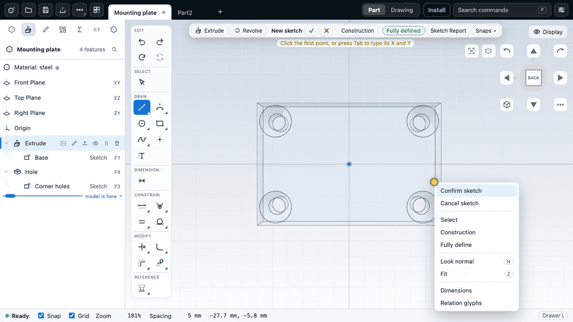
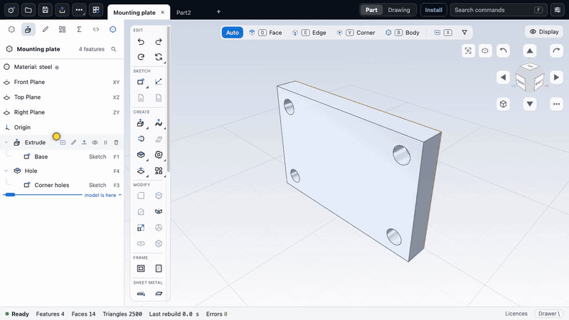

# CadKit

Parametric CAD in the browser, with a verifiable kernel and a scriptable, agent-friendly interface.





CadKit is a parametric CAD application by CivilKit. It runs in a web browser (and installs as a PWA, or as a
Mac app). A part is a feature tree saved as a `.ckpart` file; the CadKit kernel, a Rust/WebAssembly B-rep
kernel kept in a separate repository, rebuilds it on every edit. Everything the app does can also be driven
from scripts or by an AI agent.

- Live app: <https://civilkit.io/cad/>
- User guide: <https://civilkit.io/docs/cad/>
- What's new: <https://civilkit.io/cad/whats-new/>
- Kernel repository: <https://github.com/civilkit/cadkit-kernel>

## What it does

- **Modelling:** sketch (lines, arcs, circles, splines, text, equation curves, 3D sketches) with constraints and
  dimensions; extrude, revolve, sweep and loft; fillet, chamfer, shell and draft; holes and threads; linear,
  circular and other patterns, mirror and scale; surfacing; sheet metal; frames and cut lists.
- **History:** an editable feature tree with rollback, undo and redo, equations and variables, configurations,
  and several documents in tabs.
- **Assemblies:** parts placed with mates, bill of materials, drawings (PDF, SVG, DXF).
- **Checking:** measure, inspect, geometry checks and design checks against rules you choose.
- **Library and wizards:** sample parts, catalog parts, and parametric wizards for gears, propellers, turbo
  impellers, bearings, screws, washers, corner holes and knurls.
- **Import:** STEP, SolidWorks parts (`.sldprt`), SketchUp (`.skp`), STL, FreeCAD (`.FCStd`), SolidCraft files,
  and DXF and SVG as sketch geometry. What each import keeps and loses is listed in the guide.
- **Export:** STEP, STL, OBJ, 3MF, glTF binary (`.glb`), DXF, and drawings as PDF, SVG or DXF.
- **Scripting and agents:** a script language (the Script tab), a local MCP server so an AI assistant can build
  and inspect parts, and an optional agent link that lets an MCP assistant read, take pictures of and (if you
  allow it) change the part you have open. A chat panel in the app runs Claude Code on your own
  login through the local service, so you can ask for a change in words (see the guide, "Chat").

Limits and known gaps are in the guide ("Limits and known gaps"). The app is in English only.

## Use it

- **In the browser:** open <https://civilkit.io/cad/>. Nothing to install; the kernel runs in your browser, so
  parts stay on your computer. The Install button in the browser installs it as an offline app.
- **Mac app:** Apple silicon and Intel builds, from the Releases page of this repository. The download is not
  signed yet, so the first start needs one extra step; see [The Mac app](https://civilkit.io/docs/cad/getting-started/desktop).
  There are no Linux or Windows builds yet.
- **From an AI assistant:** see [Agents and the MCP server](https://civilkit.io/docs/cad/automation/mcp).
  Design notes are in `docs/agent-bridge.md` and `docs/agent-workflow.md`.

## Layout

| path | what |
|---|---|
| `apps/cad` | the application (Preact, Vite): editor, panels, file handling, library browser |
| `packages/viewport` | the 3D viewport |
| `packages/sketch` | the 2D sketch editor |
| `packages/script`, `packages/skill`, `packages/agent-tools`, `packages/agent-link`, `packages/mcp` | scripting and agent access |
| `packages/io`, `packages/fcstd`, `packages/solidcraft`, `packages/snapshot`, `packages/viewdata` | importers, renders and view data |
| `packages/platform`, `packages/store`, `packages/ui`, `packages/i18n` | platform layer, state, components, strings |
| `desktop/` | the Mac app shell (Tauri) |
| `guide/` | the user guide (mdBook sources) |
| `docs/` | design notes per feature |
| `tools/`, `e2e/`, `scripts/` | build, release and check scripts; end-to-end tests |

## Build and run

The kit expects the kernel checkout as a sibling folder named `kernel`:

```
parent/
  kernel/    the CadKit kernel repository
  kit/       this repository
```

Set `CK_REBUILD` to use another location.

```
npm install
npm run typecheck
npm test                       # unit tests
CK_WASM=<ck_wasm.wasm> npm run test:kernel   # tests that run the real kernel
npm run dev                    # development server
npm run build:pages            # static site into dist-pages
```

The kernel wasm is built in the kernel repository
(`cargo build -p ck-wasm --target wasm32-unknown-unknown --profile fast`) and copied to
`apps/cad/public/kernel/ck_wasm.wasm`, or passed with `WASM_SRC` to `build:pages`. Environment switches are
named `CK_*`. Node 22 is required.

## Files

Parts are saved as `.ckpart`: one JSON document (format name `ck-part`), optionally gzip-compressed
(`.ckpart.gz`). It stores the feature list, not the faces, so a part stays editable after reopening. Files
saved by earlier versions still open. See "File formats at a glance" in the guide.

## Licence

MIT OR Apache-2.0 (`LICENSE-MIT`, `LICENSE-APACHE`). Third-party material and its licences are in
`THIRD_PARTY.md`.
