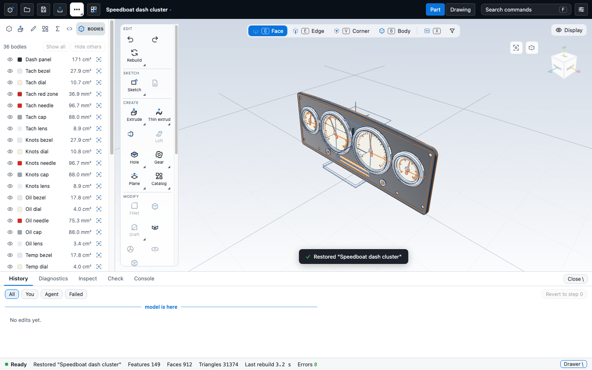
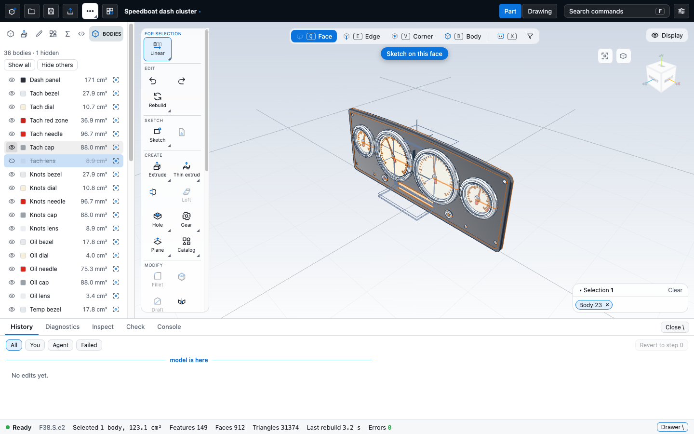

# Bodies list and per-body appearance

A part can hold several lumps (bodies): the speedboat dash has 36. Like SolidWorks, Fusion and Onshape, the app lists them,
lets you hide or isolate one without touching the feature history, and gives each its own colour, opacity and finish.




## Where bodies come from

The kernel's regen reply and the mesh carry no lump or body id (the mesh has `faceIds` and `triFace` only; `massProps({ bodies: true })`
returns volumes per lump but no faces). So the kit finds bodies itself, from data it already has: **faces joined by a shared
edge** (`SelModel.bodies()` in the app, `lumps()` in `packages/snapshot/src/appearance.ts`; both read the `faces` pair of each B-rep edge).
What would let the kit drop that: a `body` index per face in the mesh reply (and per body: volume, feature ids that made it). Nothing in
the kit depends on it. A body that is a sheet (surface) is listed without a volume.

## Document fields (view state: no feature, no undo step, exports unchanged)

```json
{
  "appearance":     { "F41": { "color": "#aebfce", "opacity": 0.18, "finish": "glass" }, "@body:F2.S1": { "color": "#2a2e35" } },
  "faceAppearance": { "F23.*": { "color": "#17181a", "finish": "matte" }, "F9.C1": { "color": "#ffffff" } },
  "bodyNames":      { "F41": "Tach lens" },
  "view":           { "hiddenBodies": ["@body:F44.S2"] }
}
```

* `color`: `#rrggbb`. `opacity`: 0.05 to 1 (1 or absent = opaque). `finish`: `matte`, `plastic`, `chrome`, `glass`, `brushed`
  (brushed metal). Without an entry a body takes the part's `material` look as before.
* `faceAppearance` sets colour and finish of single faces (exact name, or a prefix ending in `*`); the opacity of a face is ignored.
  The panel has no face editor yet: scripts write it (`appearance({ face })`), the viewport and the snapshot renderer draw it.
* The fields are kept like `explode` and `script`: `Controller.setDocExtra`, saved with the part and restored on load.
  Changing them is not an undo step and does not regenerate anything.

### The key rule

An entry key is one of:

* **body key**: `'@body:' + the lowest face name of the body` (plain string order, e.g. `@body:F83.S1`). Face names carry the id of
  the feature that made the face and are stable across regeneration, so editing, adding or removing an unrelated feature leaves
  the key, and the appearance stored under it, untouched. (The key changes only when the body loses the face that was its lowest name,
  for example when a later feature consumes it.) The panel always writes this key.
* **feature id**, e.g. `F83`: every body whose **origin** is that feature. A body's origin is the lowest-numbered feature owning one
  of its faces, i.e. the feature that created the lump; later cuts and fillets do not change it. Scripts use this key because the
  ids are known while a script runs and the face names are not; one entry covers every body a pattern makes.

A body entry wins over a feature entry, field by field. Default names follow the same keys: `bodyNames[body key]`, then
`bodyNames[origin]` (numbered when the feature made several bodies), then the origin feature's own `name`, then `Body n`.
Tests: `apps/cad/src/bodies.test.ts` (rule, merge, `unrelated feature` case), `apps/cad/src/bodies.kernel.test.ts` (real kernel: edit
another body, add a body; the dash sample).

## The panel

Left panel tab **Bodies** (same tabs as Features, Variables, Script). One row per body, ordered by creating feature:

| part of the row | does |
| --- | --- |
| eye | hide or show (view state). `Space` on a focused row does the same |
| swatch + name | click selects (shift or ctrl adds); a click on a face in the viewport selects its body row. `F2` or double click renames; Up and Down move |
| volume | from the display mesh (signed tetrahedra), cm3 or mm3 |
| isolate button | hide every other body; pressed again on the only visible body it shows all |
| Show all / Hide others | `Hide others` keeps the selected bodies |

Below the list the selected body shows **Appearance**: colour, opacity slider (5 to 100 %), finish, and the presets Glass and Chrome and Reset.
Roles and labels are set for assistive technology (`listbox` / `option`, `aria-pressed` on the eye, `aria-valuetext` on the slider);
all strings are in `locales/en.ts` under `bodies.*` and `app.leftTab.Bodies`.

## Rendering (packages/viewport)

* Hidden bodies are dropped from the mesh and its edges before it is built (`withoutFaces`): they are neither drawn nor picked.
* Bodies below full opacity are drawn by their own meshes in a **transparent pass** after the opaque ones: `depthWrite` off,
  double sided, sorted back to front by the distance of the body's centre to the camera every frame (`backToFront`), their edges still
  drawn. The opaque mesh and the clear ones share one vertex buffer; `groupByFace(mesh, rank)` makes each clear body one contiguous range.
  A clear body has no silhouette outline (an outline over what lies behind it would defeat the glass).
* **Picking**: a ray collects the hits of the opaque mesh and the clear bodies, nearest first; a hit on a body with opacity below
  `PICK_OPACITY` = 0.35 is skipped when anything lies behind it, and taken when it is the only hit (`pickThrough`). A selected clear
  body is highlighted translucently, so it does not hide what it covers.
* Opaque bodies with a colour or finish use the per-face vertex colour and roughness / metalness the viewport already has
  for assembly components. Known limits: the section view clips opaque bodies only (the clear ones are not cut), clear bodies are not
  sorted per triangle (two clear bodies that interpenetrate blend by centre distance), and the analysis modes (zebra, curvature) colour opaque bodies only.

## Scripts

```js
const p = part('Dash');
p.sketch('front', (s) => s.circle(40, [0, 0])).extrude(3);
const lens = p.handle();
p.appearance({ feature: lens, colour: '#aebfce', opacity: 0.18, finish: 'glass' });
p.bodyName(lens, 'Tach lens');
p.appearance({ face: lens, colour: '#111' });      // every face the feature made
```

`appearance({ feature | body | face, colour | color, opacity, finish })` and `bodyName(target, name)` record into the
document fields above once the handle ids are known; a bad colour, opacity, finish or face name is an error with the line number.
They are view state: no feature is added. `dash.ts` uses them (ivory dials with black ticks and red zones, chrome bezels, a dark satin
plate, red needles with a white hub, brushed caps and screws, 0.18 opacity glass lenses, red and amber lamp lenses).
Tests: `packages/script/src/appearance.test.ts`.

## Snapshot renderer

`renderSnapshot` honours the same fields (`SnapshotInput.appearance`, taken from the session document by `snapshotOf` and the CLI;
`opts.appearance: false` draws the default grey): colour, finish (metal shading from a sky / horizon / ground mirror and a
highlight), opacity and hidden bodies; see docs/snapshot.md.

## Not done / next

* No undo for appearance edits (they are view state, like the exploded view). Appearance is not part of `Revert to step`.
* No face-level editing in the panel, no per-body material (density) and no export of colours to STEP or GLB (exports unchanged).
* `export visible only` is not offered.
