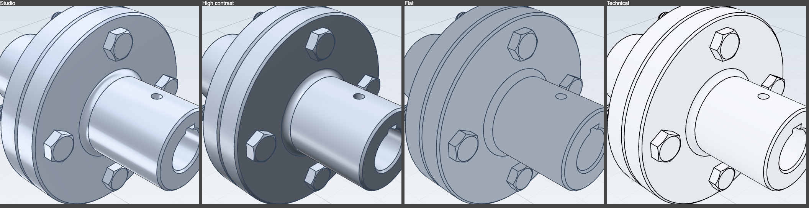
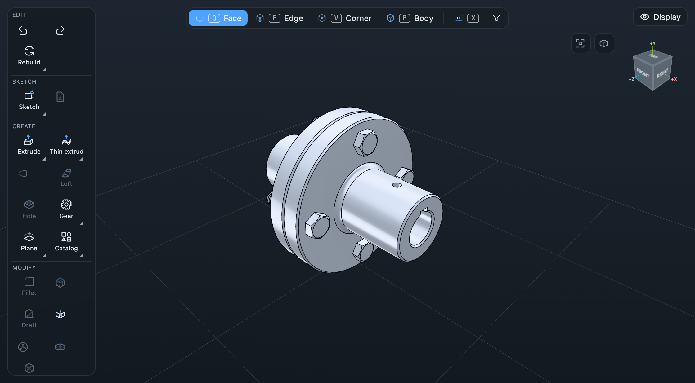
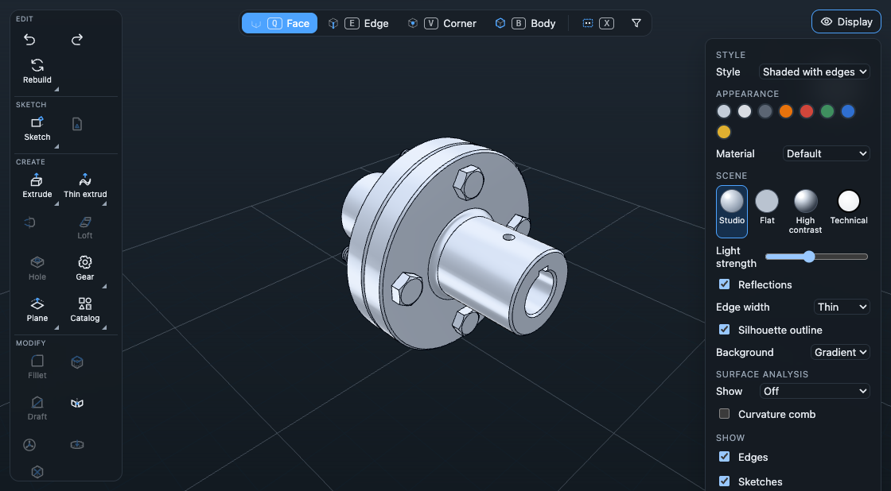
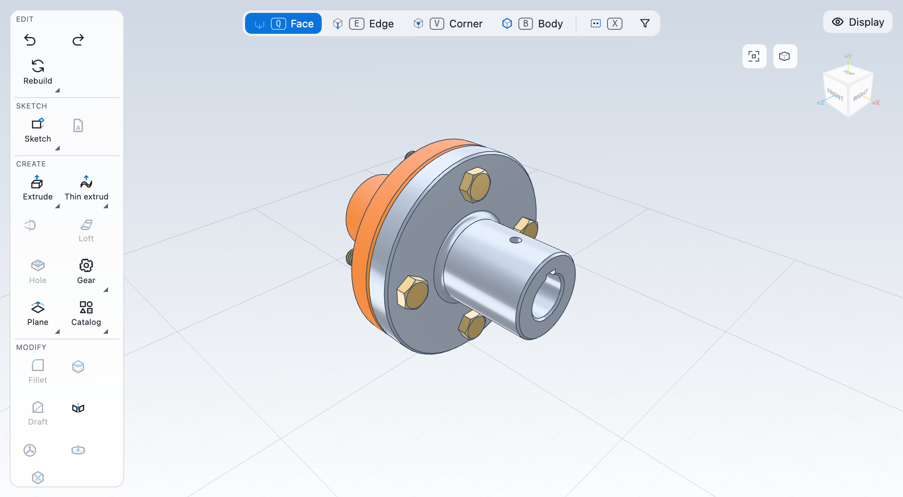

# Display styles and appearance

Everything here is viewer-only: nothing is written into the part file. `packages/part-model` has no `color` or `appearance`
field (checked in `rebuild/packages/part-model/src`), so per-part colour and material are kept in `localStorage` under
`cad.look`, keyed by part name. Per-feature or per-face colour needs a field in the document format and is not done.

## Display styles (Display popover, View tab "Style", Alt+1..5)

| Style | Faces | Edges |
|---|---|---|
| Shaded | lit | none |
| Shaded with edges (default) | lit | follow the Edges layer |
| Wireframe | colourless, but still hides and picks | always; hidden edges faint (second pass, no depth test, 18 percent) |
| Hidden lines removed | flat white | always, black |
| Ghost | translucent, opacity slider (5 to 100 percent), no depth write | follow the Edges layer |

Picking, hover and selection highlights work in every style: the body mesh stays in the scene (wireframe uses
`colorWrite = false`), so raycasts are unchanged. While a sketch is edited the body is capped at 25 percent opacity on top of
the style (`applyBodyLook(..., fade)`), and restored when the sketch closes.

The same part in the same isometric view: the previous flat grey look, the new default, and the earlier CadKit app.

## Appearance

The default look is a light cool metal under the studio light (see below), not a flat grey. A body has a colour and a finish:

| Finish | Roughness | Metalness | Used for |
|---|---|---|---|
| Default (satin metal) | 0.24 | 0.45 | steel, aluminium, titanium, cast iron |
| Brushed metal | 0.30 | 0.90 | copper alloys (brass, bronze) |
| Plastic | 0.42 | 0 | plastics |
| Matte | 0.85 | 0 | wood, rubber, gasket material, concrete |
| Glass | 0.08 | 0 | glass (35 percent opacity) |

Presets are data in `packages/viewport/src/styles.ts` (`materialParams`).

**From the material.** The colour and finish come from the material of the part (`finishOf` / `appearanceOfMaterial` in
`apps/cad/src/materials.ts`): steel is a light cool grey with metalness, brass is warm and metallic, plastics are glossy,
rubber and the new "Gasket material" (orange) are matte. Metal colours are lifted a little towards white
(`displayColor`) so a dark catalogue colour does not render dark. A colour picked in Display > Appearance wins over the material
colour; "Use material colour" off gives every body the default.

**Assemblies: one look per component.** Each inserted part carries its own material, so the viewport draws every component
in its material's colour and finish. The body is still one mesh: the colour goes in the vertex colour attribute and the finish
(roughness, metalness) in a second per-vertex attribute (`aSurf`, -1 meaning "use the material") that a shader hook in
`analysisLayer.ts` reads, so one draw call and one material remain and zebra and the curvature maps keep working.
`Viewport.setComponentLooks(map)` takes the appearance per component id; the app builds it with `componentAppearances`
(`look.ts`). A per-component override: select a face of a component, then Display > Appearance (the heading names the
component); it is stored under the key `partName#componentId` in `cad.look`.

## Lighting presets and background

Display > Scene has a thumbnail row (Studio, Flat, High contrast, Technical), a "Light strength" slider (0.3 to 2) and a
"Reflections" switch. The View tab has the same four presets as commands.

| Preset | What it is |
|---|---|
| Studio (default) | A prefiltered studio environment (PMREM, built once at start-up in `studioEnv.ts`): a grey dome with two tall soft boxes at the sides, a top light, a front fill and two rims, so metal shows soft highlights and reflections. A key light that travels with the camera adds the direct shading. The environment is fixed to the screen, so the highlights stay put while the part is turned. |
| Flat | Even sky light, no reflections, no shadows side. |
| High contrast | One strong key light, little fill, a weak environment. |
| Technical | Every face matte white, black edges, soft light: a drawing-like view. Per-component colours are not shown. |

Tone mapping is the neutral (Khronos) curve, which leaves colours alone and only rolls off bright highlights; output is sRGB.
Reflections off replaces the environment by extra sky light and fades the metalness, so faces do not go black. Without
reflections no preset has a metal look (Flat and Technical never do). The slider scales every light and the environment.

Background: theme, light, dark, gradient. The default is the gradient (`--vp-top` to `--vp-bottom`: blue-grey above, nearly white
below in the light theme, two dark blues in the dark theme), redrawn on theme change. The scene settings are stored in
`cad.look` with a version number: a look saved before the studio defaults is moved to Studio and the gradient once, and keeps
its style and appearances.

Dark theme:   The Display menu:   Per-component materials (brass bolts, gasket material): 

## Edges and silhouette

Feature edges are drawn as lines of a set pixel width (`LineSegments2`) in a colour darker than the faces but not black
(a blue-grey; near black on the dark theme; pure black for Technical and Hidden lines). Display > Edge width: thin
(0.9 px, default), medium, bold. They are depth tested against the faces (faces sit a hair behind through polygon offset).

The silhouette outline (checkbox, on by default) draws the body's back faces again, pushed outwards along their normals by a
fixed number of pixels, in the edge colour (`hull.ts`). Only the rim around the front faces survives the depth test, so every
silhouette is outlined, also on a cylinder or a fillet where no feature edge lies. It costs one extra draw of the body's buffers, is
hidden in a section view, in wireframe and ghost, and is never picked.

## Hide and show

H hides the body of the selected faces, edges or corners, or the selected sketch, plane or curve feature. Alt+H (or the
"Show all" button in the popover) shows everything. Hidden state is for the session and is not saved. A hidden body also stops
picking. Parts have one body, so "hide body" hides the whole solid.

### Hiding a feature from the tree (the eye)

The eye on a history row hides exactly what that feature made, in the view only: no kernel call, no rebuild, not saved. It
adds the feature id to `lookStore.hidden.ids` (the same list sketches, planes and surface bodies already used). The viewport
drops the triangles and edge lines whose names belong to a hidden feature (`withoutOwned` in `meshgeom.ts`; owner = the id
before the first dot of a face name, or the component id in an assembly), and its sketch curves, curves and plane. Faces a
later feature consumed are simply not there any more, so only what is still visible from the feature is hidden. Hidden faces
stop picking. The row is dimmed and shows a closed eye; clicking it again, Alt+H or "Show all" restores. Suppress (which
rebuilds) is a separate button with a pause glyph, tooltip "Suppress (rebuilds)".

## Code map

- `packages/viewport/src/styles.ts`: pure specs, material factories, presets (tests in `styles.test.ts`).
- `packages/viewport/src/viewport.ts`: hooks `setLook`, `setComponentLooks`, `setLighting(preset, intensity, reflections)`, `setEdges`, `setBackground`, `setHidden`.
- `packages/viewport/src/studioEnv.ts` (environment), `hull.ts` (silhouette), `analysisLayer.ts` (shader hook: analysis and per-face finish).
- `apps/cad/src/look.ts`: state, sanitising, hide rules, signals; `lookCommands.ts`: commands and keys.
- `apps/cad/src/DisplayMenu.tsx`: popover sections.

## Not done

- Ambient occlusion / contact shadows (the earlier app had screen-space AO; a depth/normal pass and blur are not free and the section cap and overlays draw after the main pass, so it is left out; the studio environment gives soft shading but no contact darkening).
- Cast shadows, clear-coat, textured materials (the earlier app had procedural patterns).
- Hiding one chosen face (hiding all faces of one feature is done, see above). Hiding a datum plane of the three base planes.
- Colour stored in the document: needs a kernel/part-model field.
