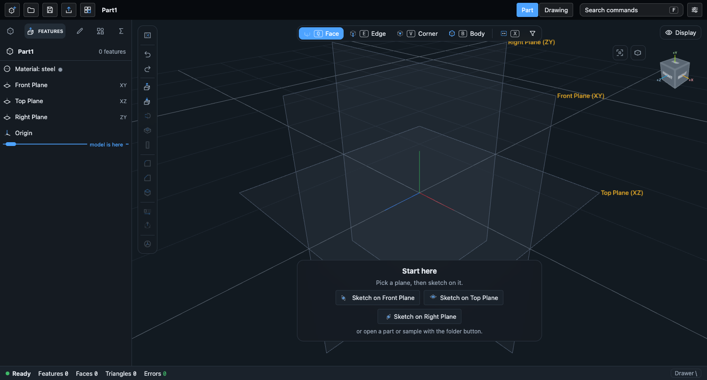
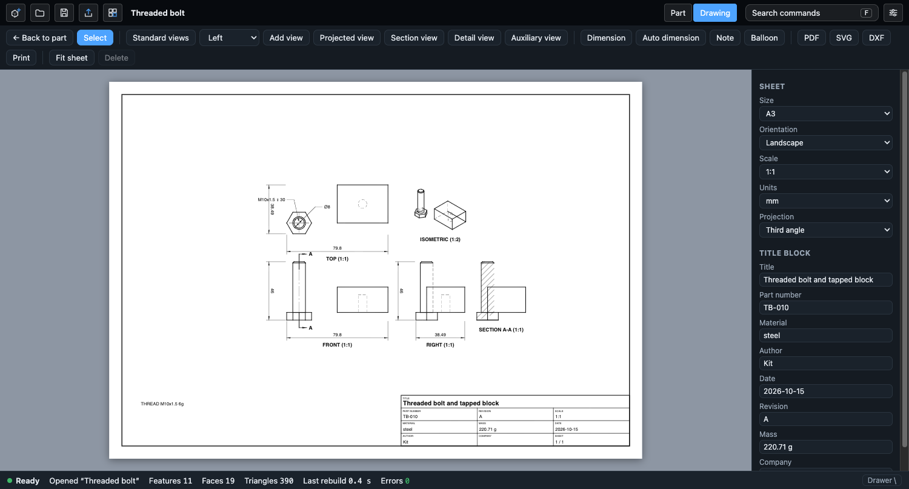

# Drawings

A drawing sheet for the open part or assembly. Switch with the **Part / Drawing** tabs in the top bar; the sheet is drawn as SVG over the
ribbon and viewport area (the 3D viewport stays mounted underneath). Code: `apps/cad/src/drawing/`.

## What the kernel offers (checked)

The kernel has a `drawing` request (`{type:"drawing", views:[{x, y, section?}], hidden}`; reply per view `{min, max, lines, edges}`, lines
of kind `e` edge, `o` silhouette, `t` tangent, `h` hatch with a visible flag `v`, `e` = index into the view's `edges`). It has no
dimension records and no sheet: sheet, title block, dimensions, callouts and balloons are app data. The older `export-dxf-views`
(three views from body edges, no hidden lines) stays as it was. Unknown top-level fields of a part document pass through the kernel
untouched (checked with a regen of a document carrying `drawing`).

The views are always requested with hidden lines on; Hidden lines and Tangent edges are per-view toggles applied on the sheet, so they cost no
kernel call. A view's `edges[]` gives the two faces an edge separates and a model point on it: that is the persistent reference the
dimensions hold.

## Sheet

Sizes A4 to A0 and ANSI A to E, landscape or portrait, a sheet scale (10:1 to 1:100) used by every view without its own scale, units (mm or
inch for dimension text; the model is millimetres) and first or third angle projection. Third angle puts the top view above the front
view, the right view to the right; first angle swaps the sides (this affects views made afterwards, not the ones already placed).

The title block (bottom right) has title, part number, material, mass, author, date, revision, company, the sheet scale and the sheet
number; all are fields in the right panel. Title and material start from the part (the name and the document material); the mass is the
kernel's volume times the material density, rewritten when the part changes while the field still holds a computed value.

## Views

| Tool | What it does |
|---|---|
| Standard views | Front, top, right and isometric at the largest standard scale that fits (room is kept for the title block and the BOM). Replaces the views on the sheet and adds overall dimensions, diameters and hole callouts. |
| Add view | Any of Front, Back, Left, Right, Top, Bottom, Isometric. |
| Projected view | Click a view, then click on the side where the new view goes. It stays level with the parent. |
| Section view | Click a view to put a vertical cut line (Shift: horizontal). The cut is kept in the view (`cut`), the kernel cuts and hatches the part, the parent shows the cut line with arrows and the letter, the view is labelled SECTION A-A. |
| Detail view | Drag a circle on a view: that area is shown larger (twice the parent's scale), cut at the circle, labelled DETAIL B. It uses the parent's data, no kernel call. |
| Auxiliary view | Click an inclined straight edge: a view looking square at it. |

Select tool: click a view to select it, drag to move it. Projected and section views move only along the axis they share with the parent
(so they stay aligned); moving a parent carries its dependants. The right panel edits the selected view: label, scale (own or the
sheet's), Hidden lines, Tangent edges, Centre marks, Label, and Align to parent. Delete removes a view with its dependants and their
dimensions. Mouse wheel zooms at the cursor, dragging empty space pans, right or middle drag also pans, Fit sheet resets.

Centre marks are drawn on round holes and on cylinder axes (two parallel silhouette lines that overlap along their length).

## Annotations

- **Dimension** (D): click an edge of a view. A straight edge gives its length (horizontal, vertical or aligned), a full circle a
  diameter, an arc a radius (Shift on the pick makes a full circle a radius). Two edges give a distance (parallel edges), an angle (edges
  that meet), a centre distance (two circles) or the distance from a circle centre to a line. Enter finishes a one-edge dimension, a second
  click completes a two-edge one. Dragging a dimension moves its line (leader angle and length for round ones). The panel edits the text:
  `<>` stands for the measured value, e.g. `<> +0.1 / -0` or `4 HOLES <>`; leaving it empty shows the measured value.
- **Auto dimension**: the selected view (all views but the isometric if none): overall width and height, one diameter per hole position
  (the smallest of concentric circles) and the callouts below.
- **Hole and thread callouts**: a circle that belongs to a `hole` or `thread` feature gets that feature's text: `M10x1.5 ↧ 30` (thread
  and length), `M8x1.25 ↧ 14` (tapped blind hole: the thread's size with the pitch from the kernel's thread tables, the hole depth),
  `Ø6.5 THRU`, `M5 CLR THRU` plus `CSK` / `C'BORE` for countersunk and counterbored holes. The text is computed from the features when the
  sheet is drawn, so it changes with the feature. See `docs/threads.md` for the thread features.
  Only real `hole` / `thread` features get a callout: a sketch circle plus a cut is drawn as a plain circle with a diameter. The PDF and DXF
  writers print `DEPTH` for the `↧` glyph (Helvetica has none); the SVG keeps the glyph.
- **Note**: click for text; Shift+click on a view for a note with a leader to the clicked point. The panel edits the text (several lines).
- **Balloon**: click on a view for a numbered balloon with a leader. **Auto balloons** (assemblies): one per BOM item on the selected view
  (front by default), attached to a visible edge of the item's component.
- **BOM table** for assemblies: the Assembly panel's bill of materials (`apps/cad/src/assembly` `bomItems`: part, quantity, material,
  mass) drawn above the title block; the checkbox hides it.

- **Surface finish** (a symbol with a leader and a roughness value such as `Ra 1.6`) and **GD&T frame** (a feature control frame from cells
  separated by `|`, e.g. `POS|0.1|A`; plain ASCII so the PDF stays in WinAnsi, no characteristic glyphs). Both are notes with a `style`.

Undo and Redo (toolbar, Ctrl+Z / Ctrl+Y while the Drawing tab is open) step through sheet edits; the part's own history is not touched. Typing in a
field is one step; changes the part makes (mass, regenerated dimensions) are saved but are not steps.

Not done: GD&T characteristic glyphs and datum triangles, tolerances other than typed text, ordinate or chain dimensions, break lines, weld symbols,
several sheets per document, a revision table.

## Output

PDF, SVG, DXF, Print in the toolbar. All four are written from one list of primitives (`render.ts`), so they agree.
- PDF: written by `output.ts` (`toPdf`, no library): one page of the sheet size, vector lines, dashes, filled arrow heads, Helvetica and
  Helvetica-Bold text.
- SVG: the sheet in millimetres (`width` / `height` in mm).
- DXF (R12 ASCII): millimetres, y up, layers per line style (`VISIBLE`, `HIDDEN`, `CENTER`, `THIN`, `HATCH`, `DIM`, `TEXT`, `BORDER`),
  line types `HIDDEN` and `CENTER`. Arrow heads are left out.
- Print: a hidden frame with the SVG at the page size (`@page size`), then `window.print()`; "Save as PDF" in the print dialog also works.

## Speed

The kernel's hidden-line pass is the cost: a plate takes a fraction of a second per view, the 24-tooth spur gear about 20 s for four views (the
isometric dominates). Views are asked one at a time, so each appears as it arrives, and are cached by part revision and view definition: leaving
and re-entering the Drawing tab, or moving, scaling and toggling lines, costs no kernel call.

## Saved with the part, and associative

The sheet is the `drawing` field of the part document (`DrawingDoc`, `drawing/model.ts`): sheet, title block, views (frame axes, position,
scale, flags, parent, cut line, detail circle), dimensions, notes, balloons. Save, autosave and reopening keep it (the controller carries it
like the exploded view: `setDocExtra('drawing', ...)`). Only references are stored, not geometry: when the part changes the next time the
Drawing tab is open (or while it is open), every view is projected again by the kernel. Dimensions made on an edge keep that edge's two
face names and a model point and find the edge again (`findRef`); overall dimensions follow the view's bounds. A dimension whose edge is
gone stays where it was and the status line says how many.

## Headless use (the MCP `drawing` tool)

`apps/cad/src/drawing/headless.ts` (`drawHeadless(session, options)`) builds the same documents without the UI: standard views at the best
(or a given) scale, automatic dimensions and hole callouts, an optional section, and SVG / PDF / DXF. `tidy` (default on) points callout
leaders away from the middle of the view and drops plain diameters of small circles (`minDiameter`, default 10 mm); hidden lines are off by
default because they bury callouts on busy assemblies. The `drawing` tool of `@kit/agent-tools` wraps it (`docs/mcp.md`); the module is
reached through the `@kit/cad-drawing` alias so packages need not import the app by path.

## Tests

`apps/cad/src/drawing/model.test.ts` (sheet, frames, picking, dimensions, callouts, alignment, hit testing, SVG / PDF / DXF writers) and
`layout.kernel.test.ts` (against the wasm kernel: standard layout, section, detail, auxiliary, thread callouts on the threaded bolt,
dimensions following a deeper plate, the drawing surviving a Controller reload). `samples.gen.test.ts` regenerates the sample drawings
(`DWG_SAMPLES=1`).

## Known gaps

- Hidden-line accuracy is the kernel's: curved-edge visibility is longer than the original's in places (`drawing-parity.md`), so some
  hidden pieces are split; a torus section answers `cutNoEffect`.
- Views placed before a projection change (first / third angle) keep their sides.
- The view toolbar adds views at free spots by a simple search; overlaps are possible and are fixed by dragging.
- Title block layout is fixed (no templates); the sheet border margin is 10 mm.
- Zoom is by wheel only (no pinch handling beyond what the browser sends as ctrl+wheel).
