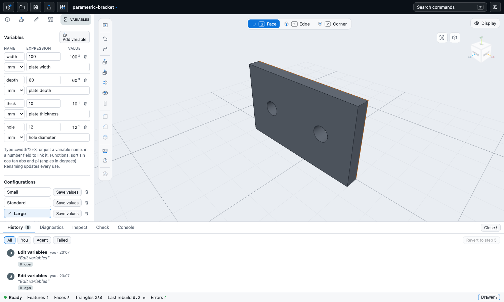
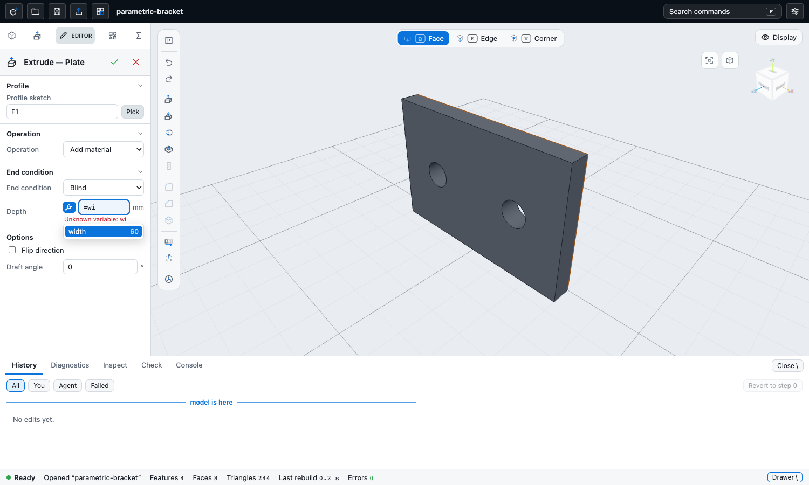
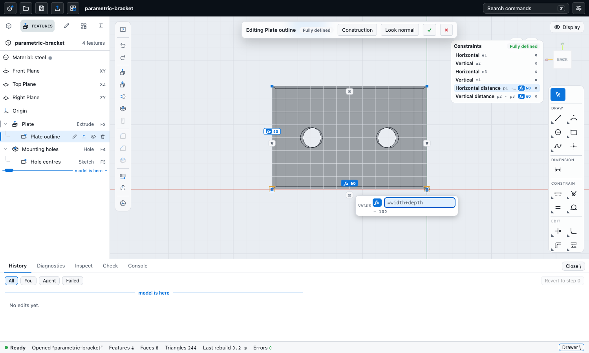

# Equations, variables and configurations

Item 7 of the parity list (`docs/gui-parity.md`, section 3.8). Named variables, expression fields wherever a number is typed, and
configurations (named sets of variable values).

## The Variables panel

A left-panel tab (the sigma icon, next to Catalog) and the command `open-variables`. One row per variable: name, expression, value
(with the number of places that use it), unit and comment. Everything is edited in place and commits on Enter or when the cell loses
focus. Add and delete buttons; unused variables only can be deleted (a used one names its uses and is refused).

- **Rename** rewrites every use in one step: other variables, configurations, expression fields in features (`=w*2` becomes `=width*2`)
  and sketch dimension expressions. Whole names only (`w` does not touch `w2` or `1e3`).
- **Errors** are shown on the row and nothing is applied until the whole list evaluates: invalid name, duplicate name, expression
  that does not parse, unknown variable, circular reference (`Circular reference between variables`). The text is mapped from the
  kernel codes `badName`, `badExpression`, `cyclicVariables` (plus two refinements the TypeScript evaluator adds: `unknownName` for an
  identifier that is not a variable, and `duplicateName`).
- If every row is valid but the kernel cannot rebuild a feature with the new values (for example a depth that becomes zero), the
  step is refused as a whole, the document stays as it was, and the failing feature ids are shown.
- Every change (edit, add, delete, rename, configuration switch) is **one undo step** in the same history as feature edits; it appears
  in the History drawer, and Undo / Redo restore the variables with it.

## Expression fields

Every number field of the feature editors (extrude depth, revolve angle, fillet radius, chamfer distance, shell thickness, hole
diameter / depth / counterbore / countersink, helix, pattern spacing, offsets ...) takes a number, a variable name, or `=expression`.

- A number stays a number. Anything else is stored as the string `=...` (a bare name `width` becomes `=width`), which is what the kernel
  reads.
- While the text is an expression the evaluated value shows under the field (`= 6 mm`), a bad one shows its error and is **not
  applied**. The field is marked **driven**: a blue `fx` badge (click it to keep the current value as a plain number).
- Variable names, the functions and `pi` complete as you type (arrow keys, Enter or Tab, or click).
- Fields the app itself computes with (draft angle, variable fillet radii) stay plain numbers and say so. Thread length is a plain
  number too (it is clamped to the hole depth).
- On-screen drag handles (depth arrow, size box) are not offered for a field that holds an expression, so a drag cannot silently
  replace it.

### Sketch dimensions

The dimension value box (double-click a dimension label or its row in the constraints list) takes the same text. The expression is
kept on the constraint as `expr` (no leading `=`), the kernel re-solves the sketch whenever a variable changes, and the dimension is
drawn with an `fx` mark. Typing a plain number unlinks it. The value boxes that follow the pointer while a tool draws accept an
expression too, but only its value is used there (no link).

## Language

Exactly what the kernel evaluates (`crates/ck-model/src/expr.rs`; `packages/ui/src/expr.ts` is a port used for the hint and the
errors, the kernel stays the authority when the part rebuilds):

- operators `+ - * / ^` (`^` right associative, `-2^2` is -4), parentheses, unary `+ -`
- functions `sqrt sin cos tan abs` (any case, **parentheses required**, trig in degrees) and the constant `pi`
- units after a number: `mm cm m in deg °` (`3 in` is 76.2); a comma is a decimal point
- variable names: letters, digits, `_`, not starting with a digit, case sensitive, not `pi`, a function or a unit

**Not supported by the kernel: `min`, `max`, `round`** (and no `if`). They are reported as unknown names rather than faked.

## Configurations

A table under the variables: each configuration is a name plus the variable expressions it sets. *Add from current values* captures
the current expressions; clicking a configuration applies them (one undo step, one rebuild); *Save values* stores the current
expressions into it; a configuration whose values no longer match the variables is marked *modified*. Renaming or deleting a
variable updates the configurations.

## Where it is stored

The part file keeps the kernel's own field, `variables: [{ name, expr }]`, plus extras on each variable (`unit`, `comment`) and two extra
top-level fields: `configurations: [{ name, values: { variable: expression } }]` and `activeConfig`. The kernel parses only what it
knows and ignores the rest, and the app's open / save / autosave round-trip the whole document, so the extras survive.
**Limitation:** other programs that rewrite the part with a strict schema may drop them (the format has no declared place for them).

## Session limitation

The session package (`@ck/session`) has edit ops for features only, no op for document-level fields. `apps/cad/src/docFields.ts` therefore
sets the fields on the session's document directly and records the step in its history stack itself, after the kernel has rebuilt the
candidate (the same atomic rule edits follow). This touches private state of the session; the clean fix is a `variables` op in the session
(and the agent interface), after which `docFields.ts` becomes a thin call.

## Sample

`parametric-bracket`: a plate driven by four variables (`width`, `depth`, `thick`, `hole`); the outline dimensions, the hole centres
(`width/4`, `width*3/4`, `depth/2`), the plate thickness (`=thick`) and the hole diameter (`=hole`) are all expressions; configurations
Small, Standard and Large. Kernel test: `apps/cad/src/parametricBracket.kernel.test.ts`.

## Tests

`packages/ui/src/expr.test.ts` (evaluator, names, cycles, completion), `ExprInput.test.tsx`, `apps/cad/src/variables.test.ts`,
`VariablesPanel.test.tsx`, and against the real kernel `controller.variables.kernel.test.ts` (rebuild, undo, redo, rename, rejected
change, configurations) and `parametricBracket.kernel.test.ts`.
