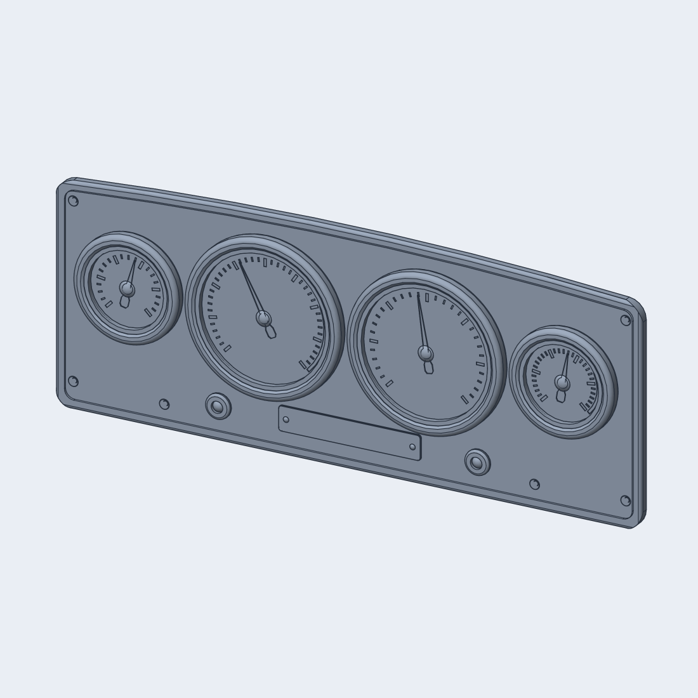
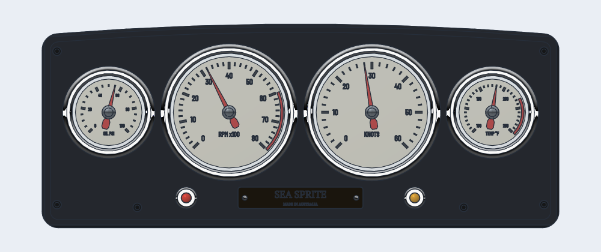
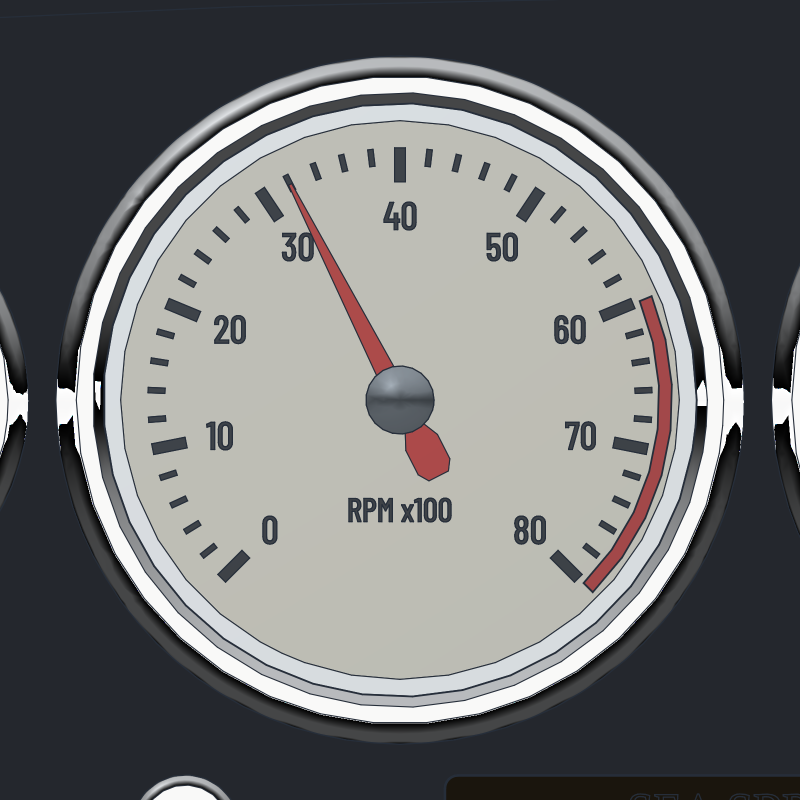
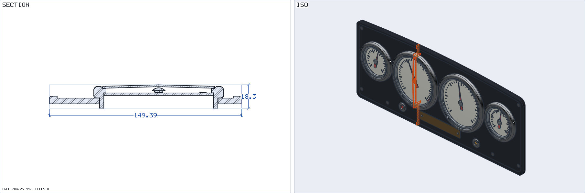

# Speedboat analog dash cluster (script-built)

A 380 x 150 mm, 6 mm dash plate for a 1960s runabout with four chrome-bezelled round gauges, built as ONE script
(`packages/script/src/dash.ts`, `dashScript(opts?)`, same pattern as `matx.ts`). It is a normal editable feature tree
(149 features, 36 separate lumps, regenerates in about 8 to 25 s on the real kernel, `validate` ok, no boolean failures).
Sample: `apps/cad/public/samples/speedboat-dash.ckpart`; Script-tab example `speedboat-dash`; test
`packages/script/src/dash.kernel.test.ts` (set `CK_WASM`; `DASH_ONLY=panel,gauges,details,bezel,profile`, `DASH_NOLENS=1`,
`DASH_OUT=file` for development).

(The snapshot renderer draws glass as opaque, so the hero renders use `dashScript({ lens: false })`; the sample and the
section view include the lenses.)

## Design intent

* Layout: the two 85 mm gauges (tach left, knots right) sit side by side at the centre, the two 52 mm gauges (oil left,
  water temperature right) outboard, all on one centre line (y = 10). Bezel OD = gauge + 16, so 101 and 68 mm, 4 mm
  between bezels. A strip below carries the nameplate (centre) and the two warning lamps flanking it. Symmetric about x = 0.
* One radius language: R2 rolled edges everywhere (plate perimeter, bezel foot), R3 rolled crown on the bezel, R12 plate corners.
* Layering from the back: plate field (z 4.5) < bezel flange (4.6) < dial plate < tick ridges < needle < hub < cap < glass
  (proud of the bezel by 1.3 mm) < bezel crown (9 mm above the flange).
* Plate: curved top edge (an arc of radius about 2257 mm, 8 mm crown), R12 corners, a 6 mm wide, 1.5 mm raised binnacle rim
  (the field is pocketed), R2 rolled outer edge, six countersunk M3 screw holes with domed-head screw solids.
* Scales (270 degree sweep, 0 at lower left, gap at the bottom): tach 0 to 80 (x100 rpm, red zone above 60), knots 0 to 60,
  oil 0 to 100 psi, temp 100 to 250 F (red above 210). Major ticks every 10 / 10 / 20 / 30 are longer than the minors.
  Needles point at 3200 rpm, 28 kn, 55 psi, 180 F.
* Manufacturable as a print or CNC prototype: the bezel is a through-tube (body behind the panel), the dial is retained by a
  ledge in the bezel, the red zone is an inlay in a 0.5 mm groove, the nameplate sits in a 1.2 mm recess.

## Separate bodies

Every material is its own lump of the one part, so a viewer can colour them: panel, 4 bezels, 4 dials (ticks are ridges of
the same lump), 2 red inlays, 4 needles (with hub), 4 caps, 4 lenses, 6 screws, nameplate, 2 rivets, 2 lamp bezels, 2 lamp
lenses (36 in total, checked by the test via `massProps({bodies:true})`). Parts that would touch carry a 0.1 mm clearance
(`CLR`, standing for glue / press fit), so the kernel does not fuse them.

## Section and bezel profile

The section sheet (left) shows plate, bezel through-tube, rolled crown, dial, ledge, needle, hub, cap and the domed lens.

The bezel profile (`dashScript({ only: ['profile'] })` extrudes it as a thin plate for drawings): rolled foot R2, outer
wall, R3 crown, glass rebate, dial ledge, through-tube.

## Parameters (`variables({...})`)

| name | default | meaning |
| --- | --- | --- |
| `W`, `H`, `T` | 380, 150, 6 | plate size and thickness |
| `CROWN` | 8 | rise of the curved top edge at the centre |
| `R_CORNER`, `RIM_W`, `RIM_H`, `RIM_ROLL` | 12, 6, 1.5, 2 | corner radius, binnacle rim width / height, rolled outer edge |
| `BIG`, `SMALL` | 85, 52 | dial diameters (bezel = +16) |
| `GAP`, `GY` | 4, 10 | gap between bezels, gauge centre line |
| `CLR` | 0.1 | clearance between lumps |
| `TICK_H`, `NEEDLE_T` | 0.3, 0.7 | tick ridge height, needle thickness |
| `SWEEP`, `START` | 270, 225 | scale sweep and the start angle (degrees, 0 = +X) |
| `PLATE_W`, `PLATE_H` | 92, 16 | nameplate |
| `LAMP_D`, `LAMP_X` | 16, 84 | warning lamp bezel diameter and x offset |

Edit the numbers in the Variables tab or the `variables({...})` call and re-run. The gauge table `G` (name, centre, size,
scale range, major / minor step, red-zone start, needle value) and `SCREWS` are plain arrays near the top of the script:
change a range or the needle value there. All gauges come from one `gauge(d)` function; `bezelPath(g)` is the bezel profile.

## Notes on how it is built

Gauge solids are revolved on the `'top'` plane (sketch x = X, sketch y = -Z) about an `axis: {from, to}` line parallel to Z
through the gauge centre, so each is one sketch + one revolve. Ticks of a gauge are one sketch of thin polygons and one
extrude. Cuts state `direction: 'into'`. The plate outline is computed (concentric top arc, tangent corner arcs) as a
function of the inset, so the same function draws the plate and the rim pocket.

## API and kernel gaps found

1. A bare bezel sectioned through its own axis (`only: ['bezel']`, `--section x=0`) drew a full circle at the rolled crown and
   reported about 28 mm2 too much area, while the same bezel inside the whole dash sectioned cleanly: a possible `section` artefact for a
   lone torus face (not minimised). Because of it the profile image is a thin extruded plate of the profile instead.
2. The snapshot renderer draws glass opaque (no transparency), so lensed models hide the dial; no per-lump colours either.
3. No sketch helper for rounded outlines with a curved side (computed by hand here); `rrect` only does straight sides.
4. `at('top', y)` sketch coordinates (y = -z) make revolves about Z awkward; a `revolve` with `axisAlong: 'z'` would help.
5. Selecting the outer rim loop needs a geometric `outside` box rule; there is no `outerLoop` selector.
6. Fillet of a rim edge on a body whose top is also pocketed works (R2), but a fillet of the corner edges after the pocket
   gave `blendUnsupported` (not pursued: corners are sketched as arcs instead).
7. No boolean failures were met: all parts are disjoint with 0.1 mm clearances (add of a disjoint lump is cheap).
