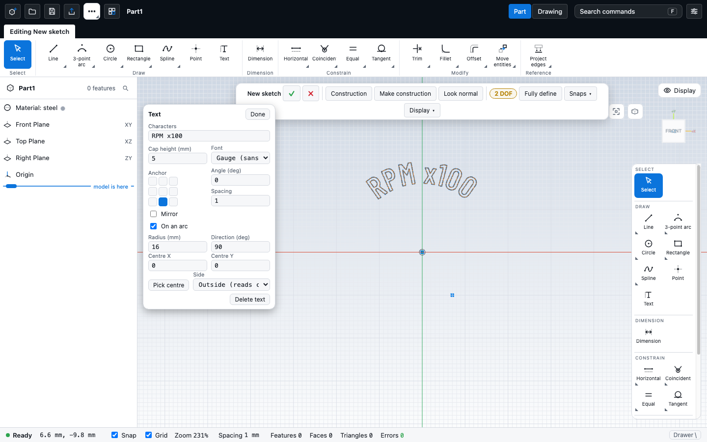

# Text: engraved and embossed lettering

Lettering on a part (dial numerals, captions, nameplates, part numbers) is a **text entity in a sketch**. The kernel turns the
letters of a built-in font into closed loops, so everything that works on a sketch profile works on text: **Cut** engraves it,
**Extrude** embosses it. The kernel side (fonts, limits, checks) is described in the kernel repository's `docs/text.md`.

## Sketch editor: the Text tool

1. Open a sketch (on a plane or on a face). Choose **Text** in the Draw palette (key `Q`).
2. Click where the text should sit. A text entity with the string `TEXT` is placed at once and its panel opens; the lettering is
   drawn in the sketch colour and follows every change.
3. Edit it in the panel (here `RPM x100` on an arc of radius 16 around the origin, anchor centre-baseline):

   


   | Field | Meaning |
   |---|---|
   | Characters | the string (1 to 500 characters, one line) |
   | Cap height | height of a capital H in mm |
   | Font | **Gauge** (condensed sans) or **Engrave** (serif), a font of the library, a font file you add, or a system font (see Fonts) |
   | Anchor | 3 x 3 grid: which point of the text sits on the clicked point (left / centre / right, top / middle / baseline) |
   | Angle, Spacing | rotation about the anchor in degrees, letter pitch factor (1 = the font's own) |
   | Mirror | flips the text (for the back of a clear part) |
   | On an arc | lays the letters along a circle: Radius (of the baseline), Direction (angle in degrees of the middle of the text seen from the centre, 90 = on top), Centre X / Y or **Pick centre** (then click a sketch point or any place), Side: *outside* reads clockwise with the tops away from the centre, *inside* reads counter-clockwise with the tops toward it |

4. **Done** (or Enter in the string field, or Esc) leaves the panel. Click the lettering later in Select mode to edit it again.

The anchor is a normal sketch point: drag it, fix it, dimension it or snap other geometry to it like any other point. Delete removes
the text and its anchor point; Copy / Move / Rotate / Scale and the patterns take text along (Rotate moves the anchor; set the Angle
field to turn the letters).

Warnings and errors appear in the panel and in the status bar: *under 0.8 mm cap height the strokes are too thin*, *characters the
font does not have were skipped* (only Latin-1), *letters were moved apart*, *letters overlap on this radius*, and for a bad value
(empty string, height 0) what to change.

**Keep lettering in a sketch of its own.** Its loops are not trimmed against, merged with or made holes of the other curves of the
sketch. One sketch can hold several texts (a dial: one text per numeral).

## Engrave and emboss

* **Engrave**: finish the sketch, **Cut** with the engraving depth (0.1 to 0.5 mm is typical) into the face the sketch lies on.
* **Emboss**: finish the sketch, **Extrude** (add) the height. Starting the sketch a little above the face (offset plane) makes the
  lettering a body of its own, with its own name and colour in the Bodies list.
* The extrude / cut dialog lists the lettering as one region per text (`regions` takes the text entity id), so one text of a
  sketch can be cut and another embossed.

## Script

```js
part('Plate').sketch('front', (s) => s.rect(60, 20)).extrude(4)
  .sketch(at('front', 4), (s) => s.text('SEA SPRITE', [0, 0], { font: 'engrave', height: 5, anchor: ['center', 'middle'] })).cut(0.3);
```

`s.text(string, [x, y], { font, height, anchor, angle, spacing, mirror, arc, polyline, name })` and
`await part.textMetrics(string, { font, height, spacing })` are documented, with the dial and arc examples, in `docs/scripting.md`
(section Lettering). The speedboat dash (`docs/speedboat-dash.md`) uses them for its dial numerals, captions and nameplate.

## Fonts

Two fonts are compiled into the kernel (SIL OFL): `gauge` (Barlow Condensed) and `engrave` (PT Serif), Basic Latin and Latin-1
(including the degree sign). They need nothing else and look the same everywhere.

The **Font** list in the Text panel offers more:

| Source | What it is | Stored in the saved file |
|---|---|---|
| **Library** | ten open-licence fonts hosted with the app (Barlow, Source Sans 3, Barlow Condensed, Bebas Neue, PT Serif, Special Elite, IBM Plex Mono, Great Vibes, Satisfy, Anton; licences in `THIRD_PARTY.md` and beside the files in `apps/cad/public/fonts/`). Fetched when you pick one (not part of the app bundle; the browser caches them) and checked against their SHA-256 | the font id and checksum only; the file is fetched again when the part opens |
| **Add font file...** | a TTF, OTF or TTC (first face) from disk | the whole font file, up to 1.5 MB; a larger font as a subset holding just the letters the part's text uses |
| **System fonts...** | the fonts installed on the machine, listed with a filter. Needs the Local Font Access API, which only Chromium browsers (Chrome, Edge) have: elsewhere the button is hidden and the panel says so. The browser asks for permission when you click the button, never earlier | as for a font file |

Picking a font loads it into the kernel and sets the text's `font` (a unique name such as `plex-sans-1a2b3c4d`: family plus the
first digits of the file's hash) and `fontHash`, so the same name can never mean two different files. The lettering follows at
once. Warnings of the kernel are shown under the list: kerning and ligatures are ignored, a variable font gives its default style
only, a font collection gives its first face, overlapping strokes may fail to engrave, and the licence flags of the font file
(embedding restricted, no subsetting).

**Licence of your own fonts.** A font you add or take from the system is stored inside the part file. Make sure you may embed
it; the panel says so under such a font. Library fonts are open-licence and only referenced.

**Subsets.** When a font file is over 1.5 MB the part keeps only the letters its text uses. The panel then says so: changing the
text to characters that were not there needs the original font (add the file again, or pick the system font again), otherwise the
new characters are reported as missing.

**Opening a part.** The kernel starts with no fonts, so every time a part opens (and after the kernel is restarted with Cancel)
the app first loads the fonts the part lists in its `fonts` field and only then builds it. A library font that cannot be fetched
(offline), or an embedded font that is damaged, is reported by name; the part still opens and its lettering shows the kernel's
`textFontNotLoaded` until the font is available (re-open online, or pick the font again).

Document field (a normal part file; an older app keeps it and ignores it):

```json
"fonts": [
  { "name": "barlow", "hash": "<sha-256>", "source": "curated", "id": "barlow" },
  { "name": "plex-sans-1a2b3c4d", "hash": "<sha-256 of data>", "source": "embedded", "family": "IBM Plex Sans", "data": "<base64 TTF/OTF>", "subset": true }
]
```

Only fonts used by a text of the part are written. In a script, `s.text('...', at, { font: 'barlow' })` takes a library id (or
`gauge` / `engrave`); an unknown id stops the script with a message listing the valid ones.

## Limits

Text is flat on a plane (no wrapping onto curved faces); one line per entity; no kerning, no ligatures (fonts are drawn letter by letter with their plain advance widths); bold and italic are separate font files; WOFF and WOFF2 are not supported (use the TTF or OTF); fonts whose strokes overlap inside a letter, and connected script faces, can fail validation when engraved; system fonts need a Chromium browser; at most 500
characters. In the editor the lettering outlines come from the kernel while a sketch is open; a closed sketch shows the extruded
or cut result, not the lettering curves.
