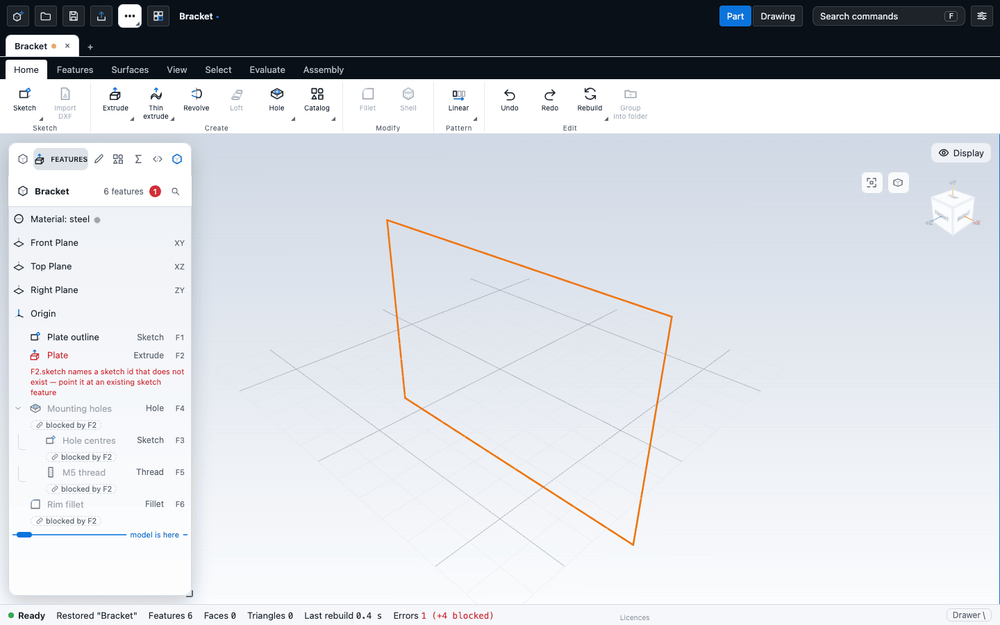

# Checks and diagnostics

This chapter explains how the app tells you that something is wrong with the model: the status bar, the red rows in the feature tree, the Diagnostics card, and the card in a feature editor that stops a change that would break the model. It also shows how to read the messages and what to try. The Check tab, which tests a part against manufacturing rules, is covered in [Design checks](design-checks.md).

## Why a model breaks

A part is a list of features that are rebuilt from first to last. When you change one feature, everything after it is rebuilt too. If one feature can no longer be built, the features that depend on it fail as well, so one problem can look like twenty. The app sorts these for you: it finds the **cause** (the first failure that stands on its own) and shows the rest as **consequences** that only follow from it. Fix the cause and the consequences normally go away.

An edit that would break the model is refused. The kernel rebuilds the candidate first, and if any feature fails the document stays exactly as it was. A broken model can still reach you by opening a file that already has failing features.

## The status bar

The bar at the bottom of the window reports on the whole part:

| Item | Meaning |
|---|---|
| Ready / Busy | Whether the kernel is working. A busy overlay with a cancel button shows during long rebuilds. |
| Notice | The latest message, such as a refused edit or a finished export. It stays for a few seconds. The Console tab of the drawer keeps the whole list. |
| Features, Faces, Triangles | Size of the model. |
| Cached view | Shown while a stored view is on screen and the model rebuilds behind it. Edits wait for the rebuild. |
| Design check chip | The last design check result, for example "FDM 3D printing: 2 errors, 5 warnings". Click it to open the Check tab. It is dimmed when the part has changed since. |
| Last rebuild | How long the last rebuild took. |
| Errors | The number of causes. When some features fail only because of an earlier one, it adds "(+N blocked)". It is red when anything fails. |

The button at the right end opens and closes the drawer, which you can also toggle with the backslash key (**\\**).

## The feature tree

A feature that fails is shown in red, with the reason underneath. Features that only fail because of an earlier one are muted and carry a **blocked by F14** chip instead of red text. Click the chip to select the cause. The tree header badge counts causes only.

An amber **!** on a row is a warning: the feature still works, but the kernel noticed something. Point at it to read the hint.

## The Diagnostics tab

Open the drawer and choose **Diagnostics**. When the model has errors, the card shows:

1. **A summary sentence** such as "The edit broke the model at F14 Trim barrel and handle: the surfaces do not cut each other. 16 later features could not be built because of it."
2. **The cause**: the feature and the error code.
3. **What to try**: plain advice for that error (see the table below).
4. Buttons:

| Button | What it does |
|---|---|
| Undo this change | Undoes the last edit. Shown when there is history to undo. |
| Select F14 | Selects the cause in the tree and frames it. |
| Show N consequences | Folds open the list of dependent errors, each of which selects its feature. "Hide consequences" folds it again. |
| Copy all errors | Copies the raw error list, handy for a bug report. |

If two unrelated features fail, they are two separate causes, and the second is listed under the first.

When the kernel refused an edit that you just made, the card describes that edit and says "This edit was not applied; your model is unchanged." The toast and the History entry carry the same one-line summary.

## In a feature editor

While an editor is open, the live preview is checked as you type. If the preview has a problem the saved model did not have, the editor shows a short card under the fields with the sentence, the advice, **Cancel edit**, **Select F14**, a folded list of consequences and **Copy all errors**. The **Confirm** button is greyed with the tooltip "This change breaks the model (F14). Cancel or adjust." Hold **Shift** while you press Confirm to try the edit anyway: the kernel still refuses it if it breaks, so Shift cannot put a broken model into the file, it only shows you the refusal. The Gear, Thread and Hole editors show just the one-line summary as a hint.

## What to try

The advice shown for common errors:

| Message (cause) | What to try |
|---|---|
| The surfaces do not cut each other | Make a smaller change, or move the trimming tool so it crosses the surface again. |
| It removes nothing / it cuts nothing | The cut or tool no longer touches the body. Move the profile so it overlaps the body, or flip the direction. |
| A face or edge it uses no longer exists | A feature was built on a face or edge that has gone. Pick it again, or undo the change that removed it. |
| The combine failed | Make sure the two bodies overlap in a volume, not only along a face, or nudge one by a small amount. |
| The fill boundary is not valid | The edges around the hole no longer form one closed loop. Make a smaller change, or pick the edges again. |
| The rounding failed (fillet or chamfer) | Use a smaller radius, round fewer edges at once, change the order, or round last. With Tangent chain on, the rounding runs around corners. |
| The wall is thicker than the part allows (shell) | Use a thinner wall. |
| The shell could not be made | Try a smaller thickness or open a different face. |
| The sketch is not a closed outline | Close the gaps in the sketch. See [When a sketch will not solve](../sketching/troubleshooting.md). |
| The sweep failed | Make sure the profile sits at the start of the path and the path has no sharp kinks. |
| The loft failed, or makes an invalid solid | Use profiles with the same number of segments, in the same order, along one direction; put a point profile first or last; no two profiles should cross. |
| The profile crosses the axis (revolve) | Move the profile to one side of the axis. |
| Anything else | Undo the last change, or adjust the values until the feature builds again. |

A rounding that is wider than the faces beside it, or a radius too large for the edges, has its own message with the same advice.

## Reading the kernel's own detail

The code shown next to the cause, such as `booleanFailed` or `missingReference`, is the kernel's error code. The kernel book explains what each means, and what the kernel checks when it decides that a solid is valid: [Validation](/docs/cad/kernel/validation/overview.html) and [Feature errors and diagnostics](/docs/cad/kernel/validation/diagnostics.html).

## A short example

You lower the angle of a surface and the status bar turns red: "Errors 1 (+16 blocked)". The edit is refused, so the model is unchanged and the Diagnostics tab shows the cause with "This edit was not applied". Read the sentence, follow "What to try", press **Select F14** to see the feature, and set a value that works. If you opened a file that is already broken, use **Undo this change** or fix the cause.

## Next

- [Design checks](design-checks.md)
- [When a sketch will not solve](../sketching/troubleshooting.md)
- [The feature tree and history](../modelling/history.md)
- [Troubleshooting](../reference/troubleshooting.md)
