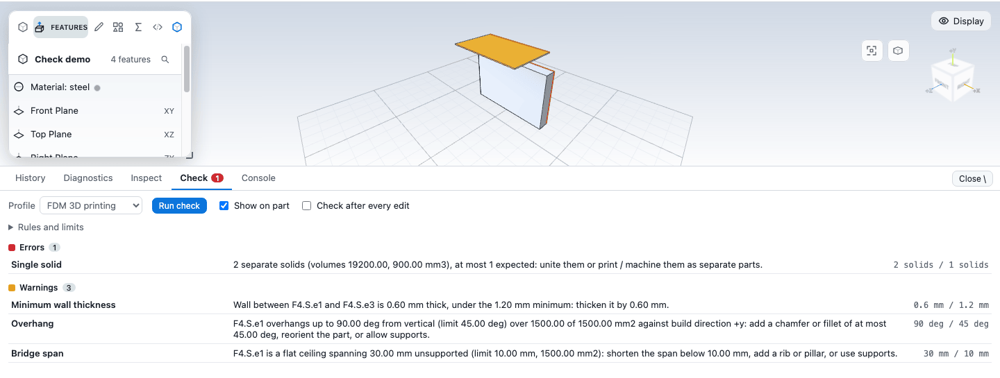

# Design checks

Design checks test a part against manufacturing rules for 3D printing, 3-axis CNC milling or injection moulding, and show you where it breaks them. This chapter covers the rules, how to run a check, how to read the results, and how to change the limits or make a rule stop edits that make things worse.

A check never changes your model, and nothing runs on its own unless you switch on **Check after every edit** or set a rule to **Block**. The rules are a first set of useful tests, not a certification of manufacturability.

## Run a check

1. Open the drawer (backslash key, or the drawer button at the right of the status bar) and choose the **Check** tab.
2. Pick a **Profile**: FDM 3D printing, CNC milling, 3 axis, or Injection moulding.
3. Press **Run check**.

The list groups the issues by severity with counts: **Errors**, **Warnings** and **Notes**. Each row shows the rule, a sentence with the numbers, and "measured / limit" with the unit. "No issues found." means every rule passed.

- **Click a row** to select the faces (or edges) it names and frame them in the view. **Point at a row** to light them up.
- **Show on part** (also the *Design issues* switch in the Display menu, off by default) tints the faces named by the issues: red for errors, amber for warnings, blue for notes.
- The status bar shows the result, for example "FDM 3D printing: 2 errors, 5 warnings". Click it to open the tab. Before your first check there is no chip.
- When you change the part, the result greys out with "Out of date: the part changed after this check. Run it again.", the tint disappears and rows stop being clickable until you run it again.

Each rule reports at most 100 issues. If there are more, a line says how many were left out.

## The rules

The rules come from the kernel. These are the rules and default limits of this version.

### FDM 3D printing

| Rule | What it checks | Default limits |
|---|---|---|
| Watertight | The body is one closed shell with no open or non-manifold edges and no inside-out solids. Exact. | |
| Single solid | The part is one solid; several solids print as separate pieces. Exact. | At most 1 solid |
| Minimum wall thickness | Wall thickness, found by casting rays inward from points on the surface. Sampled, so a very thin sliver can be missed. | 1.2 mm |
| Overhang | Downward faces steeper than a limit, measured from vertical (0 is a wall, 90 a flat ceiling), against the build direction. Faces on the build plate are ignored. | 45 degrees, build direction up (0, 1, 0), ignore patches under 0.5 mm² |
| Bridge span | Flat downward faces above the plate, reported by their narrowest width. | 10 mm, face counts as flat within 10 degrees |
| Minimum feature size | Hole and pin diameters (exact) and gaps between facing walls (sampled). | 0.8 mm diameter, 0.8 mm gap |
| Build plate contact | The flat area touching the build plate. | At least 20 mm² |

### CNC milling, 3 axis

The profile assumes a single setup with the tool approaching from +Z.

| Rule | What it checks | Default limits |
|---|---|---|
| Watertight | As above. | |
| Minimum internal radius | Vertical internal corners smaller than the cutter radius. Sharp inside edges count as radius 0; drilled holes are not corners. | 1 mm, tool axis (0, 0, 1) |
| Minimum wall thickness | As above. | 1 mm |
| Undercut / tool access | Faces the tool cannot reach: facing away from it, or hidden under another part of the body. | Direction (0, 0, 1), ignore patches under 0.5 mm² |

### Injection moulding

The profile assumes a two-part mould pulled along +Z.

| Rule | What it checks | Default limits |
|---|---|---|
| Watertight | As above. | |
| Draft angle | The angle of each wall against the pull direction. A face is flagged when at least half of its area is under the limit. | 1 degree, pull (0, 0, 1), ignore faces under 0.5 mm² |
| Uniform wall thickness | Wall thickness compared with the part's median. Sampled. | Within 0.25 (25 percent) of the median |
| Minimum wall thickness | As above. | 0.8 mm |

Not covered yet: sheet-metal rules, rules of your own, draft direction signs and parting lines, tool reach and stock, support volume, and a suggestion for the best build orientation.

### How exact the rules are

- **Exact** from the model: hole and pin diameters, concave cylinder radii and sharp inside edges parallel to the tool axis, watertightness and the solid count.
- **Based on the display triangles**: overhang, bridge, plate contact, draft and the facing-away half of undercut. These are exact for flat faces; for curved faces they are measured per triangle with an error of about 0.04 percent of the part's diagonal.
- **Sampled**: minimum wall, the gap half of minimum feature, the hidden half of undercut and uniform wall. A feature thinner than the sample spacing can be missed, and thickness is the straight distance along the surface normal.

The printing rules start with the build direction along the model's +Y axis (0, 1, 0), while the CNC and moulding rules start along +Z (0, 0, 1). These are model directions, not camera directions. Set the direction vector to the way you will actually print, machine or mould the part, or the results will be wrong for you.

## Rule modes and limits

Open **Rules and limits** to see every rule of the profile. Each has a mode and its limits.

| Mode | Effect |
|---|---|
| Off | The rule is not checked. |
| Info | Problems are listed as notes. |
| Warn | Problems are listed as warnings. |
| Block | Problems are listed as errors, and edits that make them worse are rejected (see below). |

Rules start as Warn (a few rules in a profile start as Info), so nothing blocks an edit until you choose Block. Limits are number fields with their unit; the build or tool direction is three fields for x, y and z. A limit is kept within the range the rule allows. **Reset to profile** puts every rule back to the starting mode and limits. Your settings are kept per profile in this browser, together with the profile you last used and the state of Check after every edit. They are not saved in the part file.

## Check after every edit

Tick **Check after every edit** and the active profile runs about 0.4 seconds after you finish each edit, never two at once; the chip and the tab update. It is off by default. A check on a large part can take a while, and the status shows the busy overlay with a cancel button while it runs.

## Block: stop edits that make things worse

When a rule is set to Block, the app compares the check before and after each committed feature edit (Confirm in an editor, tree commands, delete, redo). If a Block rule now has **more** issues than before, on faces or edges that were not flagged before, the edit is rejected: it is undone, no history entry is added, and a message names the rule and the numbers, for example:

> Edit rejected, it would break a Block rule: Overhang: 62 degrees on F5.S.e2, limit 45

Things to know:

- Violations that were already there never block, so a part that is not perfect yet can still be edited.
- Sketch confirmations and previews are never blocked, only committed feature edits.
- If the check itself fails or is cancelled, the edit is kept.
- The comparison uses the last check of the current state, or one the app makes just before the edit.

## Next

- [Checks and diagnostics](checks.md): feature errors and how to read them.
- [Measure and inspect](measure.md)
- [Units and settings](../getting-started/settings.md)
- Kernel book: [Validation](/docs/cad/kernel/validation/overview.html) and [Queries: design rules](/docs/cad/kernel/protocol/queries.html).
