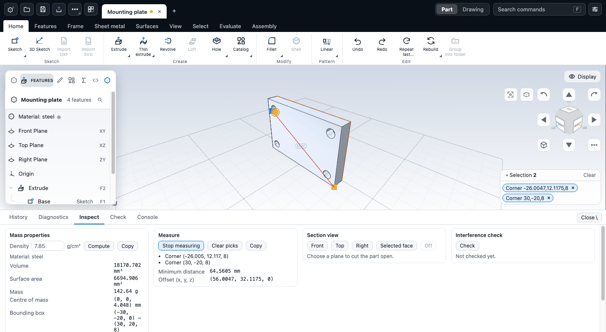

# Measure and inspect

This chapter covers the tools that look at a part without changing it: mass properties, measuring distances and angles, section views, interference between bodies, and surface analysis. None of them edits the document, and every result is a read-only query of the part as it is on screen.

## Where the tools are

The **Evaluate** ribbon tab has them. Mass properties, Measure, Interference check and Section view open the **Inspect** tab of the bottom drawer, which holds one card for each. You can also open the drawer with the backslash key (**\\**) and choose Inspect, or find any of them in the command search (press **F**).

| Tool | Command | Key |
|---|---|---|
| Measure | Measure | M |
| Mass properties | Mass properties | |
| Section view | Section view | |
| Interference check | Interference check | |
| Zebra stripes | Zebra stripes | Alt+Z |
| Gaussian curvature, Mean curvature | the same names | |
| Draft analysis | Draft analysis | Alt+D |
| Curvature comb | Curvature comb | Alt+C |

The commands need a solid on screen. There is no separate probe tool: to read a position, pick a corner with Measure. The size of what you have selected appears in a small card in the corner of the view (a lone corner has a position, not a size, so it shows no card): see [The quick readout](#the-quick-readout).

## Mass properties

Open the Inspect tab and the mass card computes at once, or press **Compute**. It shows:

- Volume (mm³), surface area (mm²) and mass,
- the centre of mass, the bounding box and its size,
- the principal moments of inertia (g·mm²).

Mass depends on the **Density** field (g/cm³). It starts from the part's material (steel is 7.85, aluminium 2.70 and so on). A note under the field says which material it took the density from. If the part has no material, or one whose density is not known, the field starts at 1 and the note asks you to set a density. You can type any value, and the mass and moments follow at once. To change the material itself see [Materials and appearance](../assemblies/appearance.md).

**Settings > General > Mass display** chooses how a mass is shown: automatic (grams below one kilogram, kilograms above), grams, kilograms, pounds or ounces, with 3 to 6 significant digits. It applies wherever a mass appears (this card, the material editor, the bill of materials and drawing tables). The values are the same; only the unit and the digits change, and it is kept on this device.

A part made of several solid bodies lists volume and mass per body in a table. Surface bodies have no volume; they are left out of the mass, and a note says so.

Once you have a result it stays current: after an edit the card shows "Out of date: the part changed." and recomputes. **Copy** puts the numbers on the clipboard as tab-separated lines for pasting into a spreadsheet.

## Measure

1. Press **M**, or choose **Start measuring** in the Measure card. The drawer opens on the Inspect tab.
2. Pick one or two items in the model. The usual selection modes work: **Q** for faces, **E** for edges, **V** for corners.
3. Read the result in the card. A red leader with the value is drawn in the view too.

Picks add up instead of replacing each other. A third pick keeps the last two. **Clear picks** empties the list, and **Copy** puts the results on the clipboard. **M** again, or **Stop measuring**, ends the tool.

| You pick | You get |
|---|---|
| A corner | Its position |
| An edge | Length. A circular edge also gives radius, diameter and centre. |
| A face | Area and surface kind. A cylinder, cone, sphere or torus also gives radius, diameter and centre. |
| Two corners | Minimum distance and the offset along each axis |
| A corner and an edge | Minimum distance |
| A corner and a face | Minimum distance, and the distance along the normal for a flat face |
| Two edges | Minimum distance. Two straight edges also give the angle (0 to 90 degrees); two circles give the centre distance. |
| A face with a face or an edge | Minimum distance, normal distance and the angle between them, from the exact surface |

Distances that involve corners and edges are taken from the lines drawn on screen, so on a curved edge they are as fine as the display. Anything with a face uses the exact surface. If a pair cannot be measured the card says "No measurement for this pair."

## The quick readout

A small card in the corner of the view shows the size of the selection as you make it. It needs no tool and no drawer: pick something with the usual selection modes and the card is there. It shows only the value lines, with no visible heading.

| You pick | The card shows |
|---|---|
| One straight edge | Length |
| One circular edge | Diameter, radius and circumference. A curved edge shows its length instead |
| One face | Area. A round face also gives its radius and diameter |
| Two items | The minimum distance between them, and the angle when there is one (two straight edges or two circular edges; two corners give the distance alone) |
| Three or more | How many items are selected |

The numbers are in the units of the rest of the app (millimetres and degrees) and follow the selection as you add and remove picks. On a phone or a tablet the card sits at the top left of the view instead of the bottom right.

It is hidden while a sketch is open and while the Measure tool is running: Measure draws its own leader with the value in the view, and its card in the drawer holds the full result.

### Common problems

| Symptom | Fix |
|---|---|
| The card is not there | Nothing is selected, a sketch is open, or Measure is running. Pick something with Measure stopped |
| The card and the selection list overlap | They share the bottom-right corner, and the card is drawn over the list. Collapse the list with its arrow button |
| It shows a count instead of a size | It gives sizes for one or two items; with three or more it shows the selection summary: the count with the total area or length, for example "3 edges, 60 mm" |
| A curved edge shows no diameter | A curve that is not a circle has no diameter: the card shows its length |

## Section view

A section cuts the part open so you can see inside. It is a view only: it does not change the model, and Measure, Mass properties and exports do not use it.

1. In the Section card choose **Front**, **Top** or **Right**. The plane starts through the middle of the part. To cut on a face, select one flat face first and choose **Selected face**; the plane starts on that face. If you have not selected a flat face you get a notice.
2. Drag the **Offset** slider, or type a number in millimetres, to move the plane along its normal.
3. Tick **Flip side** to keep the other half.
4. Choose **Off** to remove the cut. The **Section view** command on the ribbon turns the last section on or off.

The cut face is filled so the section looks solid. Selection, hover colours and design-issue colours are not clipped. The section stays while you rebuild the part or switch drawer tabs.

## Interference check

Interference finds bodies of one part that share volume. Press **Check** in the Interference card. If the part has only one solid, the card says "Needs two or more solid bodies". Otherwise it lists each pair that overlaps with the shared volume, or says "No interference between N bodies". Click a pair to select the faces involved and frame them. The result goes out of date when the part changes, and you must press **Check** again.

For components in an assembly, the Assembly tab has its own **Interference check** that names the pairs by component. See [Assemblies and mates](../assemblies/assemblies.md). Note that bodies made by overlapping features in one part are merged by the kernel, so this check mainly finds overlaps between separate bodies you have kept apart.

## Surface analysis

These tools colour the model to show how smooth the surfaces are. Turn one on in the **Surface analysis** group of the Evaluate tab, or in the **Analysis** section of the Display menu, which also has the settings. A colour legend appears over the view.

| Mode | What it shows |
|---|---|
| Zebra stripes | Stripes reflected in the surface. A break in a stripe is a break in tangency; a kink in a stripe is a break in curvature. A Stripe density slider changes the spacing. |
| Gaussian curvature | Red for dome-like, blue for saddle-like, white for flat or rolled areas. |
| Mean curvature | Red where the surface bulges out, blue where it dips in. |
| Draft analysis | Faces coloured by the angle to a pull direction (X, Y or Z) with a Least draft setting in degrees: green has draft, red has none, blue faces the other way. |
| Curvature comb | Teeth along edges and sketch curves as long as the curvature there. Smooth teeth mean a smooth curve. A Comb size slider scales it. |

Analysis colours opaque bodies only. For manufacturing checks that report numbers instead of colours, see [Design checks](design-checks.md).

## Limits

- Everything is in millimetres, grams and g/cm³. There is no unit switch.
- Mass uses one density for the whole part. A part has one material; per-body materials are not available.
- A pair of corners and edges is measured on the display lines, not the exact geometry.
- A view-only import (see [Importing](../files/import.md)) is only drawn in the viewport. The inspect tools test for a solid built from the part's features, so they should treat a part holding only an import as having no solid. This comes from reading the code, not from running it.

## Next

- [Checks and diagnostics](checks.md)
- [Design checks](design-checks.md)
- [Assemblies and mates](../assemblies/assemblies.md)
- [Selecting things](../getting-started/selection.md)
