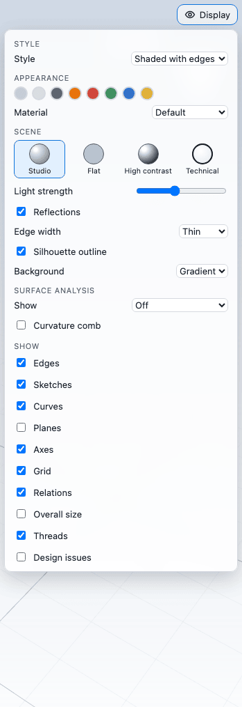
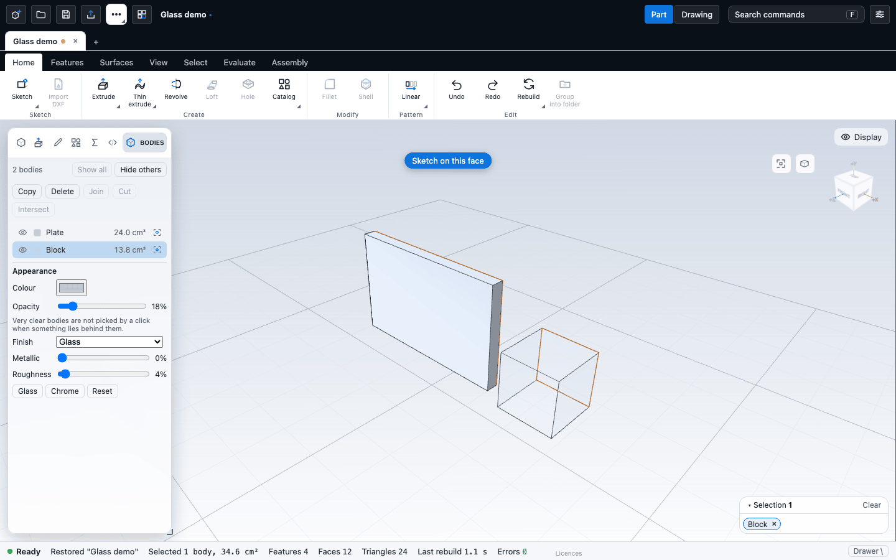

# Materials and appearance

This chapter covers how a part is made of a material, how it is coloured and finished on screen, the display styles and the Display menu, lighting and background, hiding things, and the Bodies list where each body gets its own colour, opacity and finish.

Two things are easy to confuse, so here is the rule up front:

- The **material** is part of the file. It sets the density used for mass, and it sets the colour and finish of the part unless you override them.
- A **colour or finish you pick in the Display menu** is a viewing choice kept in your browser, not in the part file. **Colours set in the Bodies list** are saved with the part.

## The material

The first row of the feature tree reads "Material: steel" (or whatever the part uses), with a colour chip. Click it, press Enter or F2 on it, or use the pencil that shows when you point at it. The Material editor opens in the left panel, with **OK** and **Cancel**. Enter applies and Escape cancels.

1. Type in the search box, or scroll the list. Materials are grouped as Steel, Aluminium, Copper alloys, Titanium, Cast iron, Plastics, Wood, Rubber, Glass, Concrete and Custom. Search matches a word of the name, the category, the standard, the grade or the region code (`s355`, `a992`, `en 10025`, `au`). Inside Steel the general steels come first, then the grades of the standards, grouped by region and standard.
2. Click a material. The editor shows a swatch, its density, a default colour and, where usual, Young's modulus, Poisson's ratio and yield strength, and the mass of the current part at that density ("was ..." shows the mass it has now). Steel grades from the standards also show ultimate strength, shear modulus, thermal expansion, the standard and grade, and the region, with a line saying whether the strengths were verified.
3. Press **OK** to apply it.

The values are textbook figures that are good for estimating mass. They are not for certifying a design.

### Woods and panels

The **Wood** category lists ten solid woods (birch, cedar, cherry, Douglas fir, eucalyptus, maple, oak, pine, teak and walnut) and five panels (MDF, chipboard P5, OSB/3, birch plywood and eucalyptus plywood). Each solid wood has its density at about 12% moisture and its stiffness along the grain from a named source (the species and a link are in the material's note), and its own colour. A part with a solid wood material shows growth rings and fine streaks in a darker tone of that colour, running along the longest side of the part; the panels have no grain. The panels are marked **unverified**: their figures are typical manufacturer values until each is checked against its product standard.

### Surface controls

The **Display** menu's appearance section has a **Surface** group under the material list. **Roughness**, **Metalness** and **Clear coat** change how the part catches the light: a rough surface spreads the reflection, a metallic one tints it with the part's colour, and a clear coat adds a thin glossy layer on top (a varnished wood, a painted panel). Each slider starts at what the chosen material gives, and a value you change is kept for the part, so choosing another material later does not undo it.

Tick **Wood grain** to draw growth rings on any part (a solid wood material has it already). **Ring spacing** is the distance between rings in millimetres, **Grain contrast** how dark they are (0 gives a plain surface), **Grain colour** the colour of the dark rings, and **Grain direction** the axis the grain runs along (by default the longest side of the part). Untick it to turn the grain off, even for a wood. **Reset surface** removes all of these changes. The settings are kept on this device, with the part's colour and material, and are not saved in the part file.

### Textures from Poly Haven

Under the Surface group, **Choose a texture...** opens a list of wood textures from the [Poly Haven](https://polyhaven.com) library (search by name; the thumbnail shows the look). Pick one and the part is drawn with it: the colour image and, when the texture has one, its roughness image, projected onto the part from the three axes, so it works on any shape without texture coordinates. **Texture size** sets how large one tile of the image is in millimetres (it starts at the real size of the sheet the texture was photographed from), and **Remove texture** goes back to the colour and the grain. The author is credited under the texture. Poly Haven textures are public domain (CC0), so they may be used in any work.

Textures come from the internet, so they depend on **Settings > General > Use online libraries**, which is **off** until you turn it on (or press **Allow online libraries** in the list). With it off the app contacts nothing; with it on it contacts `api.polyhaven.com`, `dl.polyhaven.org` and `cdn.polyhaven.com` and sends only which texture you are looking at, never your part. Each downloaded texture (about 1.5 MB at 1K) is kept in the browser, up to 120 MB with the oldest removed first, so a part that uses it still shows it offline; **Clear downloaded textures** in the same Settings section empties the cache. A part opened on a computer that has not downloaded its texture shows its plain colour until online libraries are on. The texture choice is kept on this device with the part's other appearance settings, not in the part file.

## Steel grades from the standards

The Steel category holds fifteen grades from standards, with fy (yield), fu (ultimate), E, G, Poisson's ratio, density and, where known, thermal expansion:

| Region | Grades |
| --- | --- |
| Europe | EN 10025-2 S235, S275, S355; EN 10210 S355J2H (hot-finished); EN 10219 S355J2H (cold-formed) |
| United States | ASTM A36, A992, A572 Gr 50, A53 Gr B, A500 Gr B and Gr C (round and shaped each) |
| Australia | AS/NZS 3679.1 grade 300 and 350 |

Strengths are minimum values in MPa (US figures are the ksi values converted: 36 ksi is 250 MPa). For thickness-dependent grades the figure is the thinnest band (S355: 355 MPa up to 16 mm); the note under the values says how it falls with thickness. **The Australian yields (280 and 330 MPa) are conservative lower bounds**, not a per-thickness table: the mill catalogue shows 280 to 320 MPa for 300PLUS and 340 to 360 MPa for grade 350 depending on flange or web thickness, so design yield depends on thickness.

A grade wears an **unverified** badge when a value rests on one secondary source or the editions of the standard disagree: ASTM A53 Gr B, ASTM A500 Gr C round and the two Australian grades. For A500 Gr C round the older editions give 46 ksi (315 MPa), which is the stored yield; the 2021 revision is reported to give 50 ksi (345 MPa) for all shapes, which the editor shows as "Yield strength, other edition". Check the current edition of the standard before relying on either. US elastic constants (E 200 GPa, G 77.2 GPa) are the AISC 360 values and US thermal expansion is not given. Sources are listed in [Frame stock data and sources](../modelling/frame-stock-data.md#materials).

Files that name a material by name keep working: "Mild steel", "steel" and the other general entries are unchanged, and the new grades are looked up by their names (for example `ASTM A992`, `EN 10025-2 S355`) or ids.

**Custom material...** takes a name, a density and a colour. Custom materials are stored in your browser and listed under Custom with a remove button. A custom name cannot be the same as a built-in one. A file that names a custom material keeps the name when you open it on another computer, but there the material is unknown: Mass properties then asks for a density.

**Use material colour** (on by default) lets the material colour the part. Turn it off and bodies take the default colour.

Changing the material is one undo step. It does not appear as a row in the History log, but Ctrl+Z undoes it in order with your other edits. The material is saved in the file, so Save and autosave pick it up.

## What the material changes on screen

The part is drawn in the colour and finish of its material: steel as a light cool grey with a satin metal look, brass warm and metallic, plastics glossy, rubber and gasket material matte, glass translucent. A colour you pick in Display > Appearance wins over the material colour. Choosing the default grey does not count as an override.

In an assembly each component carries its own material, so each is drawn in its own colour and finish. To override one component, select a face of it, then open the Display menu: the Appearance heading names the component ("Appearance of &lt;name&gt;"), and the change applies to that component only.

## The Display menu

The **Display** button sits on the viewport. It holds, from the top:

| Section | Controls |
|---|---|
| Style | Display style (see below). For Ghost, an Opacity slider from 5 to 100 percent. |
| Appearance | Eight colour swatches and a Material finish list: Default, Plastic, Brushed metal, Glass, Matte. |
| Scene | Four lighting presets, a Light strength slider (0.3 to 2), a Reflections switch, Edge width (Thin, Medium, Bold), a Silhouette outline switch and the Background list (Theme, Light, Dark, Gradient). |
| Analysis | Surface analysis modes (zebra stripes, curvature, draft). |
| Show | Switches for Edges, Sketches, Curves, Planes, Axes, Grid, Relations, Overall size, Threads and Design issues. While a sketch is open the sketch's own show switches appear here too. |

A **Show all** button appears when something is hidden. Layers you switch off in Show are only hidden from view; the model is not changed.

The View ribbon tab has the same style, lighting and background choices as commands, so they can be reached from the command search too.

### Display styles

| Style | Shortcut | What you see |
|---|---|---|
| Shaded | Alt+1 | Lit faces, no edge lines. |
| Shaded with edges | Alt+2 | Lit faces and edge lines (default). The Edges layer controls the lines. |
| Wireframe | Alt+3 | Edge lines only; hidden edges are drawn faint. You can still pick faces. |
| Hidden lines removed | Alt+4 | Flat white faces with black edges. |
| Ghost | Alt+5 | Translucent faces; set how transparent with the Opacity slider. |

Picking and hover highlights work in every style. While you edit a sketch, the body is faded to a quarter of its opacity and comes back when the sketch closes.

### Lighting and background

| Preset | Look |
|---|---|
| Studio (default) | Soft highlights and reflections on metal. The highlights stay fixed to the screen as you turn the part. |
| Flat | Even light, no reflections. |
| High contrast | One strong light, little fill. |
| Technical | Every face matte white with black edges and soft light, close to a drawing. Per-component colours are not shown. |

Light strength scales every light. With Reflections off, metals lose their metal look, and the Flat and Technical presets never have it. The default background is the gradient, which follows the light or dark theme.

### Edges and silhouette

Edge lines are drawn at a fixed pixel width (Thin by default) in a colour darker than the faces. The **Silhouette outline** (on by default) also outlines the rim of curved faces where no edge line lies. It is switched off in a section view, in Wireframe and Ghost, and for translucent bodies.

## Hide and show

Press **H** to hide the body of the selected faces, or the selected sketch, plane or curve. Press **Alt+H**, or the **Show all** button, to show everything again. A hidden body cannot be picked. Hiding is for the session only and is not saved.

The eye on a row in the feature tree hides exactly what that feature made, in the view only. The row dims and shows a closed eye; click it again to restore. Nothing is rebuilt. Suppress is a separate button on the row and does rebuild the model.

## The Bodies list

A part can hold several bodies. The **Bodies** tab of the left panel lists them, one row per body, ordered by the feature that made it. Each row shows an eye, a colour swatch, the name and the volume.

| Control | What it does |
|---|---|
| Eye (or Space on a focused row) | Hides or shows the body. |
| Row click | Selects the body. Shift or Ctrl adds to the selection. Clicking a face in the model selects its body row. |
| Double-click or F2 | Renames the body. |
| Isolate button | Hides every other body. Press it again to show all. |
| Show all / Hide others | Show everything, or keep only the selected bodies. |
| Copy, Delete, Join, Cut, Intersect | Edit the bodies themselves. See [Bodies and combining](../modelling/bodies.md). |

Below the list, the selected body has an **Appearance** group:

| Control | What it does |
|---|---|
| Colour | The body's colour. |
| Opacity | 5 to 100 percent. A body below 100 percent is drawn in a separate transparent pass. |
| Finish | Part material (no override), Matte, Plastic, Chrome, Glass or Brushed metal. |
| Metallic, Roughness | Fine control over the finish. |
| Glass, Chrome, Reset | Presets, and a button that removes the override. |

Appearance set here is saved with the part and is not an undo step. Very clear bodies (below about a third opaque) are skipped by a click when something lies behind them, so you can pick what you see through the glass.

## Limits

- Appearance changes, hiding and the Display menu are not undo steps.
- Per-face colours cannot be set in the Bodies list; scripts can set them (see [Scripting](../automation/scripting.md)).
- Colour and finish are not written to STEP, STL or DXF exports. See [Exporting](../files/export.md).
- A section view cuts opaque bodies only. Translucent bodies are not cut, and two translucent bodies that overlap are blended by the distance of their centres.
- Zebra and curvature analysis colour opaque bodies only.
- There are no cast shadows, ambient occlusion or textures.
- Each browser keeps its own Display choices and custom materials.

## Next

- [Assemblies and mates](assemblies.md): materials of components.
- [Measure and inspect](../analysis/measure.md): mass from the density of the material.
- [Bodies and combining](../modelling/bodies.md)
- [Saving and opening](../files/files.md)
