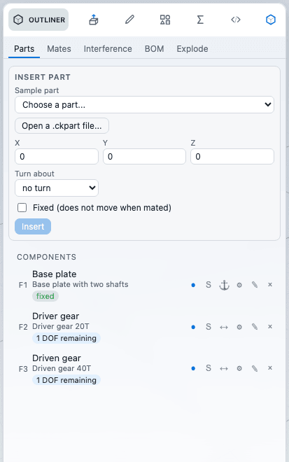
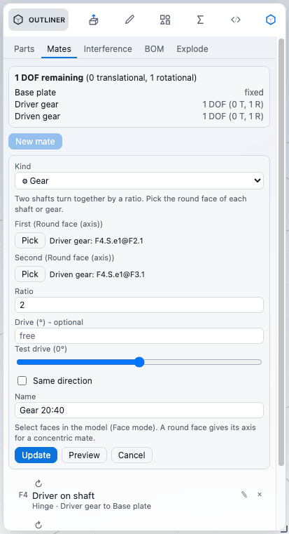

# Assemblies and mates

An assembly is a part that holds other parts as components. You insert parts, place them, and tie them together with mates so that they move the way the real thing would. This chapter covers inserting and placing components, the mate kinds, reading the degrees of freedom that are left, editing a component's own features, and the bill of materials, exploded view and interference check.

## How an assembly works

Every component is an **Insert part** feature that keeps a full copy of the part you chose. Editing the source file later does not change the assembly. Each component stays its own body, also where it touches another component.

Mates are features too. They sit in the feature history after the components they position, so they undo, redo and rebuild like any other feature. The kernel solves the mates and moves every component that is not fixed.

The **Assembly** ribbon tab has two groups:

| Group | Commands |
|---|---|
| Components | Insert part, Mate |
| Review | Bill of materials, Exploded view, Interference check |

Each command opens the **Outliner** tab of the left panel on the matching section: Parts, Mates, Interference, BOM or Explode. When a part that already holds components is loaded, the ribbon switches to the Assembly tab by itself. The commands need an open part; Mate, Bill of materials, Exploded view and Interference check also need at least one component.

## Insert a part

1. Open or start the part that will hold the components. Choose **Insert part** on the Assembly tab.
2. Under **Sample part**, pick one of the sample parts, or press **Open a .ckpart file...** to read a part from disk. A file that is not a part is refused with "That file is not a part file."
3. Set the **Placement**: X, Y and Z offsets in millimetres, and optionally **Turn about** X, Y or Z with an **Angle** in degrees. The default is no offset and no turn.
4. Tick **Fixed (does not move when mated)** if this component should stay where it is. The first component of an assembly is usually fixed.
5. Press **Insert**. The notice "Inserted &lt;name&gt;." confirms it, and the component appears in the list.

Mates move components relative to each other. A component you leave unfixed can be moved by any mate that involves it; a fixed component never is.

## Work with components

Every component is a row in the Parts list: its name, the part it came from, and a badge for the degrees of freedom it has left ("1 DOF remaining", "fully defined", "fixed"). Click a row to select the component's faces in the model. The placement fields under a selected row change its X, Y, Z and turn; press **Apply placement**. Mates move the component again afterwards, so placement matters mostly for the starting position.

Buttons on a row:

| Button | What it does |
|---|---|
| Show / Hide (the dot) | Hides the component in the view only. Not saved, and it does not change the model. |
| Suppress / Unsuppress | Leaves the component out of the build. The component stays in the file. |
| Fix / Float | Fixes the component in place, or lets mates move it again. |
| Gear icon (Edit this part) | Opens the component's own features in a tab. See below. |
| Pencil (Rename) | Renames the component. Double-clicking the name does the same. |
| Cross (Delete component) | Deletes the component together with the mates and component patterns that used its faces, in one undo step. |

## Mates

Choose **Mate** to open the Mates section, then **New mate**.

1. Pick the **Kind**. The menu is grouped as Standard, Advanced and Mechanical, and each kind has a tooltip.
2. Fill the references. Each reference slot has a **Pick** button: press it, then click a face in the model. Select faces in Face mode (the hint under the list says so). A round face gives its axis for kinds that need an axis, such as Concentric.
3. Press **Flip** if the kind has it and you want the other orientation (the wording changes with the kind, see the table).
4. Enter the value for kinds that have one (a distance, an angle, a ratio and so on) and, if you like, a **Name**.
5. Press **Preview** to see the result without committing it ("Preview shown. Apply keeps it."), then **Apply**. Cancel drops a preview.

References are faces. Edges are not accepted. Angles are in degrees, lengths in millimetres.

To change a mate, choose **Edit** on its row. Changing the kind replaces the mate. The **Delete** button removes it. Pressing Apply checks the draft first and tells you what is missing: "Pick every reference first.", "Pick different faces.", "Enter a number." and so on.

### Mate kinds

| Kind | What you pick | Extra fields | Flip means |
|---|---|---|---|
| Coincident | Two faces | | Aligned or opposed |
| Parallel | Two faces | | Aligned or opposed |
| Concentric | Two round faces (axis) | | Aligned or opposed |
| Distance | Two faces | Distance | Has a Flip switch |
| Angle | Two faces | Angle | Supplementary angle (180 minus the angle) |
| Perpendicular | Two faces | | No Flip |
| Tangent | A flat, cylindrical or spherical face and another | | The other side of a flat face, or one round face inside the other |
| Lock | Two faces | | No Flip. Freezes the two components relative to each other as they are now. |
| Symmetric | Two faces and a mirror plane | | No Flip |
| Width | The two sides of a tab and the two sides of a slot | | No Flip. Centres the tab in the slot. |
| Limits | Two faces | Limit (Distance or Angle), Minimum, Maximum | No Flip. Lets the faces move within a range. |
| Hinge | Two round faces, optional stop faces | Distance (stop offset, optional) | No Flip. Shares an axis and leaves one rotation. |
| Slot | A pin (round face), a slot wall, optional second wall | | Has a Flip switch |
| Screw | Two round faces | Pitch, Drive | Left-hand thread |
| Gear | Driver and follower round faces | Ratio, Drive | Same direction (default is opposite) |
| Rack and pinion | Pinion (round face) and rack (round or flat face) | Pitch radius, Drive, Rack direction | Reverse |

Five more kinds are listed but cannot be used yet: Profile centre, Path, Linear coupler, Cam and Universal joint. They show "kernel pending" in the menu and are disabled.

### Drive and the test slider

Gear, Screw and Rack and pinion have a **Drive** field in degrees (it may exceed 360). Leave it empty and the coupling stays free. Under the field a **Test drive** slider previews the motion: every change runs the mate as a preview, **Cancel** drops it and **Apply** keeps the value. A Drive removes one degree of freedom from the assembly, because the coupling now has a fixed angle. Hinge has no Drive.

### Degrees of freedom

The top of the Mates section reports what is still free:

- The total ("N DOF remaining") split into translational and rotational freedoms, and one line per component.
- An **Over-constrained** banner when mates repeat or contradict each other. It lists the mates that add no constraint ("Redundant") and the mates that conflict with earlier ones. Click a row to select that mate and its faces.
- A "rolled back" note for each mate the kernel refused, with the reason: it cannot be satisfied together with other mates, the faces cannot be used for that kind, both components are fixed, both faces belong to one component, or a face it used no longer exists. A rolled-back mate leaves the components where the earlier mates put them.

Normally an edit that would break a mate is refused as a whole and the assembly stays as it was. The rolled-back notes mostly appear for files that were opened with such a mate already in them. In a very large assembly the kernel skips the translational and rotational split, and the panel says so.

## Edit a component's own features

To change a component itself, press the gear icon on its row, or **Edit this part's features** in the component's editor. The component's part opens in a tab of its own, next to the assembly's, with its full feature tree, sketches and editors. A bar over the viewport reads "Editing &lt;part&gt; (in &lt;assembly&gt;)" with **Done** and **Cancel**.

- **Done** writes the edited part back into the component as one undo step in the assembly and closes the tab. Placement and mates stay, and the assembly rebuilds.
- If a mate depended on something you removed, the assembly refuses the change, the part stays open and a message says so.
- **Cancel** closes the tab and leaves the component unchanged.
- Saving to a file is refused on that tab ("Finish editing the part first"). Close it with Done or Cancel first.

Only the edited component changes. Other instances of the same part are separate copies and keep their old geometry.

## Bill of materials

Choose **Bill of materials**. The list has one line per distinct part: No., Part, Qty, Material, Mass each and Mass total, plus a Total row. Components of the same inserted part count as one line; copies made by a component pattern count too, suppressed components do not. A click on a row selects the bodies of those components.

Mass each is the volume of the part alone times the density of its material. If the material has no known density, the mass is left blank and a note says so. **Save CSV** writes `bom.csv` with the columns `No.,Part,Qty,Material,Mass each (g),Mass total (g)`; its rows end with CR LF, and a text that starts with `=`, `+`, `-` or `@` is written so that a spreadsheet shows it as text and never runs it as a formula. **Copy text** puts the same table on the clipboard as aligned plain text, ready to paste into an e-mail, and **Save text** writes it as `bom.txt`.

## Exploded view

Choose **Exploded view** to spread the components apart for viewing. It is display only: measuring, mass, section and export use the assembled positions.

| Control | What it does |
|---|---|
| Spread | How far components move from the middle of the assembly. |
| Direction | Away from the middle, or along the X, Y or Z axis only. |
| Move a component along an axis | Pick a component, an axis and an offset in millimetres to adjust one component by hand. |
| Reset | Clears the spread, direction and manual offsets. |

The arrangement is saved with the file. Hidden components are not part of it.

## Interference check

Choose **Interference check** and press **Check**. The result lists pairs of components that share volume, with the shared volume. A pair the kernel could not compute shows its error code. A click on a pair selects its faces and frames them. The result goes out of date when the assembly changes ("Out of date: the assembly changed."); press **Check** again. The Inspect drawer has the same check for the bodies of any part, see [Measure and inspect](../analysis/measure.md).

## Samples

Three sample assemblies are in the Library picker (titles starting "Assembly:"): a bolt in a block (coincident and concentric mates), a gear train (two gears on shafts with a gear mate of ratio 2; set a Drive on the gear mate to turn them) and a hinged door (a hinge with a stop and a limits mate of 0 to 110 degrees).

## Not available

- Replacing a part, or adding a new component inside the assembly; insert a part and mate it instead.
- Dragging a component in the viewport in the exploded view; use the offset fields.
- Mates on edges (faces only).
- The five pending mate kinds above.

## Next

- [Materials and appearance](appearance.md): colour and finish of components.
- [Measure and inspect](../analysis/measure.md)
- [Saving and opening](../files/files.md)
- [Drawings](../files/drawings.md): bill of materials and balloons on a sheet.
