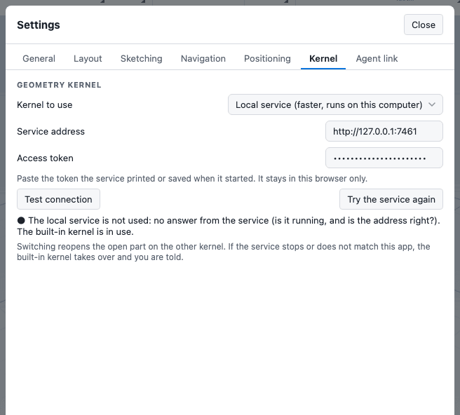

# The local kernel service

The app's geometry kernel normally runs inside your browser. You can instead point the app at a **local kernel service**: the same kernel built as a native program that runs on your own computer. This chapter covers why you might want that, how to switch to it, how the access token works, and what happens when the service goes away.

The local kernel service is experimental and optional. Nothing changes unless you switch it on, and the built-in kernel is always the fallback.

## Why use it

- It is faster on large parts, because it runs as a native program and keeps its caches warm between edits.
- It is not limited by the browser's memory ceiling, so very large documents open that the built-in kernel cannot hold.
- It is the same kernel. The results are the same up to rounding in the last digits of some floating-point values.

If your parts rebuild quickly on the built-in kernel, you gain little. See [Troubleshooting](../reference/troubleshooting.md) for slow rebuilds.

## What you need

- The `ck-native` program running on the same computer as your browser. It is built from the kernel source. [Build instructions are in the kernel guide](/docs/cad/kernel/getting-started/build.html).
- A modern browser. See "Browser caveats" below.

## Start the service

1. Start `ck-native`. It listens on `127.0.0.1` (your own computer only), by default on port 7461.
2. On its first start, the service creates an access token and stores it in its own configuration folder. It prints where the token file is. It never prints the token itself.
3. To show the token so that you can paste it into the app, run `ck-native --print-token`. It prints the token and exits.

Treat the token like a password. Anyone who has it can run the kernel on your machine.

If you load the published app from a web address rather than running it yourself, start the service with `--allow-origin` and the app's address. By default the service accepts only the local development address. See the kernel guide for the service's options.

## Switch the app to the service

1. Open **Settings**: click the gear icon at the right of the top bar, or run **Workspace settings** from command search (**F**).
2. Open the **Kernel** tab.
3. For **Kernel to use**, choose **Local service (faster, runs on this computer)**.
4. Check **Service address**. The default is `http://127.0.0.1:7461`. Use `127.0.0.1` or `localhost`. Other addresses are not supported.
5. Paste the token into **Access token**.
6. Choose **Test connection**. It shows the kernel version, protocol version and number of cores, or says why the service cannot be used. A test switches nothing.

As soon as you change the mode, address or token, the open part is reopened on the new kernel. Your undo history is kept. To go back, choose **Built-in (runs in this browser)** and the part moves back.

Once you choose the service, a **Kernel** chip appears in the status bar. It does not show while you use the built-in kernel by choice. The chip reads:

| Chip | Meaning |
| --- | --- |
| **Connecting** | Reaching the service. |
| **Local** followed by a version | Connected to the service. |
| **Built-in (service off)** | You chose the service, but it could not be used. The built-in kernel took over. |

Click the chip to open the Kernel tab.

## The access token

- The token is stored in this browser's local storage and nowhere else. It is sent in a request header, never in an address, and it does not appear in notices, status text or logs.
- Clear the **Access token** field to remove it from the browser.
- Every request to the service must carry the token. A missing or wrong token gives "the token is missing or was refused".
- The service also supports **pairing**: a one-time code from `ck-native --pair` that a client exchanges for its own token, which can later be revoked with `ck-native revoke`. The app does not offer a pairing step yet. Paste the shared token as described above.

## Same kernel or not at all

When the app connects, it checks two things:

- The service speaks the same protocol version.
- The service was built from the same kernel build as the one built into this app.

If either differs, the app refuses the service, stays on the built-in kernel, and shows a notice with the reason, for example "it is a different kernel build than this app". The two kernels are never mixed inside one document. If you see this, build the service from the kernel version that matches the app.

## If the service stops

If the service cannot be used when the app starts (not running, token missing or refused, or version mismatch), the app uses the built-in kernel and a notice says why.

If the service fails while you work, because it was stopped, restarted, timed out your session, rejected the token, or took more than five minutes to answer, the app:

1. Shows one notice: "The local kernel service stopped: ... The part was reopened on the built-in kernel."
2. Reopens the part on the built-in kernel from its last good state, keeping your undo history. The edit that was running when the service failed is not applied. Repeat it.
3. Stays on the built-in kernel until you choose **Try the service again** in the Kernel tab, or change the setting. It never flips back and forth on its own.

A request that the service refuses for its own reason, such as a crash on one operation or a request that is too large, is reported on that request like an error from the built-in kernel. It does not trigger the fallback.

If you cancel a long rebuild, the request in flight is aborted and the service starts a clean session.

## Browser caveats

Any web page can try to call a local server, so the service demands the token and checks where the request comes from. What a browser allows depends on where the app is loaded from. Treat the points below as things to test on your setup, not as guarantees.

- The app served from your own computer's development address, talking to `127.0.0.1`, works in every browser.
- The app served over **https** (a published site) calling `http://127.0.0.1` is allowed in Chrome and Firefox for local addresses, if the service lists the app's address as allowed. Recent versions of Chrome may ask once for permission to access devices on your local network. Allow it.
- **Safari** may block an https page from calling an http address. Use the built-in kernel there.
- The service is for the same computer only. A network or remote address is not supported.
- Browser extensions or security software that block local connections make the test say "no answer from the service (is it running, and is the address right?)".

## Next

- [Troubleshooting](../reference/troubleshooting.md)
- [Agents and the MCP server](mcp.md)
- [Units and settings](../getting-started/settings.md)
- [Install as an app and work offline](../reference/pwa.md)
