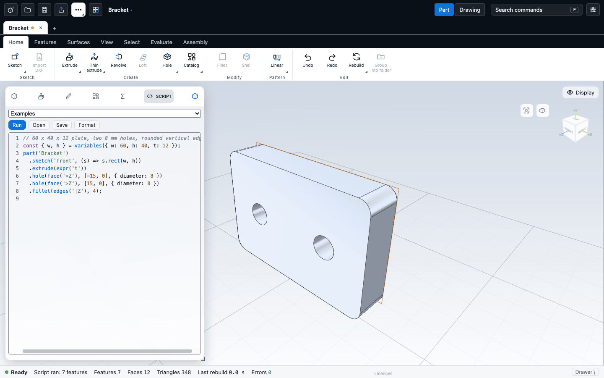

# Scripting

A short JavaScript script can build a part for you: you describe sketches and features in code, press **Run**, and the app creates a normal feature tree that you can edit like any other part. This chapter covers where to write a script, what it can create, a complete example, and the limits.

Scripts are useful for parts with many repeated or computed features, for parameter studies, and for building something the same way every time.

## Write and run a script

1. Run the **Script** command (ribbon **Home** tab, **Create** group, on the button it shares with **Catalog** and **Variables**). The **Script** tab opens in the left panel.
2. Write your script in the code box, or pick one from the **Examples** list. Examples include a bracket, a flanged cylinder and a thin-walled box.
3. Choose **Run**, or press **Ctrl/Cmd+Enter** in the code box.

What happens when you run:

- A script always builds a **new** untitled part. If the part that is open has unsaved changes, the app asks what to do with them first.
- A progress bar shows "Building n / total" and the time. **Cancel** stops the run and leaves your open part untouched.
- When the run finishes, the status says "Script ran: n features". Warnings appear as notices.
- The script text is saved in the document, so reopening the file shows it in the Script tab again.

Other buttons in the Script tab:

| Button | What it does |
| --- | --- |
| **Open** | Loads a script from a `.js`, `.ts` or `.txt` file into the box. |
| **Save** | Downloads the script as a file. |
| **Format** | Tidies the indentation (**Shift+Alt+F**). It never changes what the script builds. |

Errors are listed under the box as "Line N: message". Click one to select that line.



### Editing variables afterwards

If your script declares `variables`, they appear in the **Variables** tab. When you change one there and you have not edited the model by hand since the run, the app reruns the script with your values and rebuilds the part. If you have changed the model by hand, the app does not rerun and tells you: press **Run** to rebuild from the script, which replaces those changes.

## A complete example

This script builds a 60 x 40 x 12 plate with two 8 mm holes and rounded vertical edges.

```js
// plate with two holes and rounded edges
const { w, h } = variables({ w: 60, h: 40, t: 12 });
part('Bracket')
  .sketch('front', (s) => s.rect(w, h))
  .extrude(expr('t'))
  .hole(face('>Z'), [-15, 0], { diameter: 8 })
  .hole(face('>Z'), [15, 0], { diameter: 8 })
  .fillet(edges('|Z'), 4);
```

What each line does:

- `variables({...})` declares named values. They become document variables, editable in the **Variables** tab. It returns their numbers, so you can use `w` and `h` in the code.
- `part('Bracket')` starts the part. The name becomes the document name. Every script builds one part. If you write several `part(...)` calls, the last one wins.
- `.sketch('front', ...)` adds a sketch on the front plane. The function receives a sketch builder `s`.
- `.extrude(expr('t'))` extrudes the sketch. `expr('t')` keeps the depth linked to the variable `t`.
- `.hole(face('>Z'), [x, y], {...})` drills a hole in the face that points furthest toward +Z, at that position on the face.
- `.fillet(edges('|Z'), 4)` rounds the edges that run parallel to Z with a 4 mm radius.

A script must start with `part(...)`. A script that builds no part gives "the script builds no part: start with part("Name")".

## What a script can create

Each part method adds one feature, in order.

### Sketches

`part.sketch(plane, fn, name?)` takes a plane: `'front'`, `'top'` or `'right'`, a face selector such as `face('>Z')`, or an offset plane made with `at('front', 10)`.

Sketch builder methods:

| Method | Draws |
| --- | --- |
| `rect(w, h, [cx, cy])` | A rectangle, centred at `[cx, cy]`. |
| `rrect(w, h, r, [cx, cy])` | A rectangle with rounded corners. |
| `circle(radius, [cx, cy])` | A circle (the argument is the radius). |
| `polygon(points)`, `polyline(points)`, `line(a, b)` | A closed polygon, an open chain, a single line. |
| `arc(centre, start, end)`, `arc3(a, mid, b)` | An arc, counter-clockwise from start to end, or through three points. |
| `spline(points, {closed})`, `cvspline(points, {closed, degree})` | An interpolating or control-point spline. |
| `point([x, y])`, `points(list)` | Point entities, which holes use. |
| `polarPoints(centre, radius, n, startAngle)`, `grid(origin, [dx, dy], [nx, ny])` | Points on a circle or grid. |
| `axis()`, `axisAt(from, to)` | A construction line used as a revolve axis. |
| `text(string, at, options)` | Letters as closed profiles. See [Text](../sketching/text.md). |

Sketch planes use these axes:

| Plane | Sketch x is world | Sketch y is world | Extrudes toward |
| --- | --- | --- | --- |
| `'front'` | +X | +Y | +Z |
| `'top'` | +X | -Z | +Y |
| `'right'` | -Z | +Y | +X |

A sketch on a face has its normal pointing out of the body.

### Features

| Call | Feature |
| --- | --- |
| `.extrude(depth, {direction, mid, flip, draft, thin})` | Extrude (add) the last sketch. |
| `.cut(depth or through(), {direction})` | Extrude (cut). With the default `direction: 'auto'` the script tries into the part, and flips once if that cuts nothing, adding a warning. State the direction yourself to skip the retry. |
| `.revolve(angle = 360, {op, thin, axis})` | Revolve about the sketch's axis line. |
| `.thin(t)` | Makes the previous extrude or revolve thin-walled. |
| `.hole(face, [x, y], {diameter, depth, kind, ...})` | A hole. `kind` can be `'cbore'`, `'csk'` or `'tapped'`. Through unless `depth` is given. |
| `.holes.points / .polar / .grid(...)` | One hole feature at many points. |
| `.fillet(edges, radius)`, `.chamfer(edges, distance)` | Edge rounding. Different radii become one fillet per radius. |
| `.shell(face or faces, t)` | Hollow out, opening the given faces. |
| `.linearPattern({count, spacing, direction})`, `.circularPattern({count, axis, angle})`, `.pathPattern({path, count, spacing})` | Patterns of the last feature, or of seeds you name. Directions and axes follow the world axes. A linear pattern can use `totalLength` or `to` (a plane, face or point the last copy reaches) instead of `spacing`, and a `second` direction. A path pattern follows an open sketch. |
| `.workplane(base, offset)` | A reference plane. |
| `.loft(sections)`, `.sweep(profile, path)`, `.mirror(plane)`, `.rib(thickness)` | Loft, sweep, mirror and rib. |
| `.gear({module, teeth, thickness, ...})` | The gear generator. |
| `.thread(...)` | A cosmetic or modelled thread on a hole or cylinder. |
| `.surfaceExtrude`, `.surfacePlanar`, `.surfaceLoft`, `.thicken`, `.knit` | Surface bodies. |
| `.insertPart(doc, {...})`, `.mate({...})` | Assemblies inside the part. |
| `.appearance({...})`, `.bodyName(handle, name)` | Colour, opacity, finish and body names. They add no feature and no history step. |
| `.feature(json)`, `.sketchFeature(on, {...})` | Raw features, for anything without a helper. |

Values are numbers or `expr('w*2')`, an expression over your variables stored in the feature. Inside a sketch, an `expr` contributes its current number only, so a sketch size does not follow later edits to a variable.

### Choosing faces and edges

Selectors are resolved when the script runs, against the body as it is just before that step.

- `face('>Z')` is the face pointing along that axis that lies furthest along it. Other forms: `'<X'`, `'>Y'` and so on, or a persistent name such as `'F3.C1'`. Rule objects such as `face({ normal: [0,0,1], areaGreater: 100 })` combine tests. A selector for one face must match exactly one, or the run stops with "Line N: face(...) matches 6 faces".
- `faces(...)` matches several. Use `.largest()`, `.smallest()` and `.nth(i)` to pick one.
- `edges('|Z')` is edges parallel to Z. `edges('all')`, `'>X'`, and rule objects such as `edges({ onFace: face('>Z') })` also work.
- A face selector that resolves to the furthest of several same-facing faces gives a warning that names the candidates. Restrict it with a face name or `{of: handle}`.
- `const h = part.handle()` captures the feature just recorded, for `{of: h}` and for patterns.

### Reading results back

A script can check what it built.

```js
const p = part('Plate').sketch('front', (s) => s.rect(60, 40)).extrude(10);
const v = await p.volume();                        // mm3
p.expectVolume(60 * 40 * 10).expectValid().expectBBox({ size: [60, 40, 10] });
```

`await` reads: `volume()`, `area()`, `bbox()`, `centreOfMass()`, `inertia(density)` (mass, first moments, inertia tensor about the centre of mass and the origin, principal moments and axes; density in g/cm³), `faceCount()`, `edgeCount()`, `isValid()`, `issues()`, `faces()`, `edges()`. Assertions: `expectVolume`, `expectValid`, `expectBBox`, `expectFaceCount`. A failed assertion adds a "Line N" error, and the run continues.

Each read rebuilds everything recorded so far, so read once after a group of features, never inside a loop that adds features.

## Limits

- **Size:** a script is limited to 40,000 characters and 2,000 steps. A `for` or `while` loop stops after 100,000 turns ("loop limit exceeded").
- **Safety:** the script runs with only the API names in scope. Browser functions such as `fetch`, `window` and timers are blocked. This prevents accidents but is **not** a security boundary. Do not run scripts from people you do not trust.
- **No sketch constraints:** sketches made by a script are plain geometry without constraints.
- **No separate assemblies:** an assembly is `insertPart` plus `mate` features inside one part.
- **Not covered by helpers:** closed (ring) lofts, and sweep with a kept normal. Use `.feature({ type: ... })` for kernel features that have no helper, such as draft or helix.
- **Patterns follow the world axes:** a linear pattern runs along x, y or z. A circular pattern turns about a world axis through the origin. For a bolt circle anywhere, use `.holes.polar`. For an oblique pattern, rotate the part first.
- **Chamfers:** a chamfer with two distances, or with distance and angle, is reported as unsupported by the kernel today. Cut the bevel instead.
- **Line numbers** come from the browser. In browsers other than Chrome and Edge, an error may show line 0.
- **Fonts:** a script can use the built-in fonts `gauge` and `engrave` and a short list of library fonts by id. Fonts picked in the editor cannot be named from a script.
- **Running creates a new part.** A script cannot modify the part you have open.

## Next

- [Agents and the MCP server](mcp.md)
- [Equations and variables](../modelling/equations.md)
- [Catalog parts](../library/catalog.md), which are built with this same script language
- [Text](../sketching/text.md)
