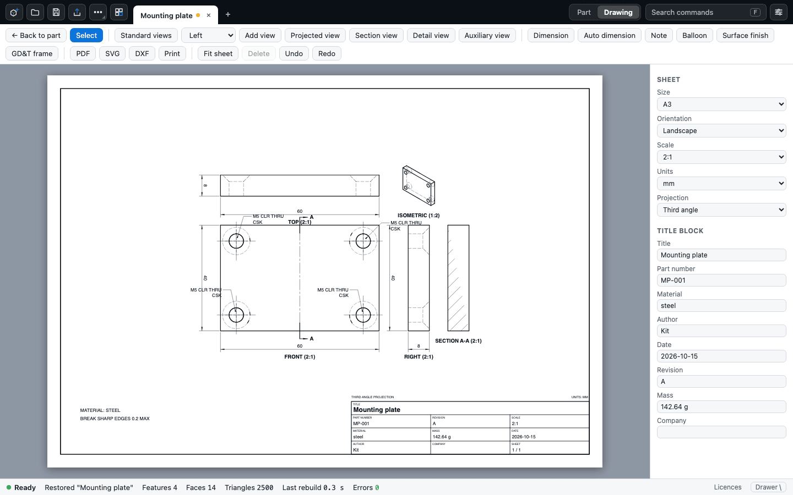

# Drawings

This chapter covers the drawing view: making a sheet of views of your part or assembly, adding dimensions, notes, balloons and a title block, and exporting the sheet as PDF, SVG or DXF.

A drawing belongs to the part. It is saved in the part file, and when the part changes the views are projected again, so the sheet follows the model.

## Open the drawing view

Press the **Drawing** tab in the top bar, next to **Part**. The sheet appears over the viewport. The tab needs an open part, and a part with no body says "Nothing to draw: the part has no body." **Back to part** (top left of the drawing toolbar) or the Part tab returns to the model. The Drawing view closes when you switch to another document tab.

## The sheet

The panel on the right edits the sheet:

| Setting | Choices | Default |
|---|---|---|
| Size | A4, A3, A2, A1, A0, ANSI A, B, C, D, E | A3 |
| Orientation | Landscape, Portrait | Landscape |
| Scale | 10:1, 5:1, 4:1, 2:1, 1:1, 1:2, 1:4, 1:5, 1:10, 1:20, 1:50, 1:100 | 1:1 |
| Units | mm, in (for dimension text; the model is in millimetres) | mm |
| Projection | Third angle, First angle | Third angle |

The sheet scale applies to every view that does not have its own scale. In third-angle projection the top view sits above the front view and the right view to its right; first angle swaps the sides. A change of projection affects views you add afterwards, not the ones already placed.

The **Title block** at the bottom right has Title, Part number, Material, Author, Date, Revision, Mass and Company, plus the sheet scale and number. Title and Material start from the part (its name and its material), and the mass is the part's volume times the material density, kept up to date while the field still holds the computed value. Type over any field to set it yourself. **From the part** puts the computed values back.

## Make views

The toolbar groups the view tools first.

| Tool | What it does |
|---|---|
| Standard views | Front, top, right and isometric views at the largest standard scale that fits the sheet, leaving room for the title block and the bill of materials. Replaces the views already on the sheet, and adds overall dimensions, diameters and hole callouts to the front view. |
| Add view | Choose Front, Back, Left, Right, Top, Bottom or Isometric from the list, then press **Add view**. |
| Projected view | Click a view, then click on the side where the new view should go. It stays aligned with the view it came from. |
| Section view | Click a view to place a cut line (hold **Shift** for a horizontal line). The cut part is hatched, the parent shows the cut line with arrows and a letter, and the new view is labelled SECTION A-A. If the line misses the part you get a notice. |
| Detail view | Drag a circle on a view. That area is shown larger (twice the parent's scale by default), labelled DETAIL B, and cut at the circle. |
| Auxiliary view | Click an inclined straight edge of a view. A view looking square at that edge is made. |

Views appear one at a time as the kernel projects them, with "Projecting views..." in the status line. Each view is cached, so moving, scaling or switching lines does not recompute it.

### Select, move and edit views

Use **Select** (the default) to click a view and drag it. Projected and section views move only along the axis they share with their parent so they stay aligned; moving a parent carries the views made from it. Dragging empty space pans the sheet, the mouse wheel zooms at the pointer, and a right or middle button drag also pans. **Fit sheet** resets the camera.

With a view selected, the panel edits:

| Setting | What it does |
|---|---|
| Label | The text under the view. The Label box shows or hides it. |
| Scale | The view's own scale, or the sheet's. |
| Hidden lines | Shows hidden edges as dashed lines. |
| Tangent edges | Shows the lines where smooth faces meet. |
| Centre lines and marks | Draws centre lines on cylinders seen from the side and centre marks on round holes. They can be picked, selected and dimensioned. |
| Align to parent | Snaps a projected or section view back into line. |

**Delete** (or the Delete key) removes the selected view together with the views made from it and their dimensions.

## Dimensions

Choose **Dimension** (or press **D**), then click an edge or a centre line in a view.

- A straight edge gives its length.
- A full circle gives a diameter; hold **Shift** on the pick to get a radius instead. An arc gives a radius.
- Click two edges for a distance (parallel edges), an angle (edges that meet), a centre distance (two circles) or the distance from a circle centre to a line. Press **Enter** to finish a one-edge dimension; a second click completes a two-edge one.
- Centre lines and centre marks work as references: click two parallel centre lines (for example the axes of two shafts) for the distance between them, a centre line and an edge for the distance from the axis to the edge, two centre marks for the distance between the hole centres, or two centre lines that meet for the angle. The dimension line is placed outside the view, beyond any dimension already there. Clicking a centre line with the Select tool selects just that line, and dragging it still moves its view.
- Drag a dimension to move its line, or the leader of a round one.
- In the panel, edit the text. Use `<>` for the measured value, for example `<> +0.1 / -0` or `4 HOLES <>`. Leave it empty to show the measured value. A radius or diameter has a toggle to switch between the two.

A dimension remembers the two faces of the edge it was made on (for a centre line, of both silhouette edges of the cylinder), so it finds the edge again after the model changes. If an edge disappears, the dimension stays where it was and the status line says how many were lost.

**Auto dimension** adds overall width and height, one diameter per hole position, and the hole callouts below, for the selected view (or all views except the isometric if none is selected).

### Hole and thread callouts

A circle that belongs to a Hole or Thread feature gets that feature's text: for example `M10x1.5 ↧ 30` for a threaded hole with its depth, `Ø6.5 THRU`, or `M5 CLR THRU`, with `CSK` or `C'BORE` for countersunk and counterbored holes. The text is computed from the feature, so it changes when the feature changes.

## Notes, balloons and symbols

| Tool | What it does |
|---|---|
| Note | Click on the sheet for a text note. **Shift**+click on a view for a note with a leader to that point. Edit the text (several lines) in the panel. |
| Balloon | Click on a view for a numbered balloon with a leader. The Number field in the panel renumbers it. |
| Auto balloons | Assemblies only. Adds a balloon for each bill-of-materials item to the selected view (front by default), attached to a visible edge of the item. |
| Surface finish | Click on a surface for a surface finish symbol with a leader. The panel edits the roughness; the default is `Ra 1.6`. |
| GD&T frame | Click for a feature control frame. Type the cells separated by a vertical bar, for example `POS\|0.1\|A`. Plain ASCII characters, no special tolerance symbols. |

For an assembly, a **bill of materials table** (part, quantity, material and mass, the same as the Assembly panel's list) is drawn above the title block. Untick **Show table** in the panel to hide it.

## Undo and delete

Ctrl+Z and Ctrl+Y (or the Undo and Redo buttons) step through the changes you made to the sheet. The part's own history is not touched. Typing in a field counts as one step. Changes that the part causes (a new mass, regenerated dimensions) are saved but are not steps. Escape drops the current tool, then clears the selection.

## Export and print

The toolbar ends with **PDF**, **SVG**, **DXF** and **Print**. All four come from the same drawing, so they agree.

| Output | Details |
|---|---|
| PDF | One page at the sheet size with vector lines, dashes, filled arrowheads and Helvetica text. |
| SVG | The sheet in millimetres. |
| DXF | DXF R2000 (AC1015) ASCII in millimetres, y up. Lines are written as LWPOLYLINE, plus circles, arcs and text. One layer per line style: BORDER, VISIBLE, HIDDEN, THIN, CENTER, DIM, TEXT and HATCH, with HIDDEN and CENTER line types. Arrowheads are left out. |
| Print | Opens the browser's print dialog at the sheet size. Choose "Save as PDF" there if you prefer. |

The file is named from the title block's Title, or the part name when it is empty. Add at least one view first. The status line shows "Saved &lt;name&gt;" after an export.

## Speed

Hidden-line projection is the slow step. A plate takes a fraction of a second per view. A complex part with many curved faces takes longer, and the isometric view is usually the slowest. Views are cached by the version of the part and the view definition, so leaving and re-entering the Drawing view, and moving or scaling views, does not repeat the work.

## Limits

- One sheet per part. There are no revision tables, ordinate or chain dimensions, break lines, weld symbols or sheet templates; the title block layout is fixed and the border margin is 10 mm.
- Tolerances are typed text only. GD&T frames have no characteristic symbols and datum triangles.
- Hidden lines come from the kernel and are sometimes split into more pieces than needed on curved edges. Section view of a torus can fail.
- Views you added before changing the projection keep their sides.
- New views are placed in a free spot by a simple search, so overlaps can happen. Drag them apart.
- Zoom is by mouse wheel only.

## Next

- [Exporting](export.md)
- [Assemblies and mates](../assemblies/assemblies.md): the bill of materials.
- [Holes and threads](../modelling/holes.md): the features that give callouts.
- [Measure and inspect](../analysis/measure.md)
