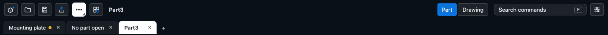

# Saving and opening

This chapter covers making, opening and saving parts, the recent list, what happens to unsaved work, automatic backups, several parts open at once in tabs, compressed files, and keeping the built geometry inside a file.

A part is saved as a `.ckpart` file. It is plain text (JSON) that holds the recipe of the part, its feature history, so it stays small and opens in any version that understands the format. See [File formats at a glance](formats.md) for what is inside.

## The file controls

New, Open, Save, Export and Library are buttons at the left of the top bar. The rest of the file actions are in the **More file actions** menu next to Export.

| Action | Where | Shortcut |
|---|---|---|
| New part | Top bar, first button | Ctrl+N (Cmd+N on a Mac) |
| Open | Top bar | Ctrl+O |
| Save | Top bar | Ctrl+S |
| Save as | More file actions | Ctrl+Shift+S |
| Save geometry in file | More file actions (a toggle) | |
| Recover earlier versions... | More file actions | |
| Import STEP / STL / OBJ / GLB / 3MF / SolidWorks / SketchUp | More file actions | |
| Export | Top bar | Ctrl+E |
| Library | Top bar | |

Some browsers reserve Ctrl+N and Ctrl+O for themselves; the buttons always work. The same actions are in the command search (press **F**). The name of the open part is shown in the top bar. Double-click it to rename the part. A dot after the name means there are changes since the last save.

## New

**New part** opens a blank part named Part1, Part2 and so on. If the current tab is still blank, the new part uses it; otherwise it opens in a new tab and the part you were working on stays open in its own tab.

## Open

**Open** shows the browser's file picker. It accepts parts (`.ckpart`, `.json`, and compressed `.gz` parts), STEP (`.step`, `.stp`), SolidWorks (`.sldprt`), SketchUp (`.skp`), DXF (`.dxf`), SVG (`.svg`), FreeCAD (`.FCStd`) and SolidCraft (`.solidcraft`) files. The app decides by the extension. What each foreign format becomes is described in [Importing](import.md).

You can also drag one file onto the window; a dashed overlay shows while you drag. Dropping more than one file at a time is refused ("Drop one file at a time."). A DXF or an SVG opens into the sketch you are editing, or as a new sketch on the front plane. STL files cannot be imported.

Files saved by earlier versions of the app still open, and are written in the current format the next time you save.

## Save and Save as

**Save** writes the part to the file it came from.

- In browsers that can overwrite files (Chromium-based ones), the first Save asks where to put the file and later Saves overwrite that same file.
- In other browsers Save downloads a file named after the part each time. Your browser decides where it goes.

**Save as** asks for a new file. In a browser with a file picker you get the picker. Otherwise a small dialog asks for the name; `.ckpart` is added for you and the dialog shows the name it will write. The dialog also has two boxes:

| Option | What it does |
|---|---|
| Compress (.gz, about 10 times smaller) | Writes `name.ckpart.gz`. See below. Shown only in the dialog (browsers without a file picker). |
| Keep the built geometry in the file | Stores the finished model in the file so it opens at once. See below. |

The name you give becomes the part name shown in the top bar, saved in the file and used by autosave. Cancelling a picker does nothing. A notice "Saved &lt;file&gt;" confirms a save, and a failure says why.

A saved file also holds a small preview picture of the part (used by the recent list) and the sheets of a drawing, exploded view and appearance of bodies if you made them. Display choices from the Display menu are not saved in the file.

## Unsaved changes

The app asks before it throws changes away.

- Closing a tab that has changes brings it up and asks **Save**, **Don't save** or **Cancel**. Save only goes on once the save really happened.
- Reloading or closing the browser window while any tab has changes shows the browser's own "leave this page?" prompt.
- Opening something does not discard the current part. It opens in a new tab (or in the current one when that is blank).

## Autosave and restore

While a part has unsaved changes, the app copies it into your browser's storage a moment after your last edit, and when you switch away from the page. If the page crashes or is closed, the next start offers **Restore your last session?** with three buttons:

- **Restore** brings back each changed part in a tab of its own, marked as changed. The tab that was active is shown again.
- **Start new** forgets the stored session.
- **Earlier versions...** opens the list described below.

The dialog does not close on Escape, so a stray key cannot discard it. Save, Open, Library and New clear the stored session.

Imported meshes and STEP data are stored compressed (see [Imported meshes and STEP data in the file](#imported-meshes-and-step-data-in-the-file)), so a part with a scan still fits. Limits: autosave skips a part whose text is over about 3 MB, and a notice tells you to save to a file. When only the packed meshes are too big for the browser's storage (about 2 MB of them), the backup leaves the meshes out, says so once, and keeps the rest; the STEP data of an imported solid is always kept. It also warns if the browser has no room or has autosave switched off. Undo history is not stored: a restored part starts with a clean history. Component tabs (see [Assemblies and mates](../assemblies/assemblies.md)) are not stored.

### Recover earlier versions

The app also keeps a rolling set of snapshots of the open part in the browser (the last ten, taken about every 30 seconds while you work, before each undo, before a large drop and before another part replaces this one). Choose **Recover earlier versions...** in More file actions, find the snapshot by time and feature count, and press **Restore**. The richest snapshot from the last day is always kept. Snapshots live only in this browser.

## Recent files and samples

**Library** opens a searchable list of parts (the sample parts and the libraries you added) with a **Recent** section above it: the last eight samples and files you opened or saved, with their age and a preview.

When you save a part, a small picture of it (a PNG of about 20 KB or less) is written into the file as an optional `thumbnail` field, together with a hash of the part. That picture is what the Recent card shows. If the part has changed since, the next save draws it again; a picture that does not match the part is never shown. If the picture cannot be drawn (no solid, or it takes too long), the file is saved without one. A file with a damaged `thumbnail` field still opens normally.

Clicking a sample opens it as a new part. Clicking a recent file reopens it if the browser still has permission for it. That works for files that you saved through the picker. A file that you opened with the plain Open dialog is listed but the browser kept no access to it, and a notice asks you to use **Open** again. If the permission is refused or the file is gone, the notice says so.

## Several parts in tabs

Parts open in tabs under the top bar. Each tab keeps its own history, selection, file, camera and unsaved-changes mark. The other tabs keep running quietly.

| Do | How |
|---|---|
| New part in a new tab | The **+** button on the tab strip, or Ctrl+Alt+T |
| Switch tabs | Click, or Ctrl+Tab / Ctrl+Shift+Tab |
| Jump to a tab | Ctrl+Alt+1 to 9 (9 is the last tab) |
| Close a tab | The cross on the tab, middle click, or Ctrl+Alt+W |
| Reorder | Drag a tab |
| See all open parts | The down arrow at the end of the strip (also shown when there are more than seven) |

Ctrl+Tab and Ctrl+W are reserved by browsers; in the installed app (see [Install as an app and work offline](../reference/pwa.md)) Ctrl+Tab works, and the Ctrl+Alt keys work everywhere. On a Mac use the Control key for these tab shortcuts.

You can have 32 tabs. Switching away from a sketch in progress finishes the sketch and keeps it; if it cannot be finished, it stays open and a notice says so. An open feature editor is closed when you switch. Closing the last tab leaves a blank part. The Drawing view closes when you switch tabs.

## Imported meshes and STEP data in the file

A reference mesh (an STL or SketchUp import) and the STEP text of an imported solid are the heavy parts of a file, so they are stored packed:

- **Meshes** are stored as one compressed block each: the vertices on a grid of at most one micron (finer for small models), written as differences between neighbours, the triangle corners as small numbers, the SketchUp colours as runs, then deflated. A 500,000 triangle scan is about 1.2 MB in the file, against about 12 MB for the raw numbers and about 24 MB for the same data as a JSON list of numbers. The rounding to a micron is the only loss: it is far below what a scan or a sketch resolves, and saving a mesh again does not move it further. A model with a value that cannot be put on a grid (not a number, or enormous) is stored exactly instead.
- **STEP text** is stored deflated, about eight times smaller than the text.
- Files written by earlier versions (meshes as plain base64, STEP text as plain text) open as they are and are packed the next time you save. A file saved by this version and opened in an older one loses its meshes and cannot rebuild the imported solid; nothing else is affected.
- A mesh that is damaged or cut off in the file is left out with a notice naming it; the rest of the part opens. A damaged STEP block leaves the imported-solid feature with an error that says its data is missing.
- Compression and decompression run in the browser's own streams, and the rest in slices of a few milliseconds, so a large part does not freeze the page. The picking tree of a big mesh is built in slices too.

## Compressed parts

A part is plain JSON and repeats itself a lot, so a file ending in `.gz` (for example `bracket.ckpart.gz`) is written compressed, roughly ten times smaller. Which control compresses depends on how the file is saved. In browsers without a file picker, Save as shows its own dialog: tick **Compress** there (a `.gz` you type in the name is stripped and the box decides). In browsers with a file picker (Chromium-based ones), Save as shows the browser's picker instead and there is no Compress box; name the file with a `.gz` ending (or choose the compressed type in the picker) and the app compresses by the name the file ended up with. Plain downloads also compress when the name ends in `.gz`.

Programs that read `.ckpart` as text (scripts, other tools) need the file decompressed first.

## Save the built geometry in the file

A large part takes a while to rebuild, and the app caches the finished view in the browser so the second open is instant. A file opened on another computer, or after the cache is cleared, would still rebuild. **More file actions > Save geometry in file** makes the file carry the finished view, so it shows the model and the tree about a second after you open it. The model still rebuilds behind it and replaces the view.

- It is a cache, never an input. If you edit the file elsewhere, or open it in a different build of the app, the stored view is ignored and the part rebuilds normally. Deleting the field is always safe.
- If the file carries a stored view that cannot be used, the app shows a short notice and rebuilds. The notice says which of four things happened: the part was edited after the view was stored, the view is from a different kernel build, the view has a format this version does not know, or it could not be read. A file with no stored view gives no notice.
- Files written by an AI agent through the MCP `export` tool with `cache: true` carry the same stored view.
- It makes files bigger. As a guide, a part with about 185,000 triangles adds about 3.4 MB of text to a recipe of about 2 MB. Combined with `.gz` it is smaller than without compression, but it does not compress as well as the recipe.
- It is off by default. The choice is remembered, and a file that was opened with its view keeps it when saved.
- Autosave never writes the view.

## Next

- [File formats at a glance](formats.md)
- [Importing](import.md) and [Exporting](export.md)
- [Install as an app and work offline](../reference/pwa.md)
- [Troubleshooting](../reference/troubleshooting.md)
