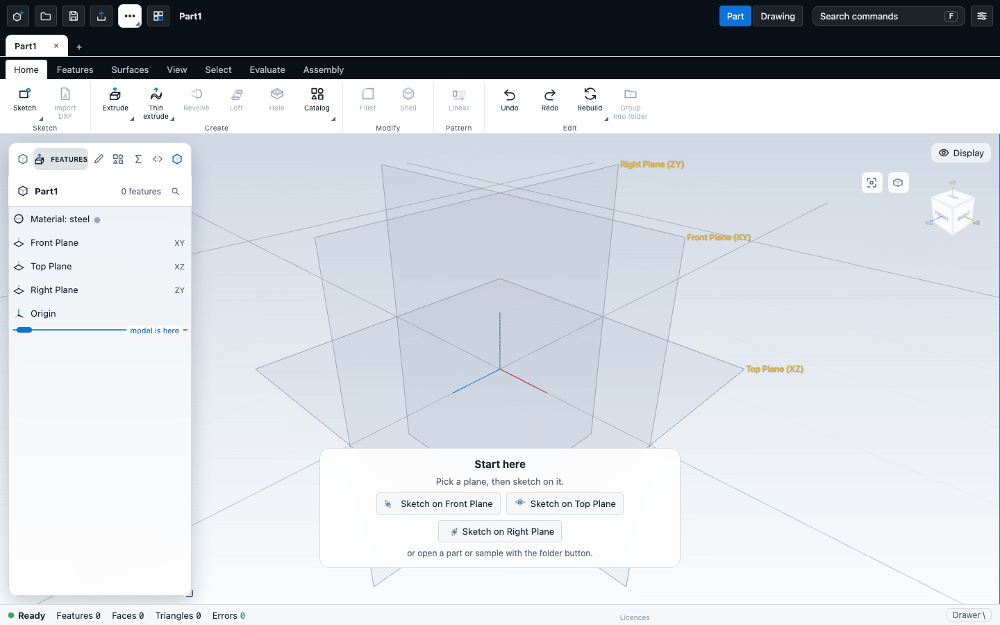
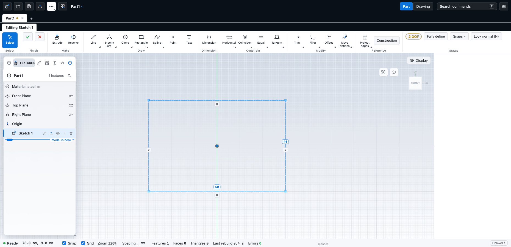
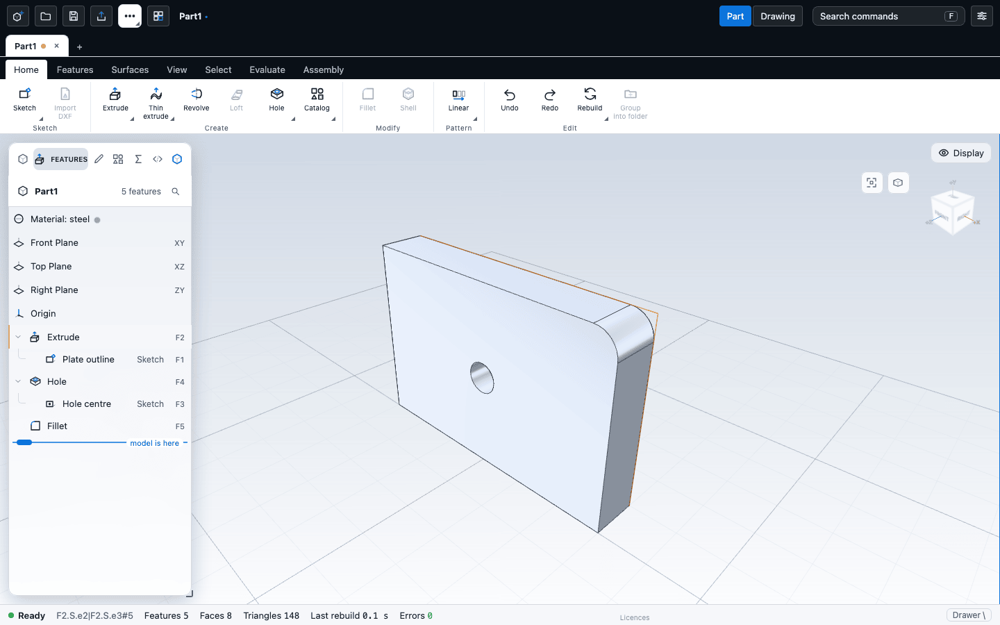

# Your first part

In this tutorial you build a small plate: you sketch a rectangle, give it dimensions, extrude it into a solid, drill a hole, round one edge and save the part. It takes about ten minutes and uses the main ideas of CadKit. The steps assume the application's default layout, with the ribbon along the top.

## 1. Start with a blank part

The application opens with a blank part called `Part1`, so you can start from it. If you have been working, click **New part** at the left of the top bar to get a fresh one (it is numbered `Part2`, `Part3` and so on). The shortcut `Ctrl+N` exists, but browsers often keep it for themselves, so it may not work in a normal browser tab; use the button.

A blank part shows a card titled **Start here** that says "Pick a plane, then sketch on it." It has three buttons: **Sketch on Front Plane**, **Sketch on Top Plane** and **Sketch on Right Plane**.

Double-click the part's name in the top bar to rename it.

## 2. Sketch a rectangle

1. Click **Sketch on Front Plane**. The ribbon is replaced by a single tab named **Editing New sketch**. The **Line** tool is already active.
2. If the view is at an angle, press `N` (or click **Look normal (N)**) to turn the view square to the sketch plane.
3. In the **Draw** group, click **Rectangle**, or press `R`.
4. Click once to place one corner, move the pointer away, and click again for the opposite corner. A rectangle appears, drawn in blue.

The blue colour means the shape can still move. The chip in the **Status** group counts the degrees of freedom that are left, for example `4 DOF`.

## 3. Dimension the rectangle

A dimension fixes a size. You will fix the width and the height.

1. In the **Dimension** group, click **Dimension**, or press `D`.
2. Click the bottom edge of the rectangle. A value box appears holding the length you drew.
3. Type `60` and press `Enter`. The edge is now exactly 60 mm and a dimension label is drawn beside it.
4. Click the left edge, type `40` and press `Enter`.

The rectangle's sides were already kept horizontal and vertical when you drew it. Two freedoms are left: where the rectangle sits on the plane. They do not matter for this tutorial, but you can remove them. Click **Fully define** in the **Status** group. CadKit adds the relations and dimensions it needs to pin the rectangle down and reports how many it added. The chip then reads **Fully defined** and the lines turn dark.

If a sketch does not behave the way you expect, see [When a sketch will not solve](../sketching/troubleshooting.md).

## 4. Extrude it

1. In the **Make** group of the sketch tab, click **Extrude**. This finishes the sketch and opens the **Extrude** editor in the left panel.
2. The solid appears as a preview. The defaults are **Add** (selected in the **Operation** control, next to **New body** and **Cut**), an end condition of **Blind** and a **Depth** of 10 mm. Leave them.
3. If the solid grew the wrong way, tick **Flip direction**.
4. Click the check mark (**Confirm**) at the top of the editor.

The ribbon returns to its normal tabs. In the feature tree you now see the Extrude, with its sketch tucked beneath it. Press `7` to look at the part from the **Iso** view, and `Z` to fit it in the window.

## 5. Add a hole

1. Press `Q` to choose **Face** selection.
2. Click the large flat face on one side of the plate. It lights up.
3. On the **Home** tab, in the **Create** group, click **Hole**, or press `Shift+H`.
4. A new sketch starts on that face with the **Point** tool active. Click once near the middle of the face to place the hole's centre.
5. Click the check mark in the **Finish** group (**Confirm sketch**), or press `Enter`.
6. The **Hole** editor opens. The defaults are **Simple**, size **M6**, fit **Normal** and end condition **Through**. The editor shows the resulting **Hole diameter**.
7. Click **Confirm**.

To move the hole later, double-click its sketch in the feature tree, change the point's position or dimension it from an edge, and finish the sketch again. For several holes see [Holes and threads](../modelling/holes.md).

## 6. Round an edge

1. Press `E` to choose **Edge** selection.
2. Click one of the four short edges of the plate, the ones that run across its thickness.
3. On the **Home** tab, in the **Modify** group, click **Fillet**, or press `Shift+F`.
4. The **Fillet** editor opens with a small radius (about 0.5 mm for this plate). Change **Radius** to `5`. Leave **Tangent chain** on.
5. Click **Confirm**.

The corner is now rounded. If you picked the wrong edge, click **Undo** in the **Edit** group, or press `Ctrl+Z`, and try again.

## 7. Save the part

1. Click **Save** in the top bar, or press `Ctrl+S`.
2. Your browser either asks where to put the file or downloads it. The file ends in `.ckpart`.

To save under another name, open **More file actions** (the three-dot button in the top bar) and choose **Save as**.

CadKit also keeps an automatic backup in the browser while you work. After a crash it offers **Restore your last session**. The backup is a safety net, not a replacement for saving to a file. See [Saving and opening](../files/files.md).

## What you did

Each step is a feature in the tree on the left: the sketch, the Extrude, the hole's point sketch and Hole, and the Fillet. Double-click any of them to reopen its editor and change a value. CadKit rebuilds everything after it. Try it now: open the Extrude's chevron in the tree to reveal its sketch, double-click the sketch to reopen it, double-click the `60` label, type `80`, press `Enter`, and finish the sketch. CadKit rebuilds the plate and every feature after it.

## Next

- [The interface](interface.md)
- [Moving around the model](navigation.md)
- [Selecting things](selection.md)
- [Starting a sketch](../sketching/start.md)
- [Extrude, revolve, sweep and loft](../modelling/solids.md)
- [Holes and threads](../modelling/holes.md)
- [Fillets, chamfers, shells and drafts](../modelling/edges.md)
