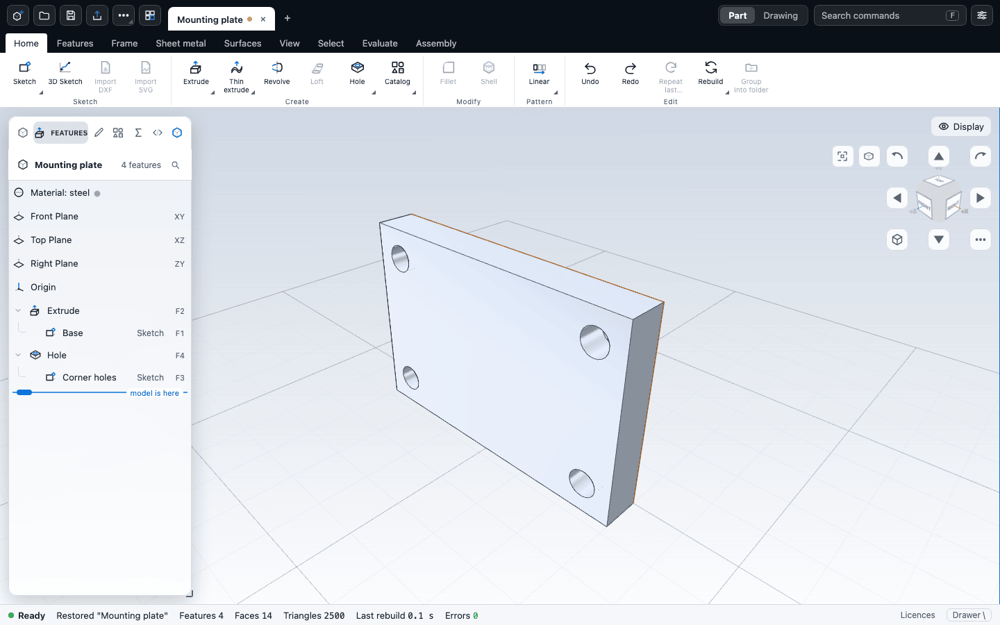
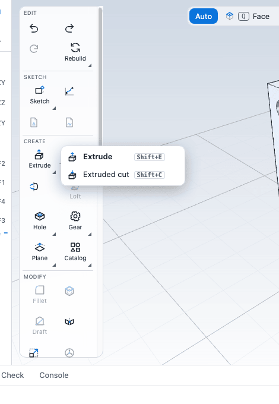

# The interface

This chapter is a tour of the CivilKit CAD window: the top bar, the ribbon, the feature tree and other side panels, the viewport, the status bar, the bottom drawer, command search, the Display menu and document tabs. It describes the default layout; [Units and settings](settings.md) shows how to rearrange it.

## Layout at a glance

From top to bottom:

1. The **top bar**: file buttons, the **document tabs** (one per open part), the Part / Drawing switch, command search and settings.
2. The **ribbon**: tabs of command groups, directly under it.
3. The working area: the **left panel** (feature tree and friends), the **viewport**, and the **inspector panel** on the right when a feature is selected.
4. The **drawer** (hidden until you open it).
5. The **status bar**.

All three side areas can be resized by dragging the thin handle between them and the viewport. Double-click a handle to reset it. Drag a panel to nearly nothing and it folds away. See [Units and settings](settings.md) for the layout presets and **Reset layout**.

## On a phone or tablet

The same app adapts to the screen. It chooses a layout from the window width and the pointer: a phone (narrower than 700 px, or a touch device whose short side is under 500 px), a tablet (narrower than 1100 px, or any touch device) or a desktop. Change it in **Settings > Layout > Screen layout** if the automatic choice is wrong for you; the choice is remembered, and your panel settings are not changed by it.

- **Phone.** The drawing takes the screen: one slim bar at the top and one bar at the bottom, nothing else. The top bar has the **file menu** (new, open, save, export, library ...), the **title** of the document (a dot after it means unsaved changes; tap it for the list of open documents and New part), **undo**, **redo** and **more** (search commands, Part or Drawing, rename, settings). The bottom bar has **Tools**, **Tree**, **Properties** and **Diagnostics**. **Tools** opens the ribbon as one strip just above the bar: the tabs as chips, then the tools of the chosen tab in a single row with their names that you scroll sideways; picking a tool, or tapping the drawing, closes it again. The tree, the properties (or the editor while you edit a feature) and the diagnostics open as **sheets** that share the screen with the drawing: the drawing shrinks to the room above the sheet and keeps its framing, so the model stays in view and updates while you change a value. A sheet that edits something rises to about 60% of the screen at most; the tree and diagnostics lists can go higher. Drag the handle at the top of a sheet to move it between its heights, drag it down to close it, or use its close button. When the on-screen keyboard is up the bars give way, and the sheet and the field you are typing in stay visible above the keyboard. Dialogs such as Samples and Settings fill the screen, and the Settings tabs scroll sideways.
- **Numbers on a phone.** Every number field opens the digit keypad with a Done key. Fields that take a formula or a variable have an **ƒ** key beside them that switches to the full keyboard (and **123** back), and a **±** key where the keypad has no minus. The label on the drawing (for example "Depth 20 mm") is a button too: tap it to type an exact value in place.
- **Sketching with a finger.** While a sketch tool is active, one finger belongs to the tool: press the first point (a circle's centre), drag to size the shape with a live preview and lift to place it, or tap, then tap, as before. Two fingers pan and pinch the sketch view. A circle dragged out this way is selected with its **radius** field focused, so you can type an exact size. A touch the system cancels, or a second finger that lands, drops whatever the first one began. The bar above the bottom bar has **Done**, **Cancel shape**, **Undo** and **Delete**, because a phone has no Enter, Escape or Delete key. Points are picked from twice as far as with a mouse.
- **Tablet.** One top bar row, the ribbon compact (tabs, then its tools) and the tree and the properties docked at the sides, as on a desktop but narrower. A single open document has no tab strip.
- **Touch on the model.** One finger orbits (or draws, with a sketch tool), two fingers pinch to zoom and pan, a tap selects. One finger dragging the view cube turns the model; a tap on a cube face, an edge or a corner snaps to that view. The arrow ring around the cube has finger-sized buttons (44 px): four arrows that turn the view a step (hold to keep turning), two roll arrows and **Home**. On a phone it is open by default, 160 px square in the top right corner so the middle of the drawing stays clear; its menu button (three dots) hides the arrows when you want the room, and sets the step size. See [Moving around the model](navigation.md). Putting a second finger down cancels whatever the first one began, so a pinch never selects or moves anything. Buttons are at least 44 px; the hide and suppress buttons of tree rows are always visible, since a finger cannot hover.

## The top bar

From left to right:

| Control | What it does |
| --- | --- |
| **New part** (`Ctrl+N`, which a browser tab may keep for itself) | Opens a blank part in a new tab, or in the current tab if that is still blank. |
| **Open** (`Ctrl+O`) | Opens a part file. |
| **Save** (`Ctrl+S`) | Saves the part. |
| **Export** (`Ctrl+E`) | Opens the Export menu. See [Exporting](../files/export.md). |
| **More file actions** | A menu with **Save as**, **Save geometry in file**, **Recover earlier versions…**, **Import STEP / SolidWorks / SketchUp**, **Import SketchUp with hidden geometry** and **Rotate imported model**. |
| **Library** | Opens the Library picker: the sample parts and the libraries you added. |
| Part name | Double-click to rename the part. A dot after the name means unsaved changes. |
| **Part** / **Drawing** | Switches the document between the model and its drawing. See [Drawings](../files/drawings.md). |
| **Search commands** (`F`) | Opens command search. |
| **Settings** | Opens the settings dialog. |

When a newer version of the application is available the bar shows a note with **Refresh** and **Later**. When your browser allows it, an **Install** button appears. See [Install as an app and work offline](../reference/pwa.md).

## Document tabs

On a desktop the open parts are tabs in the top bar, between the file buttons and the **Part** / **Drawing** switch. You can keep several parts open and switch between them without losing undo history.

- **+** opens a new blank part after the current tab.
- **×**, or a middle click, closes a tab. A tab with unsaved changes asks **Save**, **Don't save** or **Cancel**.
- Double-click the active tab to rename the part. Right-click a tab for **Rename**, **Close** and **Close the other tabs**.
- Drag a tab to reorder it. The **▾** button lists all open parts when the strip overflows.
- `Ctrl+Alt+1` to `Ctrl+Alt+9` jump to a tab (9 is the last), `Ctrl+Alt+T` opens a new part and `Ctrl+Alt+W` closes the current one. `Ctrl+Tab` and `Ctrl+Shift+Tab` step through the tabs, but browsers reserve them and they may not reach the page in a normal tab; they work in the installed app.
- Opening a file, a sample or an import uses the current tab if it is blank and a new tab otherwise.
- You can have at most 32 tabs.
- Switching tabs while a sketch is open finishes the sketch and keeps it.

Closing the browser page while any tab has unsaved changes makes the browser ask first.

## The ribbon

The ribbon is a row of tabs; each tab holds groups of buttons. Many buttons stand for a family of commands: the button shows the one you used last, and a small arrow, a long press or a right click opens the others. For example the **Extrude** button also holds **Extruded cut**.

| Tab | Groups |
| --- | --- |
| **Home** | **Sketch**, **Create**, **Modify**, **Pattern**, **Edit** |
| **Features** | **Reference**, **Create**, **Modify**, **Bodies** |
| **Frame** | **Frame** (**Frame** and **Cut list**) |
| **Sheet metal** | **Rules**, **Create**, **Flatten**, **Export** |
| **Surfaces** | **Create**, **Edit** |
| **View** | **Views**, **Display style**, **Appearance** (lighting, background and **Show**), **Workspace** |
| **Select** | **Pick**, **Expand**, **Position** |
| **Evaluate** | **Measure**, **Surface analysis** |
| **Assembly** | **Components**, **Review** |

The **Frame** tab is where the structural Frame tool lives: **Frame** builds a frame from a sketch of lines and a stock profile, and **Cut list** opens a drawing of it with the numbered pieces, the cut list and the bill of materials. On a phone the same tab is in the tool sheet.

The **Assembly** tab appears when the part contains inserted components, and opens by itself when you open an assembly.

Three things change the ribbon:

- **While a sketch is open** the ribbon shows one tab, named **Editing** followed by the sketch name. Its groups are **Select**, **Finish**, **Make**, **Draw**, **Dimension**, **Constrain**, **Modify**, **Reference** and **Status**. See [Starting a sketch](../sketching/start.md).
- **While a feature editor is open** the commands that create or change geometry are greyed out. Undo, Redo, view, selection and inspection commands stay available. Confirm or cancel the editor first.
- **A command that cannot run** is greyed, and its tooltip says why: for example **Fillet** says "Select edges, or two or more faces, to round".

The ribbon has two sizes, **Full** and **Compact**, and can be turned off, in which case you reach every command through command search. File commands are in the top bar, not on a ribbon tab.

## The tool rail

The tool rail is a column of tools down the left edge of the view: the modelling commands without the ribbon. It is off on a first visit. Turn it on with **Tool rail** in Settings > **Layout** (the presets set it: **Plasticity-style** has it on, **Classic ribbon** and **Minimal** leave it off).

- **Sections** run down the rail: **Edit**, **Sketch**, **Create**, **Modify**, **Frame**, **Surfaces**, **Pattern**, **Inspect**, **Assembly** and **Select**. A section that would be empty in this build is skipped.
- **One cell per family.** A cell shows the tool you used last from that family (the Extrude cell is fixed and always shows Extrude); the rest open from it with a long press, a flick to the right, a right click, or the triangle in its corner. The last tool is remembered per family and shared with the ribbon.
- **For selection** sits at the top while something is selected: the commands that apply to what is selected, most relevant first, in the order of the right-click menu among the commands that can run now; commands that cannot run move to the end. Its memory is per kind of selection, so the tools you used on a face come back when you pick another face.
- **Button labels** (Settings > Layout) switches the rail between **Icons and text** and **Icons only (label on hover)**, as it does the ribbon.

While a sketch is open the rail keeps **Edit** and, when the ribbon is off, gains the sketch sections (**Select**, **Draw**, **Dimension**, **Constrain**, **Modify**, **Reference**); with the ribbon on the sketch tools stay on the ribbon. See [Starting a sketch](../sketching/start.md).

File, export, camera and display commands have no cell on the rail: they stay in the top bar, on the View tab and in command search.

### Common problems

| Symptom | Fix |
|---| ---|
| There is no rail | It is off by default. Settings > **Layout** > **Tool rail** |
| A family opens a tool you did not want | The cell opens on the last tool of that family. Long press, right click or press the corner triangle to pick another |
| The rail is missing while sketching | With the ribbon on, only **Edit** is shown there; the sketch tools are on the ribbon. Turn the ribbon off to carry them on the rail |
| A command you look for is not on the rail | File, export, view, layer and display commands are not on it by design. Use the top bar, the View tab or command search (**F**) |

## The left panel

The left panel can be docked, floating over the viewport, or hidden. Press `[` to show or hide it. When tabs are on (the default) it has these tabs. They are icon buttons in a row at the top of the panel, in the order below; the name of each is its tooltip, and the active tab also shows its name.

| Tab | Contents |
| --- | --- |
| **Outliner** | The parts, mates and patterns of an assembly. |
| **Features** | The feature tree, described below. While a feature editor is open it takes this place. |
| **Editor** | The editor of the selected feature. |
| **Catalog** | Shapes and library parts to drop onto the model. See [Catalog parts](../library/catalog.md). |
| **Variables** | Named values and configurations. See [Equations and variables](../modelling/equations.md). |
| **Script** | A script box. See [Scripting](../automation/scripting.md). |
| **Bodies** | The bodies of the part, with colour, opacity and finish. See [Bodies and combining](../modelling/bodies.md). |

### The feature tree

The tree lists the history of the part in build order. At the top are fixed rows: **Material**, **Front Plane**, **Top Plane**, **Right Plane** and **Origin**. Below them is one row per feature. A sketch that a feature uses is tucked under that feature.

- Click a row to select it, Ctrl-click to add to the selection, Shift-click to select a range.
- Double-click a row to open its editor. Double-clicking a sketch reopens it for editing.
- Hover a row to see its buttons: **Select in viewport**, **Edit**, **Roll back to here**, the eye (**Hide (view only)** / **Show**), the pause button (**Suppress (rebuilds)** / **Unsuppress (rebuilds)**) and **Remove**.
- A failed feature is red with its reason underneath. Features that fail only because an earlier one failed are muted and say "blocked by" the cause.
- Drag the **model is here** marker to roll the model back to an earlier step. See [The feature tree and history](../modelling/history.md).
- Use the search box to find a feature by name, type or id.
- `F2` renames the selected feature, `Delete` removes it, `Ctrl+Shift+U` suppresses or unsuppresses it, and `Ctrl+G` groups several neighbouring features into a folder.

## The inspector panel

On the right, the inspector shows the properties of the selected feature as plain fields. It appears only while a feature is selected. The same fields are in the feature's editor. You can set it to **Off**, **Docked right** or **Floating** in the settings.

## The viewport

The viewport shows the model. Over it you find:

- The **view cube** in the top right corner, with its arrow ring (turn, roll, home) and the **Fit** and projection buttons under it. See [Moving around the model](navigation.md).
- The **Display** button (an eye icon), described below.
- The **selection list** at the bottom right when something is selected. See [Selecting things](selection.md).
- On-canvas handles: arrows and dots you can drag to change a depth, a fillet radius, a shell thickness or a hole diameter. They can be turned off in the settings.
- Notices and a busy indicator with a **Cancel** button when a rebuild takes long.

Right-click the viewport for a menu of the commands that apply to what is selected. With nothing selected it offers the three **New sketch** commands, **Extrude**, **Extruded cut**, selection commands and **Fit**.

If you turn on the **Selection mode bar** in the settings, a small bar appears at the top of the viewport with **Auto**, **Face**, **Edge**, **Corner**, **Body**, a **Box select** button and a filter button.

## The status bar

The status bar runs along the bottom.

| Item | Meaning |
| --- | --- |
| **Ready** / **Busy** | Whether the kernel is working. |
| Hover name | What is under the pointer. |
| Notices | The latest message, for a few seconds. |
| **Selected** | A summary of the selection, such as `3 faces, 12.4 cm²`. |
| **Features**, **Faces**, **Triangles** | Size of the part. |
| **Cached view** | Shown while the stored view of a part is on screen during a rebuild. |
| Design check chip | The result of the last design check. See [Design checks](../analysis/design-checks.md). |
| **Kernel** | Shown only when you use the local kernel service. Click it to open the kernel settings. |
| **Last rebuild** | How long the last rebuild took. |
| **Errors** | The number of failed features, in red when not zero. |
| **Drawer** | Opens and closes the drawer. |
| **Licences**, **Documentation** | Links to the licence list and to this guide, at the right end of the bar. |

In a sketch the bar also shows the pointer position on the sketch plane, the active snap, the **Snap** and **Grid** switches, the **Zoom** and the grid **Spacing**. Click **Spacing** to type a grid spacing; `0` or empty means automatic.

## The drawer

Press `\` or click **Drawer** in the status bar to open the drawer at the bottom of the window. It has five tabs:

| Tab | What it shows |
| --- | --- |
| **History** | Every edit as a step, with filters **All**, **You**, **Agent** and **Failed**. Click a step to go back to it. |
| **Diagnostics** | Why a failed feature failed and what to try. See [Checks and diagnostics](../analysis/checks.md). |
| **Inspect** | Measure, mass properties, section view and interference. See [Measure and inspect](../analysis/measure.md). |
| **Check** | Design rule checks. See [Design checks](../analysis/design-checks.md). |
| **Console** | Recent messages. |

Badges on the tab names count entries; red means problems.

## Command search

Press `F`, or click **Search commands**, to search every command by name, group or tab. Type a few letters, move with the arrow keys, press `Enter` to run the highlighted command and `Esc` to close. Greyed commands cannot run in the current state. Before you type, the search offers a short list of pinned commands: **Iso**, **Fit**, **Undo**, **Redo**, **Samples** and **Workspace settings**.

Command search is the one place that lists everything. If you cannot find a button, search for it. [Commands and shortcuts](../reference/commands.md) lists the commands and their keys.

## The Display menu

The **Display** button in the viewport opens a panel with these sections:

- **Style**: **Shaded**, **Shaded with edges** (the default), **Wireframe**, **Hidden lines removed** and **Ghost**, with an opacity slider for Ghost.
- **Appearance**: a colour and a material finish for the part, or for the selected component of an assembly.
- **Scene**: lighting presets **Studio**, **Flat**, **High contrast** and **Technical**, **Light strength**, and **Reflections**.
- **Edge width** and **Silhouette outline**, and the **Background**.
- **Surface analysis** options. See [Surfaces](../modelling/surfaces.md).
- **Show**: switches for **Edges**, **Sketches**, **Curves**, **Planes**, **Axes**, **Grid**, **Relations**, **Overall size**, **Threads** and **Design issues**.
- While a sketch is open, a **Sketch** section with **Dimensions**, **Relation glyphs**, **Reference dimensions**, **Colour by definition** and **Constraints panel**.

These settings change only how the part looks. They are never written into the part's geometry.

## Next

- [Moving around the model](navigation.md)
- [Selecting things](selection.md)
- [Units and settings](settings.md)
- [Commands and shortcuts](../reference/commands.md)
