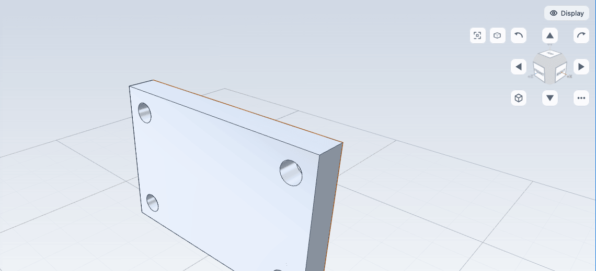

# Moving around the model

This chapter covers how to orbit, pan and zoom the 3D view, how to jump to standard views with the view cube, the number keys and the ribbon, how to switch between perspective and parallel projection, and how the display styles help you see what you are doing. None of this changes the part: navigation and display settings only move the camera and change how the model is drawn.

## Mouse and keyboard

In the model view:

| To do this | Do this |
| --- | --- |
| Orbit | Drag with the left or the middle mouse button. |
| Pan | Drag with the right mouse button, or `Shift` + middle button. |
| Zoom | Scroll the wheel, or hold `Ctrl` and drag with the middle button (drag up to move in). |
| Orbit in steps | Press the arrow keys. Each press turns the view 15 degrees. |
| Pan in steps | Press `Alt` + an arrow key. |
| Fit the model | Press `Z`. |
| Open the context menu | Right-click without moving. |

The arrow keys work when the focus is on the viewport or the page, not in a text field or a panel, and not while a sketch is open.

### In a sketch

While a sketch is open the left button is used for drawing and picking, so the other buttons navigate:

| To do this | Do this |
| --- | --- |
| Orbit | Drag with the right mouse button. |
| Pan | Drag with the middle mouse button. |
| Zoom | Scroll the wheel. The view zooms towards the pointer, so you can reach a small detail without panning first. |
| Square the view to the sketch plane | Press `N`, or click **Look normal**. |

## The view cube

The view cube sits in the top right corner of the viewport and follows the camera. It is a chamfered cube labelled **RIGHT**, **LEFT**, **TOP**, **BOTTOM**, **FRONT** and **BACK**, with coloured arms for the +X, +Y and +Z axes. It has 26 targets, and the one under the pointer (or under your finger while you press) lights up in the accent colour:

- Click a **face** to look at the model from that side.
- Click an **edge** (the bevel between two faces) to look from 45 degrees between those two sides.
- Click a **corner** (the small triangle where three faces meet) for an isometric-style view from that corner.
- Drag the cube to orbit the model.

Around the cube are the **arrow ring** buttons, in four groups you can switch on or off (see the menu below). On a phone only the left and right arrows are on to begin with, which keeps most of the drawing clear; a tablet and the desktop start with all four groups.

| Button | What it does |
| --- | --- |
| Four triangles (left and right: **Turn left/right**; up and down: **Turn up/down**) | **Turn the view** one step. The model moves the way the arrow points, as it does when you drag that way: the right arrow brings the model's left side towards you. Click and hold to keep turning. |
| Two curved arrows at the top corners (**Roll**) | **Roll the view** clockwise or counter-clockwise about the direction you look. Click and hold to keep rolling. |
| Home (bottom left; **Home**) | The isometric view of the whole model. |
| Menu (bottom right, three dots) | The checkboxes **Turn left/right**, **Turn up/down**, **Roll** and **Home** switch each group on or off (a group that is off takes no room; with all four off only the cube and the menu button remain); **Step** sets how far one click turns the view (15, 30, 45 or 90 degrees, 90 by default). **Look normal** is here too while a sketch is open. The groups and the step are kept for this browser. |

From a face view, four 90 degree steps in the same direction come back to where you began. From an edge or corner view, left and right keep the tilt of the view and turn it to the next side; up and down tilt the view and stop on the Top or Bottom view rather than turning the model upside down. Once the view is rolled, or on Top or Bottom, the arrows turn about the screen's own axes. Dragging the cube or the model orbits from wherever the view is and takes the roll out again.

Turning, snapping and Home are animated; with the system setting for reduced motion they jump.

The **Fit** and projection buttons sit under the ring (beside it on a narrow canvas of a desktop window). The cube, the ring and these buttons are laid out so they never cover each other or the selection readout.

## Standard views

The number keys jump to the standard views. They work when the focus is not in a text field and no sketch tool is using the keys.

| Key | View |
| --- | --- |
| `1` | **Top** |
| `2` | **Front** |
| `3` | **Right** |
| `4` | **Back** |
| `5` | **Left** |
| `6` | **Bottom** |
| `7` | **Iso** |
| `Z` | **Fit** (the whole model fills the window) |

The same commands are in the **Views** group of the **View** tab, and in command search. The **Views** button shows the view you used last.

The standard views follow the camera's up axis, not the names of the reference planes. By default Y is up. With Z up, **Top** looks down onto the XY plane. See below to change it.

## Perspective and parallel projection

Click the projection button under the view cube's arrow ring, click **Projection** in the **Views** group of the **View** tab, or press `P`, to switch between a perspective view and a parallel (orthographic) one. In a sketch, `P` is the **Project edges** tool instead; use the button there.

## Up axis, orbit mode and orbit centre

Open **Settings** and choose the **Navigation** tab (or click **Up axis** on the **View** tab to switch the up axis quickly).

| Setting | Choices | What it does |
| --- | --- | --- |
| **Up axis** | **Y up (SolidWorks style)** (default), **Z up (Onshape, Fusion, Blender style)** | Which axis points up on screen. It turns the camera, the ground grid and the view cube. |
| **Orbit mode** | **Turntable (no roll)** (default), **Trackball (free rotation)** | Turntable keeps the up axis upright and stops just short of the poles. Trackball rotates freely and can roll or go over the pole. |
| **Orbit around** | **Model centre** (default), **Point under the cursor**, **Selection** | The point the camera turns about. With **Point under the cursor** the pivot is the point of the model under the pointer when you start the drag. With **Selection** it is the middle of the selected faces or edges. |

The up axis changes only the camera. Parts, sketches, reference planes and exported files are exactly the same on either setting, and a part saved with one opens correctly with the other.

## Display styles while you work

Display styles do not move the camera, but they decide what you can see.

| Style | Shortcut | Good for |
| --- | --- | --- |
| **Shaded** | `Alt+1` | A clean look without edge lines. |
| **Shaded with edges** | `Alt+2` | The default. |
| **Wireframe** | `Alt+3` | Seeing through the part. Hidden edges are drawn faint. You can still pick faces. |
| **Hidden lines removed** | `Alt+4` | A drawing-like view. |
| **Ghost** | `Alt+5` | A translucent part, so you can see sketches and features inside. An opacity slider appears in the Display menu. |

Choose a style in the **Display style** group of the **View** tab, in the **Display** menu on the viewport, or with the shortcut. Picking and hover work in every style.

To hide the body of the selected faces, or the selected sketch, plane or curve, press `H`. Press `Alt+H` to show everything again. This changes the view only and is not saved. To hide one feature from the tree, use the eye button on its row. The **Show** switches in the Display menu hide whole kinds of things, such as **Planes**, **Axes** or **Sketches**. See [The interface](interface.md).

The lighting presets (**Studio**, **Flat**, **High contrast**, **Technical**) and the background (**Theme**, **Light**, **Dark**, **Gradient**) are in the **Appearance** group of the **View** tab.

## Tips

- If you lose the model, press `Z` to fit it.
- If you are used to a program where Z points up, set **Up axis** to **Z up** so the standard views and the orbit feel familiar.
- Double-click a face to select the feature that made it and open that feature's editor. Alt+click selects the whole body. See [Selecting things](selection.md).

## Next

- [Selecting things](selection.md)
- [Units and settings](settings.md)
- [Starting a sketch](../sketching/start.md)
