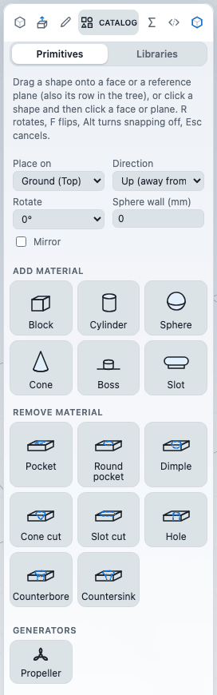

# Catalog parts

The Catalog holds ready-made shapes that you drop onto your model: plain primitives (blocks, holes, pockets) and parametric parts (cuboids, tubes, tori, edge rounders and more). This chapter covers how to place one, what its parameters mean, and how to edit the result.

Dropping a catalog item does not paste a mesh. It adds real sketches and features (extrudes, lofts, revolves, fillets) to your part, so you keep editing it in the feature tree, in the Variables panel and with the size box, like anything you modelled by hand.

## Open the Catalog

Run the **Catalog** command: key **Shift+K**, ribbon **Home** tab, **Create** group (it shares a button with **Variables** and **Script**). The Catalog tab of the left panel opens. It needs an open document.

It has two tabs:

- **Primitives**: six ready shapes that add material and eight that remove it, plus a **Generators** block with the **Propeller** wizard (see [Parametric wizards](wizards.md)).
- **Libraries**: one searchable list that holds the parametric parts described below, the bundled samples and any libraries you added. See [The library and samples](library.md).

## Placing a catalog item

You can drag or click.

**Drag**
1. Press on a card and move over the model. A label follows the pointer, naming the shape, the face under it and any snap. The part turns translucent and shows the real result, rebuilt as you move.
2. Release over the model to drop it. Release anywhere else, or press **Esc**, to cancel. Nothing is written until you drop.

**Click to place**
1. Click a card. It stays highlighted.
2. Move over a face and click. Press **Esc** or click the card again to put it down.

While you place:

| Key | Effect |
| --- | --- |
| **R** | Rotate 90 degrees. |
| **F** | Flip to the other side. |
| **Alt** | Turn snapping off. |
| **Esc** | Cancel. |

Snapping applies on flat faces. Within 14 screen pixels the shape snaps to a corner, a circle centre (a hole rim), an edge midpoint or a face centre. The label names which.

One drop is one undo step.

### Where it goes

- **On a face:** the shape sits flat on the face under the pointer. Primitives work on curved faces too: they get a tangent plane at the picked point. Parametric parts need a **flat** face. On a curved face you get "Parts library shapes need a flat face".
- **On a plane:** drop on a reference plane drawn in the viewport, on its row in the feature tree, or on a plane feature. A face under the pointer wins over a plane.
- **On empty space:** with no body yet, the shape becomes the first body on the ground plane (Top for Y up, Front for Z up). Once a body exists, empty space is not a target.
- **Cuts and edge rounders need a body.** Their cards are dimmed until there is one, and dropping gives "Nothing to cut yet: drop a block first".

### The Placement row

The **Placement** row sets how the next shape stands. It is always visible on the Primitives tab and in a collapsed **Placement** section on the Libraries tab.

| Control | What it does |
| --- | --- |
| **Place on** | **Ground** (the default, named for your up axis), **Front**, **Top** or **Right**. A plane you hover or drop on overrides it. |
| **Direction** | **Up (away from the plane)** or **Down (flipped)**. |
| **Rotate** | 0, 90, 180 or 270 degrees. |
| **Sphere wall (mm)** | Wall thickness of the next Sphere primitive. 0 makes a solid sphere, a larger value makes it hollow. |
| **Mirror** | Mirrors the shape. |

On a face the shape has its own frame, so Rotate, Mirror and Direction do not apply there.

## Primitives

| Adds material | Removes material |
| --- | --- |
| **Block**, **Cylinder**, **Sphere**, **Cone**, **Boss**, **Slot** | **Pocket**, **Round pocket**, **Dimple**, **Cone cut**, **Slot cut**, **Hole**, **Counterbore**, **Countersink** |

Sizes are picked for you: 40 % of the smaller side of the face, rounded to a neat number (30 mm for the first body). Adding shapes are as tall as they are wide. Cutting shapes go half as deep, never more than half the part's thickness. Holes go through the part, with an ISO size matched to the face.

| Shape | What it makes |
| --- | --- |
| Block, Pocket | A sketched rectangle, extruded or cut. |
| Cylinder, Boss, Round pocket | A sketched circle, extruded or cut. |
| Cone, Cone cut | A circle extruded with a draft that tapers the radius to a fifth. |
| Slot, Slot cut | A rounded-bar sketch, extruded or cut. |
| Sphere, Dimple | The first body gets a whole sphere. On a part, a hemisphere that sits on the face. |
| Hole, Counterbore, Countersink | A point sketch and a through hole. |

A sphere on a face is a hemisphere on purpose. A whole sphere fused to a flat face does not mesh correctly in the current kernel.

After a drop, the shape is selected and shows its size box: drag a handle to resize, or drag the centre pad to move it. Hold **Alt** to skip snapping while you move.

## Parametric parts

On the **Libraries** tab, the cards marked **Included** in the library named **BOSL2 parts** are parametric. The app builds each one as exact geometry (cylinders, cones, spheres and tori are true surfaces, not polygon meshes). The detail panel names the source and licence of each part.

Use the **Category** menu to filter: **Blocks**, **Cylinders**, **Round**, **Profiles**, **Edge masks**. The search understands everyday words: "pipe" finds Tube, "hexagon" finds Regular prism, "ramp" finds Wedge, "donut" finds Torus, and "printable hole" finds Teardrop. Matches from this set appear first.

### Setting parameters

Click a card to select it. A form opens under the list with one field per parameter, each with its unit. A `*` next to a label means the value becomes a document variable. **Reset** returns the form to its defaults.

If a combination is not valid, the form says "Check the values:" with the reason, and the card cannot be placed until you fix it.

Then drag the card or click it and then a face. While you drag, the real features are previewed using the form values. The drop commits them, with any variables, as one undo step.

Under the form, a **Script** section shows the exact script that will be added. It is the same text that runs. See [Scripting](../automation/scripting.md).

### Parameters shared by many parts

| Parameter | Choices or range | Meaning |
| --- | --- | --- |
| **Operation** | **Add material** (default) or **Cut into the part** | Available on Cuboid, Cylinder / cone, Tube, Rectangular tube, Pie slice and Regular prism. A cut goes into the part from the picked face and needs a body. |
| **Origin** | **Bottom on the face** (default) or **Centred** | Bottom puts the base on the face. Centred puts half the shape into the part. |
| **Rounding radius** and **Chamfer** | 0 up to the limit for the shape | Round or chamfer edges. Only one of the two can be non-zero. A cut cannot be rounded or chamfered. |

### The parts

| Part | Category | Parameters (default, range) | Notes |
| --- | --- | --- | --- |
| **Cuboid** | Blocks | Length X 40 (1-200), Width Y 30 (1-200), Height Z 20 (1-200), Rounding 0 (0-50), Chamfer 0 (0-50), Origin, Operation | Rounding or chamfer applies to all twelve edges and must be under half the smallest side. |
| **Prismoid** | Blocks | Base X 40, Base Y 30, Top X 20, Top Y 15, Height 25, Top shift X 0, Top shift Y 0 | A rectangle-to-rectangle taper. No rounding or chamfer. Add only. |
| **Wedge** | Blocks | Length X 30, Width Y 20, Height Z 15 | A right-triangle prism. Add only. |
| **Rectangular tube** | Blocks | Height 30, Length X 30, Width Y 20, Wall 3 (0.2-40), Origin, Operation | The wall must be less than half the smaller side. |
| **Cylinder / cone** | Cylinders | Height 30, Base diameter 20, Top diameter 20 (0.5-200), Rounding, Chamfer, Origin, Operation | Equal diameters give a cylinder. Different diameters give a cone. Only a cylinder can be a cut. |
| **Tube** | Cylinders | Height 30, Outer diameter 30, Inner diameter 22, Origin, Operation | The inner diameter must be at least 0.2 mm smaller than the outer. |
| **Pie slice** | Cylinders | Height 10, Diameter 40, Angle 60 (5-350), Origin, Operation | A sector of a cylinder, with its apex at the origin. |
| **Regular prism** | Cylinders | Sides 6 (3-24), Height 20, Radius 15 (to the corners), Flat at start off, Rounding, Chamfer, Origin, Operation | Hexagon, octagon and so on. A corner points along +X unless **Flat at start** is ticked. |
| **Sphere** | Round | Diameter 30, Origin | An exact sphere. |
| **Torus** | Round | Major radius 15, Minor radius 4, Origin | The minor radius must be smaller than the major. |
| **Teardrop** | Profiles | Length 20, Radius 5, Angle 45 (20-80), Cap height 0 | A circle plus a pointed cap, extruded in both directions. Cap height 0 gives a pointed tip. See the note below. |
| **Onion** | Profiles | Radius 15, Angle 45, Cap height 0 | A sphere with a conical hat. |
| **Round face edges** | Edge masks | Radius 3 (0.5-8) | Rounds every edge of the face you pick. Needs a body. |
| **Chamfer face edges** | Edge masks | Chamfer leg 3 (0.5-8) | Chamfers every edge of the face you pick. Needs a body. |

Lengths and diameters are in millimetres. A cap height above 0 must be at least the circle's tangent height, or the form reports it.

The Teardrop form's note suggests using it as a cut for a printable horizontal hole. The part itself adds material only: it has no **Operation** choice, so it cannot be used as a cut at present.

### What gets created and how to edit it

Take a Cuboid with a Rounding of 3 dropped on a face. The app adds a variables block, a sketch of the rectangle on the face, an extrude, and a fillet. The rounding and height are variables with a unique prefix, such as `cuboid1_`, `cuboid2_` for the next drop.

- **Variables** link only to feature parameters: extrude depth, fillet radius, chamfer distance and loft offsets. Change them in the **Variables** tab and the part regenerates.
- **Sizes drawn into a sketch** (a width, a diameter, an angle) are plain numbers in the sketch. Change them by editing the sketch, with the size box, or in the script. Editing a variable does not change them.
- On a face, fillets and chamfers leave the footprint edges alone, so a rounded boss merges with the face instead of filleting the junction.
- Spheres, tori, onions and rounded cones are revolved shapes. On a face the app adds a hidden helper sketch and a perpendicular plane, which are listed in the tree but hidden in the view.
- On the ground, the base sits on the plane and the shape rises away from it.

### Limits

- Parametric parts need a flat face. Primitives handle curved faces; parametric parts do not.
- Edge rounders act on every edge of the picked face. You cannot pick a subset of edges. For that, use Fillet or Chamfer.
- Only two anchors are offered, bottom and centre. There are no spin, orient or named anchors. Rotate the part, or place it on another face.
- A cuboid chamfer leaves the corner where three chamfers meet as the kernel builds it, with no extra trimming cut.
- Some options are not offered: choosing a subset of edges on a cuboid, rounding or chamfering a prismoid, rounding a tube, and mesh-style spheres.
- Cut mode is not available for Prismoid, Wedge, Sphere, Torus, Teardrop or Onion.
- Curves are exact, so there is no facet-count setting.
- Rotate and Mirror in the Placement row do not apply to revolved shapes.

## Credits

The parametric parts are ported from BOSL2, an OpenSCAD library, used under the BSD 2-Clause licence.

## Next

- [The library and samples](library.md)
- [Parametric wizards](wizards.md)
- [Equations and variables](../modelling/equations.md)
- [Scripting](../automation/scripting.md)
- [The feature tree and history](../modelling/history.md)
