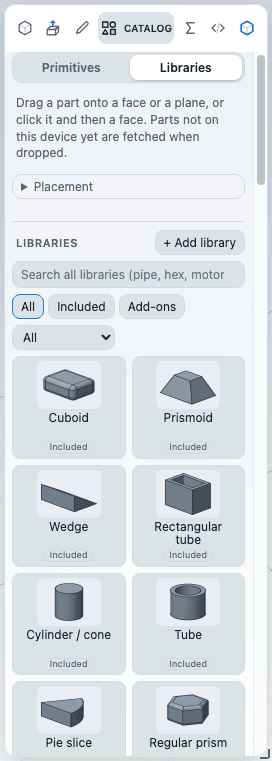

# The library and samples

This chapter covers the bundled sample parts, the Libraries tab of the Catalog (parts you can drop into a model), how to add libraries of your own, and how licences and thumbnails work.

## Samples

Samples are complete example parts that ship with the app. Use them to see how a feature is built or as a starting point.

1. Click the **Samples** button in the top bar (the icon right of the file menu), or press **F** to open command search and type "samples".
2. Type in the filter box to narrow the list. Every word must appear in the sample's title or id. The filter text is kept when you close and reopen the dialog.
3. Click a sample. It opens as a new document. If the current document has unsaved changes, the app asks first what to do with them.

When the filter box is empty, the dialog also lists your recent files and samples above the list, newest first. Press **Esc** or **Close** to leave the dialog.

A sample is an ordinary part. Edit it, save it under a new name with **Save as**, and the sample itself is never changed.

## The Catalog and its two tabs

Parts you drop into a model live in the **Catalog** panel. Open it with the **Catalog** command (key **Shift+K**; ribbon: Home tab, Create group), or open the Catalog tab of the side panel. The Catalog needs an open document; with none, it says "Open a part to use the catalog."

The Catalog has two tabs:

- **Primitives**: plain shapes (block, cylinder, hole and so on) that you drop onto faces. See [Catalog parts](catalog.md).
- **Libraries**: one searchable list of parametric parts, bundled samples, and the libraries you have added.

Each library entry is a card with a picture, a name and a mark:

| Mark | Meaning |
| --- | --- |
| **Included** | Ships with the app: the parametric catalog parts and the bundled samples. |
| **Add-on** | Comes from a library you added. |

Add-on cards also show a cloud icon while the part is not stored on your device, and **Installed** once it is.

### Finding a part

- The search box covers every library at once: title, id, category and tags. Type several words and every one must match.
- The chips **All**, **Included** and **Add-ons** limit the list by origin.
- The **Category** menu limits it to one category.
- The list shows 60 cards at a time; choose **Show more** for the next page.

## Putting a part in your model

There are two ways to bring a library part into the open document, and they differ in where the part ends up.

### Drag it where you want it

Drag a card onto the model. A translucent preview follows the pointer and shows the real result. Release to drop it; release off the canvas or press **Esc** to cancel and nothing is written.

You can also click a card, then click a face. Hold **Alt** to turn snapping off.

Where it lands:

- On a face, the part stands on that face, with its own up direction along the face normal. The drop point becomes the part's origin.
- On a datum plane, a plane row in the feature tree, or empty ground, it goes onto that plane at the pointer. The first body goes on the ground plane.
- The **Placement** row applies in part. **Direction: Down** hangs the part below the plane (ground and plane drops only). **Rotate** turns the part about the plane normal when you drop it on a plane or the ground. On a face, Rotate has no effect because it would turn the body the part stands on; the app tells you the part keeps its orientation. **Mirror** is not applied to library parts.

The drop is one undo step. The part's variables are given a unique prefix so they do not collide with yours, and its feature ids are renumbered.

If the part is not stored on your device, the app fetches it first, shows a "Fetching..." spinner, and checks it. If the fetch fails you get an error message and nothing changes.

### Insert at the part's own origin

Click a card to select it. The detail panel shows the library, licence, category, tags and size, with links to the part and library pages, and four buttons:

| Button | What it does |
| --- | --- |
| **Insert** | Adds the part to the open document at its own origin, as one undo step. Disabled when no document is open. |
| **Open as new document** | Opens the part as a new document, with its provenance recorded. |
| **Download** | Saves the part as a `.ckpart` file on your computer. |
| **Install** | Keeps the part on this device so it works offline. Shown only for add-on parts that are not installed yet. |

Use **Insert** when you want the part exactly where it was designed. Use a drag when you want to choose the place.

### Inserting versus opening

| | Insert or drop | Open as new document |
| --- | --- | --- |
| Result | The part's features join the open document | A new document holding only the part |
| Undo | One step | Not applicable |
| Variables | Prefixed, so they never collide | Kept as they are |
| Appearance (colours, body names, saved view) | Not carried over | Kept |

Both record where the part came from. The Libraries tab lists, under "Parts from libraries in this document", each inserted part with its library and licence. An inserted part that you undo drops out of the list.

### When a part stays at its origin

The app moves a dropped part only when it can do so safely. In these cases it leaves the part at its own origin and tells you why:

- The target face is curved.
- The part is drawn on several different standard planes, or on planes derived in ways other than an offset.
- The part uses fixed directions of the document, such as a pattern along a world axis.
- The part is an assembly (it holds inserted components and mates).
- You dropped it on a plane feature and the part refers to edges.

If you need a different orientation on a face, drop or insert the part and then move it with the [move / rotate ball](../modelling/transforms.md).

## Adding a library

You can add a library from a GitHub repository, a web address, or a folder on your computer. A library is data only: part files and a list. Nothing downloaded from a library is ever run.

1. On the Libraries tab, choose **+ Add library**.
2. Enter one of:
   - `github:owner/repo`, optionally with `@branch-or-tag` (for example `github:owner/repo@v1.0`).
   - The `https` address of a `library.json` file.
   - **Pick a folder...** and choose a folder that holds a `library.json` and the part files it lists.
3. Choose **Fetch**. The dialog shows the library name, the number of parts, its licence, and how many parts have no picture.
4. If the licence needs confirmation, tick **I understand this licence applies to parts taken from this library**.
5. Choose **Add library**.

Notes:

- Only `https` addresses are accepted. Addresses that redirect to a non-HTTPS address are refused.
- GitHub libraries are read from the repository's public files. Private repositories are not supported.
- A branch can move. Give a tag or a commit when you want a fixed version. Each part's checksum is checked either way, and a part that does not match its listed checksum or size is refused.
- A folder library is remembered only through the copy saved when you added it. To refresh it, add the folder again.

### Managing libraries

Expand **Manage libraries** under the list. Each library has a row with its mark, part count, licence and a link to its page. For add-on libraries:

- **Refresh** fetches the list again.
- **Remove library** removes it and its saved files from this device.

Without a network, the saved list and the parts you installed keep working, and an **offline** badge appears on the library.

### Installing for offline use

Choose **Install** on a card (it appears on hover) or in the detail panel. The part is downloaded, verified and kept on your device (in the browser's storage). Dropping or inserting a part also saves it. See [Install as an app and work offline](../reference/pwa.md).

## Licences

Every library, and optionally each part, states a licence. The app compares it with a list of permissive licences (MIT, BSD, 0BSD, Apache-2.0, ISC, CC0, CC-BY, OFL, Unlicense, Zlib and combinations of only these).

For any other licence, or none at all, the app asks you once per library and licence to confirm before you use a part: "parts taken from this library may carry its terms." Your choice is remembered on this device and is never written into documents. This is a notice, not legal advice. Check a library's terms yourself before you use its parts in a product. The bundled samples are never asked about.

## Thumbnails

Each card has a picture:

- The parametric catalog parts and the bundled samples have pictures prepared in advance.
- Add-on parts use the picture the library lists.
- A part with no picture gets one drawn on your device once it is installed, in the background when the browser is idle. Until then, and for parts that are not installed, the card shows a placeholder with its category icon.

A library without pictures still works. It only looks plainer.

## Limits

- Mirror does not apply to library parts, and Rotate and Direction apply only to drops on a plane or the ground, not on a face.
- A part drawn on several planes, or tied to fixed world directions, cannot be moved when dropped. It lands at its own origin.
- Appearance is not carried into the document on Insert. Open the part as a new document to keep it.
- There is no download progress bar; a spinner shows while a part is fetched.
- No GitHub token support, so no private repositories.
- Parts that cannot be fetched while offline give "This part is not saved on this device and there is no network."

## Next

- [Catalog parts](catalog.md)
- [Parametric wizards](wizards.md)
- [Install as an app and work offline](../reference/pwa.md)
- [Saving and opening](../files/files.md)
