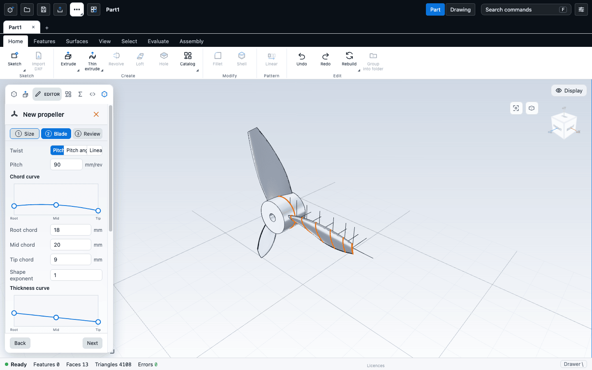
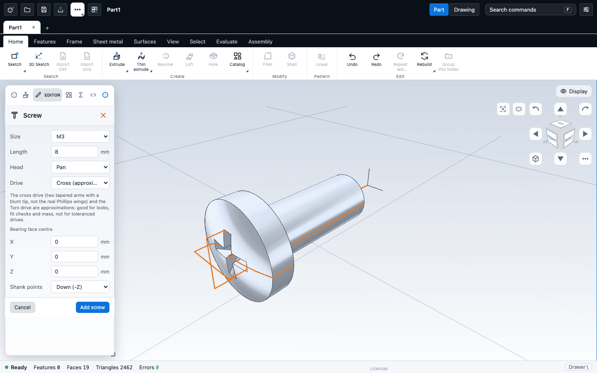
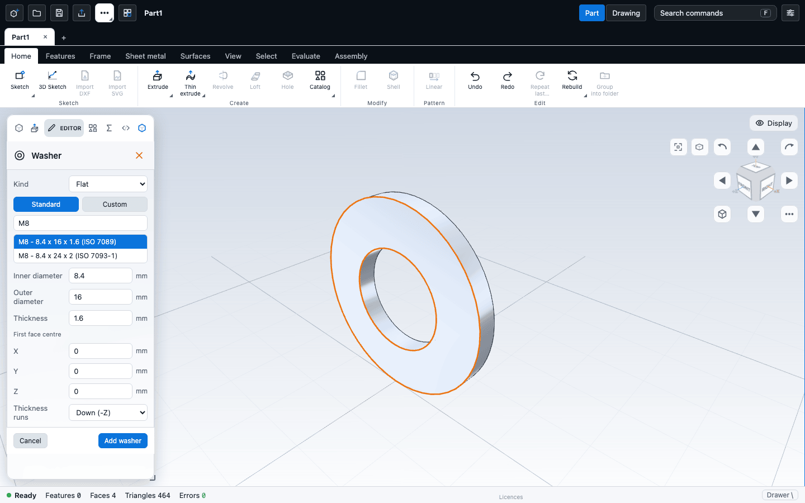
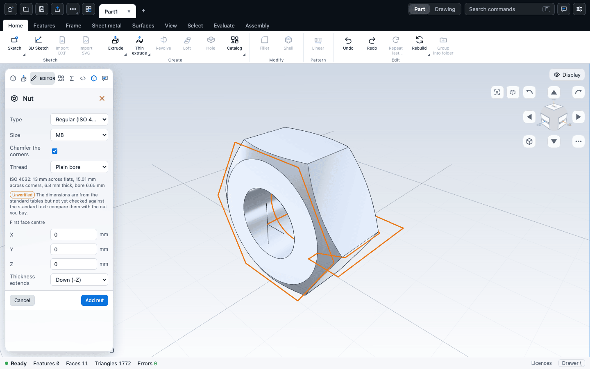
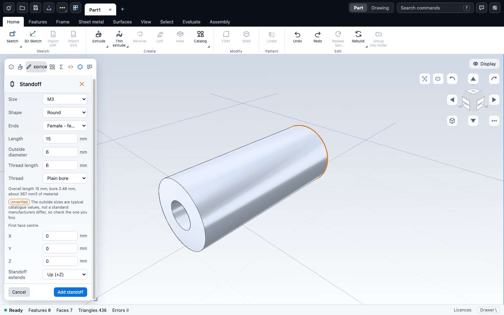
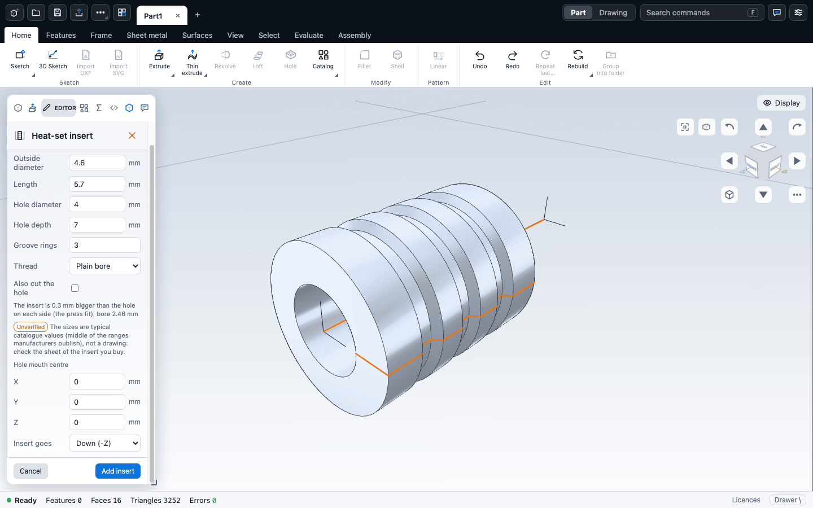
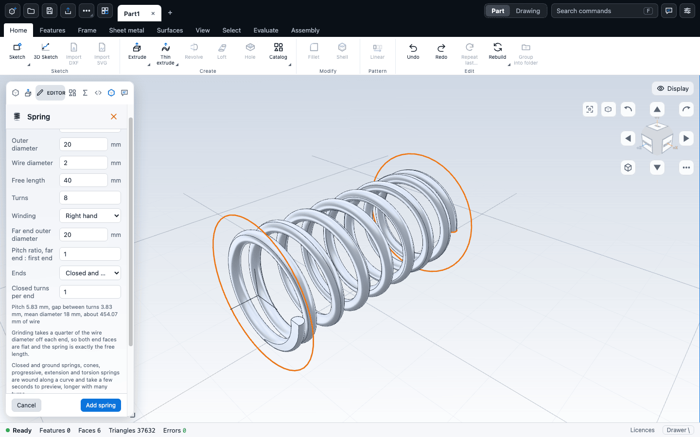
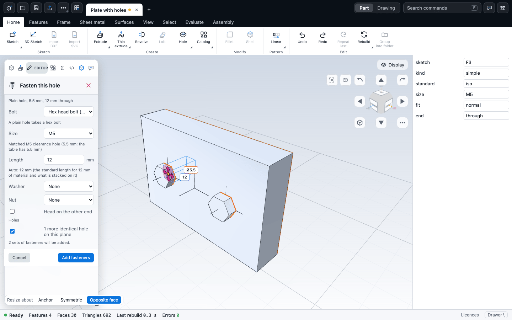
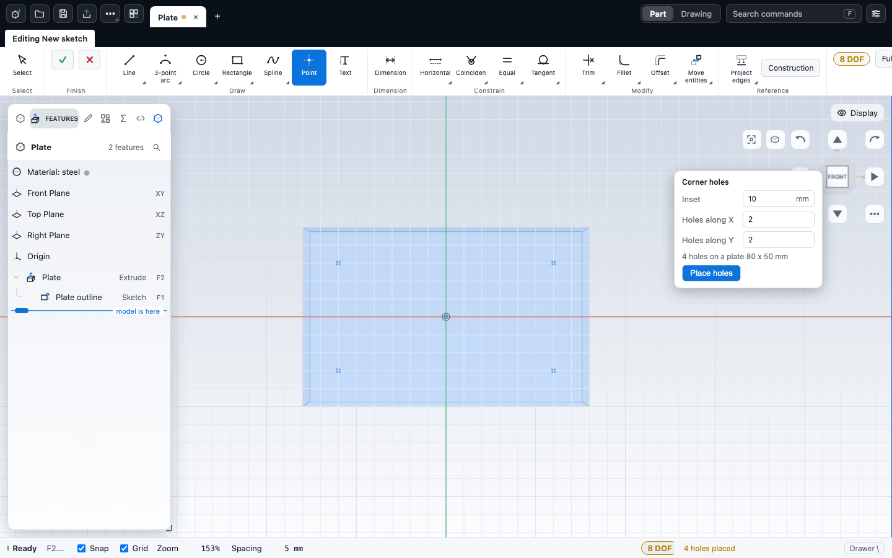

# Parametric wizards

This chapter covers the commands that build a whole part from a few parameters: gears (spur, ring, helical, herringbone and rack), propellers (airfoil and marine), turbo impellers, ball bearings, screws, washers, nuts, standoffs, heat-set inserts, springs, a two-part case, knurls, and corner holes on a plate. Each one produces ordinary features that you can inspect and edit afterwards.

All of these are about geometry only. The app does not calculate strength, lubrication, or aerodynamic or hydrodynamic performance.

## What the wizards have in common

- They live on the **Features** tab, **Create** group. The Gear button is a family: **Gear** (default, shortcut **Shift+Y**), **Gear pair**, **Propeller**, **Impeller**, **Knurl**, **Screw**, **Washer**, **Nut**, **Standoff**, **Heat-set insert**, **Spring**, **Case** and **Bearing** share one ribbon button, and the button shows the one you used last. You can also search for them with command search (**F**).
- You need an open document. The commands are greyed out without one.
- A live preview shows in the viewport while you change values.
- A readout and checks show the derived numbers. Errors stop the build. Warnings do not.
- The settings are stored on the part, so you can reopen the wizard later and change them. The features are regenerated from the settings, keeping their ids, so later features that refer to them keep working.

Whether a wizard's result moves when you edit the part it sits on depends on the wizard. A bearing added from a selected flat face stays on that face (see [Bearings](#bearings)), and a knurl cut into a cylinder keeps its distance from the cylinder's end face (see [Knurl](#knurl)). The other wizards (Gear, Propeller, Impeller, Screw, Washer, Nut, Standoff, Heat-set insert, Spring) are built at the numbers you gave.

Parts built by a wizard are not locked. You can add fillets, cuts and patterns on top. What you cannot do is edit the generated profile sketch by hand while it is still tied to its wizard (see each section).

## Gears

**Gear** builds a parametric gear from a true involute tooth profile. **Gear pair** builds two meshing gears at the right centre distance. Both are one undo step, and the Gear editor opens on the result with a live preview. Press **Enter** or the tick to keep it, or **Esc** or the cross to cancel.

### Where the gear goes

- With one face selected, the gear is built on that face.
- With a plane feature selected in the tree, it is built on that plane.
- Otherwise it is built on the Top plane.

A new gear starts as a spur gear: module 2, 20 teeth, 20 degree pressure angle, face width 10, bore 8, no hub. **Gear pair** starts with the same gear plus a 40-tooth mate with a 10 mm bore and a backlash of 0.06 of the module.

### Gear types

| Type | What you get |
| --- | --- |
| **Spur** | External straight-toothed gear. |
| **Ring** | Internal gear: a rim with the teeth cut on the inside. No keyway or hub. Root fillet is not applied. |
| **Helical** | External gear whose teeth twist, built as a real twisted extrude. Has helix angle and hand. |
| **Herringbone** | Double-helical gear: two opposed helices, with an optional groove between them. |
| **Rack** | A straight rack of the given number of teeth. No bore, hub or mate. |

Bevel and worm gears are not built by the Gear command. The sample list includes a bevel gear and a worm screw that were modelled by hand.

### Parameters

| Parameter | What it does | Default | Range and notes |
| --- | --- | --- | --- |
| Sizing | Choose **Module** or **Diametral pitch**. | Module | Diametral pitch converts as module = 25.4 / pitch. |
| Module | Tooth size in mm. | 2 | 0.1 or more. |
| Diametral pitch | Teeth per inch, when sizing is by pitch. | 12.7 | 0.5 or more. |
| Teeth | Number of teeth. | 20 | 6 or more. For a rack it is the number of teeth along it, 1 or more. |
| Pressure angle | Flank angle. | 20 deg | 10 to 30. |
| Face width | Thickness of the gear. For a herringbone, the total. | 10 mm | 0.1 or more. |
| Helix angle | Tooth twist (helical and herringbone). | 15 deg | 1 to 45. A herringbone starts at 30 and warns outside 15 to 45. |
| Hand | Helical: **Right** or **Left**. Herringbone: **Apex leading** or **Apex trailing**. | Right | A mating gear takes the opposite hand. |
| Centre groove | Herringbone: width of the groove between the two chevrons. 0 means none. | About 3 x module when you switch to herringbone | The groove leaves a web at the root, so the two halves stay joined. |
| Rim thickness | Ring gear: radial thickness beyond the tooth roots. | 0, meaning 2.5 x module | 0 or more. |
| Bore diameter | Shaft hole through the gear. | 8 mm | 0 means no bore. |
| Keyway | Cuts a keyway in the bore. | Off | Needs a bore. |
| Key width and depth | Keyway size. | 0, meaning "by shaft size" | The default follows the common DIN 6885 table for the bore size. Type your own values to override. |
| Hub diameter and length | Optional boss on the gear. | 0 (no hub) | Length is measured from the front face. For a herringbone, the hub is centred on the mid plane. |
| Addendum | Tooth height above the pitch circle, as a multiple of the module. | 1 | 0.2 or more. |
| Dedendum | Tooth depth below the pitch circle, as a multiple of the module. | 1.25 | 0.2 or more. |
| Root fillet | Radius at the tooth root, as a multiple of the module. | 0.3 | 0 to 0.6. 0 gives a sharp root. |
| Profile shift | Shifts the cutter. Positive thickens the tooth and raises the tip. | 0 | -1 to 1.5. |
| Backlash | Tooth thickness removed at the pitch circle by this gear, in mm. | 0 | 0 or more. |

Helical and herringbone gears use the module and pressure angle as normal values; the app converts them to the profile in the plane of rotation.

### Adding a mating gear

For spur, helical and herringbone gears, tick **Add a mating gear** in the **Mating gear** section. It takes the module, pressure angle, width, profile shift and backlash from the first gear and has its own tooth count, bore and hub. The editor shows the centre distance and the gear ratio.

Ticking the box starts the mate at twice the teeth and, if the backlash was 0, sets it to 0.06 of the module so the flanks do not touch. The two gears are separate solids in one part, not an assembly.

### The readout and its warnings

The **Readout** section shows the pitch, outside, root and base diameters (a rack shows circular pitch and length), the contact ratio, and the minimum number of teeth that avoids undercut.

The contact ratio is measured against the mating gear. With no mate, it uses a gear with the same number of teeth. A value of 1.2 or more runs smoothly. For helical and herringbone gears the total includes overlap.

| Warning | What to do |
| --- | --- |
| Fewer teeth than the minimum for no undercut (18 at 20 degrees and a standard addendum) | Add teeth, or press **Use shift** to apply the profile shift that avoids undercut. |
| Teeth come to a point | Raise the module or tooth count, or lower the addendum or profile shift. |
| Tip lowered to keep a land | Same remedy as above. |
| Teeth touch at the root | Reduce backlash, profile shift or dedendum. |
| Ring tip circle below base circle | The ring's teeth were shortened. Change the tooth count or the shift. |
| Herringbone helix angle outside 15 to 45 | Choose an angle in that range. |
| Half the face width twists more than a quarter turn | Lower the helix angle or the face width. |
| Groove at least as wide as the face | Lower the groove or widen the face. |

### What is built

Gear parts are made of ordinary features: a profile sketch (the closed tooth outline), an extrude for the body, and optionally a hub, a groove (herringbone), a bore and a keyway. A pair repeats these for the second gear. A helical gear uses the extrude's twist. A herringbone uses two extrudes with opposite twist, up and down from the mid plane.

### Editing a gear afterwards

Double-click any feature the gear made in the feature tree, and the Gear editor opens on the settings. The features are regenerated with the same ids. You cannot edit the profile sketch by hand while it belongs to the gear. To take it over, delete the gear's settings by editing the part file, or rebuild the shape from a copy of the sketch.

Large gears take time to rebuild. Cost grows roughly in line with the tooth count, and a herringbone costs about twice a helical gear of the same size. The preview waits until you stop typing before it rebuilds.

## Propellers

The **Propeller** command opens a three-step wizard in the **Editor** tab of the left panel: **Size**, **Blade** and **Review**. You can also start it from the Catalog: **Primitives** tab, **Generators**, **Propeller**.

On the **Size** step, **Family** selects what kind of propeller you make. You choose the family for a new propeller only. An existing propeller reopens in the family that made it.

| Family | Use it for |
| --- | --- |
| **Airfoil** | Fans, drones and aircraft: airfoil sections lofted into a blade. |
| **Marine** | Boat propellers: the blade face lies on a helicoid, with the thickness on the back. |

On the **Review** step, **Create** adds the propeller as one undo step. When you reopen a built propeller, the button says **Apply** and regenerates it.

The shaft axis is Z, the thrust is toward +Z, and the first blade lies along +X.

### Airfoil propeller

Presets on the **Size** step: **Drone 5 inch**, **Desk fan** and **RC plane**. **Custom** is the default.

#### Size step

| Parameter | What it does | Default | Range |
| --- | --- | --- | --- |
| Diameter | Tip diameter. | 120 mm | 10 mm or more. |
| Hub diameter | Central boss. | 24 mm | Above 0 and at most 60 % of the diameter. |
| Hub length | Hub length along the shaft. | 20 mm | Above 0. |
| Bore diameter | Shaft hole. 0 means none. | 6 mm | Leaves at least 1 mm of hub wall, and stays inside the blade roots. |
| Blades | Number of blades. | 3 | 2 to 8. |
| Rotation | **Counter-clockwise** or **Clockwise**, seen from the thrust side (+Z). | Counter-clockwise | |

#### Blade step

| Parameter | What it does | Default | Range |
| --- | --- | --- | --- |
| Twist | How the blade angle varies along the span: **Pitch** (constant pitch), **Pitch angle** (the same law set by an angle), or **Linear** (straight line from root angle to tip angle). | Pitch | |
| Pitch | Distance advanced per revolution. | 90 mm/rev | Above 0. |
| Angle at reference, Reference radius | Pitch angle and where it is measured, as a fraction of the tip radius. | 20 deg at 0.75 | Angle up to 80 deg. Radius 0.25 to 1. |
| Root angle, Tip angle | Linear twist ends. | 55 and 12 deg | Up to 80 deg. |
| Root, mid and tip chord | Blade width along the span. Drag the three points on the **Chord curve** graph, or type values. | 18, 20, 9 mm | At least 1 mm. |
| Thickness at root, mid and tip | Thickness as a fraction of the chord, on the **Thickness curve**. | 0.14, 0.10, 0.06 | 0.02 to 0.4. |
| Shape exponent | Moves the mid value toward the root (below 1) or the tip (above 1). One for chord, one for thickness. | 1 | 0.2 to 5. |
| Airfoil | **NACA 4-digit**, **Circular arc**, or **Flat plate**. | NACA 4-digit | |
| Camber | Section curvature as a fraction of the chord. | 0.04 | 0 to 0.12. |
| Camber position | NACA 4-digit only. | 0.4 | 0.1 to 0.9. |
| Pivot | Chordwise point the sections turn about. 0 is the leading edge. | 0.4 | 0 to 1. |
| Rake | Backward sweep out of the plane of rotation. | 0 deg | -45 to 45. |
| Skew | Sideways offset of the tip toward the trailing side. | 0 mm | Within half the radius. |
| Root embed | Where the blade starts inside the hub, as a fraction of the hub radius. | 0.6 | 0.3 to 0.9. |
| Sections | Airfoil sections the blade passes through. More follows the twist more closely and builds more slowly. | 7 | 5 to 12. |

Drag a point on a graph up or down, or focus a point and use the arrow keys (hold **Shift** for bigger steps).

#### Review step

The readout gives the diameter, blade count, pitch, pitch-to-diameter ratio, section angles at the root, at 0.7 R and at the tip, and the blade area ratio. Checks list errors (these disable **Create**) and warnings, for example blades that overlap at the hub, a root deeper than the hub, or a tip too thin to print.

#### What is built, and how to edit it

The hub is a circle extruded on the mid plane. Each blade section is a sketch of two splines on its own plane. The blade is a loft through the sections, joined to the hub, repeated as a circular pattern, and a bore is cut.

Hub diameter, hub length, bore and blade count are named variables (`prop_hub_d`, `prop_hub_len`, `prop_bore_d`, `prop_blades`). Edit them in the Variables panel to rebuild just the hub and bore. The blade shape itself is part of the generated sketches, so change it in the wizard. If you change the hub radius in Variables so the blade roots poke out, change the hub in the wizard instead; it moves the roots with it.

Double-click any propeller feature to reopen the wizard.

### Marine propeller

Choose **Marine** under **Family** on the **Size** step. The wizard has the same three steps. Presets: **Outboard, 3 blades**, **Inboard, 4 blades**, **Quiet, 5 blades skewed**.

#### Size step

| Parameter | What it does | Default | Range |
| --- | --- | --- | --- |
| Diameter | Tip diameter. | 250 mm | Above 0. |
| Hub diameter | Central boss. | 50 mm | Above 0 and below 60 % of the diameter. |
| Hub length | Hub length. | 110 mm | Long enough to hold the blade roots. The review tells you how long if it is too short. |
| Bore diameter | Shaft hole. | 20 mm | Must leave a wall (under 90 % of the hub). |
| Blades | Number of blades. | 3 | 2 to 6. |
| Rotation | **Right-hand** or **Left-hand**. Left is the mirror of right. | Right-hand | |

#### Blade step

| Parameter | What it does | Default | Range |
| --- | --- | --- | --- |
| Pitch / diameter | Pitch at the tip divided by the diameter. | 1 | 0.4 to 2. |
| Progressive pitch | How much the pitch changes from tip to root. Positive means more pitch at the hub. | 0 | -0.15 to 0.5. |
| Rake | The blade leans aft by this angle. Negative leans it forward. | 0 deg | -20 to 30. |
| Expanded area ratio | Total developed blade area over disc area. Sets the widest chord. | 0.5 | 0.25 to 1.2. |
| Widest chord at | Where the blade is widest, from the hub (0) to the tip (1). | 0.45 | 0.05 to 0.95. |
| Root chord, Tip chord | Widths at the ends, as a fraction of the widest chord. | 0.55, 0.3 | 0.05 to 1. |
| Tip skew | Sweep back of the mid-chord line at the tip. | 15 deg | -45 to 45. A warning above 45. |
| Thickness at the root, at the tip (t / D) | Blade thickness as a fraction of the diameter, normal to the face. All of it is on the back. | 0.035, 0.005 | 0.005 to 0.08 at the root, 0.001 to 0.04 at the tip. |
| Thickest at | Where along the chord the foil is thickest. | 0.45 | 0.2 to 0.7. |
| Edge thickness | Edge thickness as a fraction of the maximum. The edge is never thinner than 0.3 mm. | 0.06 | 0.02 to 0.5. |
| Tip rounding | Outer share of the span over which the tip closes to a round end. 0 keeps a square tip. | 0.15 | 0 to 0.4. |
| Root embed | Where the blade starts inside the hub. | 0.85 | 0.35 to 0.95. |
| Section spacing | Angle between the helicoid sections. Finer follows the outline better. | 3 deg | 3 to 10. |

#### Marine: what to expect

- The blade is one loft through closed sections in planes through the shaft, joined to the hub, patterned, and bored. Hub diameter, bore and blade count are plain numbers, not document variables.
- With rake and progressive pitch at 0, the face is a true constant-pitch helicoid.
- Joining the blade to the hub is the touchy step. If the preview fails, the wizard retries with section spacings of 7, 6, 4 and 3 degrees and tells you which one built ("The hub fuse failed at ... degrees; built with a section spacing of ..."). If nothing builds, try a pitch/diameter above 0.8 or a coarser spacing by hand.
- A warning tells you when the pitch at the hub is 0.8 D or lower, because those are the cases most likely to need a retry.
- Editing a marine propeller usually changes the section count, so **Apply** removes the old features and adds new ones, and takes two undo steps. An edit that keeps the section count replaces them in place, in one step.
- A rake of about 25 degrees or more can leave a few small gaps in the display mesh. The solid is still valid, but the Check panel may list them.

## Turbo impellers

The **Impeller** command builds an open radial compressor wheel: a shaped hub, back-swept main blades, shorter splitter blades between them, and a shaft bore. The wizard has three steps: **Hub**, **Blade** and **Review**, opened in the **Editor** tab of the left panel. Presets: **Compressor, 7 + 7 blades** (the default), **Small compressor, 5 + 5 blades**, **Wide, 9 + 9 blades, more wrap**.

### Hub step

| Parameter | What it does | Default | Range |
| --- | --- | --- | --- |
| Exducer diameter | Hub diameter at the back face (the wheel exit). | 45 mm | Above 0. |
| Inducer diameter | Hub diameter at the nose plane (the inlet). | 20 mm | Above 0 and below the exducer diameter. |
| Hub length | Axial length from the nose to the back face. | 16 mm | Above 0. |
| Bore diameter | Shaft bore. 0 means none. | 8 mm | Must leave a wall in the hub. |
| Main blades | Full-length blades. | 7 | 3 to 12. |
| Splitter blades | Short blades between the main ones. | 7 | 0 up to the main blade count. |

### Blade step

| Parameter | What it does | Default | Range |
| --- | --- | --- | --- |
| Total wrap | How far each blade winds around the axis. | 75 deg | 20 to 160 (a warning above 120). |
| Blade thickness at the hub | Tangential thickness where the blade meets the hub. | 2.5 mm | Above 0 (the field minimum is 0.3). |
| Blade thickness at the tip | Tangential thickness at the shroud end. | 0.8 mm | At least 0.2 mm. A warning below 0.5 mm. |
| Splitter start | Where splitters begin along the flow path (0 is the nose, 1 the back face). | 0.45 | 0.15 to 0.85. |
| Section line, axial and radial | Reach of the hub-to-shroud line each blade section follows. | 0.6 and 2.2 mm | Above 0 in both. |
| Root embed | How far the blade roots sit below the hub surface, so the join holds. | 1.0 mm | 0.3 to 3. |
| Sections per blade | Sections the blade passes through. | 12 | 8 to 24 (10 to 16 is the suggested range). |

The review step reports the radii, blade counts, wrap, section line length and tip pitch, and lists errors and warnings. If a preview fails, the wizard retries with 12, 10 and then 14 sections and tells you which count built.

### Limits and editing

- There is one meridional blade shape. There is no leading-edge sweep, no changing wrap along the span, and no shroud surface. The hub contour's knee is fixed at 75 % of the length.
- Blades are joined to the hub without a root fillet.
- Reopen the wizard by clicking any feature the impeller made.

## Bearings

**Bearing** adds a ball bearing as ordinary features: an inner ring, an outer ring and, for an open bearing, the balls. Start it from **Features > Create**, command search, or the Catalog: **Primitives** tab, **Generators**, **Bearing**. The live preview shows the bearing before **Add bearing** keeps it as one undo step.

The **Size** list holds the nominal ISO 15 dimensions (bore x outer diameter x width) of the miniature 6xx series (602 to 629), the MR miniature series (MR52 to MR149), the 60xx, 62xx and 63xx series (bores 10 to 60 mm) and some inch sizes (R2 with its 1/8 inch bore, R3, R4, R6, R8, R10, R12). Type in **Search** to narrow the list: `620` lists 6200 to 6209, `8x22` finds the 608, and a whole designation such as `6204-2RS` or `MR63ZZ` picks that size and its sides. Typing a bore, outer diameter or width by hand makes it a custom size.

| Parameter | What it does | Default |
| --- | --- | --- |
| Sides | **Open** shows the balls, **Shielded (2Z)** is a flat disc on each face, **Sealed (2RS)** is a thicker seal with a sloping lip. | Shielded |
| Chamfer | Chamfer on all four corners of each ring. 0 leaves them sharp. | By size (0.1 mm for the smallest, 0.3 mm for a 608, 1 mm for a 6204 or larger) |
| Balls, Ball diameter | Open bearings only. | The diameter is just under the gap between the races, the count about 1.6 ball diameters of pitch |
| First face centre, Extends | Where the first face sits and which way the bearing runs from it. | Origin, up (+Z) |

Each ring and each ball is its own body (named, for example, *Bearing 608 inner ring*), and a shield or seal belongs to the outer ring. Each ring has a ball groove (a circular arc about the ball centre circle, radius 0.52 ball diameters and 0.27 deep, so the balls sit in it); a bearing too small for one gets plain races. There is no cage, and the ring, groove, ball and shield sizes follow rules of thumb rather than a maker's catalogue. Use it for assemblies, fit checks and looks, not for load ratings.

### Housing seat

The **Housing seat** read-out gives the pocket for the outer ring: its diameter with the fit allowance, and the bearing width as the depth. **Fit** chooses **H7 housing** (cut at the middle of the +IT7 / 0 zone of ISO 286), **Nominal (press fit)** (the outer diameter itself) or **0.2 mm clearance** (for a printed pocket). Select a flat face before you open Bearing and the bearing is placed on that face, running into the body; tick **Cut this pocket in the picked face** and the pocket is cut first, then the bearing is added in it.

### Following the face

A bearing added from a selected flat face stays on that face. Put a bearing at each end of a 30 mm shaft, then change the shaft length to 20 mm in the extrude: the bearing and its pocket at the far end move with the end face, and changing the length back moves them back. The same holds for a plate that gets thicker or thinner. The face must be flat and face along the X, Y or Z axis, and the bearing keeps its distance from the face's own origin, so it follows the face along its normal but not when you move the shaft sideways in its sketch.

What does not follow: a bearing placed by typing its numbers without a selected face, one whose first face centre or direction you changed by hand (only sliding it across the face keeps it attached), one on a tilted face, and bearings made in an earlier version, which stay at the position they were made at. Delete such a bearing and add it again from the face to attach it. If an edit leaves a seat that no longer touches the part, the failure card says so and suggests this.

In the Script tab: `part('Housing').bearing({ designation: '608', seal: '2RS', origin: [0, 0, 10], axis: [0, 0, -1], seat: true })`; add `onFace: 'F2.C1'` (the face the bearing sits on) to build it from the face as the wizard does. The **Bearings** example shows a row of them.

## Screws

**Screw** adds a screw or bolt as ordinary features: one body for the head and shank, then cuts for the drive. Start it from **Features > Create**, command search, or the Catalog: **Primitives** tab, **Generators**, **Screw**. The preview shows the screw as you change the fields; **Add screw** keeps it as one undo step, and **Escape** or the cross cancels. It needs an open document, but no solid: the screw is placed at the numbers you give.

| Field | What it does | Default |
| --- | --- | --- |
| Size | The metric size from the list, M2 to M16. | M3 |
| Length | The shank, in millimetres, from the underside of the head to the tip (a countersunk screw: from its flat top). | 8 mm |
| Head | **Pan**, **Button (dome)**, **Countersunk**, **Cheese (cylindrical)** or **External hex**. Picking a head sets the drive to the usual one for it. | Pan |
| Drive | **Cross (approximate)**, **Hex socket**, **Slotted**, **Torx (approximate)** or **None**. Not shown for an external hex head: that one is turned from outside. | Cross |
| Bearing face centre X, Y, Z | Where the screw sits: the centre of the underside of the head (a countersunk screw: of its flat top), in millimetres. | 0, 0, 0 |
| Shank points | Which way the shank points: **Down (-Z)**, **Up (+Z)**, -X, +X, -Y or +Y. | Down (-Z) |

Cross and Torx are approximations: the cross is two tapered arms with a blunt tip rather than real Phillips wings, and the Torx is a star that looks the part. They are good for looks, fit checks and mass, not for toleranced drives.

The screw is its own body and does not merge with what it touches; it is listed as *Screw* in the Bodies panel. Not every size has every head: the table follows the standards, so M12 and M16 have button, countersunk and hex heads only, and a head the size has no row for is refused with the kernel's message.

There is no thread option: a helical thread on a shank does not build yet. Add one afterwards with **Home > Create > Thread** on the shank, as for any cylinder (see [Holes and threads](../modelling/holes.md)).

The wizard always starts from the defaults: it does not reopen from the tree. To change a screw, delete the features it made in the *Screw* folder and add it again.

In the Script tab: `screw({ size: 'M5', length: 12, head: 'countersunk', origin: [0, 0, 10], axis: [0, 0, -1] })`.

### Common problems

| Symptom | Fix |
| --- | --- |
| The length is refused | It must be more than 0, and a countersunk screw's length includes its head, so it must exceed the head height |
| A hex head shows no Drive row | A hex head takes no drive: it is turned from outside |
| "size M12 has no pan head in the table" | Not every size has every head. Pick one the size has: M12 and M16 take button, countersunk and hex |
| The screw sits in the wrong place | The bearing face centre is the middle of the face it sits on. Check it, and which way the shank points |
| You want a thread on the shank | Not in the wizard: add it with **Home > Create > Thread** afterwards |

## Washers

**Washer** adds a flat or a spring (split) washer as ordinary features: one sketch and one extrude, a separate body, all in one tree folder named *Washer* (the next one *Washer 2*). Start it from **Features > Create**, command search, or the Catalog: **Primitives** tab, **Generators**, **Washer**. The preview shows the washer as you change the fields; **Add washer** keeps it as one undo step, and **Escape** or the cross cancels. It needs an open document, but no solid.

| Field | What it does | Default |
| --- | --- | --- |
| Kind | **Flat**, or **Spring (split)**. | Flat |
| Standard / Custom | **Standard** shows a list of sizes with a filter box above it: type `M8`, `8` or `7089` (every word you type must appear in the row), click a row, or press **Enter** when one row is left. Picking a row fills the three diameters and the thickness. **Custom** hides the list. Editing any of the numbers switches to Custom by itself. | Standard, M8 |
| Inner diameter, Outer diameter, Thickness | The size in millimetres. | 8.4, 16, 1.6 |
| Gap width | Spring only: the width of the split, across it. | The thickness |
| First face centre X, Y, Z | The centre of the washer's first side, in millimetres. Give a screw the same position and axis and the washer lies under its head. | 0, 0, 0 |
| Thickness runs | Which way the thickness extends from that side: **Down (-Z)**, **Up (+Z)**, -X, +X, -Y or +Y. | Down (-Z) |

### Washer on a hole

Click **Washer on a hole** in the wizard, then click the wall of a hole on the part (or its circular edge: press **E** for edge picking). The wizard reads the hole's diameter and axis and the flat face it opens on, takes the standard size whose medium clearance hole (ISO 273) the hole contains (a 6.6 mm hole gives M6, 9 mm gives M8, 11 mm gives M10), and places the washer coaxial with the hole, touching that face, in the usual *Washer* folder. If the hole is smaller than the smallest clearance hole of the standard, the nearest size is used and the panel says so. You can still pick another size, change the kind (the spring washer reads the same hole), choose Custom, and set an **Offset from the face** to lift the washer off the seat. In a through hole the washer sits on the end you picked, or the upper one; **Seat on the other end** switches. In a blind hole it sits on the open end, and in a counterbored hole on the counterbore floor. A countersunk or chamfered hole, a hole that is not along the X, Y or Z axis, and a face that is not a hole are refused with a message instead of a guess. Editing the position fields by hand leaves the hole. A screw, washer and nut stack on a hole is not part of this: add the screw separately.

The standard lists are ISO 7089 (normal series, M1.6 to M64; DIN 125 form A has the same sizes), ISO 7093-1 (large series, M3 to M36; DIN 9021 has the same sizes over this range) for flat washers, and DIN 127 B (spring lock washer, M2 to M36) for spring washers: each row shows `M8 - 8.4 x 16 x 1.6 (ISO 7089)`, inner x outer x thickness. A size the tables could not confirm is left out: use Custom.

The spring washer is a flat split ring. The lift (the helical twist of a real one) is not modelled, and the gap is cut square.

The wizard always starts from the defaults: it does not reopen from the tree. To change a washer, delete the features it made in the *Washer* folder and add it again.

In the Script tab: `washer({ inner: 8.4, outer: 16, thickness: 1.6, origin: [0, 0, 4], axis: [0, 0, 1] })`, or `kind: 'spring', gap: 2` for the split ring.

### Common problems

| Symptom | Fix |
| --- | --- |
| The list shows "No standard size matches" | Clear the filter, or switch to Custom and type the size |
| The outer diameter is refused | It must be larger than the inner diameter |
| The gap is refused | It must be more than 0 and smaller than the hole |

## Nuts

**Nut** adds a hexagon nut as ordinary features: a hexagonal prism as a separate body, the bore cut through it, and a revolve cut that chamfers the corners at 30 degrees on both faces. Start it from **Features > Create**, command search, or the Catalog: **Primitives** tab, **Generators**, **Nut**. The preview shows the nut as you change the fields; **Add nut** keeps it as one undo step, and **Escape** or the cross cancels. Everything goes into one tree folder named *Nut* (the next one *Nut 2*), and the body has the same name.

| Field | What it does | Default |
| --- | --- | --- |
| Type | **Regular (ISO 4032)**, **Thin (ISO 4035)** or **Style 2 (ISO 4033)**. Style 2 has no sizes below M5: picking it with a smaller size moves to M5. | Regular |
| Size | M2, M2.5, M3, M4, M5, M6, M8, M10, M12, M14 or M16: the metric coarse sizes of the kernel's thread table that the standard lists. | M8 |
| Chamfer the corners | A 30 degree chamfer on both faces, starting from a bearing-face circle of 0.9 times the width across flats. Off leaves a plain prism. | On |
| Thread | **Plain bore** (a bore at the minor diameter, no thread feature), **Cosmetic thread** (a bore at the tap drill with a cosmetic thread: it shows in the thread list and drawings) or **Modelled thread** (the real helical groove). | Plain bore |
| Print clearance | Modelled thread only: millimetres, positive for a looser nut thread (the major and minor diameters grow by twice this), negative for a tighter one; up to 1 mm either way. | 0 |
| First face centre X, Y, Z | The centre of the nut's first face, in millimetres. Give a screw or a washer the same position and axis and the nut stacks on it. | 0, 0, 0 |
| Thickness extends | Which way the thickness runs from that face: **Down (-Z)**, **Up (+Z)**, -X, +X, -Y or +Y. | Down (-Z) |

The panel shows the width across flats, the width across corners, the thickness and the bore of the size. Those come from the maximum dimensions of ISO 4032, 4035 and 4033, entered from the standards' public tables and **not yet checked against the standard text**: the panel says so, and marks the rows that are less certain than the rest (M14, and the thin M2 and M2.5). Compare them with the nut you buy before you rely on a value.

A modelled thread is slow to preview and can fall back to a cosmetic one if the kernel cannot cut it (the thread list says so). A large print clearance on a fine pitch is the usual cause: in testing an M5 nut took 0.1 mm, but 0.2 mm made the kernel fall back to a cosmetic thread. The nut is its own body and does not merge with the screw it sits on. The washer face and the bore countersink of real nuts are not modelled, nor are nyloc rings, flanges and wings.

In the Script tab: `nut({ size: 'M5', type: 'thin', thread: 'modeled', clearance: 0.1, origin: [0, 0, 6], axis: [0, 0, 1] })`.

## Standoffs

**Standoff** adds a round or hexagonal spacer, female-female or male-female, with its threads, as a separate body in one *Standoff* folder. It is on the same buttons as the Nut wizard.

| Field | What it does | Default |
| --- | --- | --- |
| Size | M2, M2.5, M3, M4, M5 or M6. Picking a size fills the outside size and the thread length with the usual values for it. | M3 |
| Shape | **Round** or **Hex**. | Round |
| Ends | **Female - female** (a threaded bore in each end) or **Male - female** (a bore in the first end and a stud on the far one). | Female - female |
| Length | The length of the body, end to end. A male stud adds to it, and the panel shows the overall length. | 15 mm |
| Outside diameter / Width across flats | The outside size, according to the shape. | 6 mm (round), 5.5 mm (hex) |
| Thread length | The depth of each female thread and the length of the male stud. | 6 mm |
| Thread, Print clearance | As for the nut. On a stud a positive clearance makes the stud thinner. | Plain bore |
| First end centre X, Y, Z, Standoff extends | Where the first end sits and which way the standoff extends from it. | 0, 0, 0, Up (+Z) |

The wizard checks what it can without the kernel: the threads must not meet (twice the thread length less than the length for female-female, the thread length less than the length for male-female), and the wall must be at least 0.5 mm, so the outside size is at least the nominal diameter plus 1 mm. A problem blocks **Add standoff** and says what to change. The outside sizes are typical catalogue values, not a standard: round standoffs of one thread size are sold in several diameters, so enter the one you buy. The ends are square (no chamfers) and the stud is a plain cylinder at the nominal diameter.

In the Script tab: `standoff({ size: 'M3', length: 12, kind: 'hex', ends: 'male-female', threadLength: 6, origin: [20, 10, 1.6] })`.

## Heat-set inserts

**Heat-set insert** adds the knurled brass insert that is pressed into a printed part with a soldering iron, and, if you ask, the hole for it. The insert is one revolve as a separate body in a *Heat-set insert* folder: a ring with the bore of the thread and a few groove rings round the outside that stand for the knurl.

| Field | What it does | Default |
| --- | --- | --- |
| Size | M2, M2.5, M3, M4, M5 or M6. Picking a size fills the next five fields. | M3 |
| Outside diameter, Length | The insert's size over the knurl and end to end. | 4.6, 5.7 mm |
| Hole diameter, Hole depth | The recommended hole in the plastic: a little smaller than the insert, and deeper than it is long to leave room for the displaced plastic. | 4, 7 mm |
| Groove rings | The number of rings round the outside, 0 to 8. | 3 |
| Thread, Print clearance | As for the nut. | Plain bore |
| Also cut the hole | Cuts the recommended hole at the mouth, before the insert is added. **Cut it into** then lists the bodies of the document: **Every body it reaches** (the default) or one of them by name. | Off |
| Hole mouth centre X, Y, Z, Insert goes | The centre of the face the insert is pressed into, and the direction it goes in. The insert lies flush with that face. | 0, 0, 0, Down (-Z) |

The values are typical catalogue dimensions, the middle of the ranges that manufacturers publish (for M3: 4.0 to 4.6 mm outside, 4 to 5.7 mm long, a 3.8 to 4.2 mm hole), and **not** a manufacturer's drawing: the panel marks them unverified, and the sheet of the insert you buy comes first. The insert is bigger than the hole by the press fit, 0.3 mm on each side for M3. The two bodies overlap by that amount, as they do in reality once the plastic has flowed round the knurl, so an interference check on the pair reports it. To leave out the overlap, set the hole diameter to the outside diameter.

In the Script tab: `heatSetInsert({ size: 'M3', hole: true, origin: [0, 0, 12], axis: [0, 0, -1] })` (`hole: 'Block'` cuts only the body made with that name).

These three wizards always start from the defaults and do not reopen from the tree. To change one, delete the features in its folder and add it again.

### Common problems

| Symptom | Fix |
| --- | --- |
| "There is no M4 nut in ISO 4033" | Style 2 starts at M5: pick Regular or Thin, or a larger size |
| The two threads would meet | The standoff is too short for two threads: shorten them, lengthen it, or use Male - female |
| The wall would be under 0.5 mm | The outside size is too small for the thread: use at least the nominal diameter plus 1 mm |
| The hole is refused | It must be no larger than the insert's outside diameter, and at least as deep as the insert is long |
| A modelled thread comes out cosmetic | The kernel could not cut the groove: lower the print clearance, or use a cosmetic thread |

## Springs

**Spring** adds a coil spring as ordinary features: one wire swept along a helix, as a separate body in one tree folder named *Spring* (the next one *Spring 2*). Start it from **Features > Create**, command search, or the Catalog. The preview shows the spring as you change the fields; **Add spring** keeps it as one undo step, and **Escape** or the cross cancels. The wizard shows the geometry it derives (the pitch, the gap between turns, the mean diameter and the length of wire for a compression spring; the overall length for an extension spring; the angle between the legs for a torsion spring) and refuses values that would make the turns touch.

| Field | What it does | Default |
| --- | --- | --- |
| Type | **Compression**, **Extension (hooks)** or **Torsion (legs)**. | Compression |
| Outer diameter | The outside diameter of the coil, measured over the wire. An extension spring needs more than three times the wire diameter, for the hook bends. | |
| Wire diameter | The diameter of the wire. | |
| Free length | Compression only: the length with no load, end to end, wire included. | |
| Turns | How many times the wire goes round; fractions are fine. For an extension spring it counts the tight body between the hooks; for a torsion spring the fraction after the whole turns sets the angle between the legs. | |
| Winding | **Right hand** or **Left hand**. | Right hand |
| Far end outer diameter | Compression only: a value different from the outer diameter makes the coil a cone. | The outer diameter |
| Pitch ratio, far end : first end | Compression only: 1 is an even pitch, below 1 the turns close up towards the far end (a progressive suspension spring), above 1 they open. | 1 |
| Ends | Compression only: **Plain** (the wire just stops), **Closed** (tight turns that touch at each end) or **Closed and ground** (closed turns with both ends ground flat, so the spring is exactly the free length). | Plain |
| Closed turns per end | Closed and ground ends only: how many turns at each end touch the next. They count in the turns above, so the body has the turns less twice this many. | 1 |
| First leg length, Second leg length | Torsion only: the length of each straight leg, which leaves the coil tangent to its end. | |
| First end centre X, Y, Z | Where the spring starts: the centre of its first end (the lowest point of the lower hook for an extension spring). | 0, 0, 0 |
| Spring extends | The direction from that end: **Up (+Z)**, **Down (-Z)**, +X, -X, +Y or -Y. | Up (+Z) |

An **extension spring** is a tight coil of touching turns with a machine hook, an open loop centred on the axis, at each end; a fraction of a turn turns the two hooks against each other. A **torsion spring** is a close-wound coil with a straight leg at each end. **Closed and ground** takes a quarter of the wire diameter off each end. Closed and ground springs, cones, progressive, extension and torsion springs are wound along a curve and take a few seconds to preview, longer with many turns.

A spring is its own body and does not merge with the part it sits in. Only the geometry is made: the app does not work out the spring rate or the stress, and an extension spring has the machine hook only, no other end types.

In the Script tab: `spring({ outer: 12, wire: 1, length: 30, coils: 8, ends: 'ground', closedTurns: 1 })`, with `topOuter` for a cone and `progression` for a progressive pitch; `extensionSpring({ outer: 10, wire: 1, coils: 12 })`; and `torsionSpring({ outer: 10, wire: 1, coils: 4.25, leg1: 15, leg2: 15 })`. All three take `hand`, `origin` and `axis`.

## Make a case

**Case** makes a closed box with a lipped lid in one step: the outside size, the wall, where the lid starts and the lip, and you get two bodies, a base and a lid, in one tree folder named *Case* (the next one *Case 2*). It does what takes several steps by hand and needs no selected face, which the **Shell** command does: two cups, each an outline extruded as its own body and shelled open on one face, a ring-shaped tongue on the rim of one and a matching groove in the rim of the other, and the lid placed on top of the base. Start it from **Features > Create**, command search, or the Catalog. The preview shows the base and the lid as you change the fields; **Add case** keeps them as one undo step, and **Escape** or the cross cancels.

| Field | What it does | Default |
| --- | --- | --- |
| Width, Depth, Height | The outside size of the closed case, lid included, in mm. | 80, 50, 30 |
| Wall thickness | The thickness of every wall, the floor and the top. At least 0.4 mm, and two walls must be thinner than the smallest outside size. | 2 |
| Round the edges | Which outside edges are rounded: **Off**, **Side edges** (the four vertical edges), **Top edges** (the outer edges of the lid top and of the base bottom, never the seam where the halves meet and never the inside) or **Side and top edges**. A radius field appears for each edge that is on. | Off |
| Side edge radius | The radius of the four vertical edges, on the outside. It must be more than the wall, so the inside corner does not collapse, and at most half the width or depth. | 5 |
| Top edge radius | The radius of the round on the top of the lid and on the bottom of the base. With both on, the round follows the rounded outline, so it can be at most the side edge radius. It is also limited to about 2.2 times the wall (a bigger round would leave under half a wall at the round) and to less than the height of the shorter half less the groove. | 2 |
| Lid height | How tall the lid is: the case is cut this far below its top, so the cut is at *height - lid height* above the bottom. It starts at a quarter of the height (at least three walls) and follows the height until you type a value. | A quarter of the height |
| Tongue height | How far the tongue stands out of its half. The groove is this plus the clearance deep. Follows the wall (0.75 of it) until you type a value. | 1.5 |
| Tongue width | The width of the tongue as a fraction of the wall, centred in the wall. | 0.5 |
| Clearance | The gap between tongue and groove on each side and at the top, in mm. 0.2 suits an FDM printer. | 0.2 |
| Tongue on | **Lid** (the tongue stands out of the lid and the groove is in the base) or **Base**. | Lid |
| Name of the base, Name of the lid | The names of the two bodies. | Base, Lid |
| Bottom face centre X, Y, Z | Where the case stands: the centre of its bottom face. It rises along +Y from there: the floor is on the Top plane and the lid on top. | 0, 0, 0 |

The panel shows the heights of the two halves, where the cut is and the tongue and groove sizes. Checks in plain words block the preview and **Add case** until the numbers work: a wall under 0.4 mm, a side edge radius that is not more than the wall, a top edge radius above any of the limits in the table, a lid or a base not taller than the wall, a groove that would leave less than a wall under it, a tongue and its clearance on both sides as wide as the wall, or two halves with the same name.

With the defaults and a lid height of 15 mm, the case is the one built in [Cases and moulds](../modelling/cases-and-moulds.md): two valid bodies of 28 882.24 mm³ together. The case is its own pair of bodies and leaves the bodies already in the document alone, including an earlier case closed at the same height. The tongue is centred in the wall, with the clearance on both sides and above it: the nearest the two halves come to each other, apart from where the rims rest on each other, is the clearance (checked with **Evaluate > Overlap** and the clearance measurement).

The top edges are rounded after each cup is shelled, so the outside gets the round and the inside stays square: where the radius is bigger than the wall, the wall at the round is thinner than the wall (it is *wall x 1.41 - 0.41 x radius* thick there, 1.17 mm for a 4 mm round on a 2 mm wall). The tongue and groove are on the seam rim and are not touched, so the fit keeps its clearance.

What it does not make: screw bosses, a seal groove, snap fits, vents or a label recess. Add those afterwards with the ordinary features, cutting into the base or the lid by name.

In the Script tab: `caseBox({ width: 80, depth: 50, height: 30, wall: 2, lidHeight: 15, tongueHeight: 1.5, tongueWidth: 1, clearance: 0.2 })` (also `radius` for the side edges and `topRadius` for the top edges, each 0 = sharp, `tongueOn: 'lid' | 'base'`, `names`, `origin`; `axis: 'y'` (the default: the case stands on the Top plane and rises along +Y, the app's up axis) or `axis: 'z'` (the old orientation: lying on the Front plane, rising along +Z); `joint: 'lipJoint'` builds one shelled box and splits it with the lip joint instead, in a part with no other body). The wizard and the helper build the same features.

## Adding a bolt to a hole

**Add fastener to hole** puts a bolt in a hole you point at, with a washer and a nut if you want them. The size, the head and the length come from the hole, so for the usual case there is nothing to type.

1. Select the cylindrical wall of a hole (click it in face mode), or several holes, then right-click and choose **Add fastener to hole**. The same command is on the **Features** tab, **Create** group, and in command search; it is greyed out until a hole wall is selected. In the feature tree, right-click a **Hole** feature, or a pattern of holes, and choose **Add fastener to hole**.
2. The **Fasten this hole** panel opens with the fasteners already previewed in the viewport. Change what you want:
   - **Bolt**: **Hex head bolt** (ISO 4017), **Socket cap screw** (ISO 4762), **Button head** (ISO 7380) or **Countersunk** (ISO 10642). It starts from the mouth of the hole: a plain hole takes a hex bolt, a counterbore a socket cap screw and a countersink a countersunk screw. The panel says which rule applied.
   - **Size**: the nearest metric size to the bore, M2 to M16. A 5.5 mm bore is *M5 clearance*, a 4.2 mm bore is *M5 tapped*; the line under the field says which it matched and the table value it was compared with. When the bore is more than 0.3 mm from every table value the line says *nearest*, not *matched*.
   - **Length**: the material along the hole axis from the bearing face to where the hole leaves, plus what you stack on it (the washers and the nut), rounded up to the next standard length (6, 8, 10, 12, 16, 20, 25, 30, 35, 40, 45, 50 ... 200 mm). Type your own and **Auto** brings the standard one back. A blind hole takes the longest standard length that fits its depth.
   - **Washer**: none, under the head, or under the head and under the nut (ISO 7089 flat washers).
   - **Nut**: a hex nut (ISO 4032) on the far side of a through hole, sitting on the face the hole leaves by (or on the floor of a pocket the hole widens into there).
   - **Head on the other end**: shown for a plain through hole, which opens on both sides.
   - **Holes**: the other holes to fasten in the same step. **N more identical holes on this plane** counts the holes with the same diameter, type (plain, counterbored, countersunk) and depth that open on the same plane, however they were made (a Hole feature, a pattern of it, a cut); it is on by default when there are any. Other selected holes, and the other holes of the pattern a hole belongs to, have boxes of their own and get their own size and length.
3. **Add fasteners** (or **Enter**) adds everything as one undo step; **Escape** cancels.

Each fastener is its own body in one tree folder named *Fasteners*: *Bolt*, *Washer*, *Washer (nut)* and *Nut*, numbered (*Bolt 1*, *Bolt 2* ...) when there are several holes. They sit on the hole axis with the head outside and the shank pointing into the part, and none of them cuts or fuses with the part, so the hole stays as it was. A hex head is built as a second body and united with the shank by name, which keeps it from fusing with the plate it sits on.

### What it cannot do

- It reads **plain, counterbored and countersunk** holes whose walls are cylinders and cones about one axis. A hole modelled with a real thread (a helical groove) is not matched by its thread pitch: only its bore diameter is read, so the size is the nearest one by diameter. A hole that is not a hole (a boss, a slot) is refused with a message.
- A **blind hole gets no nut**: it has no far side. A **tapped** hole (a bore at the tap drill) gets no nut either, because the bolt holds by its thread; the panel says why.
- A countersunk mouth takes no washer, and a washer or a head wider than a counterbore is refused with the two sizes.
- The socket cap screw and the button head use the shapes of the Screw wizard: cap screws above M10 (and the cap head's exact ISO 4762 height) are not in its table, so those choices say so. The bolt is plain: no thread is drawn on its shank.
- The bolt is not tied to the hole. If you move the hole or change its diameter afterwards, delete the *Fasteners* folder and add them again.

## Corner holes

Corner holes put mounting holes on a plate in one step, instead of placing each point by hand.

1. Select the plate's flat face and start **Hole** (**Shift+H**). The Point tool is active as usual, and a **Corner holes** card appears at the top right of the canvas.
2. Choose **Place holes**. By default this puts a hole in each of the four corners, 10 mm in from both edges.
3. Confirm the sketch with the tick, as for any hole. The Hole editor opens for the size, kind, fit and depth.

| Field | What it does | Default |
| --- | --- | --- |
| Inset | Distance from both edges to each hole centre. | 10 mm |
| Match corner fillet | Shown when the plate has equal rounded corners. The inset follows the fillet radius, so each hole is concentric with its corner. | Off |
| Holes along X, Holes along Y | Holes on each row and column, corners included. 2 and 2 is the four corners. 3 adds a hole in the middle of each side. Holes lie on the edge of the grid, never in the interior. | 2 and 2 |

The card shows the hole count and the plate size. Pressing **Enter** in a count field also places the holes. Placing again replaces the earlier corner points. Points you added by hand with the Point tool stay.

Nothing is placed, and the button is disabled, when the inset is 0 or negative, the inset is half the plate or more, a count is below 2 or not a whole number, or the plate has no size. A warning appears, and the holes are still placed, when less than 1 mm of material would be left between a hole and the edge.

To change them later, double-click the hole in the feature tree. The same card appears above the Hole editor, with the button **Update holes**. It re-places the points against the face as it is now (so a plate that changed size is followed) in one undo step. Hole size, kind, fit and depth are left alone. If you moved or dimensioned the points by hand, **Update holes** puts them back on the grid.

Limits: the exact plate outline is used only for a flat face that is a rectangle, with or without equal rounded corners. Any other outline uses its bounding box and says so. The inset is a plain number, not an expression. A hole sketch on a plane that is not a body face (a standard or datum plane) has no card. Use the Point tool there.

See [Holes and threads](../modelling/holes.md) for the hole settings themselves.

## Knurl

The Knurl wizard puts a straight, diamond or pyramid pattern of grooves on a cylindrical face. Select a cylindrical face on the outside of a body, then choose **Knurl** from the **Create** group. You can also open **Knurl** first: the panel says "Click a round face of the part" and waits, the **Knurl** button stays dimmed, and clicking a round face in the viewport fills in the cylinder. If you click a face that cannot be knurled (a flat face, a tilted cylinder or the wall of a hole), the panel says why and keeps waiting. **Escape** or **Cancel** closes it. Set the pattern, the groove shape, the number of grooves, their depth, the helix angle (diamond) and the band along the axis; the viewport previews the result as you type.

**Cosmetic (instant)** is ticked when the wizard opens. In that mode the grooves are only drawn: they appear at once however many you ask for, but the body stays a plain cylinder, so the mass and the Bodies list do not include them. Exported files (STEP, STL, OBJ and a folder export) do: the export cuts the grooves as real ones in a copy of the part and writes the copy, so the open part stays as it is (see [Exporting](../files/export.md)). A cosmetic knurl has a row under Origin in the feature tree ("Knurl 1 (display only): 30 grooves"); click it to reopen the wizard and change it. The export notice says how many knurls it included. If you turn that off in Settings, the app instead tells you they are not in the file and offers to convert them to real cuts.

A cosmetic knurl is kept in the part file: Save writes it and opening the file brings it back, with its row. It is not a feature, so it is not in the history, and a part built by a script loses it when the script is run again; changing a variable of such a part does not rerun the script while a cosmetic knurl is present, and says so. If you need the grooves in the part itself (in its mass, or for a program that opens the part file rather than an export), untick **Cosmetic** so they are part of the solid.

Untick **Cosmetic** to make a real cut. The grooves are then cut into the solid as ordinary features, in one "Knurl" folder, so mass and exports include them. Diamond and pyramid cuts take several seconds to build, and the preview waits until you stop typing. The wizard keeps your choice when you change the pattern.

### Following the end face

A cut knurl keeps its distance from the end of the cylinder. Knurl a 30 mm shaft with a band that ends 5 mm from its far end, then change the length of the shaft in the extrude to 20 mm or 40 mm: the band moves with that end and stays 5 mm from it, and changing the length back puts it back. The band is measured from whichever flat end face of the cylinder is nearer to it (for a band across the whole cylinder, the end that the extrude moves), so a band near the fixed end stays where it is. This holds for straight grooves, and for diamond and pyramid when **Build** is **Cut grooves**.

What does not follow: a **Cosmetic** knurl (a display record at fixed positions), a diamond or pyramid built as **Faceted** (the wizard says so under the options), a cylinder whose ends are not flat faces (a chamfer, a fillet or a cone at the end), and knurls made in an earlier version. They keep the numbers they were made with. If a change then leaves a band past the end of the part, the failure card says the knurl band no longer touches the part and suggests undoing the change or setting the band again. If the part becomes shorter than the band reaches, shorten the band.

In the Script tab: `knurl({ radius: 10, from: 15, to: 25, count: 24, depth: 0.5, onFace: { face: 'F2.C1', at: 30 } })` builds the cut grooves from the end face `F2.C1`, which lies at 30 along the axis; `from` and `to` then say where the band is now. For diamond and pyramid add `method: 'boolean'`.

## Samples

The **Library** picker lists ready-made examples to open and study: *Spur gear*, *Gear pair*, *Herringbone pair*, *Marine propeller*, *Turbo impeller*, and a plate with rounded corners and four corner holes. Samples made by these wizards reopen in the same editor. Hand-modelled samples (a bevel gear, helical gear, a four-blade propeller) do not.

## Next

- [The library and samples](library.md)
- [Catalog parts](catalog.md)
- [Holes and threads](../modelling/holes.md)
- [The feature tree and history](../modelling/history.md)
- [Equations and variables](../modelling/equations.md)
