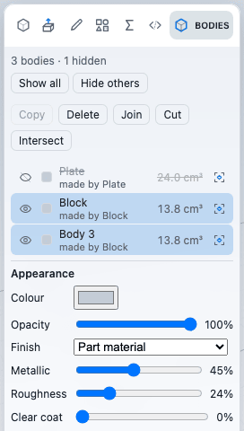
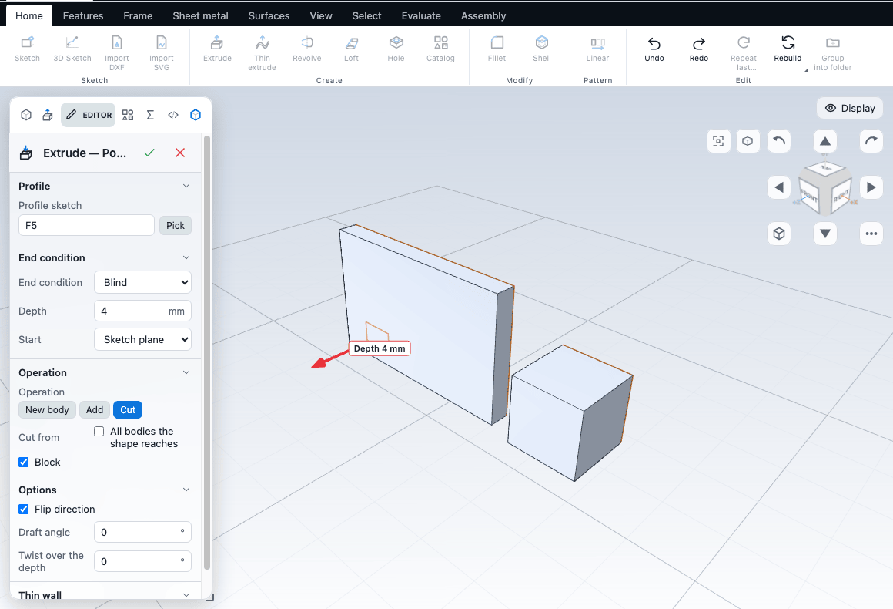

# Bodies and combining

A part can hold more than one solid. Each separate solid is a **body**. This chapter covers how bodies come about, the Bodies panel, and how to join, cut, intersect, copy and delete them. Colour, opacity and finish of a body are covered in [Materials and appearance](../assemblies/appearance.md).

## How a part gets several bodies

- **New body.** The Operation control of Extrude, Revolve, Sweep and Loft offers **New body**. The new solid stays separate from the others, even where it overlaps or touches them. It gets a name such as Body 1, which you can change in the Editor. See [Extrude, revolve, sweep and loft](solids.md).
- **A sketch that misses the body.** A new Extrude whose sketch plane does not reach the existing body starts as a New body. A sketch that meets the body starts as Add, and the first solid of a part always just adds.
- **Copy.** The Copy button in the Bodies panel, and Copy Here on the move and rotate ball, make a second body from an existing one. See [Moving things](transforms.md).
- **Sphere.** A Sphere (from the Catalog) can also be a new body. See [Extrude, revolve, sweep and loft](solids.md#sphere).
- **Disjoint solids.** Solids that share no face and no edge are separate bodies even if you made them with Add.

Two solids that are **joined** by Add become one body. A New body that you later want joined must be combined explicitly.

A body is a set of faces connected by shared edges. The Bodies panel lists the bodies the model currently has.

## The Bodies panel

Open the **Bodies** tab in the left panel (next to Features, Variables and Script). The tab is available when the left panel tabs are on in the workspace settings. It lists one row per body, in the order they were created.

| Part of the row | What it does |
|---|---|
| Eye | Hides or shows the body. Space on a focused row does the same. This changes the view only, not the model |
| Colour swatch and name | The line under the name says which feature made the body ("made by Boss-Extrude1"). Click selects the body; Shift-click or Ctrl-click adds to the selection. Clicking a face in the view selects its row. F2 or a double-click renames. Up and Down move between rows |
| Volume | The body's volume, in cm³ or mm³. A sheet shows no volume |
| Isolate button | Hides every other body. Press it again on the only visible body to show all |

Under the list:

| Button | Needs | What it does |
|---|---|---|
| Show all | A hidden body | Shows every hidden body |
| Hide others | A selected body and two or more bodies | Keeps the selected bodies visible and hides the rest |
| **Copy** | One selected body | Makes a copy in the same place, named after the source body with " 2". Move the copy afterwards |
| **Delete** | One or more selected bodies | Deletes the bodies |
| **Join**, **Cut**, **Intersect** | Two or more selected bodies | Combines them. The first body you selected keeps the result, and the others are used up |

Below those, the selected body shows its **Appearance** settings. See [Materials and appearance](../assemblies/appearance.md).

Hidden bodies are not drawn and cannot be picked. Hiding a body in the panel is saved with the part, but it is not an undo step, and it does not change the geometry or what you export. Copy, Delete, Join, Cut and Intersect are features: they appear in the tree, can be undone, and show in the History.

### Names

A body that the part names (from the Operation control, a copy or a combine) shows that name, ahead of the feature name. Renaming it in the panel renames it in the feature that made it and in every feature that refers to it. A name another body already has is refused with "Another body is already called ...". A body that has no name in the part falls back to the feature that made it, or Body 1, Body 2, and so on.

## Which body an Add or Cut acts on

An Add fuses with every body the new solid touches or overlaps; a Cut removes material from every body it reaches. An Add that reaches no body makes a separate one, and the first solid of a part just adds.

Once the part names at least one other body, the editors of **Extrude**, **Revolve**, **Loft** and **Sweep** show a control for it, and what it is called depends on the operation:

| Operation | Control | Choices |
|---|---|---|
| Add | **Target body** | **Automatic (every body the shape reaches)**, or one named body, which the operation then acts on alone (the others are left as they are) |
| Cut | **Cut from** | **All bodies the shape reaches**, or a ticked list of the named bodies: only the ticked ones lose material |

Neither control is shown for **New body**, and neither appears until the part has a body it names. A body that the part no longer names stays in the list, so the feature still shows what it points at.

### Parts converted from another CAD system

A part converted from another program can carry its stored solid (named **Original (STEP)**) on top of the body its history builds, so two identical solids lie on one another. **Original (STEP)** is hidden when the part is opened only if the body its history rebuilds is there and has the same volume (within 0.5%); if the history is suppressed, greyed, failed or a different size, it stays visible. Show or Hide in the Bodies panel changes that. An Add or Cut that is sketched on a face of one of two identical bodies acts on the body that owns the face, so a hole cut from a face does not meet its twin. When an Automatic cut cannot be made on all the bodies at once, it is made on each body in turn, the one that owns the face first; a body the tool misses, or whose hole already holds the tool, is skipped, and the cut is refused only when no body is touched.

## Combine bodies

Join, Cut and Intersect make a **Combine bodies** feature.

1. Select the bodies in the panel. Click the **target** first: it is the body that keeps the result.
2. Click **Join**, **Cut** or **Intersect**.

| Operation | Result |
|---|---|
| Join | The target and the other bodies become one |
| Cut | The other bodies are subtracted from the target |
| Intersect | Only the volume shared by all of them is kept |

Double-click the Combine bodies feature in the tree to open its Editor.

| Option | What it does | Default |
|---|---|---|
| Operation | Join, Cut or Intersect. (Split appears here only if the feature already uses it.) | The button you clicked |
| Target body | The body that keeps the result. Read-only; shown in words | The first body selected |
| Tool bodies | The other bodies. Read-only; shown in words | The other selected bodies |
| Keep the tool bodies | The tools survive instead of being used up | Off |

Which bodies a combine acts on is set when you create it. To change them, delete the feature and make it again.

Typical failures:

- A Cut that touches nothing is refused ("it cuts nothing").
- An Intersect of bodies that do not overlap leaves nothing.
- A join can fail when the bodies only meet along a face. The Editor advises: "Make sure they overlap in a volume, not just along a face, or nudge one by a small amount."

See [combine](/docs/cad/kernel/format/features-patterns.html#combine) in the kernel book.

## Delete body

Two routes.

- Select one or more bodies in the Bodies panel and click **Delete**.
- Select faces in Face mode and choose **Features > Bodies > Delete body**. Every body holding a selected face is deleted.

The feature is called **Delete or keep body**. In its Editor the **Mode** drop-down switches between **Delete** and **Keep**. Keep removes all the bodies except the selected ones, which is the quick way to throw away everything but one body.

See [deleteBody](/docs/cad/kernel/format/features-edits.html#deletebody) in the kernel book.

## How other features treat several bodies

- **Add** joins the new solid to the body it meets. **New body** joins nothing.
- **Shell** hollows only the body that holds the faces you left open.
- **Patterns and Mirror** repeat features. To copy whole bodies, use Copy or the ball. See [Patterns, mirror and scale](patterns.md).
- **Scale** can scale the whole part. See [Patterns, mirror and scale](patterns.md).
- **Mass properties** and **Interference** use the solid bodies. Sheets have no volume.

## Interference check

To find bodies that overlap by mistake, use **Evaluate > Measure > Interference check** and click **Check**. It lists the "Bodies that share volume". It needs two or more solid bodies. With one body it says so, and with none overlapping it says "No interference between N bodies". See [Measure and inspect](../analysis/measure.md).

Bodies that you made with New body can overlap without any warning while you model. Run the check before you export or make a drawing.

## Common problems

| Symptom | Fix |
|---|---|
| An extrusion became a separate body instead of joining | The sketch plane did not reach the body. Change Operation to Add, or move the sketch plane onto the body |
| Two bodies merged into one | They touch and were joined by Add. Make the second one with New body, or use Cut/Intersect afterwards |
| Join, Cut or Intersect is greyed out | Select two or more bodies in the panel |
| A cut removes nothing | The tool body does not overlap the target. Check Interference first |
| A body cannot be picked in the view | It is hidden, or it is almost transparent with something behind it. Check the eye and the opacity |

## Next

- [Materials and appearance](../assemblies/appearance.md)
- [Moving things: the move / rotate ball and handles](transforms.md)
- [Measure and inspect](../analysis/measure.md)
- [The feature tree and history](history.md)
