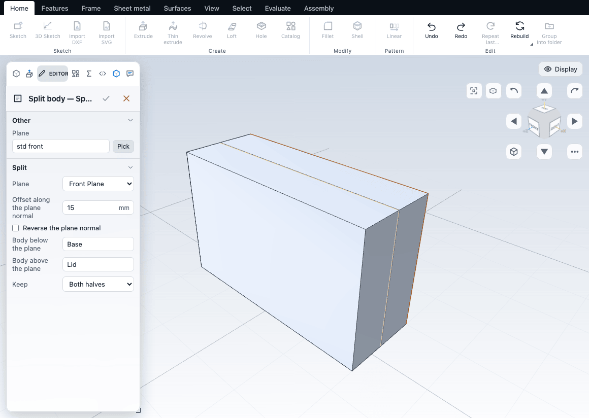
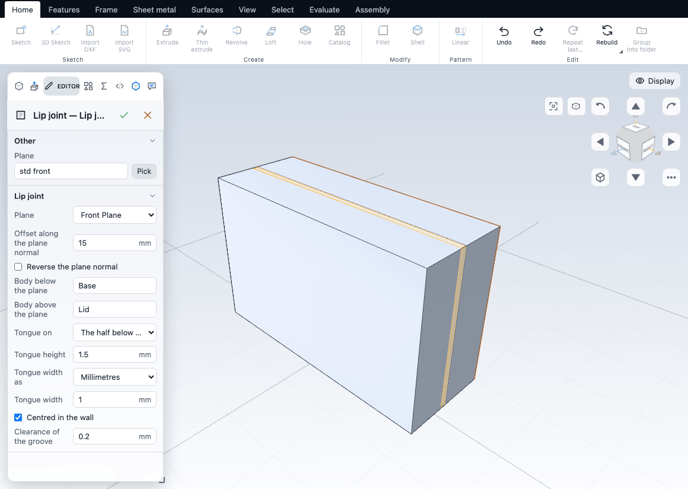
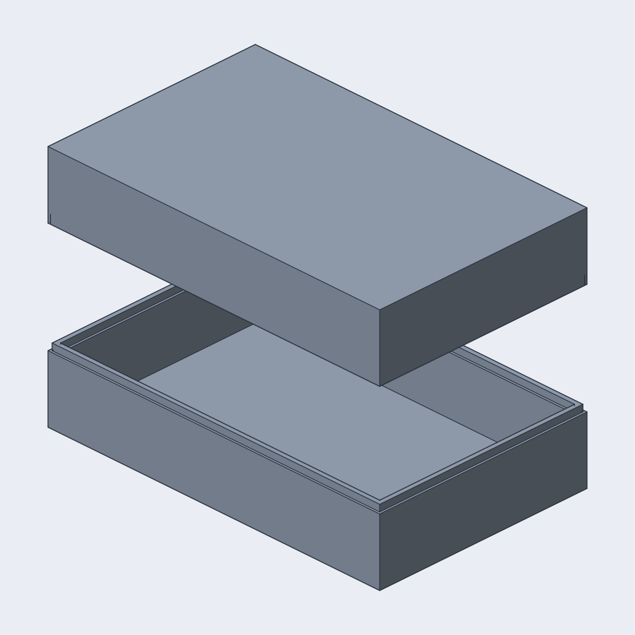
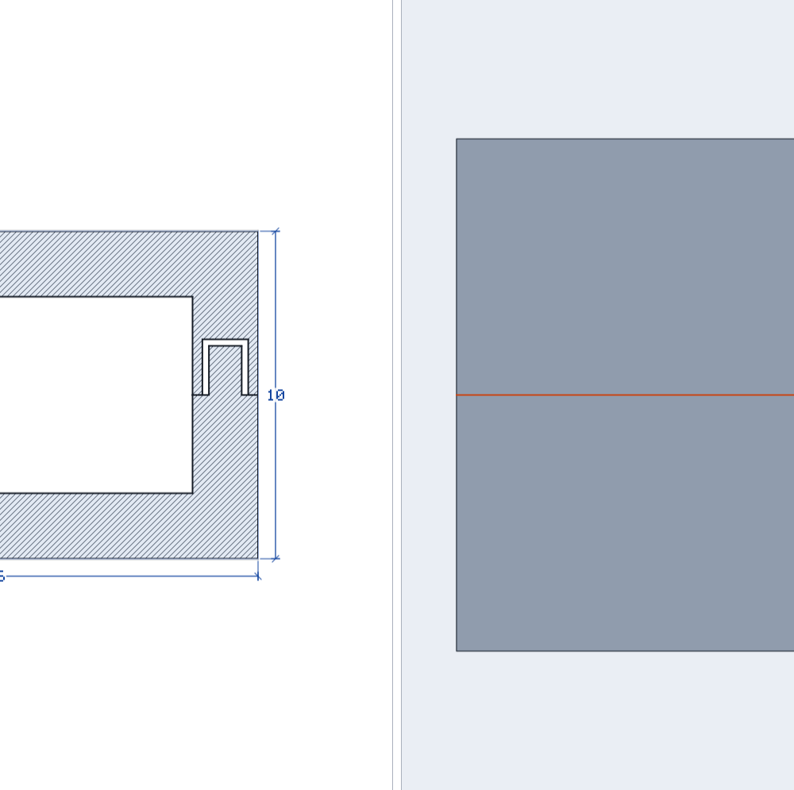

# Cases and moulds

A two-part case is a shelled box cut into a base and a lid, with a tongue on one half and a groove on the other so the halves locate and close. A mould is a block with the part cut out of it, split into two halves. Both start from the same step, a split of one body by a plane. This chapter builds a case with the commands and with a script, and describes the mould recipe. For a plain closed box with a lipped lid in one step, use the [Case wizard](../library/wizards.md#make-a-case) (**Features > Create > Case**).

## Split body

**Split body** (**Features > Modify**) cuts a body at a plane into two bodies. A picked planar face is the plane; with nothing picked it is the standard plane across the smallest side of the body, through the middle, which is where a case is cut. The two halves are named **Base** and **Lid**.

The Editor has:

| Option | What it does | Default |
|---|---|---|
| Plane | Front, Top, Right or a reference plane. **Pick** in the Plane section takes a planar face instead. | Across the smallest side |
| Offset along the plane normal | Moves the plane. | The middle of the body |
| Reverse the plane normal | Turns the plane round, which swaps the half below with the half above. | Off |
| Body below the plane, Body above the plane | The names of the two halves. "Below" is the side the plane normal points away from. | Base, Lid |
| Body to split | Shown only when earlier features named several bodies. | The only body |
| Keep | Both halves, or only the half below or above. | Both halves |

A plane that does not cross the body fails with `cutNoEffect`. The faces keep their names; the cut face of each half belongs to the Split feature. See [split](/docs/cad/kernel/format/features-edits.html#split) in the kernel book.



## Lip joint

**Lip joint** (**Features > Modify**) does the split and then follows the outer boundary of the cut face, which for a shelled box is the outside of the wall, and makes:

- a **tongue** on one half, standing out of the cut face by the tongue height, with a width and a distance from the outer wall;
- a **groove** in the other half in the same place, wider by the clearance on each side and deeper by the clearance.

The Editor has everything Split body has, and:

| Option | What it does | Default |
|---|---|---|
| Tongue on | The half below or above the plane. | Below |
| Tongue height | How far the tongue stands out of its half, in mm. The groove is this plus the clearance deep. | 15% of the smallest dimension of the body, rounded |
| Tongue width as | A fraction of the wall thickness, or millimetres. | A fraction, 0.5 |
| Centred in the wall / Distance from the outer wall | Centred, or the distance in mm from the outer wall to the tongue. | Centred |
| Clearance of the groove | The gap between tongue and groove on each side and at the top, in mm. | 0.2 |

The wall thickness is measured on the cut face, at its narrowest. A tongue and its clearance that do not fit the wall are refused with the numbers (`inset + width + clearance` more than the wall). A solid body has no wall to measure: give the width and the distance in millimetres. The tongue and groove follow flat cut faces with a closed outline; a curved rim is refused in the way [Lip / groove](edges.md#rib-and-lip) refuses it.



## A two-part case with a script

This script builds a 80 x 50 x 30 mm hollow box with 2 mm walls and cuts it at mid height with a joint: a tongue 1 mm wide and 1.5 mm high, centred in the wall, and a groove 0.2 mm wider on each side and 0.2 mm deeper.

```js
part('Case')
  .sketch('front', (s) => s.rect(80, 50)).extrude(30)
  .feature({ type: 'shell', faces: [], thickness: 2 })              // no open face: a closed cavity
  .lipJoint(at('front', 15), { height: 1.5, width: 1, clearance: 0.2, names: ['Base', 'Lid'] });
```



The result is two valid bodies, **Base** and **Lid**. The numbers that prove the fit:

| | Volume (mm³) |
|---|---|
| The hollow box before the cut | 29 104 |
| Tongue added to the base: 1.5 x (the area between the outline offset by 0.5 and by 1.5) | 378 |
| Groove removed from the lid: 1.7 x (the area between the outline offset by 0.3 and by 1.7) | 599.76 |
| The two bodies together | 28 882.24 |

The total is the box plus the tongue minus the groove: 29 104 + 378 - 599.76. The groove is larger than the tongue by 221.76 mm³: that void, 0.2 mm on each side and at the top, is the clearance. The two bodies do not overlap (**Evaluate > Overlap** reports none).

The section below is the same joint on a small 16 x 12 x 10 mm case (the 0.2 mm gap would be two pixels wide at 80 mm):



What to know:

- **Shell first, with no open face.** `shell` with an empty `faces` list closes the cavity, so both halves are cups. To get an open box, shell with `faces: [face('>Z')]` instead: the "lid" is then a ring of wall and the groove still follows it.
- **The plane is `at('front', 15)`.** `front` runs along +Z, so the offset is the height of the cut. The half under the plane is "below" and is named first in `names`.
- **Name the halves, then target them.** `names` gives the two halves their names (**Base** and **Lid** unless you change them in the editor); they show in the Bodies panel and stay through later features. A cut made after the joint with no body named meets each half on its own, so the halves are not joined again where they touch. To change only one half, name it: `from: 'Lid'` in a script, or the **Cut from** list of a cut, which names the bodies of the part once a split has named them. In a test, a through cut with `from: 'Lid'` left the base unchanged and kept both names. A boss or other added solid that crosses the seam was not tested; add it before the split.
- **Wall thickness is read from the cut face.** `width` and `inset` can also be given in mm; `widthRatio` (default 0.5) is a fraction of the wall.
- **Clearance for printing.** 0.2 mm suits an FDM printer; use a larger value for a looser print, a smaller one for resin.
- **Not done yet.** Snap fits, screw bosses and a seal groove are not part of the joint, and a split along a curved or tilted surface needs a different tool (the plane must be flat).

`.split(plane, { names })` does the cut alone, and `.lipJoint(plane, { height, width, widthRatio, inset, clearance, tongue, names })` takes the options above; both are in the script reference.

## A mould from a part

A mould half is the part's negative in a block. The steps use the bodies and booleans described in [Bodies and combining](bodies.md):

1. **Make the part a body** with Operation **New body**, named `Part`.
2. **Scale for shrinkage.** Scale `Part` by `1 / (1 - shrinkage)`; a 2% shrinkage gives 1.0204. See [Scale](patterns.md#scale).
3. **Make a block** around it, also as a New body, named `Block`.
4. **Cut the cavity.** Combine bodies, **Cut**, target `Block`, tool `Part`, with **Keep tools** on, so the shrunk part stays next to the mould for checking.
5. **Split the block** along the parting plane with Split body, names `Lower` and `Upper`.

As a script:

```js
part('Mould')
  .sketch('front', (s) => s.circle(12)).extrude(20, { newBody: 'Part' })                   // the part: a 24 x 20 mm cylinder
  .feature({ type: 'scale', factor: 1 / (1 - 0.02), bodies: [{ body: 'Part' }] })         // 2% shrinkage
  .sketch(at('front', -10), (s) => s.rect(60, 60)).extrude(40, { newBody: 'Block' })      // the block, 10 mm past the part each end
  .combine('cut', 'Block', 'Part', { keepTools: true })                                   // the cavity
  .split(at('front', 10), { target: 'Block', names: ['Lower', 'Upper'] });                // the parting plane, half way up the part
```

Run on the kernel, the script gives three valid bodies and no warnings:

| Body | Volume (mm³) |
|---|---|
| `Part`, the shrunk positive: π x 12² x 20 x 1.0204³ | 9 613.11 |
| `Lower` | 67 193.44 |
| `Upper` | 67 193.44 |

`Lower` and `Upper` together are the 60 x 60 x 40 block (144 000 mm³) minus the cavity: 144 000 - 9 613.11 = 134 386.89. Each half holds half the cavity, so the cavity is the shrunk part. Here the part sits wholly inside the block, so the cavity is closed until the split opens it; a real mould leaves the part's flat face on the parting plane or the block face.

What the recipe does not do: it adds no draft angle (draft the faces of `Part` on each side of the parting plane first, with Draft), it makes a flat parting plane only (a stepped or curved parting surface needs a kernel feature that does not exist yet), it does not detect undercuts, and sprues, vents, ejector pins and registration keys are modelled by hand with extrudes and cuts on `Lower` and `Upper`.
