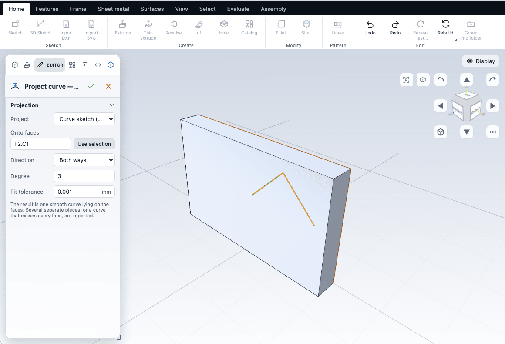
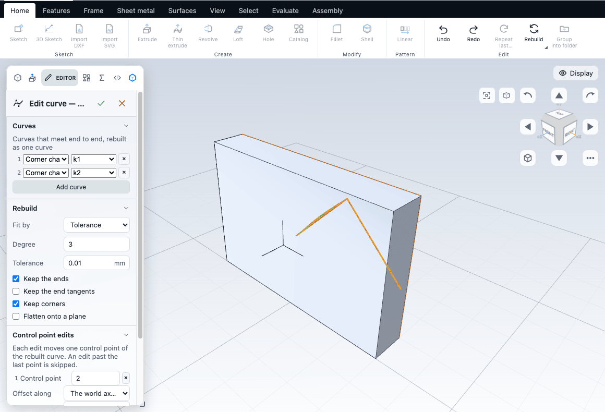

# Curves on faces

Three commands reshape geometry without making a solid. **Project curve** lays a sketch or an earlier curve onto the faces of a part, **Edit curve** rebuilds edges and curves into one smooth curve, and **Freeform** pushes a face into a new shape with a control net.

**Project curve** and **Edit curve** sit on the **Reference** button of the **Features** tab, with Plane, Axis and Helix. **Freeform** sits on the **Edit** button of the **Surfaces** tab, with Trim surface, Knit and Thicken. All three are in command search (**F**), and each is greyed out until it has something to work on. Each result is an ordinary feature: it sits in the tree, rebuilds with the part and takes part in undo.

## Project curve

Project curve takes a curve that lies flat (a sketch, or a curve feature you made earlier) and lands it on the faces you choose. What comes out is one smooth curve lying on those faces, which a later Project curve or Edit curve can take as its source.

1. Make a sketch that holds the curve, or select a curve feature in the tree.
2. In Face mode (**Q**) pick the faces the curve should land on. Pick none to use every face of the part and of its surfaces.
3. Choose **Features > Reference > Project**.
4. Set the options, then press **Enter** or the tick.

| Option | What it does | Default |
|---|---|---|
| Project | The source: a sketch or an earlier curve. With none selected it takes the sketch selected in the tree, else the last sketch that holds a curve. | The last sketch with a curve |
| Onto faces | The faces the curve lands on. | The picked faces, else every face |
| Direction | **Both ways**, **Along the sketch normal** or **Against the sketch normal**. | Both ways |
| Degree | How smooth the curve is. Must be between 2 and 9. | 3 |
| Fit tolerance | How closely the curve follows the faces, in millimetres. | 0.001 mm |

The note in the editor says what to expect: the result is one smooth curve lying on the faces, and a curve that misses every face is reported. If the result comes in several separate pieces, the editor's note says so, but check the curve in the view. A projection that reaches no face is refused and the feature is left as it was.

## Edit curve

Edit curve rebuilds a chain of edges, sketch curves or an earlier curve into one smooth curve, keeping the ends and the corners you ask it to keep. The pieces must meet end to end, in the order you add them.

1. In Edge mode (**E**) pick the edges of the chain, or select a curve feature or a sketch in the tree.
2. Choose **Features > Reference > Edit curve**.
3. Set the rebuild and the keep options, add control point edits if you want to shape it, then press **Enter**.

| Option | What it does | Default |
|---|---|---|
| Curves | The chain, one row each, with **Add curve**. | The picked edges, else the sketch or curve feature selected in the tree, else the last one |
| Rebuild, Fit by | **Tolerance** follows the picks to a tolerance; **Number of control points** fits a fixed count. | Tolerance |
| Degree, Tolerance or Control points | The numbers of the chosen fit. The degree must be between 2 and 9. | Degree 3, tolerance 0.01 mm |
| Keep the ends, Keep the end tangents, Keep corners | What the rebuilt curve must match at its ends and at a corner. | Ends and corners kept |
| Flatten onto a plane, Plane | Puts the curve flat on a plane instead of following the picks. | Off |
| Control point edits | **Add edit**, then a control point number, a direction (the world axes, or the curve's tangent, normal and binormal), an offset and a weight. An edit past the last point is skipped. | None |

## Freeform

Freeform rebuilds a face as a net of control points and lets you push some of them. Pick faces in Face mode (**Q**) and choose **Surfaces > Edit > Freeform**. The editor has two sections.

**Control net**

| Option | What it does | Default |
|---|---|---|
| Face | The faces to rebuild. | The picked face |
| Degree U, Degree V | How smooth the net is along each direction. | 3 and 3 |
| Spans U, Spans V | How many pieces the net is cut into along each direction. | 2 and 2 |

The note under the fields gives the size of the net: with the defaults the face is rebuilt as a 5 x 5 net of points, numbered from 0. Rebuilding alone does not change the shape.

**Point moves**

- **Add move** adds a row. **Points (column,row)** names the points to shift: `2,2`, or `2,2; 2,3` for several, counted from 0 in the corner of the net.
- **Offset X**, **Offset Y** and **Offset Z** move them by that many millimetres. **Offset along** chooses the frame: the world axes, the face (X and Y along it, Z out of it), or a plane with **Plane**.
- **Spread to neighbours** shares the move with the points around it (0 is none). **Mirror about** repeats it across a plane. **Skip this edit** turns a row off without deleting it.

The outer ring of the net never moves, so the face keeps the border it shares with its neighbours. Moving points works on exactly one face: the editor says so when you have picked several. Several faces can be rebuilt at once, but their points cannot be moved by these edits.

## Common problems

| Symptom | Fix |
|---|---|
| Project curve is greyed out | It needs a body or a surface, and a sketch or curve to project. Start a sketch, or select one in the tree |
| The curve misses every face | Move the sketch over the part, or pick the faces the curve does cross, or change the direction |
| A degree is refused | The degree must be between 2 and 9 |
| Edit curve will not build | The chain must meet end to end. Keep **Keep corners** on for a chain with a corner, and check the order of the rows in **Curves** |
| Freeform says to pick a single face | Point moves work on one face only. Clear the extra picks, or delete the moves |
| The face will not move at its border | The outer ring never moves. Move points inside the ring |
| An edit does nothing | An edit past the last point of the net is skipped. Check the control point number |

## Next

- [Surfaces](surfaces.md)
- [Reference geometry](reference-geometry.md)
- [Offsets and references](../sketching/offset-reference.md)
- [Commands and shortcuts](../reference/commands.md)
