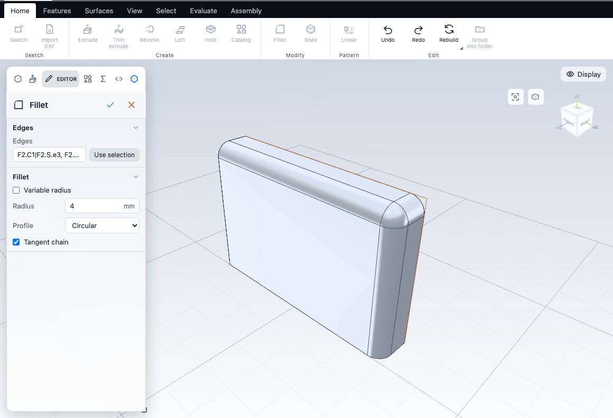

# Fillets, chamfers, shells and drafts

These features change a body that already exists. Fillet rounds edges, Chamfer bevels them, Shell hollows the body, and Draft tilts faces so a part can leave a mould. You select edges or faces on the model first, then run the command.

## Selecting what to change

Pick modes decide what a click selects. The Select tab and the keys switch them: **Face** (Q), **Edge** (E), **Corner** (V), **Body** (B). The mode named **Auto** picks whatever is nearest the pointer. See [Selecting things](../getting-started/selection.md).

- **Fillet and Chamfer** accept selected edges, selected corners, or two or more selected faces.
  - Edges: each selected edge is rounded.
  - A corner: every edge that ends at the corner is rounded, so rounding a cube corner rounds its three edges.
  - Two or more faces: every edge that two of the selected faces share is rounded. For two faces that is their common edges, including every arc of a ring that is split into arcs. If the faces share no edge, the command says "These faces do not share an edge" and adds nothing.
- **Shell** needs one or more selected **faces**: the faces that are left open.
- **Draft** needs one or more selected **faces**: the faces to tilt.

A command that cannot run is greyed, and its tooltip says why. The messages include "Select edges, or two or more faces, to round", "Select a second face (or select edges) to round", "Switch to edge selection to round edges" and "Select one or more faces to leave open".

Each command is also in the canvas right-click menu: right-click an edge or corner for Fillet and Chamfer, and a face for Fillet, Chamfer, Shell and more.

## Fillet

A fillet rounds the sharp edge between two faces with a smooth arc.

1. Select the edges (or faces) as above.
2. Choose **Home > Modify > Fillet** (Shift+F). **Chamfer** (Shift+B) shares the same button and is in its list: click the small triangle on the button.
3. The Editor opens with a small radius, so the first preview shows only a slight rounding. Type the radius you want, then confirm with the tick or Enter.

A new fillet starts with a small radius: about 5% of the smallest dimension of the body, rounded to a tidy value (a 40 x 25 x 10 mm body gives 0.5 mm). Change it to the size you need. A new chamfer starts with the same small distance.

| Option | What it does | Default |
|---|---|---|
| Edges | The list of edges. Use selection fills it from the model and keeps following the selection until you click Done. | The selected edges |
| Radius | Constant radius in mm. For the Chordal profile it is labelled Chord width. | About 5% of the smallest dimension |
| Variable radius | Gives each edge a Start radius and an End radius that blend along it. The start is the end of the edge nearer where you picked it. These two fields take plain numbers, not expressions. | Off |
| Profile | The cross-section of the round (see below). | Circular |
| Conic ratio (0 to 1) | Fullness of a conic round. Shown for Conic. | 0.5 |
| Shape (0.1 to 1) | Shape of a curvature-continuous round. Shown for Curvature continuous (G2). | 0.5 |
| Tangent chain | Also rounds the edges that continue the selected ones smoothly. | On |

**Profiles.**

- **Circular** is the usual round, a circular arc.
- **Conic** is flatter or fuller than a circle, controlled by the Conic ratio.
- **Chordal** is sized by the width of the chord rather than the radius.
- **Curvature continuous (G2)** blends into both faces without a visible change in curvature, controlled by Shape.

**Tangent chain.** With it on, selecting one edge of a rounded outline rounds the whole outline: edges that meet at a vertex and continue each other within 1 degree, and the other arcs of a ring split into arcs. The extra edges are lit before you run the command, and the Editor says "N more edge(s) added through the tangent chain". Face selections are not chained. The choice is remembered in your browser. Switching it in the Editor re-applies it to the feature's edge list.

**Variable radius rules.** Edges that meet at a corner of a variable fillet need the same radius where they meet. A radius of 0 at one end is built as a very small radius.

**Corners.** Where three rounded edges meet at a convex corner, the kernel adds a spherical patch. If edges meeting at a corner have different radii they end in a mitre, and the feature shows a warning.

Not offered: the corner (vertex) chamfer type and the full-round fillet between three faces.

**Handle.** With an edge selected, a yellow dot appears beside it. Drag it outward for a new fillet, or inward for a chamfer, and release to make the feature. With an edge next to an existing fillet or chamfer, drag the dot to change its size in place. Hold Shift for fine movement, Ctrl for whole millimetres, or type a number while dragging (a minus sign makes a chamfer) and press Enter. Esc cancels. You can switch handles off in the workspace settings.

See [fillet](/docs/cad/kernel/format/features-edits.html#fillet) in the kernel book.

## Chamfer

A chamfer cuts a flat bevel along an edge. Select edges exactly as for Fillet and choose **Chamfer** (Shift+B).

| Option | What it does | Default |
|---|---|---|
| Chamfer type | Equal distance, Two distances, or Distance and angle. | Equal distance |
| Distance (Distance 1) | The leg of the bevel, in mm. Same default as a fillet radius. | About 5% of the smallest dimension |
| Distance 2 | The second leg. Shown for Two distances. | Same as Distance 1 |
| Angle | The angle between the bevel and the first face, in degrees. Shown for Distance and angle. | 45 |
| Tangent chain | As for Fillet. | On |

For Two distances and Distance and angle, Distance 1 is measured on the first face of each picked edge. If the legs end up on the wrong faces, swap the two values. See [chamfer](/docs/cad/kernel/format/features-edits.html#chamfer).

## Shell

Shell hollows the body to a wall thickness and removes the faces you selected, leaving an open box or a cup.

1. Switch to Face mode and select the faces to leave open.
2. Choose **Home > Modify > Shell** (Shift+S).

| Option | What it does | Default |
|---|---|---|
| Faces | The faces to open. Use selection refills it. | The selected faces |
| Wall thickness | Thickness of the walls in mm. | The larger of 1 mm and 2% of the smallest dimension, rounded to 0.1 |
| Grow outward | Builds the walls outward from the existing surface instead of inward. | Off |

With the shell selected, an arrow on the inner wall changes the thickness when you drag it.

A wall that is too thick for the part fails with "the wall is thicker than the part allows". The Editor offers **Use suggested thickness (N mm)**, the largest wall that works. Walls also fail where a tight inside curve is smaller than the wall: use a thinner wall, or round the curve first. See [shell](/docs/cad/kernel/format/features-edits.html#shell).

## Draft

Draft tilts faces by an angle about a neutral plane. Use it on the walls of a moulded or cast part so it can be pulled out of the tool.

1. Switch to Face mode and select the faces to tilt.
2. Choose **Features > Modify > Draft** (Shift+G).

| Option | What it does | Default |
|---|---|---|
| Faces | The faces to tilt. | The selected faces |
| Angle | Draft angle in degrees. | 3 |
| Neutral plane | The plane that stays fixed, and whose normal is the pull direction. Pick sets it from a selected face. | The plane of the first sketch in the part |

Faces keep their names when drafted, so later features still find them. A face parallel to the neutral plane cannot be drafted. An angle that turns an edge over fails with the kernel's message "edge &lt;faces&gt; turns over", naming the two faces that meet at the edge: use a smaller angle. Faces that continue a drafted face smoothly are drafted with it. See [draft](/docs/cad/kernel/format/features-edits.html#draft).

To check the result, use **Draft analysis** on the Evaluate tab. See [Surfaces](surfaces.md#surface-analysis).

You can also taper an extrusion directly with its Draft angle option. See [Extrude, revolve, sweep and loft](solids.md).

## Rib and lip

Two more edits share the Draft button (**Features > Modify**).

- **Rib** adds a thin wall from an open sketch line to the body. Draw a line or chain that reaches the body, then choose Rib. The Editor has Profile and Thickness (about 10% of the smallest dimension at first). A line that does not reach the body fails with "does not touch the body". See [rib](/docs/cad/kernel/format/features-solids.html#rib).
- **Lip / groove** adds a raised band along the rim of a flat face, or cuts a groove into it. Select the rim face (Face mode), then choose Lip / groove. It follows every edge of the picked faces. The Editor has Kind (Lip or Groove), Width and Height, both about 5% of the smallest dimension at first. See [lip](/docs/cad/kernel/format/features-edits.html#lip).

## When a feature fails

A fillet, chamfer or shell the kernel refuses still opens its Editor as a draft, with a plain-words reason. Cancel removes the draft.

| Message | What to do |
|---|---|
| "the rounding runs off the faces beside it" | The radius is wider than the neighbouring faces. Use a smaller radius, keep Tangent chain on so the round runs on through corners, or round fewer edges at once. |
| "the radius is too large for these edges" | Use a smaller radius. |
| "the rounding could not be built" | Try a smaller radius, fewer edges at once, or a different order. |
| "this edge or corner shape cannot be rounded yet" | Try fewer edges, a chamfer instead, or leave the rounding to the end of the history. |
| "the wall is thicker than the part allows" | Use a thinner wall, or click Use suggested thickness. |
| "a face or edge it uses no longer exists" | An earlier edit renamed or removed what the feature was built on. Pick the edges or faces again, or undo. See [The feature tree and history](history.md). |

Rounding order matters. Large rounds first, small rounds and chamfers last, and rounds at the very end of the history are the least likely to break when you edit an earlier feature.

## Next

- [Holes and threads](holes.md)
- [Patterns, mirror and scale](patterns.md)
- [Bodies and combining](bodies.md)
- [The feature tree and history](history.md)
