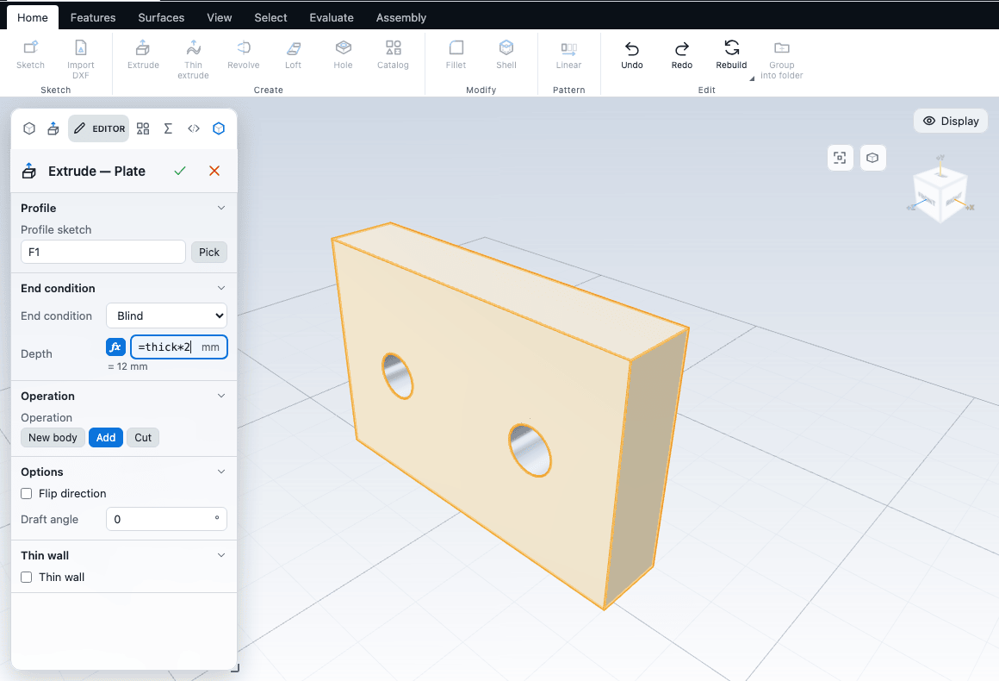
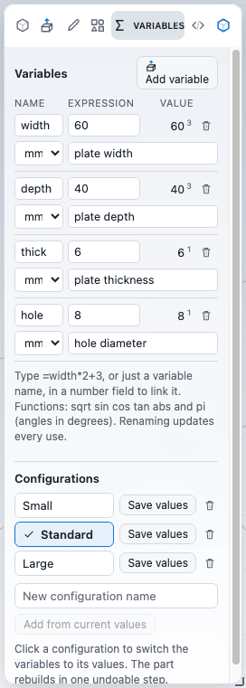

# Equations and variables

Any number you type into a feature can be a formula instead. You can also define named values (variables) once and use them in many places, so that changing one number resizes the whole part. This chapter covers variables, expressions in fields, units, evaluation order, and what the errors mean.

## Typing a formula in a field

Every number field in the feature Editors accepts three kinds of input:

- A plain number, such as `12.5`.
- A variable name, such as `width`.
- An expression that starts with `=`, such as `=width*2+3`.

A number stays a number. Anything else is stored as an expression and re-evaluated whenever a variable changes.

While the text is an expression:

- The field shows a blue **fx** badge. The evaluated value shows under the field (for example `= 6 mm`).
- A bad expression shows its error and is **not applied**. The model keeps the last good value.
- Variable names, the functions and `pi` complete as you type. Use the arrow keys with Enter or Tab, or click.
- Click **fx** to keep the current value as a plain number and break the link.

Some fields take a plain number only, because the app itself calculates with them. These say "This field takes a plain number" if you type a formula. They are the draft angle, the Start and End radius of a variable fillet, the scale factors, the loft tensions, and the thread length.

Drag handles on the canvas (the depth arrow, the size box) are not offered for a field that holds an expression, so a drag cannot silently replace your formula. Remove the formula first if you want to drag.

### Sketch dimensions

A sketch dimension takes the same text. Double-click the dimension label (or its row in the constraints list), and type a number, a name or `=expression`. The dimension is drawn with an `fx` mark, and the sketch is solved again whenever a variable changes. Typing a plain number unlinks it. The value boxes that follow the pointer while you draw accept an expression, but only its value is used there and no link is made.

Sketch point coordinates and circle radii in the sketch itself are plain numbers. To drive a size from a variable, dimension it and give the dimension an expression. See [Constraints and dimensions](../sketching/constraints.md).

## The Variables panel

Open it from **Home > Create > Variables** (it shares the Catalog button) or from the **Variables** tab of the left panel.

Each row has:

| Column | What it is |
|---|---|
| Name | Letters, digits and `_`, not starting with a digit. Case sensitive. |
| Expression | A number or an expression. It can use other variables. |
| Value | The evaluated result in mm or degrees. A small number beside it counts the places that use the variable. Hover for the list |
| Unit | A label: blank, `mm` or `°`. It is a note for you. It does not change the value |
| Comment | Free text |

Click **Add variable** to add a row; a new one starts as `10` with the unit `mm`. Edit any cell in place. A cell commits when you press Enter or leave it.

- **Rename** rewrites every use in one step: other variables, configurations, feature fields (`=w*2` becomes `=width*2`) and sketch dimensions. Only whole names are replaced, so `w` does not touch `w2`.
- **Delete** works only for a variable nothing uses. A used one is refused with "&lt;name&gt; is used by &lt;places&gt;. Change those fields first."
- Nothing is applied until the whole list evaluates. If it does not, the row shows the error and the part is unchanged.
- If every row is valid but the part cannot rebuild with the new values (for example a depth that becomes zero), the whole change is refused with "The part would not rebuild with that change, so nothing was changed", and the failing features are shown.
- Each change is **one undo step** in the same history as feature edits. It appears in the History as Edit variables, Rename variable, Add variable and so on.

A worked example. Define `t = 4` and `d = t*2`. Type `=d` into an Extrude depth. The depth is 8. Change `t` to `5` and the depth becomes 10.

## Writing expressions

| Part | What is allowed |
|---|---|
| Operators | `+  -  *  /  ^` and parentheses. `^` is right-associative and binds tighter than unary minus: `-2^2` is -4 and `2^3^2` is 512 |
| Functions | `sqrt`, `sin`, `cos`, `tan`, `abs`, each with one argument in parentheses. Angles are in degrees. Names are not case sensitive |
| Constant | `pi` |
| Variables | By name. Variable names are case sensitive |
| Numbers | `12`, `.5`, `1e3`. A comma counts as the decimal point, so `1,5` is 1.5 |

Not available: `min`, `max`, `round`, and conditions. They are reported as unknown names.

### Units in expressions

You can put a unit directly after a number. The unit converts the number to millimetres (or degrees):

| Unit | Multiplier |
|---|---|
| `mm`, `deg`, `°` | 1 |
| `cm` | 10 |
| `m` | 1000 |
| `in` | 25.4 |

So `=3 in` is 76.2, `=2 cm` is 20, and `=1.5 m` is 1500. Length fields are in millimetres and angle fields are in degrees. The unit only scales the number. It is not checked against the kind of field, so `=90 deg` in a length field is just 90.

A unit has to follow a number. It cannot follow a name or a parenthesis. `=3 mx` and `=width mm` are errors. Variable names cannot be `pi`, a function name or a unit.

For the full grammar and a table of results, see [Variables and expressions](/docs/cad/kernel/format/expressions.html) in the kernel book.

## Order of evaluation

Variables can use each other in any order. You do not have to define a variable before you use it. The part works out the values by repeatedly evaluating every variable whose expression uses no unresolved variable.

- `a = b + 1` with `b = 5` works whichever row comes first.
- A **cycle** (`a = b + 1` and `b = a + 1`) cannot be solved. The panel refuses it with "Circular reference between variables".

## Errors

| Message | Meaning |
|---|---|
| Not a valid expression | A syntax problem: a missing parenthesis, `sqrt 4` without brackets, a result that is infinite (`1/0`) |
| Unknown variable | The name is not defined (names are case sensitive: `W` is not `w`) |
| Invalid name: letters, digits and _, not starting with a digit, and not pi, sqrt, sin, cos, tan, abs or a unit | The variable name breaks the rules |
| Name already in use | Two variables share a name |
| Circular reference between variables | Variables depend on each other in a loop |
| This field takes a plain number | The field is one the app calculates with |

If a feature uses a variable that is missing or cannot be worked out, the feature fails and shows in red in the tree, with a message such as an invalid expression. Define the variable or correct the formula. See [The feature tree and history](history.md).

## Configurations

A configuration is a named set of variable values, such as Small, Standard and Large.

- **Add from current values** captures the current expressions under the name you typed in **New configuration name**.
- Click a configuration to switch the variables to its values. The part rebuilds in one undo step.
- **Save values** stores the current expressions into that configuration. A configuration whose values no longer match the variables is marked *modified*.
- Renaming or deleting a variable updates the configurations.

Configurations are saved in the part file, but other programs that rewrite the part may not keep them.

## Next

- [The feature tree and history](history.md)
- [Constraints and dimensions](../sketching/constraints.md)
- [Units and settings](../getting-started/settings.md)
