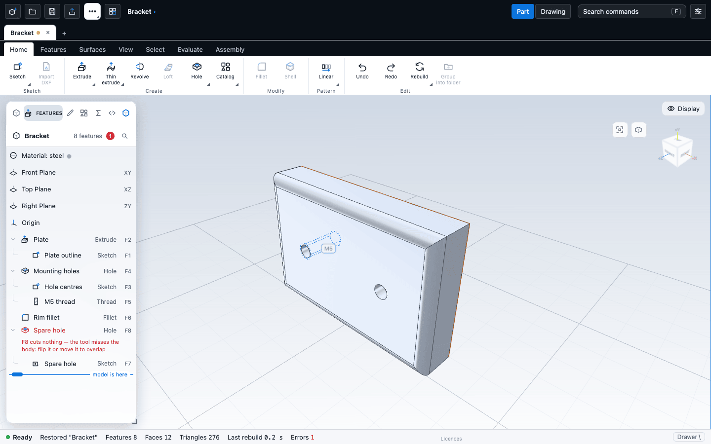
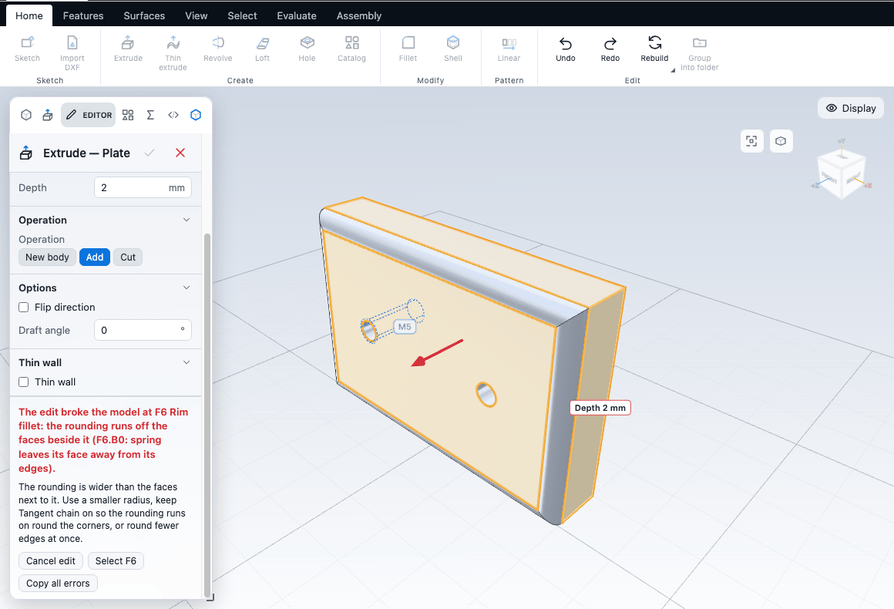

# The feature tree and history

Every part is a list of features, built in order from top to bottom. The feature tree shows that list. You can rename, reorder, suppress, delete and group features, step back in time with the rollback bar, and undo or redo any change. This chapter also explains what happens to later features when you edit an earlier one.

## The feature tree

The tree is the **Features** tab of the left panel. At the top it shows the part name (double-click it, or press F2 with no feature selected, to rename the part), the number of features, and a count of failed ones in red. Below that come fixed rows for the material, the Front, Top and Right planes, and the origin, then one row for each feature.

A row shows the feature's icon, its name, and its id (such as F4) in muted text. Some details:

- A sketch is tucked under the first feature that uses it. Click the chevron to open or close it. A thread sits under its hole.
- A note such as "patterned by F7" marks a feature that a pattern repeats.
- A **failed** feature is red with the reason under it. A feature that only fails because an earlier one failed is muted and says "blocked by F3": click it to jump to the cause.
- An amber ! on a row is a warning. The feature still works. Hover for the text.
- A **suppressed** feature is dimmed and in italics.
- Hovering a row tints in the view what the feature made. Hovering a face in the view marks its feature's row.

Select a row with a click. Ctrl-click (Cmd on a Mac) toggles one more, and Shift-click selects a range. With a row selected, the rows that depend on it get a thin marker at the left edge.

### Search

Press **Ctrl+F** in the tree, or click the magnifier, to search features by name, type or id (for example `F62`, `revolve`, `lens`). Enter or Down goes to the next match, Shift+Enter or Up to the previous, and Esc clears the search.

### Row buttons

Hovering or selecting a row shows buttons on its right:

| Button (tooltip) | What it does |
|---|---|
| Select in viewport | Selects the faces the feature made (not for sketches and planes) |
| Edit | Opens the feature's Editor |
| Roll back to here | Moves the rollback line below this row |
| Hide (view only) / Show | Hides or shows what the feature made. Nothing is rebuilt |
| Suppress (rebuilds) / Unsuppress (rebuilds) | Suppresses or restores the feature. It shows a pause icon |
| Remove | Deletes the feature. It shows a trash icon |

When several rows are selected, the buttons act on all of them.

## Rename

Select a feature and press **F2**, or choose **Home > Edit > Rename**. Type a name and press Enter. Esc cancels. An empty or unchanged name cancels. Renaming is one undo step. A generated name for a plane or a sketch, such as "Plane 10 from Front", keeps following its settings until you give it a name of your own.

## Suppress

Suppressing a feature builds the part as if it were not there, without deleting it. Select it and press **Ctrl+Shift+U**, click its Suppress button, or choose **Suppress / unsuppress** from the right-click menu. With a mix of suppressed and active features selected, they all become suppressed. If they are all suppressed, they all come back. Suppress a feature to see the part without it, or to find out which later features depend on it. Like any edit, a suppress that would break a later feature is refused and the model stays as it was.

## Delete

Select one or more features and press **Delete** or **Backspace**, or click its Remove button. A "Deleted F5" notice appears with an **Undo** button.

If a feature you did not select still uses the one you are deleting (a sketch used by an extrude, a seed used by a pattern), the delete is refused and the message names what uses it. Select those too and they go together. Deleting is one undo step.

## Reorder

Drag a row onto another row to move it there. A feature travels with the sketches tucked under it. A move is refused, with a short message, when it would put a feature before one it uses, for example before its own sketch. A Loft that you point at a later sketch is moved for you, and the app says "Loft moved after ...".

## The rollback bar

The **model is here** line in the tree marks how far the model is built. Drag it up between rows to see the part as it was at that point. Features below the line are greyed out and not built.

- Drag the line, or focus it and press Up, Down, Home or End.
- Click the **Roll back to here** button on a row to put the line below that row.
- Click **Roll forward** on the line, or choose **Home > Edit > Roll forward**, to return to the end.
- While rolled back, new features are added right after the line and the line moves past them.
- A sketch you start while rolled back previews on the part as it is at the line.

The rollback line is only a view. Every feature is still in the part. The line is not saved and is not an undo step, and reloading the part puts it back at the end.

## Folders

A folder groups neighbouring features under one collapsible row. It changes only the tree, not the order or the result.

1. Select two or more features that are next to each other.
2. Choose **Group into folder** (**Ctrl+G**, or **Home > Edit**, or the right-click menu).
3. Type a name. It starts as "Folder".

Click a folder to open or close it. Double-click it, or choose **Rename folder**, to rename it. A button on the folder row selects every face of the group in the view.

Drag a row onto a folder to put it at the end of that folder. Drag it onto a row in the folder to take that place, or onto a row outside to leave. Drag a folder header onto a row or another folder to move the whole folder. Folders do not nest.

| Right-click on | Choices |
|---|---|
| A feature | Group into folder (Ctrl+G), Remove from folder (when in one), Rename (F2), Suppress / unsuppress (Ctrl+Shift+U), Delete |
| A folder | Rename folder, Ungroup, Delete folder |

**Ungroup** removes the folder and leaves the features where they are. **Delete folder** deletes its features, with the same rules and Undo notice as Delete.

A folder action is refused when the rows are not neighbours ("Only features next to each other can be grouped; folders do not change the build order"), when it would put a feature before one it uses, when the name is taken, or when it would split another folder. Whether a folder is open or closed is remembered in your browser for each part; long parts start with their folders closed.

## Undo and redo

Every change is one undo step: a new feature, an edit confirmed in the Editor, a rename, a delete, a suppress, a move, a variable change, a folder action, or a whole drag. A drag is previewed first and only counts when you release it.

| Action | Keys | Where |
|---|---|---|
| Undo | Ctrl+Z (Cmd+Z) | Home > Edit |
| Redo | Ctrl+Shift+Z or Ctrl+Y | Home > Edit |
| Rebuild | Ctrl+B | Home > Edit |

Rebuild builds the part again from the document and shows "Rebuilt". Use it when something looks stale. The kernel does not keep a cache, so every build is a full rebuild.

**The History log.** Open the drawer (**View > Workspace > Toggle drawer**, or the backslash key) and choose **History** for a log of every edit. Filter by All, You, Agent (edits made through the MCP server, see [Agents and the MCP server](../automation/mcp.md)) or Failed. Click an entry to go back to that step: the later steps are undone, and Redo can bring them back. A "model is here" line shows where you are. Rejected edits appear in the log marked failed, so you can see what was refused.

Each open part (tab) has its own undo history. A part restored after a crash comes back without its undo steps.

## Editing an earlier feature

Double-click a row, click its Edit button, or double-click one of its faces in the view (not while sketching). The Editor opens on that feature, with a live preview. Everything after it is rebuilt as you type.

What happens to later features:

1. **The values still work.** Features keep referring to faces and edges by name (for example the top face of F2). Changing a depth, a radius or a sketch size keeps those names, so later features follow the change. A fillet on a box edge stays on that edge when the box grows.
2. **A name disappears.** If the edit removes or reshapes what a later feature points at (for example you delete the feature that made the face, or change a sketch so that an edge no longer exists), that later feature fails with "a face or edge it uses no longer exists".
3. **The app protects the model.** While you type, the preview shows the problem. If the draft would break the model, the tick is greyed out with "This change breaks the model (F5). Cancel or adjust." Holding Shift while you confirm tries it anyway. An edit that the kernel refuses is not applied at all: you get "This edit was not applied; your model is unchanged", the cause and a list of things to try, and **Undo this change**, **Cancel edit** and **Select F5** buttons.

Tips that make editing earlier features safer:

- Put fillets, chamfers and shells late in the history.
- Dimension and constrain sketches, and give features and sketches clear names.
- Use variables for sizes that several features share. See [Equations and variables](equations.md).
- Use **Suppress** to test whether a feature is the cause.
- Use the rollback line to edit a feature "as it was" without looking at the later features.

## Failures and the Diagnostics tab

Failed features are red in the tree. The drawer's **Diagnostics** tab explains the **cause** first and lists the features that only fail because of it. Fix the cause and the others usually clear. See [Checks and diagnostics](../analysis/checks.md).

## Next

- [Equations and variables](equations.md)
- [Fillets, chamfers, shells and drafts](edges.md)
- [Saving and opening](../files/files.md)
- [Checks and diagnostics](../analysis/checks.md)
