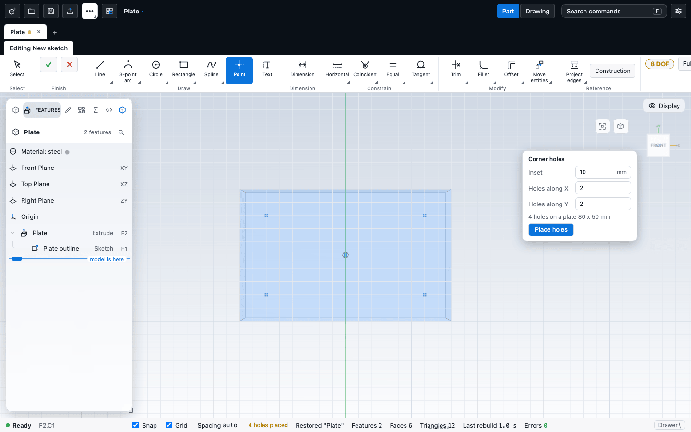

# Holes and threads

The Hole feature drills plain, counterbored and countersunk holes at points you place on a face, using standard metric sizes. The Thread feature then marks a hole wall or a shaft as threaded, either as a drawing-style marker or as a real helical groove.

## Make a hole

A hole is drilled at the points of a sketch. There are two ways to start.

**From a face.**

1. Select one flat face of the body. Face mode (Q) makes this easy.
2. Choose **Home > Create > Hole** (Shift+H).
3. A new sketch opens on that face with the Point tool active and the hint "Place the hole centres with the Point tool or use Corner holes, then confirm the sketch". Click to place one point per hole.
4. Confirm the sketch with the tick. The hole is added and the Hole editor opens on it.

If you confirm a sketch with no point, the hint appears again and no hole is made. Cancelling the sketch adds nothing.

**From a sketch of points.** If the part already has a sketch that contains point entities, Hole with no face selected uses it at once. It uses the sketch selected in the tree, else the last sketch that has points. Draw such a sketch with the Point tool on a face or plane. See [Sketch tools](../sketching/tools.md).

The direction is chosen so the hole goes into the body. If it points the wrong way, tick **Flip direction** in the Editor.

Hole is disabled until the part has a solid and you have either one face selected or a sketch of points. The right-click menu on a face also lists Hole.

### Corner holes

When you start a hole from a face, a **Corner holes** card appears at the top right of the canvas. It places mounting holes on a rectangular plate in one click.

| Field | What it does | Default |
|---|---|---|
| Inset | Distance from both edges to each hole centre, in mm. | 10 |
| Match corner fillet (R x mm) | Shown when the face has equal rounded corners. The inset follows the corner radius, so each hole sits concentric with its corner. | On when shown |
| Holes along X, Holes along Y | Holes on each row and column, corners included. 2 and 2 is the four corners. 3 adds a hole in the middle of each side. | 2 and 2 |

Click **Place holes**, then confirm the sketch. Placing again replaces the earlier corner points, but keeps points you added by hand. When you reopen the hole later, the same card shows with **Update holes**, which re-places the points against the face as it is now (useful after the plate changes size) without touching the hole's size or type.

The card refuses an inset of 0 or less, or of half the plate or more, and counts below 2. It warns when less than 1 mm of material is left at the edge. If the face is not a rectangle with equal corners, the holes are placed against its bounding box and the card says so. Slanted edges, unequal corners and slots all fall into this case. The inset is a plain number. The card is not shown for a sketch on a standard plane (use the Point tool).

## The Hole editor

Double-click the hole in the feature tree to reopen it. The Editor has five sections.

| Control | What it does | Default |
|---|---|---|
| Hole type | Simple, Counterbore or Countersink. | Simple |
| Counterbore diameter, Counterbore depth | Size of the step. Counterbore only. | Table values for the size |
| Countersink diameter, Countersink angle | Size and included angle of the cone. Countersink only. | Table diameter, 90 degrees |
| Size | M2 to M24, or Custom diameter. Custom is for Simple holes only. | M6 |
| Diameter | Hole diameter in mm. Custom only. | |
| Fit | Tap drill, Close, Normal or Loose. Tap drill is for Simple holes only. | Normal |
| Hole diameter | A read-out of the finished diameter from size and fit. | |
| End condition | Blind, Through or Up to next. | Through |
| Depth | Depth in mm. Blind only. | Twice the diameter, at least 10 mm |
| Drill point tip (118 degrees) | Ends a blind hole in a drill-point cone. Blind only. | Off |
| Flip direction | Drills the other way. | Off |
| Threaded | Adds a thread to the wall (see below). Simple holes only. | Off |

A new hole starts with the type, size and fit of the last hole you confirmed. A custom diameter is not remembered. Number fields take expressions and variables. See [Equations and variables](equations.md).

### Sizes and fits

Choosing a size fills in everything that goes with it. The hole diameter depends on the fit: Tap drill suits a hole you will tap, Close and Normal are clearance for a bolt, and Loose is a generous clearance. All values are in mm.

| Size | Tap drill | Close | Normal | Loose | Counterbore diameter x depth | Countersink diameter |
|---|---|---|---|---|---|---|
| M2 | 1.6 | 2.2 | 2.4 | 2.6 | 4.3 x 2.3 | 4.4 |
| M2.5 | 2.05 | 2.7 | 2.9 | 3.1 | 5.0 x 2.8 | 5.5 |
| M3 | 2.5 | 3.2 | 3.4 | 3.6 | 6.5 x 3.4 | 6.5 |
| M4 | 3.3 | 4.3 | 4.5 | 4.8 | 8.0 x 4.4 | 8.6 |
| M5 | 4.2 | 5.3 | 5.5 | 5.8 | 10.0 x 5.4 | 10.4 |
| M6 | 5.0 | 6.4 | 6.6 | 7.0 | 11.0 x 6.4 | 12.4 |
| M8 | 6.8 | 8.4 | 9.0 | 10.0 | 15.0 x 8.6 | 16.4 |
| M10 | 8.5 | 10.5 | 11.0 | 12.0 | 18.0 x 10.6 | 20.4 |
| M12 | 10.2 | 13.0 | 13.5 | 14.5 | 20.0 x 12.6 | 24.4 |
| M16 | 14.0 | 17.0 | 17.5 | 18.5 | 26.0 x 16.6 | 32.4 |
| M20 | 17.5 | 21.0 | 22.0 | 24.0 | 33.0 x 20.6 | 40.4 |
| M24 | 21.0 | 25.0 | 26.0 | 28.0 | 40.0 x 24.8 | 48.4 |

The counterbore values follow ISO 4762 socket-head screws, and the countersink diameters follow ISO 10642. Counterbores and countersinks always use an ISO size, so they have no Custom diameter. For them, Tap drill counts as Normal. You can type your own counterbore or countersink dimensions; impossible values (a step wider than the body, a cone with no room) come back as an error with a hint.

For a size that is not in this table, choose Custom diameter on a Simple hole.

### End conditions

- **Blind** drills to the Depth you type.
- **Through** drills through the whole body. There is no bottom face.
- **Up to next** is offered, but the kernel currently drills it the same as Through.

### Several positions

A hole with several points shares one set of settings: editing it edits all positions at once. Each position has its own wall, which matters for threads.

### The diameter handle

For a Simple hole, select the cylindrical wall of the hole in the view. A dot appears on the wall. Drag it to change the diameter, which then becomes a Custom diameter. Counterbore and countersink holes take their sizes from the table, so there is nothing to drag.

For the exact definition, see [hole](/docs/cad/kernel/format/features-edits.html#hole) in the kernel book.

## Threads

A thread feature marks a cylindrical face as threaded: the wall of a hole, or a shaft. It records the standard, size, class, length and hand. By default it is **cosmetic**: the model does not change, the thread appears as a marker in the view, and it is available to drawings and checks. If you turn on **Model the thread**, the kernel cuts a real helical groove.

### Add a thread to a hole

The easy way is inside the Hole editor.

1. Open the hole in the Editor and tick **Threaded** at the top of the Size section. Only Simple holes can be threaded.
2. The hole is drilled to the tap drill of the thread. The size picker becomes a thread picker. A **Thread options** section appears with Length, Hand and Model the thread.
3. Confirm. The hole and the thread are one undo step, and editing the hole later updates the thread with it.

Clearing Threaded puts the hole's own size back and removes the thread. With several hole positions you get one thread per position, all with the same settings.

### Add a thread to any cylinder

Use this for shafts, or for holes made some other way.

1. In Face mode, select the cylindrical face. The command only enables for a cylinder, not for a flat face with a round hole in it.
2. Choose **Home > Create > Thread** (Shift+T). It is in the Hole button's list.
3. The Thread editor opens. The new thread uses the metric size nearest the face diameter, full length, right hand, cosmetic.

You can select several faces first (Ctrl-click or Shift-click) and get one thread per face, all editable together. **Select same size** (Select tab, Expand group) selects every cylinder in the body with the same diameter and kind, so all holes of one diameter are one click.

### The Thread editor

| Control | What it does | Default |
|---|---|---|
| Standard | ISO metric coarse, ISO metric fine, UNC, UNF, BSP parallel (G), NPT (tapered), Trapezoidal (Tr), Acme. Changing it picks the nearest size of the new standard. | ISO metric coarse |
| Common sizes | Chips for the usual sizes of the standard. | |
| Size | A search box. Type to filter (`m6`, `1/4`, `g1/2`), use Up and Down, and Enter to pick. The sizes nearest the face diameter come first. | Nearest to the face |
| Class | The tolerance class. It is recorded with the thread and does not change the geometry. | The standard's usual class |
| Length | Full (the whole face) or Custom (a number in mm, held between one pitch and the face length). | Full |
| Hand | Right or Left. | Right |
| Start | Open end, Top or Bottom. Shown only when it matters, that is when both or neither end of the face is open. | Open end |
| Model the thread | Cuts a real helical groove. Slower to rebuild. Remembered as the default for new threads. | Off |

A read-out card shows the pitch and the diameters that matter: for a hole the tap drill and minor diameter, for a shaft the major diameter and root diameter.

**Fit check.** The thread editor compares the face with the thread. An internal thread wants a hole within 3 percent of the tap drill, and an external one wants a shaft within 3 percent of the major diameter. A green "Fits" line means it does. An amber line gives the kernel's advice and a one-click **Use M8** (or whatever is nearest) button. For example, a 6.5 mm hole with an M6 thread shows "hole is 6.5, M6 tap drill is 5". Drill the hole to the tap drill, or pick the size that fits.

**Length handle.** While the Thread editor is open, a dot sits on the axis at the end of the thread. Drag it to set the length; at the face length it becomes Full. Ctrl snaps to whole millimetres. The value goes into the Editor, and you confirm as usual.

When threads are made together, or sit next to each other with identical settings, the Editor edits them as a group, and the face chip says "4 holes, Ø 5 mm". To edit one alone, change its settings first, or give it its own Shift+T.

### Cosmetic or modelled?

| | Cosmetic (default) | Modelled |
|---|---|---|
| Body geometry | Unchanged | A helical groove is cut |
| In the view | Dashed rings and lines at the thread, with the size as a label; hide them with **View > Appearance > Show > Threads** | The groove itself |
| Rebuild time | Fast | Slower, many more triangles |
| Good for | Normal modelling, drawings, hole callouts | Showing or printing a real thread |

Some threads cannot be modelled, and then the thread stays cosmetic and the Editor shows "Not built: ..." with the reason. This happens for tapered NPT threads, threads of more than 60 turns, lengths shorter than one turn, a bore or shaft that does not match the thread, and a failed cut.

### Patterns

A linear or circular pattern, or a mirror, copies the threads of the features it repeats. The copies are not separate tree rows. Edit the source thread and every copy follows. See [Patterns, mirror and scale](patterns.md).

For the exact definition, see [thread](/docs/cad/kernel/format/features-edits.html#thread) in the kernel book.

## Common problems

| Symptom | Fix |
|---|---|
| Hole is greyed out | Select exactly one flat face, or make a sketch of points first. |
| The hole goes the wrong way | Tick Flip direction. |
| Thread is greyed out | Select a cylindrical face in Face mode. A flat face with a round hole in it is not a cylinder; select the wall inside the hole. |
| Amber "does not fit" line | The hole or shaft diameter is not the thread's tap drill or major diameter. Use the suggested size, or edit the hole. |
| "The thread tables are not loaded yet" | Wait a moment and try again. |
| The Threaded box is disabled | Only Simple holes can be threaded. Counterbore and countersink walls are not a single cylinder. |

## Next

- [Patterns, mirror and scale](patterns.md)
- [Fillets, chamfers, shells and drafts](edges.md)
- [Equations and variables](equations.md)
- [The feature tree and history](history.md)
