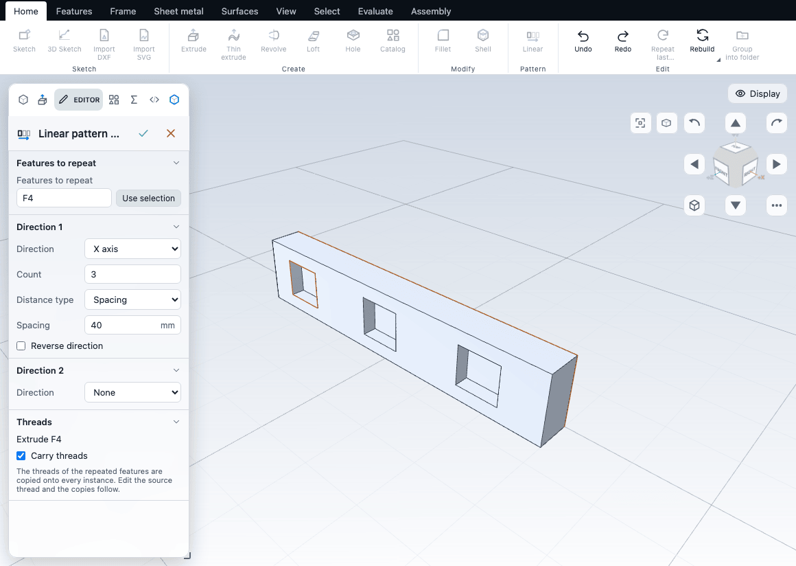
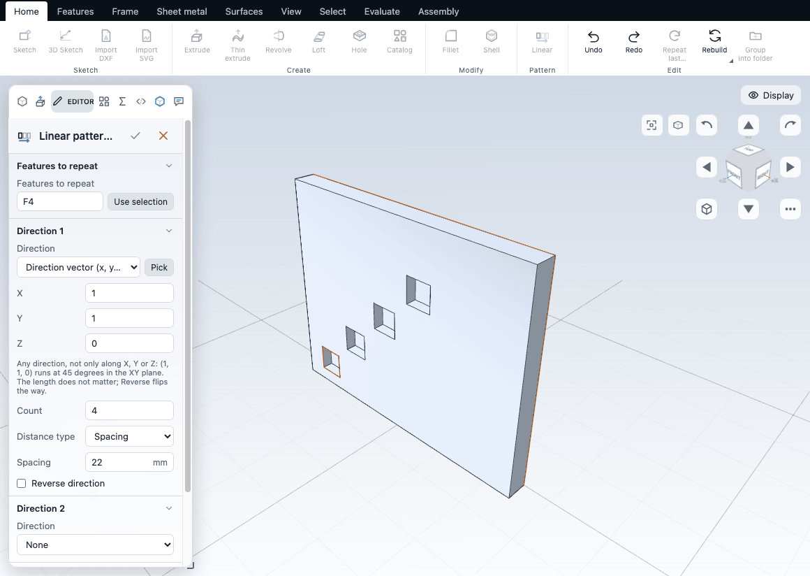
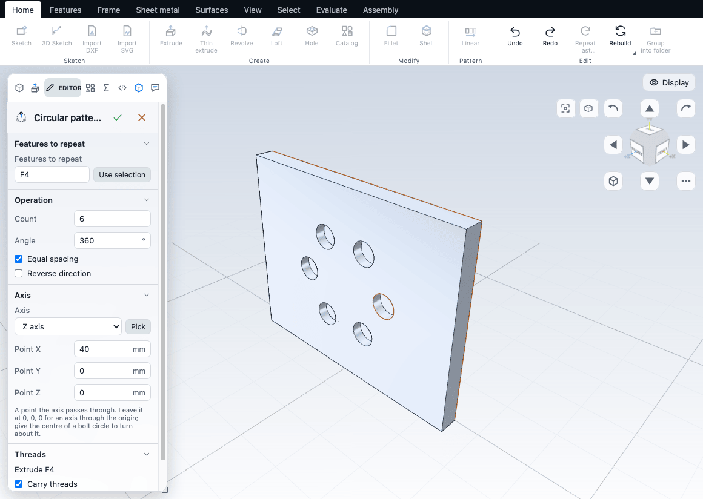

# Patterns, mirror and scale

Patterns repeat a feature in a row, in a grid, around an axis or along a path. Mirror reflects a feature, or the whole body, about a plane. Scale makes the part larger or smaller. All three work on features and bodies that already exist.

## Seeds: what gets repeated

Linear pattern, Circular pattern and Mirror copy **features**, not faces. The feature that is repeated is called the **seed**. A seed is a feature that made material or removed it: an extrude, a cut, a revolve, a hole, a sweep, a loft, or an earlier pattern.

- The copies are combined with the body in the same way as the seed. Copies of a cut cut, and copies of a boss add.
- A copy that falls outside the body does nothing. It is not an error, but the pattern gets a warning that lists those copies (see [When copies miss, stand apart or overlap](#when-copies-miss-stand-apart-or-overlap)).
- A pattern of a pattern is allowed.

The command chooses the seed for you: the feature selected in the feature tree, or if none is selected, the last feature that is not a sketch, plane, axis or pattern. Select the feature in the tree before you run the command if you want a different one. In the Editor the seed appears under **Features to repeat**, as a list of feature ids such as `F4`, separated by commas.

When a seed is a hole with a thread, the Editor shows what is meant ("Hole F4 + Thread F5"). See [Threads in patterns](#threads-in-patterns).

## Linear pattern

A linear pattern makes copies of the seed in a row.

1. Select the feature in the tree (optional).
2. Choose **Home > Pattern > Linear pattern** (Shift+L). You can also right-click a face or the body and choose it there.
3. Adjust the Editor and confirm.

The Editor has a **Direction 1** and a **Direction 2** section. Each direction has the same options:

| Option | What it does | Default |
|---|---|---|
| Direction | What the copies run along: the X, Y or Z axis, a **Direction vector (x, y, z)** (any direction, such as (1, 1, 0) for 45 degrees; the length does not matter), or a **straight edge or round face picked in the view** with the **Pick** button (the copies run along the edge from its start to its end, or along the axis of the round face, and follow it when the part changes). Direction 2 also has **None**, which turns it off. | Direction 1: the world axis along which the body is longest. Direction 2: None |
| Count | Number of instances along this direction **including the seed**. A count of 1 or less makes no copies. | 3 (Direction 2: 2 when you turn it on) |
| Distance type | **Spacing**: the distance between neighbouring copies. **Extent**: the distance from the seed to the last copy; the copies are spread evenly over it, and it stays the same when you change Count. **To object**: the last copy reaches a plane, a flat face or a point (see below). | Spacing |
| Spacing | With Spacing: the distance between neighbours, in mm. | About 20% of the body length along the direction, rounded to a tidy value (1, 1.5, 2, 2.5, 3, 4, 5, 6, 8 or 10 times a power of ten), at least 1 mm |
| Extent | With Extent: seed to last copy, in mm. Must be above 0. | The span the copies covered when you switched |
| Object | With To object: Front, Top or Right plane, an earlier Plane feature, or a face. Click **Pick** and click a flat face in the view. | None (pick one) |
| Offset | With To object: moves the end the way the copies go. A negative offset stops short of the object. | 0 |
| Reverse direction | Copies go towards the negative direction. Not shown for To object: the object sets the side. | Off |

The Editor also has **Features to repeat** (the seeds, as feature ids) and, when the part contains threads, **Carry threads** (see below).

With Direction 2 on, the pattern is a grid: Count x Count 2 instances. The two directions must point different ways (a direction along the first is refused).

### To object

The last copy reaches the object, measured from the middle of what is repeated (the centre of the box around the seed). With a plane or a flat face, that is where a line from the middle along the direction meets it, so the face must lie across the direction, not along it. The copies follow the object: move the plane or the face and the copies spread out or close up to it. If the object lies behind the seed, the copies go the other way.

The pattern is refused, with a message, when the object runs along the direction (no copy can reach it), when it lies at the middle of the seed or the offset takes the end back past the seed, or when the face is curved.

The script API (see [Scripting](../automation/scripting.md)) can also give a point: `linearPattern({ count: 3, to: [50, 0, 0] })`.

## Circular pattern

A circular pattern turns copies of the seed around an axis.

Choose **Home > Pattern > Circular pattern** (Shift+P). It is on the same button as Linear pattern: click the small triangle to open the list.

| Option | What it does | Default |
|---|---|---|
| Features to repeat | The seeds. | The seed chosen as above |
| Axis | The X, Y or Z axis, **Direction and point (x, y, z)** for a typed direction (it can be oblique), or a straight edge or round face picked in the view with **Pick** (the copies turn about the edge, or about the axis of a round face such as a hole wall, and follow it when the part changes). | The world axis along the body's shortest dimension |
| Axis point | Shown for the X, Y, Z and typed axes: a point the axis passes through. 0, 0, 0 is an axis through the origin; give the centre of a bolt circle to turn about it. | 0, 0, 0 |
| Count | Number of instances including the seed. | 3 |
| Angle | With Equal spacing: the total angle the copies are spread over. Without it: the step between neighbours. In degrees. | 360 |
| Equal spacing | On: copies are spread evenly, so 360 degrees with 4 copies puts them 90 degrees apart, and any smaller total puts the last copy exactly at the Angle. Off: the Angle is the gap between neighbours. | On |
| Reverse direction | Turns the other way. | Off |
| Carry threads | As for Linear pattern. | On |

Known limits of the circular pattern:

- The axis is not the centre of the part and not the seed's own axis unless you say so: set the **Axis point** to the centre you want (a bolt circle round (40, 0) is the Z axis through the point 40, 0, 0), or pick the edge or the round face that marks it.
- A seed that ends up outside the body after turning produces no change and no error.

## Pattern on path

A pattern on path repeats the seed along an open sketch: a chain of lines and arcs.

1. Draw the path as a sketch. It must be open: a chain with two loose ends.
2. Select the feature to repeat in the tree (optional).
3. Choose **Home > Pattern > Pattern on path** (on the same button as Linear pattern).

The command uses the newest open sketch, or the one selected in the tree, and spreads 3 instances over its whole length.

| Option | What it does | Default |
|---|---|---|
| Path sketch | The open sketch the copies follow. | The newest open sketch |
| Count | Number of instances including the seed. | 3 |
| Distance type | **Spacing** between neighbours along the path, or **Extent** from the seed to the last copy. | Extent |
| Spacing / Extent | In mm, measured along the path. | The path length |
| Start point | **Distance along the path** (mm) or **Fraction of the path** (0 to 1). Where the seed sits along the path; the copies follow on from there. A fraction keeps its place when the path gets longer or shorter. | 0 |
| Run from the other end | The path runs from its other end. | Off |
| Orientation | **Fixed**: the copies are moved but not turned. **Follow the path**: the copies turn with the path, so a seed beside an arc stays beside it all the way round. | Fixed |

The path runs from its end nearest the seed. The seed does not have to sit on the path: each copy keeps the seed's offset from the path (turned with it when Orientation is Follow the path).

A last copy that would lie past the end of the path is refused, and the message gives the largest spacing that fits. A start point outside the path is refused too.

## When copies miss, stand apart or overlap

After a linear, circular or path pattern is built, the feature gets a warning (the triangle in the feature tree) when:

- some copies change nothing: a cut copy misses the body, or a boss copy lies inside the material. The warning lists the copy numbers;
- boss copies do not touch the body, so each stands as a body of its own;
- copies overlap each other, because the spacing is smaller than the seed. For a linear pattern in one direction the warning gives the smallest spacing that keeps them apart.

These are warnings, not errors: the pattern is still built.

## Mirror

Mirror reflects the seed about a plane. The copy is the seed's mirror image on the other side.

1. Select the feature in the tree (optional).
2. Select one flat face if you want to mirror about that face (optional).
3. Choose **Features > Modify > Mirror** (Shift+M).

With exactly one face selected, the mirror plane is that face. Otherwise it is the Right plane. The Editor has **Features to repeat**, **Plane** (Pick sets it from a selected face), and a checkbox whose label is the raw field name, `body` (there is no friendlier text for it). Tick it to reflect the whole body made so far and unite it with itself. A reflection that lies clear of the body is added as a separate body.

For the exact definitions of the features, see the kernel book: [linear pattern](/docs/cad/kernel/format/features-patterns.html#lpattern), [circular pattern](/docs/cad/kernel/format/features-patterns.html#cpattern), [pattern on path](/docs/cad/kernel/format/features-patterns.html#curvepattern) and [mirror](/docs/cad/kernel/format/features-patterns.html#mirror).

## Threads in patterns

A pattern or mirror carries the threads of its seeds onto the copies, so a threaded hole patterned six times has six threads. When the part contains threads, the Editor shows a **Threads** section that lists the seeds in words and has a **Carry threads** checkbox (on by default).

- Off: the copies are plain holes and shafts. List a thread feature itself under Features to repeat to copy just that one.
- The copies are not separate tree rows. The seed and its thread show a note "patterned by F7" in the tree. Edit the source thread and every copy follows. If you try to add a thread to a face that gets its thread from a pattern, the app edits the source thread instead and says so.
- A drawing callout for a threaded hole that is patterned reads, for example, `4x M5 THRU`.

See [Holes and threads](holes.md).

## Scale

Scale makes the part bigger or smaller without changing how its features are named.

Choose **Features > Modify > Scale**. It is enabled when the part has a solid. A new Scale doubles the whole part about its centre of mass. Change it in the Editor.

| Option | What it does | Default |
|---|---|---|
| Same in every direction | One factor for all directions. Untick it for a factor per axis. | On |
| Factor | The scale factor. A plain number. Must be above 0. | 2 |
| Factor X, Factor Y, Factor Z | One factor per axis. Shown when Same in every direction is off. | The same value as Factor |
| About | The point that stays fixed: Centre of mass or Origin. | Centre of mass |
| Bodies | Which bodies are scaled. It shows "The whole part". | The whole part |

Scale is exact for flat faces, for cylinders and cones stretched along their axis, for free-form faces, and for spheres and tori under a uniform factor. It is refused, with a hint, for the cases it could not keep exact: round faces stretched across their axis, a sphere or torus with different factors per axis, and surfaces made by revolving, extruding, screw or offset operations. The part is left as it was. Negative factors are refused: use Mirror instead.

Scale acts on the bodies as they are at that point in the history. Features added after it work on the scaled part. See [scale](/docs/cad/kernel/format/features-patterns.html#scale) in the kernel book.

## Not available

These are known in the file format but cannot be built yet, so the app has no command for them:

- Patterns driven by a sketch of points or a fill of a face.
- Dome, split line and offset surface.

To copy whole bodies, use **Copy** in the Bodies panel. See [Bodies and combining](bodies.md).

## Common problems

| Symptom | Fix |
|---|---|
| The pattern shows no copies | Copies fall outside the body; the warning on the feature lists them. Check Count, Spacing and Reverse direction. |
| "the object runs along the pattern direction" | To object needs a plane or face across the direction. Pick another face, or a plane square to the direction. |
| "the last copy lies past the end of the path" | Use the spacing the message gives, fewer copies, or an earlier start point. |
| The wrong feature is repeated | Select the right feature in the tree before running the command, or edit Features to repeat. |
| "a face or edge it uses no longer exists" | The seed was deleted or renamed by an earlier edit. See [The feature tree and history](history.md). |
| Circular pattern rotates about the wrong centre | Set the Axis point to the centre of the circle, or pick the edge or round face that is its axis. |
| A picked edge or face is refused (missingReference) | A direction or axis needs a straight edge or a round (cylindrical) face. A flat face or a curved edge has no single direction. |
| The copies of an edge-direction pattern go the wrong way | Tick Reverse direction: the edge runs from its start to its end as the kernel reads it. |
| Scale is refused | See the cases above. Scale the sketch before extruding instead, or use uniform factors. |

## Next

- [Moving things: the move / rotate ball and handles](transforms.md)
- [Bodies and combining](bodies.md)
- [Holes and threads](holes.md)
