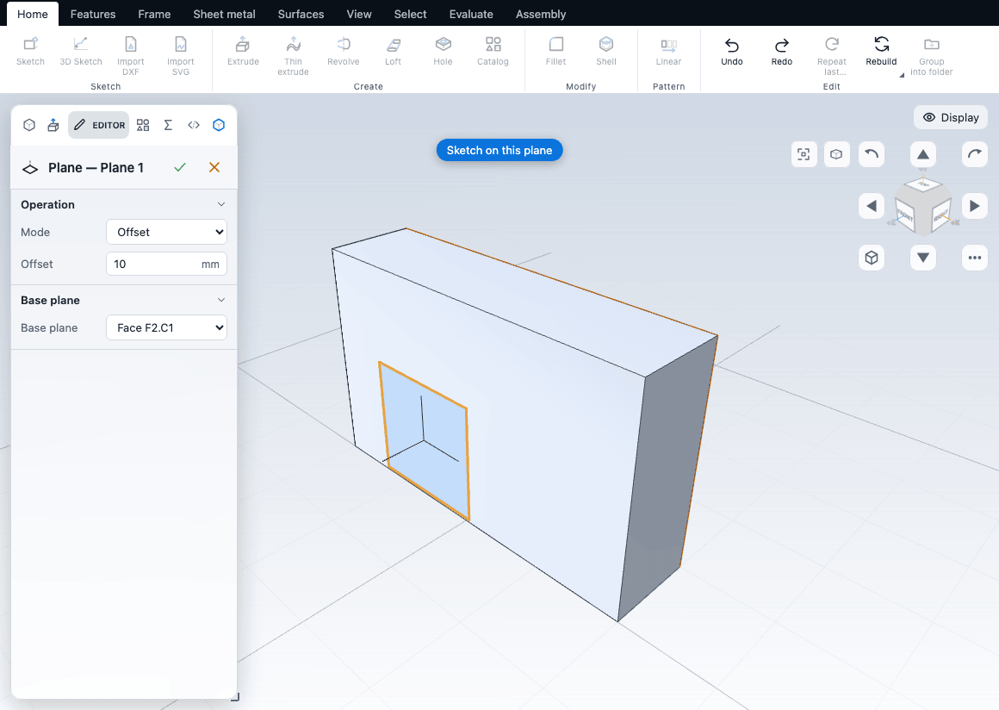

# Reference geometry

Reference geometry is construction aid that has no volume of its own: planes to sketch on, axes to turn things about, and helix curves. You make them from the **Reference** group of the **Features** tab, which holds one button with **Plane** (Shift+N), **Axis** (Shift+A) and **Helix**.

None of these change the solid. They appear in the feature tree and in the view, and later features use them.

## Plane

A reference plane is a flat sheet of any size that you can sketch on, mirror about, or hang another plane from.

### Create one

The command picks its starting point from what you have selected:

| You selected | The new plane |
|---|---|
| Two faces | A **Midplane**: halfway between them |
| One flat face | An **Offset** plane, 10 mm from that face |
| A Plane feature in the tree | An Offset plane, 10 mm from it |
| The Front, Top or Right plane in the tree | An Offset plane, 10 mm from it |
| Nothing | An Offset plane, 10 mm from the Front plane |

The plane's name is made from its settings, for example "Plane 10 from Front" or "Plane between F2.C1 and F2.C0". It updates when you change the offset or base, until you rename it yourself.

### The Plane editor

| Control | What it does | Default |
|---|---|---|
| Mode | How the plane is made: Offset, Angle, Midplane, Parallel, Three points. Origin and directions appears only for a plane that already uses it | Offset (Midplane for two faces) |
| Offset | Distance in mm along the base plane's normal. A negative value goes the other way | 10 |
| Angle | Degrees. Shown only for a plane that already has an angle | |
| Flip direction | Turns the plane around so it faces the other way. In Offset mode the base is flipped before the offset is applied, so the plane lies on the other side of the base (offset 10 flipped is 10 mm the other way). In Angle mode it negates the angle. Shown only for a plane that already has it set; a new plane starts without it | Off |
| Base plane | The plane to start from: Front Plane, Top Plane, Right Plane, an earlier Plane feature, or the face it hangs on ("Face F2.C1") | The base chosen as above |

Offset and Midplane are complete: pick the base (and, for a midplane, the two faces at creation) and the plane is built. The other modes need extra references that the Editor cannot set yet: Angle needs a line to turn about, Parallel needs a point, Three points needs three points, Origin and directions needs vectors. If you switch a plane to one of them it fails with a "missing reference" error and the plane is not built. Switch back to Offset or Midplane. For midplanes, the Editor can change the first base only; to change the second face, delete the plane and make it again.

The kernel has more plane modes (perpendicular, line and point, normal to a path or curve, tangent to a cylinder or sphere). The app uses the tangent plane by itself when you sketch on a curved face. See [planes](/docs/cad/kernel/format/planes.html#the-plane-feature) in the kernel book.

### Using a plane

- **Sketch on it.** Select the plane in the tree and press **S**, or choose **Sketch on selected face or plane**. The sketch origin is the plane's origin. See [Starting a sketch](../sketching/start.md).
- **Mirror about it.** Pick it in the Mirror editor. See [Patterns, mirror and scale](patterns.md).
- **Draft against it.** A plane can be the neutral plane of a draft. See [Fillets, chamfers, shells and drafts](edges.md).
- **Base another plane.** Select it, then run Plane again.

Planes are drawn only while the **Planes** layer is on (**View > Appearance > Show**). A plane that follows a face moves when the face moves.

### Limits

A plane made from a face needs that face to be flat. If an earlier edit removes the face or base a plane hangs on, the plane fails, and so do the sketches built on it. See [The feature tree and history](history.md).

## Axis

An axis is a straight reference line.

### Create one

| You selected | The new axis |
|---|---|
| One cylindrical face | The cylinder's centre line |
| Two faces | The line where their planes meet |
| Nothing | The line where the Front and Top planes meet (the X axis) |

If you select one flat face, the command makes the axis, then the kernel reports that the face is not cylindrical and nothing is added. Select a cylinder, or two faces. Only the first two selected faces are used.

The Axis Editor has no fields: the references are fixed when it is created. To change them, delete the axis and make another.

### Using an axis

An axis is drawn while the **Axes** layer is on. The kernel lets a plane in Angle mode turn about it, but the app's editors do not yet offer an axis feature in a list. The Circular pattern axis is a choice of the X, Y or Z axis (through the origin or through a point), a typed direction, or a picked edge or round face, and Revolve uses a construction line in its own sketch. So an Axis is mostly a visual and measuring aid today. See [Patterns, mirror and scale](patterns.md) and [Extrude, revolve, sweep and loft](solids.md).

For the exact definition, see [axis](/docs/cad/kernel/format/planes.html#the-axis-feature) in the kernel book.

## Helix

A helix is a spiral curve around an axis, such as the centre line of a spring or a screw. It adds no solid.

### Create one

1. Draw a sketch with a **circle**. The circle gives the radius and the centre. See [Sketch tools](../sketching/tools.md).
2. Choose **Features > Reference > Helix**.

The command uses the sketch selected in the tree, else the last sketch with a circle. It is greyed out if there is none. The helix runs along the sketch normal, through the circle's centre, starting at the sketch plane.

### The Helix editor

| Control | What it does | Default |
|---|---|---|
| Profile sketch | The sketch with the circle | The sketch chosen as above |
| Defined by | Which two sizes are set: Pitch and revolutions, Pitch and height, Revolutions and height | Pitch and revolutions |
| Pitch | Rise per full turn, in mm | About 10% of the smallest body dimension, rounded to a tidy value (1 with no body) |
| Revolutions | Number of turns | 5 |
| Height | Total rise in mm | 10 |
| Start angle | Where the helix starts, in degrees from the sketch's x axis | 0 |
| `leftHand` | Check for a left-hand helix. The label is the raw field name | Off (right hand) |
| Reverse direction | Rises against the sketch normal | Off |

The third size is calculated from the two you choose with Defined by. With the default, Height has no effect.

Known gap: the kernel reads the Defined by choices as "pitch and revolutions", "height and revolutions" and "height and pitch". The app's list names Pitch and height and Revolutions and height with different internal names, so for now those two choices behave like Pitch and revolutions. Use Pitch and revolutions, and set Pitch and Revolutions to get the height you want (height is pitch times revolutions).

### Using a helix

A helix is a curve, drawn while the **Curves** layer is on. The kernel can sweep a profile along a helix to make a spring or coil. The Sweep editor in the app, however, lists open sketches only as paths, so you cannot pick a helix there. For threads, use the Thread feature instead. See [Holes and threads](holes.md). To sweep along a helix today, use scripting. See [Scripting](../automation/scripting.md).

For the exact definition, see [helix](/docs/cad/kernel/format/features-solids.html#helix) in the kernel book.

## Next

- [Starting a sketch](../sketching/start.md)
- [Extrude, revolve, sweep and loft](solids.md)
- [Patterns, mirror and scale](patterns.md)
