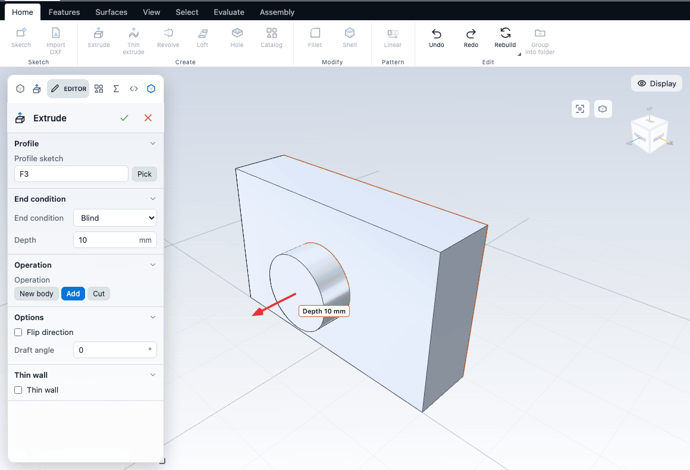
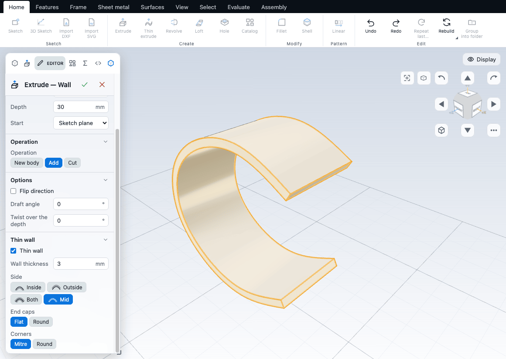
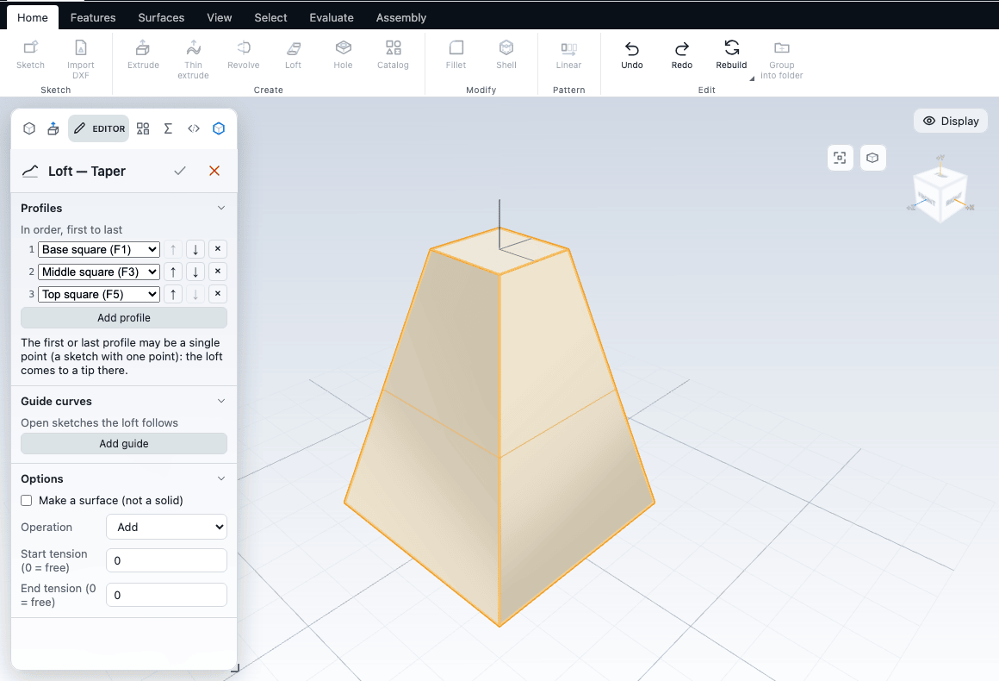

# Extrude, revolve, sweep and loft

These four features turn sketches into solids: Extrude pushes a profile in a straight line, Revolve turns it about an axis, Sweep drags it along a path, and Loft blends between several profiles. You can use each one to add material, cut material, or start a separate body.

## How every solid feature works

1. Draw the sketch (or sketches) first. See [Starting a sketch](../sketching/start.md).
2. Run the command. The feature is added to the feature tree straight away with sensible defaults, the Editor opens on it, and the model shows a live preview.
3. Change the options. The preview follows every change.
4. Click the tick at the top of the Editor (or press Enter) to confirm, or the cross (or Esc) to cancel. Confirming is one undo step.

If the kernel cannot build the first attempt (for example Loft with profiles it cannot join), the feature still opens in the Editor as a draft with the reason shown, so you can fix the values. Cancel removes the draft.

**Which sketch is used.** The command uses the sketch you selected in the feature tree. With nothing selected it uses the newest sketch that still has shapes no feature has used. If every sketch is already used, the app says "Every sketch is already used by a feature. Select a sketch in the tree to use it again, or draw a new one (S)." With no sketch at all it says "Draw a sketch first".

While you are inside a sketch, the **Make** group of the Sketch tab has Extrude and Revolve buttons. They finish the sketch and start the feature in one step.

**Ribbon buttons with several tools.** Some buttons hold a family of tools, for example Loft and Sweep. The button shows the tool you used last. Click the small triangle on it, right-click it, or press and hold to open the list. The Extrude button is the exception: it always runs Extrude, and Extruded cut is chosen from its list.

## Extrude

Extrude pushes the closed shapes of a sketch along the sketch normal.

Start it from **Home > Create > Extrude** (Shift+E). **Extruded cut** (Shift+C) is in the same button's list and starts with the operation set to Cut. Right-clicking empty canvas also lists both.

The Editor has these parts. Defaults are what a new feature starts with.

| Option | What it does | Default |
|---|---|---|
| Profile sketch | The sketch to extrude. Pick changes it. | The sketch chosen as above |
| End condition | How far the extrusion goes (see below). | Blind |
| Depth | Length in mm. Shown for Blind and Mid plane. For Mid plane it is labelled Total depth. | 10 mm |
| Operation | New body, Add or Cut (see below). | Chosen from the situation |
| Body name | Name of the new body. Shown for New body. | Body 1, Body 2, ... |
| Flip direction | Extrude the other way. Not shown for Mid plane or Through all, both ways. | Off |
| Draft angle | Tapers the walls, in degrees. 0 means straight. Not available for Mid plane or Through all, both ways. | 0 |
| Draft outward | Tapers the walls outward instead of inward. Shown when the draft angle is above 0. | Off |
| Thin wall | Builds a wall around the curve instead of filling it (see [Thin walls](#thin-walls)). | Off |
| Shapes | One checkbox per closed shape in the sketch. Shown when the sketch has two or more shapes. | All checked |

Number fields accept expressions and variables. The draft angle is the exception: it takes a plain number. See [Equations and variables](equations.md).

### End conditions

| End condition | The extrusion goes |
|---|---|
| Blind | The Depth you type, from the sketch plane. |
| Mid plane | Half the Total depth each side of the sketch plane. |
| Through all | From the sketch plane through the whole body. |
| Through all, both ways | Through the whole body on both sides of the sketch plane. |
| Up to next | To the next face of the body in the extrusion direction. |

With no body yet, Through all uses a length of 1000 mm. Up to next with no body, or with no face ahead of the sketch, fails with a message in the Editor.

The kernel also knows the end conditions Up to face, Offset from face and Up to point, but it does not cut them yet, so the app does not offer them. To end a boss at a face, use Through all or Up to next, or set a Blind depth.

### Add, cut or new body

The **Operation** control decides how the solid meets the body you already have.

- **Add** joins the new solid to the body.
- **Cut** removes the new solid from the body.
- **New body** keeps the new solid as a separate body, even where it overlaps or touches another body. It gets a name (Body 1, Body 2, ...) that you can edit. To merge bodies later, use Join in the Bodies panel. See [Bodies and combining](bodies.md).

A new Extrude starts as:

- **Cut** when you used Extruded cut.
- **Add** when it is the first solid of the part, or when the sketch plane reaches the existing body.
- **New body** when the part already has a solid and the sketch plane does not reach it.

You can always change it in the Editor.

Only Extrude chooses its operation this way. Revolve, Thin revolve, Sweep and Loft always start as **Add**; switch to Cut or New body in the Editor if you need it.

The direction is chosen for you. A boss grows away from the face its sketch sits on. A cut tries both sides and keeps the one that actually touches the body. Tick Flip direction to reverse either.

If a cut removes nothing, the Editor says "Nothing to cut: no body under this sketch." or "Nothing to cut: this cut does not reach any body." The second message comes with a one-click **Add instead** button, and a **Flip direction** fix is offered when the cut misses in this direction.

### Draft and tips

A draft angle tapers the extrusion toward its end. A drafted extrusion of a circle comes to a point at some height. If you type a taller depth, the app lowers it to that height and says "Limited to the tip (N mm)". Lower the angle or the depth to avoid it.

### Shapes (regions)

A sketch can hold several closed shapes, and shapes inside shapes (a circle in a rectangle). By default all are extruded and inner shapes become holes. In the Shapes list, untick a shape to leave it out, or untick the outer one to extrude only the inner disc. One shape must stay ticked. Hovering a row lights the shape in the view. This also lets one sketch feed several features: a new Extrude picks up the shapes nothing has used yet.

### The depth arrow

While the Extrude editor is open, an arrow on the preview sets the depth. Drag it, hold Ctrl to snap to whole millimetres, or type the number in the Editor to be exact. It is shown for Blind and Mid plane only, and not when Depth holds an expression.

### Thin walls

Thin wall builds a wall of a given thickness around the curves instead of filling them. It works on open curves (a C-shape, a polyline), where it gives a wall in one step, and on closed curves, where it gives a hollow wall. It is available in Extrude, Extruded cut and Revolve. The **Thin extrude**, **Thin cut** and **Thin revolve** commands (Home > Create, the button after Extrude) start with it on.

| Option | What it does | Default |
|---|---|---|
| Thin wall | Switches the wall on. | Off |
| Wall thickness | Thickness in mm. | About 10% of the profile size, at least 1 mm |
| Side | Inside, Outside, Both or Mid. Inside is the inner side of a bend, or the interior of a closed loop. Mid centres the wall on the curve. | Inside |
| Other side thickness | Thickness of the second side. Shown for Both. | Same as Wall thickness |
| End caps | Flat or Round. Shown when the sketch has an open chain. | Flat |
| Corners | Mitre or Round. | Mitre |

A thickness the curve cannot take (thicker than a bend radius, or eating a short segment) shows a hint with the largest thickness that works.

If you extrude an open sketch without Thin wall, the Editor shows a card "This profile is open" with three buttons:

- **Make thin wall** turns the option on.
- **Close with a line** adds the missing segment to the sketch, and shows the gap in the view. It is disabled when the sketch has no single chain with two loose ends.
- **Extrude as surface** turns the feature into an extruded surface (Extrude only). See [Surfaces](surfaces.md).

For the exact definition of Extrude and its thin walls, see the kernel book: [extrude](/docs/cad/kernel/format/features-solids.html#extrude), [thin walls](/docs/cad/kernel/format/features-solids.html#thin-walls).

## Revolve

Revolve turns a closed profile about a line of the same sketch.

1. In the sketch, draw the closed profile on one side of a **construction line**. The construction line is the axis. See [Sketch tools](../sketching/tools.md) for how to make a line a construction line.
2. Choose **Home > Create > Revolve** (Shift+R), or the Revolve button in the Sketch tab.

The axis is the first construction line of the sketch. With none, the app says "Draw a construction line for the axis" and creates nothing. The Axis field in the Editor shows the line in use.

| Option | What it does | Default |
|---|---|---|
| Profile sketch, Axis | The sketch and its axis line. | First construction line |
| End condition | Blind turns from the sketch plane by the Angle. Mid plane centres the turn on the sketch plane. | Blind |
| Angle | Degrees of turn. For Mid plane it is labelled Total angle. | 360 |
| Operation, Body name | Same controls as Extrude. A new Revolve always starts as Add | Add |
| Flip direction | Turn the other way. Not shown for Mid plane. | Off |
| Thin wall, Shapes | As for Extrude. | Off, all |

A full 360 degree turn has no end caps. A profile that crosses the axis fails with "the profile crosses the axis": move it to one side. Revolve has no draft and no other end conditions. See [revolve](/docs/cad/kernel/format/features-solids.html#revolve) in the kernel book.

## Sweep

Sweep moves a closed profile along an open path.

1. Draw the **path** as an open chain of lines and arcs in one sketch, or, for a path that bends in all three directions, as one spline in a [3D sketch](../sketching/sketch-3d.md).
2. Draw the **profile** as a closed shape in a second sketch on a plane that is perpendicular to the path at its start.
3. Choose **Home > Create > Sweep** (Shift+W), or pick it from the Loft button's list.

With nothing selected, Sweep takes the newest unused closed sketch as the profile and the newest unused open sketch as the path. The Editor lets you change both.

| Option | What it does | Default |
|---|---|---|
| Profile (closed) | The profile sketch. | Newest unused closed sketch |
| Path (open) | The path sketch. | Newest unused open sketch |
| Guide curves | Open sketches the profile scales to follow. Add guide adds one; the guide must be as long as the path. | None |
| Twist over the path | Degrees of turn along the path. Hidden when there are guide curves. | 0 |
| Operation, Body name | As for Extrude. | Add |

Common failures: the profile is not perpendicular to the path start, the path has a sharp kink, or a corner between a line and an arc is not tangent (make the arc tangent). Sweeping into a sheet is not available. A helix (see [Reference geometry](reference-geometry.md)) cannot be chosen as the path in the Editor: its Path list shows open sketches only. See [sweep](/docs/cad/kernel/format/features-solids.html#sweep) in the kernel book.

## Loft

Loft joins two or more profiles in order, like a skin stretched between them.

1. Draw one sketch per profile, each closed, on its own plane (for example offset planes).
2. Select the profile sketches in the tree in the order you want, using Ctrl-click, or leave nothing selected.
3. Choose **Home > Create > Loft** (Shift+O).

With no selection, Loft takes the unused closed sketches drawn since the last solid feature, in tree order, or else the two newest unused ones.

| Option | What it does | Default |
|---|---|---|
| Profiles | The ordered list of sketches. Each row has a drop-down and up, down and remove buttons. Add profile adds a row. At least two. | The sketches chosen as above |
| Auto-order | Appears when the profiles do not follow each other along the loft. One click sorts them. | |
| Guide curves | Open sketches the loft follows along its length. Add guide adds one. | None |
| Make a surface (not a solid) | Builds a sheet instead of a solid. Profiles may then be open curves, all of one kind. | Off |
| Operation, Body name | As for Extrude. Hidden for a surface. | Add |
| Start tension, End tension | How strongly the loft leaves the first and last profile along its normal. 0 means free. | 0 |

**Points.** The first or the last profile may be a sketch holding a single point. The loft then comes to a tip there. Only one end can be a point; a point cannot be in the middle, and it cannot be combined with guide curves or with a surface loft. The Editor explains whichever rule you break.

**Order.** If the profiles do not run in order along the loft it would fold back on itself. Use **Auto-order**. A loft can only use sketches that come before it in the tree. If you pick a later sketch, the loft moves to just after it and the app says "Loft moved after ...".

Each profile must be one closed region. Profiles with holes make a hollow loft; they need the same number of holes. See [loft](/docs/cad/kernel/format/features-solids.html#loft) in the kernel book.

## Sphere

A sphere needs no sketch, and there is no ribbon button for it. Make one from the Catalog: open **Catalog** (Shift+K), go to Primitives, and drop **Sphere** (adds material) or **Dimple** (removes material, a spherical pit). A solid ball is a Sphere feature centred where you drop it. A hollow ball (set **Sphere wall (mm)** above 0 and below half the size) is built from a revolved profile instead, and has the Revolve options. See [Catalog parts](../library/catalog.md).

Double-click a Sphere feature in the tree to edit it:

| Option | What it does | Default |
|---|---|---|
| Radius | Ball radius in mm. | Half the size set when it was dropped |
| Centre X, Centre Y, Centre Z | Position of the centre in mm. | Where it was dropped |
| Operation | New body, Add or Cut. | As dropped (Add or Cut) |
| Body name | Name of the new body. Shown for New body. | Body 1, Body 2, ... |

A ball dropped on a face is centred on the spot, so it is half in and half out of the face: it adds a dome or cuts a pit.

## Common mistakes

| Symptom | Cause and fix |
|---|---|
| "Draw a sketch first" | No sketch exists. Draw one, then run the command. |
| "This profile is open" | The sketch is not a closed loop. Close it, use Thin wall, or make a surface. See [When a sketch will not solve](../sketching/troubleshooting.md). |
| An extruded cut changes nothing | The sketch plane does not reach the body, or the cut goes the wrong way. Use Flip direction, or Add instead. |
| A new body appears when you wanted to add | The sketch plane did not touch the existing body. Switch Operation to Add. |
| Extrude with a draft is shorter than Depth | The taper closes to a tip. Lower the angle or the depth. |
| Revolve fails | No construction line, or the profile crosses it. |
| Loft twists or folds | Profiles are out of order, or start points differ. Use Auto-order. |

## Next

- [Fillets, chamfers, shells and drafts](edges.md)
- [Bodies and combining](bodies.md)
- [Surfaces](surfaces.md)
- [The feature tree and history](history.md)
