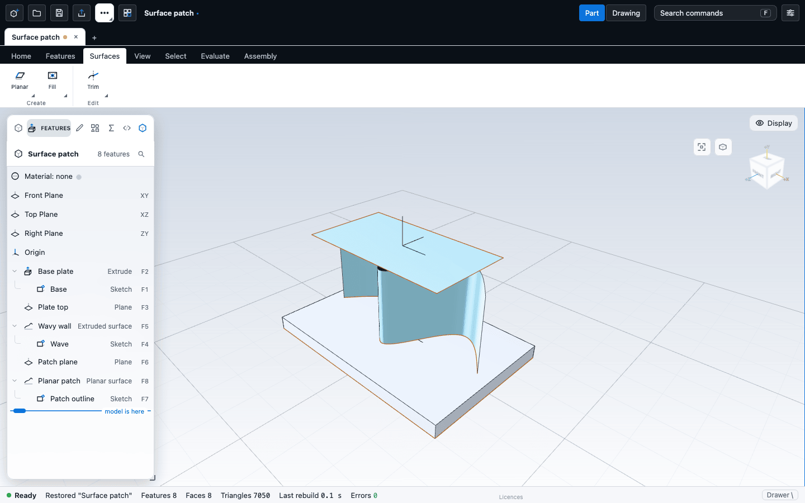

# Surfaces

A surface is a sheet: it has faces and edges but encloses no volume. You build surfaces when a shape is easier to describe by its skin than by a solid, then trim, join and thicken them. This chapter covers the commands on the **Surfaces** tab, how sheets show in the view, and the tools that check a surface.

## Surface bodies

A feature that makes a sheet leaves a **surface body**. Surface features are Planar surface, Extruded surface, Revolved surface, Lofted surface, Trim surface, Fill surface, Extend surface, Pipe cut, a Knit that is not made into a solid, and Delete face on a solid. A surface body is named after the feature that made it.

How sheets look and behave:

- Sheets are drawn with a cool teal tint so you can tell them from solids. Both sides are lit.
- You can pick the faces and edges of a sheet exactly as for a solid, including the border edges (one face) that Fill and Extend use.
- **H** hides the body that holds the selection (a sheet or the solid), and **Alt+H** (Show all) brings everything back. Hiding is for the view only and is not saved.
- Mass properties and interference counts solids only. A part with no solid reports that sheets have no volume or mass. See [Measure and inspect](../analysis/measure.md).
- A section view clips sheets, but a sheet has no inside, so the cut is not capped.

## Where the commands are

| Group | Commands |
|---|---|
| Surfaces > Create | **Planar surface** (default), Extruded surface, Revolved surface, Lofted surface in one button. **Fill surface** (Shift+I) and **Extend surface** (Shift+X) in the next |
| Surfaces > Edit | **Trim surface** (default), **Knit**, **Thicken** in one button |
| Features > Modify | **Pipe cut** |
| Features > Bodies | **Delete body** and **Delete face** |

Each command makes its feature at once, opens the Editor with a live preview, and is one undo step. A command that has nothing to work on says "Nothing to build this feature from: pick what it needs first", or is greyed with a tooltip.

## Making a sheet

| Command | Needs | Defaults |
|---|---|---|
| Planar surface | A closed sketch: the one selected in the tree, else the last that fits | A flat sheet filling the sketch |
| Extruded surface | A sketch with curves, open or closed | Blind, 10 mm |
| Revolved surface | A closed sketch with a construction line as the axis | 360 degrees about the first construction line |
| Lofted surface | Two or more sketches, open or closed, all of one kind | As Loft, with Make a surface on. See [Extrude, revolve, sweep and loft](solids.md#loft) |

An open sketch extruded as a surface gives a wall you can thicken later. The Editor for an Extruded or Revolved surface shows the sketch, the End condition and the Depth or Angle. A surface sweep (Sweep with a sheet result) is not available.

## Trim, knit, thicken

**Trim surface.** Trim cuts a surface with a plane or with another surface and keeps one side.

1. Select what trims. Either pick the faces of the two surfaces (the first is trimmed by the second), or pick a face of a solid (its plane is the tool).
2. Choose **Surfaces > Edit > Trim surface**.

With nothing picked it uses the surface selected in the tree, then another surface, then the last reference plane. The Editor has:

| Option | What it does | Default |
|---|---|---|
| Surface to trim | The sheet that is cut. | The target chosen as above |
| Trimmed by | A plane (pick a face) or another surface. | The tool chosen as above |
| Keep the other side | Keeps the part on the opposite side. | Off |
| Trim both surfaces | The tool surface is trimmed by the first too. | Off |

If the tool no longer crosses the sheet, the trim fails with "the surfaces do not cut each other". Move the tool or change the sheet.

**Knit.** Knit joins sheets along their shared edges into one sheet.

- With faces picked, Knit uses the surfaces they belong to. Otherwise it uses the one selected in the tree, else every surface in the part.
- The Editor lists the surfaces with a checkbox each.
- **Make a solid when the result is closed** turns a sealed shell into a solid. It is off by default. If the shell still has open edges, the Editor reports that it is not closed.

**Thicken.** Thicken turns a sheet into a solid. The Editor has Surface, **Thickness**, Side (Front, Back or Both) and Operation (Add or Cut). Thickness starts at about 10% of the body size at first, or 1 mm with no body.

Tick **Variable thickness** and the single thickness becomes a ramp: the sheet is thick at one end and thin at the other, which is what a blade or a tapered plate needs.

| Control | What it does | Default |
|---|---|---|
| Ramp along | **X axis**, **Y axis** or **Z axis**: the direction the positions are measured along. A direction that is none of those (set by a script, say) is shown as its vector | Z axis |
| Position | Where a stop sits, in millimetres along that direction | 0, then 10 |
| Thickness | How thick the sheet is at that stop, in millimetres | The thickness you had, then half of it |
| Add stop, Remove | Stops are added at the end and removed from anywhere: 2 to 6 in all | Two stops |

The note in the editor gives the rules: "Thickness at positions along the axis (2 to 6, rising). The stops must cover the whole surface." Between two stops the thickness is interpolated, so the sheet changes smoothly. Positions run from the smallest to the largest, and stops that do not reach across the whole sheet are refused.

**Delete face.** Select faces in Face mode and choose **Features > Bodies > Delete face**. The faces are removed; deleting a face of a solid leaves a sheet.

## Fill and extend

**Fill surface** closes a loop of boundary edges with a patch. Pick the edges in Edge mode, or select a surface in the tree, and choose **Fill surface** (Shift+I). Without picked edges it uses the first open loop of the surface.

| Option | What it does | Default |
|---|---|---|
| Continuity | How the patch meets its neighbours: G0 (touching), G1 (tangent), G2 (curvature), G3. | G0 |
| Fairing | How the patch is smoothed: Smooth net, Thin plate, Curvature or Variation. | Smooth net |
| Merge with the surface | Joins the patch to the surface it fills. | On |
| Edges | The boundary edges, with Use selection. | The picked edges |

**Extend surface** continues an open border of a sheet along its own shape. Pick one border edge (or select the surface) and choose **Extend surface** (Shift+X). Distance is about 10% of the model size at first. The command extends the border edges you picked, or else the first open edge of the surface. In the Editor you can add more border edges with Use selection. The kernel extends each open border edge, but only one edge of any one face: two edges of the same face are refused with the code `extendNotBoundary`, and so is an edge that is not an open border (an edge shared by two faces). The kernel's detail text is "only open boundary edges extend". So pick border edges only, at most one per face, or make several Extend features. A wavy edge may report that it cannot be extended at the default distance; try a shorter distance.

## Pipe cut

Pipe cut rolls a ball of a given radius along edges and cuts away everything it touches. Select edges in Edge mode, or select faces to use their rim edges, and choose **Features > Modify > Pipe cut**. Radius is about 10% of the smallest dimension at first. The solid becomes a surface body.

## Not available

- **Project curve**, **Edit curve** and **Freeform** are covered in [Curves on faces](curves.md). Inside a sketch, the Project tool is a different thing: it projects model edges onto the sketch plane. See [Offsets and references](../sketching/offset-reference.md).
- Offset surface, cut with surface, split line and dome are not built yet.
- Guide curves and strength for Fill are not offered.

For the exact definitions, see [Surfaces and curves](/docs/cad/kernel/format/features-surfaces.html) in the kernel book: [knit](/docs/cad/kernel/format/features-surfaces.html#knit), [fill](/docs/cad/kernel/format/features-surfaces.html#fill), [trim surface](/docs/cad/kernel/format/features-surfaces.html#trimsurface), [thicken](/docs/cad/kernel/format/features-surfaces.html#thicken), [extend](/docs/cad/kernel/format/features-surfaces.html#extend).

## Surface analysis

Four views and a comb help you judge whether a surface is smooth. They colour or decorate the displayed mesh and are never saved with the part. Turn them on from **Evaluate > Surface analysis**.

| Command | Keys | Shows |
|---|---|---|
| Zebra stripes | Alt+Z | Stripes reflected in the surface. A break in a stripe is a break in tangency, a kink a break in curvature. Has a stripe density control. |
| Gaussian curvature | | Red where the surface is dome-like, blue where saddle-like, white where flat or rolled. |
| Mean curvature | | Red where it bulges out, blue where it dips in. |
| Draft analysis | Alt+D | Colours faces by their angle to a pull direction: green has draft, red has none, blue faces the other way. Controls: Pull direction and Least draft (degrees). |
| Curvature comb | Alt+C | Teeth along edges and sketch curves, as long as the curvature there. Smooth teeth mean a smooth curve. Has a Comb size control. |

Use only one colour mode at a time; the comb can be added to it. The analysis reads the displayed mesh, not the exact surface, and it does not show continuity (G1, G2) between faces as a number. The Hidden-lines and Wireframe display styles draw no faces, so only the comb shows there.

## Next

- [Extrude, revolve, sweep and loft](solids.md)
- [Curves on faces](curves.md)
- [Bodies and combining](bodies.md)
- [Measure and inspect](../analysis/measure.md)
- [Offsets and references](../sketching/offset-reference.md)
