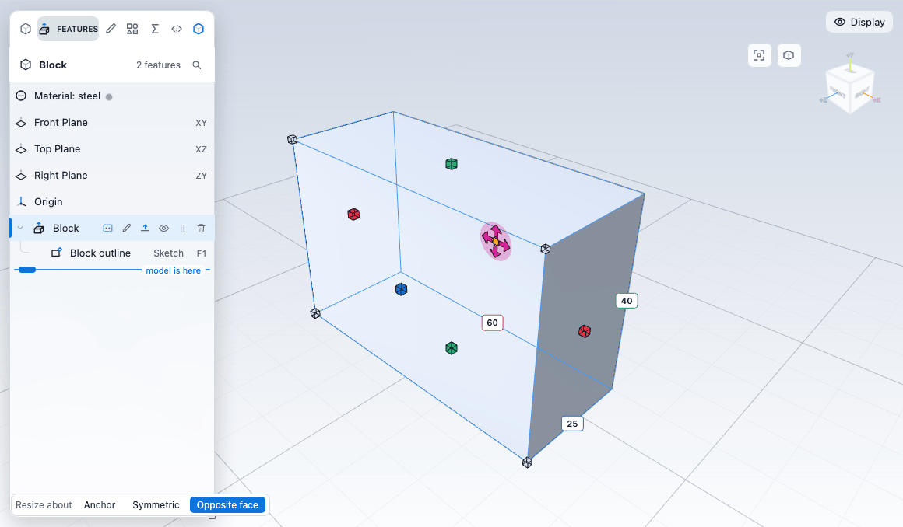
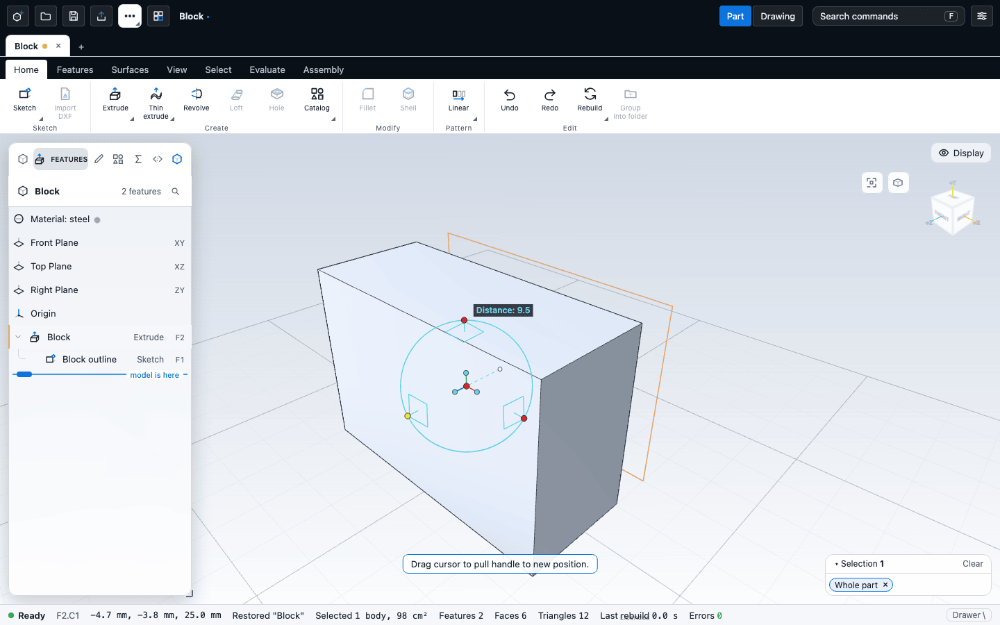

# Moving things: the move / rotate ball and handles

You can change a model by dragging it directly. The **move and rotate ball** moves, turns and copies a body, pushes a face, or shifts the sketch behind a feature. **Handles** that appear on a selection resize and reshape features on the canvas. Every drag is previewed live and becomes one undo step when you release.

## Handles on the canvas

Select something and a small handle appears on it. Drag the handle and the part redraws as you go. Nothing is written until you let go. Esc puts everything back. A click on a handle that does not move does nothing.

| Select | Handle | Dragging it |
|---|---|---|
| An edge, several edges or a corner | A yellow dot beside the selection | Outward makes a fillet, inward makes a chamfer. See [Fillets, chamfers, shells and drafts](edges.md) |
| A face next to an existing fillet or chamfer | A dot on the blend face | Changes its radius or distance in place |
| The inner wall of a shell | An arrow | Changes the wall thickness |
| The wall of a plain hole | A dot | Changes the hole diameter |
| A shape feature in the tree (extrude, cut, revolve, hole) | The size box (below) | Changes width, length and height, or moves the shape |
| An Extrude open in the Editor | An arrow on the preview | Sets the depth |
| A Thread open in the Editor | A dot at the end of the thread | Sets the thread length |
| The whole body | The move and rotate ball (F10) | See below |

While you drag, a readout shows the number ("Fillet 3 mm", "Depth 42 mm"). These keys work while you drag a handle:

| Key | Effect |
|---|---|
| Shift | Fine control: a tenth of the pointer movement |
| Ctrl (Cmd) | Snap to whole millimetres, or 15 degrees for rings |
| Digits, `.`, `-` | Type the exact value instead of dragging |
| Enter | Commit now |
| Esc | Cancel |

Handles are hidden while you sketch and while a feature's Editor is open, except the depth arrow and the thread length handle. To turn all handles off, clear **Direct-manipulation handles on the canvas** in the workspace settings.

### The size box

Click a shape feature's row in the feature tree (with nothing selected in the view), or select one of its faces, and its **size box** appears: a wireframe box around the profile and its depth, with a handle on every face centre and every cap corner.

- Drag a face handle to change the width, length or height. Hover a handle to see its dimension. The three labels always show the numbers; click one and type an exact value, then press Enter.
- Drag a corner handle to change width and length together.
- Shift or Ctrl snaps to a round step. Digits type a value.
- A **Resize about** menu at the bottom left chooses what stays put when you change a width or length: **Anchor** (the profile scales about its anchor point), **Symmetric** (both faces move equally about the centre), or **Opposite face** (the opposite face stays; the default). The height always grows from the sketch plane.
- To **move the shape** in its sketch plane, drag the flat four-arrow pad at the centre of the footprint, drag the shape itself, press Tab or double-click the pad and type an **X offset**, **Y offset** or a **Distance from edge**, or use the arrow keys (the grid step; Shift is 10 times larger, Alt a tenth). Shift while dragging keeps to one axis, Ctrl snaps to the grid, and Alt turns snapping off. Snap hints appear in the readout.

A resize or move edits the feature's sketch (its points and its dimensions), so it is one undo step. If the sketch is also used by other features, they all move with it (undo reverts). A constraint that the change breaks is removed, and the app tells you which. A fixed point that would have to move refuses the edit.

Limits: Through all and Up to next extrusions get width, length and corners but no height handle. A revolve gets only the flat profile box. A hole gets a diameter handle only if it is Simple.

## The move and rotate ball

The ball is a manipulator that follows a selection. Turn it on with **F10**, with **Move / rotate ball** (Select tab > Position), or with **Move body** in the right-click menu of a body. Esc turns it off. If it cannot act on the selection, the app tells you what to select.

| You selected | The ball acts on | Result |
|---|---|---|
| The whole body (Alt+click, the Body pick mode B, or **Select body**) | The body | A **Move or copy body** feature |
| A Move or copy body feature in the tree | That feature | Edits it in place |
| One or more faces | The faces | A **Move face** feature: flat faces slide along their normal, curved faces grow or shrink. Only the face-normal handle is live |
| A feature built from a sketch on the Front, Top or Right plane | The feature | Shifts that sketch's points in its plane. Everything else that uses the sketch moves too |
| Edges, corners or nothing | Nothing | F10 is greyed out |

While the ball is on, the contextual handles step aside. It hides during sketching and while an Editor is open.

### Move, rotate and copy

The ball is a cyan ring that always faces the camera, with a centre dot and three axis stubs (X red, Y green, Z blue) ending in dots.

| Gesture | Result |
|---|---|
| Click an axis end dot | Selects the axis (the dot turns yellow). Click again or click empty space to deselect |
| Drag an axis end dot | Moves along that axis |
| Drag a plane square | Moves in that plane |
| Drag the ring | Turns about the view direction, or about the selected axis |
| Drag inside the ring with an axis selected | Turns about that axis |
| Ctrl while dragging | Snap to the increments (10 mm and 15 degrees at first) |
| Shift while dragging | A tenth of the movement |
| Digits, then Enter | Type the exact distance or angle |
| Esc | Cancels the drag. A second Esc turns the ball off |
| Space | Attaches or detaches the ball. A detached ball (white) moves only itself, to reposition it |

Angles are right-handed about the axis. Move and rotate are combined: the turn is applied first, then the move.

**Right-drag** a handle instead of left-drag, and on release a menu offers **Move Here**, **Copy Here**, **Create Radial Pattern** (for a turn) or **Create Linear Pattern** (for an axis move), and **Cancel**. Copy Here keeps the source body and adds a copy. A pattern dialog (**Repeated copy**) asks for the Number of copies (the source body stays, so 5 copies make 6 bodies), the Distance or Angle, and for a radial pattern a Step up along the axis. A pattern is one undo step.

**Right-click** gives more:

| Click on | Menu |
|---|---|
| An axis end dot | **Edit Distance** (type it, as a Move or Copy), **Create Linear Pattern** |
| The ring | **Edit Angle** (about X, Y, Z or the view; Move or Copy), **Create Radial Pattern**, **Snap Increments** |
| An orientation dot (the stub end) | **Parallel to Axis** (pick a cylinder), **Perpendicular To Face** (pick a flat face), **Parallel To Edge** (pick an edge), **Reverse**, **Mirror (Copy)** |
| The centre dot | **Edit Position** (X, Y, Z), **To Point** (a corner), **To Center Point** (a circle edge), **To Midpoint** (an edge) |

The orientation commands re-aim the ball only. They do not rotate the object. Use them to aim an axis along a direction you need, then drag.

The snap increments can also be set in the workspace settings, on the **Positioning** tab.

### What each move writes

One gesture is one feature or one edit. A second plain move of the same bodies, right after the first, is folded into the existing Move or copy body feature. A copy is always a new feature. Select the feature in the tree and double-click it to open its Editor: it shows the bodies, how far they went ("by 10, 0, 0 mm"), and **Make a copy** with a body name. The amount is read-only there: change it by dragging the body again with the ball.

For the exact definitions, see [moveBody](/docs/cad/kernel/format/features-patterns.html#movebody) and [moveFace](/docs/cad/kernel/format/features-edits.html#moveface) in the kernel book.

## Limits

- **Link Here** is disabled. Linked copies need instances, which the kernel does not have.
- **Mirror (Move)** is disabled, because a mirror in this kernel joins the mirror image to the body. **Mirror (Copy)** works only when the handle points along X, Y or Z and the ball sits on that plane through the origin. For other planes use the Mirror feature. See [Patterns, mirror and scale](patterns.md).
- Only a whole body can be copied or patterned with the ball. A face can only be pushed.
- Patterns made with the ball are chains of Move or copy body copies of the body, not the Linear and Circular pattern features.
- Faces: there is no rotation and no copy, and several faces move together by the same amount. A face move the kernel refuses (for example, a face that would collapse) shows the reason and changes nothing. Moving a hole by sliding its cylinder sideways is not supported.
- Moving a feature works only for sketch-based features on the three standard planes. Features on a face, 3D sketches and features without a sketch say so.
- Free three-axis moves and free trackball rotation are not available.
- Copy along a curve is not available.
- The ball itself is not saved with the part.

## Next

- [Patterns, mirror and scale](patterns.md)
- [Bodies and combining](bodies.md)
- [The feature tree and history](history.md)
- [Selecting things](../getting-started/selection.md)
