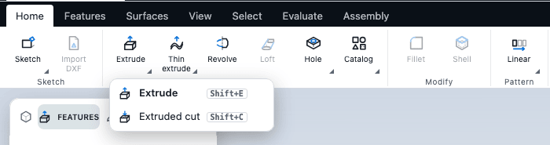

# Commands and shortcuts

This chapter lists every command in the app with its exact label, where to find it, and its keyboard shortcut. Use it to look up a name you have seen, or to find the key for something you do often.

## How to find a command

- **Ribbon.** The tabs at the top: **Home**, **Features**, **Frame**, **Sheet metal**, **Surfaces**, **View**, **Select**, **Evaluate** and **Assembly**. While a sketch is open, the ribbon shows a **Sketch** tab instead.
- **Command search.** Press **F**, or choose **Search commands** in the top bar, and type any part of a command's name. Every command in this chapter is there with its shortcut. Press **Enter** to run the highlighted one.
- **Top bar.** File commands (New, Open, Save, Export and more) live in the bar above the ribbon, not on a tab.
- **Right-click menu.** The menu on the canvas lists the commands that suit what you have selected.
- **Tool palette.** The palette at the left edge (when it is on) holds most modelling commands in sections.

Buttons that hold several related commands (for example **Extrude** with **Extruded cut**) are drawn once on the ribbon. The button runs the command you used last, and its flyout lists the rest. The tables below list every member of such a button separately, in the group where the button sits.

Where the ribbon shows a shorter caption than the command's name, the table gives both. Command search and tooltips use the full label. A command is greyed out until it can run. The "Available when" column says what it needs.

## Shortcut conventions

- **Ctrl** means **Ctrl** on Windows and Linux and **Cmd** on macOS.
- Single letters are used for view, pick and sketch tools, so most modelling commands use **Shift** plus a letter. For example **Extrude** is **Shift+E**.
- While a sketch is open, the sketch tools take their own letters (for example **L** for Line), and the Shift+letter modelling shortcuts do not run. Combinations with **Ctrl** (such as **Ctrl+S** and **Ctrl+Z**) still work. See "Sketch tab" below.
- Shortcuts do not fire while you are typing in a text, number or list field.

## Ribbon tabs

### Home tab

#### Sketch

Start a sketch. See [Starting a sketch](../sketching/start.md).

| Command | Ribbon caption | Shortcut | Available when |
| --- | --- | --- | --- |
| Sketch on selected face or plane | Sketch | `S` | An open document |
| Sketch on selected face | On face |  | One face selected |
| New sketch: front plane | Front |  |  |
| New sketch: top plane | Top |  |  |
| New sketch: right plane | Right |  |  |
| New sketch from DXF | DXF sketch |  | An open document |
| Import DXF into sketch | Import DXF |  | A sketch open |
| New sketch from SVG | SVG sketch |  | An open document |
| Import SVG into sketch | Import SVG |  | A sketch open |

#### Create

Solids, holes and the panels for Catalog, Variables and Script. See [Extrude, revolve, sweep and loft](../modelling/solids.md) and [Holes and threads](../modelling/holes.md).

| Command | Ribbon caption | Shortcut | Available when |
| --- | --- | --- | --- |
| Extrude |  | `Shift+E` | An open document |
| Extruded cut | Cut | `Shift+C` | An open document |
| Thin extrude |  |  | An open document |
| Thin cut |  |  | An open document |
| Thin revolve |  |  | A sketch with a construction axis line |
| Revolve |  | `Shift+R` | A sketch with a construction axis line |
| Loft |  | `Shift+O` | Two or more sketches |
| Sweep |  | `Shift+W` | A closed sketch and an open path sketch |
| Hole |  | `Shift+H` | One face selected, or a sketch of points |
| Thread |  | `Shift+T` | Cylindrical faces selected (face mode) |
| Catalog |  | `Shift+K` | An open document |
| Variables |  |  | An open document |
| Script |  |  |  |

#### Modify

See [Fillets, chamfers, shells and drafts](../modelling/edges.md).

| Command | Ribbon caption | Shortcut | Available when |
| --- | --- | --- | --- |
| Fillet |  | `Shift+F` | Edges selected, or two or more faces |
| Chamfer |  | `Shift+B` | Edges selected, or two or more faces |
| Shell |  | `Shift+S` | Faces selected (face mode) |

#### Pattern

See [Patterns, mirror and scale](../modelling/patterns.md).

| Command | Ribbon caption | Shortcut | Available when |
| --- | --- | --- | --- |
| Linear pattern | Linear | `Shift+L` | A feature to repeat |
| Circular pattern | Circular | `Shift+P` | A feature to repeat |

#### Edit

See [The feature tree and history](../modelling/history.md).

| Command | Ribbon caption | Shortcut | Available when |
| --- | --- | --- | --- |
| Undo |  | `Ctrl+Z` | An open document |
| Redo |  | `Ctrl+Shift+Z` | An open document |
| Repeat last command |  |  | After a command has run that can run again |
| Rebuild |  | `Ctrl+B` | Not while sketching |
| Rename |  | `F2` | Not while sketching |
| Suppress / unsuppress | Suppress | `Ctrl+Shift+U` | Features selected |
| Delete feature | Delete | `Delete` | Features selected |
| Roll forward | Roll fwd |  | The history is rolled back |
| Group into folder |  | `Ctrl+G` | Two or more features selected |

### Features tab

#### Reference

Reference geometry. See [Reference geometry](../modelling/reference-geometry.md) and [Curves on faces](../modelling/curves.md).

| Command | Ribbon caption | Shortcut | Available when |
| --- | --- | --- | --- |
| Plane |  | `Shift+N` | An open document |
| Axis |  | `Shift+A` | An open document |
| Helix |  |  | A sketch with a circle |
| Project curve | Project |  | A solid or a surface, and a sketch or curve to project |
| Edit curve |  |  | A document with a curve to rebuild: picked edges, or a sketch or curve feature |

#### Create

One button holds Gear, Gear pair, Propeller, Impeller, Knurl, Screw and Bearing. See [Parametric wizards](../library/wizards.md).

| Command | Ribbon caption | Shortcut | Available when |
| --- | --- | --- | --- |
| Gear |  | `Shift+Y` | An open document |
| Gear pair |  |  | An open document |
| Propeller |  |  | An open document |
| Impeller |  |  | An open document |
| Knurl |  |  | An open document |
| Screw |  |  | An open document |
| Bearing |  |  | An open document |

#### Modify

See [Fillets, chamfers, shells and drafts](../modelling/edges.md) and [Patterns, mirror and scale](../modelling/patterns.md).

| Command | Ribbon caption | Shortcut | Available when |
| --- | --- | --- | --- |
| Draft |  | `Shift+G` | A solid and faces selected |
| Rib |  |  | A solid and an open sketch |
| Lip / groove | Lip |  | A solid and faces selected |
| Mirror |  | `Shift+M` | A solid and a feature to mirror |
| Scale |  |  | A solid |
| Pipe cut |  |  | A solid and faces or edges selected |

#### Bodies

See [Bodies and combining](../modelling/bodies.md).

| Command | Ribbon caption | Shortcut | Available when |
| --- | --- | --- | --- |
| Delete body | Del. body |  | A solid and a face selected |
| Delete face | Del. face |  | A solid and a face selected |

### Sheet metal tab

The tab between **Frame** and **Surfaces**. See [Sheet metal](../modelling/sheet-metal.md).

#### Rules

| Command | Ribbon caption | Shortcut | Available when |
| --- | --- | --- | --- |
| Rules | Rules |  | An open document |

#### Create

| Command | Ribbon caption | Shortcut | Available when |
| --- | --- | --- | --- |
| Base flange | Base |  | No first plate yet, and a closed sketch (selected or the last) |
| Edge flange | Edge |  | A sheet that is not unfolded |
| Contour flange | Contour |  | No first plate yet, and an open chain of sketch lines |
| Convert to sheet | Convert |  | No sheet yet, and a solid body |
| Hem | Hem |  | A sheet that is not unfolded |
| Fold | Fold |  | A sheet that is not unfolded, and a sketch with a line |
| Cut | Cut |  | A sheet that is not unfolded, and a closed sketch on a plane parallel to the base |
| Corner | Corner |  | A sheet that is not unfolded |

#### Flatten

| Command | Ribbon caption | Shortcut | Available when |
| --- | --- | --- | --- |
| Unfold | Unfold |  | A sheet that is not unfolded |
| Refold | Refold |  | An unfolded sheet |
| Flat pattern | Flat |  | A sheet |

#### Export

| Command | Ribbon caption | Shortcut | Available when |
| --- | --- | --- | --- |
| Flat pattern DXF | DXF |  | A sheet |
| Bend table (CSV) | Bends CSV |  | A sheet |
| Bend table (JSON) | Bends JSON |  | A sheet |

### Surfaces tab

#### Create

See [Surfaces](../modelling/surfaces.md).

| Command | Ribbon caption | Shortcut | Available when |
| --- | --- | --- | --- |
| Planar surface | Planar |  | A closed sketch |
| Extruded surface | Extruded |  | A sketch with curves |
| Revolved surface | Revolved |  | A sketch with an axis line |
| Lofted surface | Lofted |  |  |
| Fill surface | Fill | `Shift+I` |  |
| Extend surface | Extend | `Shift+X` |  |

#### Edit

See [Surfaces](../modelling/surfaces.md) and [Curves on faces](../modelling/curves.md).

| Command | Ribbon caption | Shortcut | Available when |
| --- | --- | --- | --- |
| Trim surface | Trim |  |  |
| Knit |  |  | At least one surface |
| Thicken |  |  | A surface |
| Freeform |  |  | A solid or a surface, and faces selected |

### View tab

#### Views

Camera. See [Moving around the model](../getting-started/navigation.md).

| Command | Ribbon caption | Shortcut | Available when |
| --- | --- | --- | --- |
| Iso |  | `7` |  |
| Top |  | `1` |  |
| Front |  | `2` |  |
| Right |  | `3` |  |
| Back |  | `4` |  |
| Left |  | `5` |  |
| Bottom |  | `6` |  |
| Fit |  | `Z` |  |
| Switch between perspective and parallel view | Projection | `P` |  |
| Switch the up axis between Y and Z (camera only) | Up axis |  |  |

#### Display style

Display style, hide and show. See [Selecting things](../getting-started/selection.md).

| Command | Ribbon caption | Shortcut | Available when |
| --- | --- | --- | --- |
| Shaded |  | `Alt+1` |  |
| Shaded with edges | With edges | `Alt+2` |  |
| Wireframe |  | `Alt+3` |  |
| Hidden lines removed | Hidden | `Alt+4` |  |
| Ghost |  | `Alt+5` |  |
| Hide body or object | Hide | `H` | Something selected to hide |
| Show all |  | `Alt+H` | Something hidden |

#### Appearance

Lighting and background are radio choices. The **Show** menu turns display layers on and off, and stays open while you tick several. The command names for layers are the layer names.

| Command | Button | Ribbon caption | Shortcut |
| --- | --- | --- | --- |
| Studio | Lighting |  |  |
| Flat | Lighting |  |  |
| High contrast | Lighting | Contrast |  |
| Technical | Lighting |  |  |
| Theme | Background |  |  |
| Light | Background |  |  |
| Dark | Background |  |  |
| Gradient | Background |  |  |
| Edges | Show menu |  |  |
| Sketches | Show menu |  |  |
| Curves | Show menu |  |  |
| Planes | Show menu |  |  |
| Axes | Show menu |  |  |
| Grid | Show menu |  |  |
| Relations | Show menu |  |  |
| Overall size | Show menu |  | `Shift+D` |
| Threads | Show menu |  |  |

#### Workspace

Panels and settings. See [Units and settings](../getting-started/settings.md).

| Command | Ribbon caption | Shortcut | Available when |
| --- | --- | --- | --- |
| Command search | Search | `F` |  |
| Show or hide the side panel | Side panel | `[` |  |
| Toggle drawer | Drawer | `\` |  |
| Reset layout |  |  |  |
| Workspace settings | Settings |  |  |

### Select tab

#### Pick

See [Selecting things](../getting-started/selection.md).

| Command | Ribbon caption | Shortcut | Available when |
| --- | --- | --- | --- |
| Face |  | `Q` |  |
| Edge |  | `E` |  |
| Corner |  | `V` |  |
| Body |  | `B` |  |
| Select all |  | `Ctrl+A` | Not while sketching |
| Invert selection | Invert | `Ctrl+I` | An open document with a body |
| Deselect all | Deselect | `Ctrl+Shift+A` | Something selected |
| Box select | Box | `X` |  |
| Select body | Body |  | An open document |
| Show in tree |  |  | A selection |

#### Expand

Grow the current selection. See [Selecting things](../getting-started/selection.md).

| Command | Ribbon caption | Shortcut | Available when |
| --- | --- | --- | --- |
| Select tangent | Tangent |  | A selection |
| Select parallel | Parallel |  | A selection |
| Select similar | Similar |  | A selection |
| Select loop | Loop |  | A selection |
| Select connected | Connected |  | A selection |
| Select same size | Same size |  | Cylindrical faces selected |

#### Position

See [Moving things: the move / rotate ball and handles](../modelling/transforms.md).

| Command | Ribbon caption | Shortcut | Available when |
| --- | --- | --- | --- |
| Move / rotate ball | Move ball | `F10` | A selection that can be moved |

### Evaluate tab

#### Measure

See [Measure and inspect](../analysis/measure.md).

| Command | Ribbon caption | Shortcut | Available when |
| --- | --- | --- | --- |
| Measure |  | `M` | A solid |
| Mass properties | Mass |  | A solid |
| Interference check | Overlap |  | A solid |
| Section view | Section |  | A solid |

#### Surface analysis

See [Surfaces](../modelling/surfaces.md).

| Command | Ribbon caption | Shortcut | Available when |
| --- | --- | --- | --- |
| Zebra stripes | Zebra | `Alt+Z` | A body on screen |
| Gaussian curvature | Gaussian |  | A body on screen |
| Mean curvature | Mean |  | A body on screen |
| Draft analysis | Draft check | `Alt+D` | A body on screen |
| Curvature comb | Comb | `Alt+C` | A body on screen |

### Assembly tab

#### Components

See [Assemblies and mates](../assemblies/assemblies.md).

| Command | Ribbon caption | Shortcut | Available when |
| --- | --- | --- | --- |
| Insert part |  |  | An open document |
| Mate |  |  | Components in the document |

#### Review

See [Assemblies and mates](../assemblies/assemblies.md).

| Command | Ribbon caption | Shortcut | Available when |
| --- | --- | --- | --- |
| Bill of materials | BOM |  | Components in the document |
| Exploded view | Explode |  | Components in the document |
| Interference check | Overlap |  | Components in the document |

## Top bar

These commands are not on a ribbon tab.

| Command | Where | Shortcut |
| --- | --- | --- |
| New part | **New part** button | `Ctrl+N` (1, below) |
| Open | **Open** button | `Ctrl+O` |
| Save | **Save** button | `Ctrl+S` |
| Export | **Export** menu | `Ctrl+E` |
| Library | **Library** button | |
| Search commands | **Search commands** button | `F` |
| Workspace settings | Gear icon at the right | |

The **More file actions** menu (three dots, right of Export) holds the rest of the file commands:

| Command | Shortcut |
| --- | --- |
| Save as | `Ctrl+Shift+S` |
| Save geometry in file | |
| Recover earlier versions… | |
| Import STEP / STL / OBJ / GLB / 3MF / SolidWorks / SketchUp | |
| Import SketchUp with hidden geometry | |
| Rotate imported model | |

**Save geometry in file** is a switch. **Rotate imported model** is available only while an imported SketchUp model is on screen. See [Saving and opening](../files/files.md) and [Importing](../files/import.md).

The **Export** menu lists:

| Command | Menu caption |
| --- | --- |
| Export STL (binary) | STL |
| Export STL (ASCII) | STL text |
| Export OBJ | OBJ |
| Export STEP | STEP |
| Export sketch as DXF | Sketch DXF |
| Export 3 views as DXF | Views DXF |

An export command is available only when there is something to export: a solid, or for the sketch DXF a sketch. See [Exporting](../files/export.md).

The **Part** / **Drawing** switch at the right of the top bar switches between the model and its drawing sheet. See [Drawings](../files/drawings.md). Double-click the active document tab to rename the document; right-click a tab for Rename, Close and Close the other tabs.

## Sketch tab

While a sketch is open, the ribbon shows one tab, titled "Editing" followed by the sketch name. Its groups, left to right, are **Select**, **Finish** (OK and Cancel), **Make** (**Extrude**, **Revolve**), **Draw**, **Dimension**, **Constrain**, **Modify**, **Reference** and **Status**. The tools below also appear in command search.

Sketch tools have their own single-letter shortcuts, active while a sketch is open and a text field is not focused.

| Group | Tools (shortcut) |
| --- | --- |
| Draw | Line (`L`), Rectangle (`R`), Centre rectangle, Rounded rectangle, Circle (`C`), Centre arc, 3-point arc (`A`), Tangent arc, Ellipse, Polygon, Slot, Arc slot, Point, Text (`Q`), Centreline, Spline, Control-point spline, Add spline point, Bridge curve |
| Dimension | Dimension (`D`) |
| Constrain | Horizontal (`H`), Vertical (`V`), Coincident, Midpoint, Fix, Equal, Parallel, Perpendicular, Collinear, Tangent, Concentric, Symmetric |
| Modify | Trim (`T`), Extend (`E`), Fillet, Chamfer, Offset (`O`), Mirror, Linear pattern, Circular pattern, Move entities, Copy entities, Rotate entities, Scale entities |
| Reference | Project edges (`P`), Construction (`X`) |

See [Sketch tools](../sketching/tools.md) and [Constraints and dimensions](../sketching/constraints.md).

## Right-click menu

The menu on the canvas depends on what is selected. Each row runs the command of the same name and shows the same shortcut and the same reason when it is disabled.

| Selection | Rows |
| --- | --- |
| Nothing | New sketch: front plane, New sketch: top plane, New sketch: right plane; Extrude, Extruded cut; Select body, Select all, Invert selection; Fit |
| A face | Sketch on selected face, Hole, Shell, Fillet, Chamfer; Linear pattern, Circular pattern; Show in tree; Select tangent, Select parallel, Select similar, Select loop, Select connected; Invert selection, Deselect all |
| An edge | Fillet, Chamfer; Show in tree; Select tangent, Select parallel, Select similar, Select loop, Select connected; Invert selection, Deselect all |
| A corner | Fillet, Chamfer; Invert selection, Deselect all |
| A body | Select body; Move body; Linear pattern, Circular pattern, Shell; Invert selection, Deselect all |

**Move body** is listed but disabled with the reason "The kernel cannot move bodies yet" when the kernel in use does not support it.

## Other commands outside the ribbon

| Command | Where | Notes |
| --- | --- | --- |
| Auto | **Selection mode bar** over the viewport (switch it on in Workspace settings) | A toggle. On, hover and click pick the corner, edge or face nearest the pointer. Off, you pick one kind with `Q`, `E`, `V` or `B`. It is not in command search. |
| Move body | Right-click menu on a selected body | Listed but disabled when the kernel in use cannot move bodies. Not in command search. |

## Keys that are not commands

| Key | Does |
| --- | --- |
| `Ctrl+Y` | Redo (alongside `Ctrl+Shift+Z`). Not while sketching. |
| `Backspace` | Delete the selected features (alongside `Delete`). |
| `Esc` | Clear the selection. Also cancels placing and closes dialogs. |
| Arrow keys | Orbit the view in 15 degree steps when the canvas has focus. |
| `Alt`+arrow keys | Pan the view when the canvas has focus. |
| `Alt`+click | Select the whole body. |
| `Ctrl+Enter` in the Script tab | Run the script. |
| `Shift+Alt+F` in the Script tab | Format the script. |
| `Ctrl+Tab`, `Ctrl+Shift+Tab` | Switch to the next or previous document tab. Use the **Ctrl** key, not **Cmd**. (1) |
| `Ctrl+Alt+1` to `9` | Jump to a document tab (9 is the last). |
| `Ctrl+Alt+T`, `Ctrl+Alt+W` | New document tab, close the active tab. |
| `Enter` in a sketch | Confirm the sketch (the same as OK). |
| `R`, `F`, `Alt`, `Esc` while placing a catalog item | Rotate, flip, no snapping, cancel. See [Catalog parts](../library/catalog.md). |

Arrow keys and Alt+arrow do not act while a sketch is open or when no document is open.

(1) In a normal browser tab, the browser may keep `Ctrl+N` (new window) and `Ctrl+Tab` / `Ctrl+Shift+Tab` (switch browser tab) for itself, so the app never sees them. If they do not respond, use the buttons or menus instead.

## Next

- [The interface](../getting-started/interface.md)
- [Moving around the model](../getting-started/navigation.md)
- [Selecting things](../getting-started/selection.md)
- [Glossary](glossary.md)
