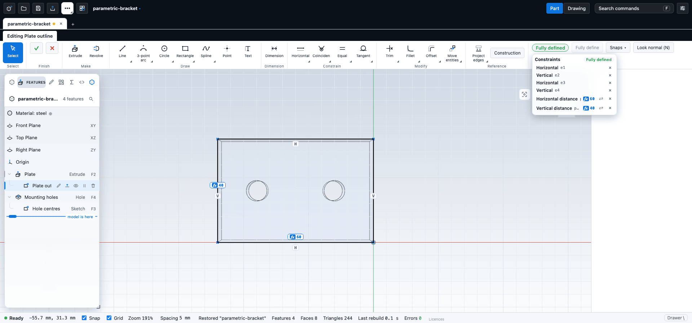

# Constraints and dimensions

Constraints and dimensions are the rules that hold a sketch in shape. A constraint such as **Parallel** or **Tangent** relates two pieces of geometry; a dimension fixes a size or a distance. This chapter lists every constraint and dimension, shows how to add, change and delete them, and explains how CadKit tells you how well defined a sketch is.

## Why constrain

A sketch with no constraints is only a drawing: drag one point and the shape distorts. Constraints let the sketch keep its meaning when you change a value. A rectangle that stays a rectangle, a hole that stays centred and a slot that stays 10 mm wide are all constraints at work. In a parametric part you change a dimension and everything after it follows.

You do not have to constrain everything. A sketch can be extruded while it still has freedom. But a fully defined sketch behaves predictably, and CadKit marks it as such.

## Geometric constraints

Geometric constraints are in the **Constrain** group of the **Editing** tab. Choose a tool, click what it needs, and CadKit adds one constraint and waits for the next set of picks. Picks can be points or curves; a click on an existing point wins over a click on a curve.

| Tool | Picks | What it does |
| --- | --- | --- |
| **Horizontal** (`H`) | A line, or two points | Makes the line horizontal, or the two points level. |
| **Vertical** (`V`) | A line, or two points | Makes the line vertical, or the two points one above the other. |
| **Coincident** | Two points | Makes the points the same point. A circle or arc stands for its centre. |
| **Midpoint** | A point and a line, in either order | Puts the point at the middle of the line. |
| **Fix** | A point | Pins the point where it is now. |
| **Equal** | Two lines, or two circles or arcs | Makes the lengths equal, or the radii equal. |
| **Parallel** | Two lines | Makes the lines parallel. |
| **Perpendicular** | Two lines | Makes the lines meet at a right angle. |
| **Collinear** | Two lines | Puts both lines on one straight line. |
| **Tangent** | A line and a circle or arc, or two circles or arcs | Makes the curves touch smoothly. Two lines cannot be tangent. When the two share an end point, the tangent is at that point. |
| **Concentric** | Two circles or arcs, or a circle or arc and a point | Gives them the same centre. |
| **Symmetric** | Two points and a line, in any order | Makes the points mirror images of each other across the line. |

The constraint list also shows **Point on line** and **Point on circle**. You do not add these with a tool: they come from snapping to a curve while you draw, and from **Trim** and **Extend**.

### When a constraint is refused

A constraint that would add nothing, or would contradict what is already there, is refused and the sketch is left unchanged. The hint line tells you why:

- **That constraint is already there.**
- **That would add nothing: the sketch already implies it.**
- **That conflicts with the existing constraints.**
- **That cannot be picked here**, **Pick a different item** or **Nothing to pick there**, when a click does not fit what the tool needs.

## Dimensions

The **Dimension** tool (`D`) is a smart dimension: you click what to measure and it chooses the right kind. It then offers a value box holding the measured value.

| Click | You get | Notes |
| --- | --- | --- |
| A line | **Distance**: the length of the line | A second click on a point or line refines it. |
| Two points | **Distance** between them | Press `H` for the **Horizontal distance**, `V` for the **Vertical distance**, or `A` for the aligned distance (the default). |
| A point and a line | **Point to line**: the distance to the (infinite) line | |
| A circle | **Diameter** | Press `R` to dimension the **Radius** instead. |
| An arc | **Radius** | |
| Two lines | **Angle** between them, in degrees | The angle at the point where they meet. |

To set the dimension:

1. Click what you want to measure.
2. Type the value you want, or leave the measured one.
3. Press `Enter` or `Tab`. The geometry moves to the new value.

`Esc` first clears a typed value, then the picks. A dimension that already exists for the same things is refused. A value must be a positive length, or an angle of 0 up to but not including 360 degrees.

A value can be a number, an expression such as `=width*2+3`, or the name of a variable. A dimension linked this way shows `fx`. See [Equations and variables](../modelling/equations.md).

### Change or delete a dimension

- **Double-click** the dimension label in the view, type a new value and press `Enter`.
- Or select the item in the **Constraints** list and double-click its row.
- Delete a dimension or any other constraint with the **×** button on its row in the list.

When you change an **Angle** dimension by a lot (more than about 90 degrees from the present angle), the solver can end on the opposite solution, with the line pointing the other way. Change the value in steps if that happens.

### Reference dimensions

A reference dimension measures but does not constrain. It shows in italic brackets, for example `(20)`. It is a way to read a size that other constraints already fix.

- When you add a dimension that the sketch already fixes, or that would conflict, CadKit adds it as a reference dimension and tells you.
- To turn a driving dimension into a reference one, click the arrows button on its row in the **Constraints** list, or right-click its label.
- To turn a reference dimension back into a driving one at its present value, double-click its label, or click the button again.

The **Display** menu has a **Reference dimensions** switch.

## How defined is the sketch

The **Status** group of the **Editing** tab shows a chip with the state of the sketch.

| Chip | Meaning |
| --- | --- |
| `N DOF` | The sketch is under-defined. N is the number of **degrees of freedom**: the number of independent ways the shape can still move or change size. |
| **Fully defined** | Nothing can move: every point and every size is fixed by constraints. |
| **Over-constrained** | Some constraints conflict with, or repeat, others. |

In the **Constraints** list the same states are worded **N degrees of freedom**, **Fully defined**, **Over-constrained** and **Does not solve**.

With **Colour by definition** on (the default), the geometry is coloured to match:

| Colour | Meaning |
| --- | --- |
| Blue | Something about this item can still move or change. |
| Dark (light on a dark background) | Fully defined. Nothing can move. |
| Red | A constraint that names it conflicts with others. |

An item is blue if it is not fully determined; one dimension can fix a line's length while its position stays free. CadKit works out the colours by testing each point against the solver, a moment after you stop editing, and never changes the sketch while doing so. A point that is fixed in only one direction, such as a point on a circle about a fixed centre, counts as under-defined.

### Sketch Report

**Sketch Report** (in the **Status** group, and in the command search) opens a summary of the sketch. On a desktop it is a small window over the view; on a phone or tablet it is a sheet from the bottom edge. Either stays open while you keep editing and follows the sketch.

- The sketch name and its state: **Fully defined**, the number of degrees of freedom, **Over-constrained**, **Conflicting constraints** or **Does not solve**.
- Counts of points, lines, arcs, circles, splines, construction entities, **Closed profiles** (the shapes Extrude can use) and **Open chains** (loose ends).
- The number of constraints, then **Driving dimensions** and **Reference dimensions**, and the constraints counted by kind.
- **Conflicting and redundant constraints**: click one to select the geometry it names in the sketch. Delete it from the **Constraints** list.

### Fully define

**Fully define** in the **Status** group adds relations and dimensions until the degrees of freedom reach zero, but only the ones the solver accepts.

1. It first adds relations that your drawing already shows: horizontal and vertical within one degree, parallel and perpendicular within one degree, and equal lengths and radii.
2. It then adds dimensions one at a time, taken from the present geometry: radii, line lengths, angles at shared corners, and finally positions from the origin.

The message says how many relations and dimensions were added, and how many degrees of freedom remain if no dimension could remove them (a spline, for example). The button does nothing, and says so, if the sketch is already fully defined or has conflicts. The whole step can be undone in one go. Because the dimensions copy your drawing, review them before you rely on them.

## The Constraints list

Click the chip to open the **Constraints** list. It also opens by itself the first time a sketch becomes over-constrained. Each row shows the kind of constraint, the things it names, and its value. Hover a row to light the geometry it names in the view.

- A row in **red** is a conflict: it cannot hold together with the constraints before it. Delete it, or one of the others.
- A row in **amber** is redundant: the sketch already implies it. It does no harm, but it counts toward over-constrained.
- **×** deletes a constraint.
- The arrows button switches a dimension between driving and reference.

When the sketch is over-constrained the list also names the blamed constraints under **Conflicting** or **Redundant**, each with a delete button. See [When a sketch will not solve](troubleshooting.md).

The list is a pop-over. The **Constraints panel** switch in the sketch **Display** menu turns it off.

## Seeing constraints in the view

Relation glyphs (H, V, =, tangent and so on) are drawn on the geometry, and driving dimensions are drawn as labels. The **Sketch** section of the **Display** menu has switches for **Dimensions**, **Relation glyphs**, **Reference dimensions**, **Colour by definition** and **Constraints panel**. They change only what is drawn. A few constraints that tools add automatically, such as the placing constraints of a pattern, are hidden in the view and shown only in the list.

## Limits

- You cannot edit a constraint's picks. Delete it and add it again.
- The glyph switches work per kind (dimensions, relations, reference), not per type of constraint.
- A fully defined sketch cannot be changed by dragging. CadKit says so: remove a constraint first.
- Constraints between a sketch and the part itself are a snapshot, not a live link. See [Offsets and references](offset-reference.md).

## Next

- [Sketch tools](tools.md)
- [Offsets and references](offset-reference.md)
- [When a sketch will not solve](troubleshooting.md)
- [Equations and variables](../modelling/equations.md)
