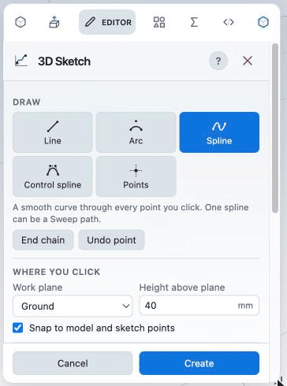
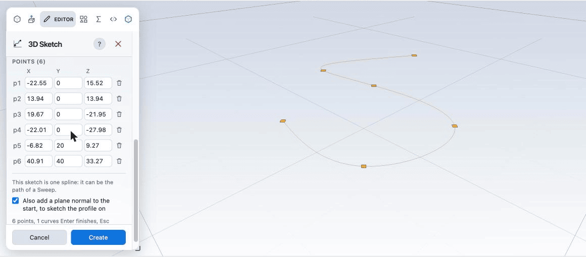
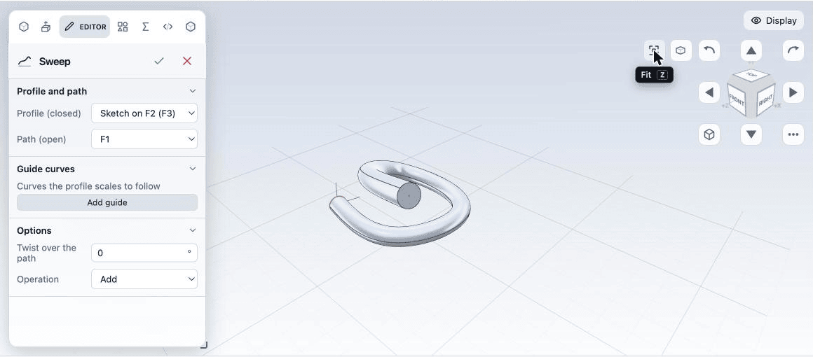
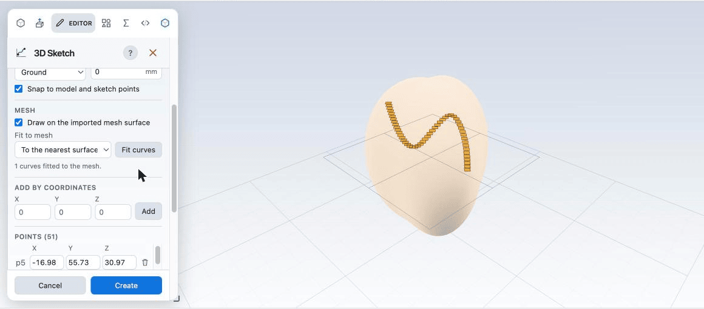

# Introduction to 3D sketching

This page teaches the **3D Sketch** tool with two short projects. When you want the full list of options, see the [3D sketches](sketch-3d.md) reference.

## What a 3D sketch is

A normal sketch is flat. It lives on a plane or a face, and every point has two coordinates. You draw a closed outline in it and extrude, revolve or cut.

A **3D sketch** has no plane. Every point has three coordinates, **X**, **Y** and **Z**, so the curve can rise, fall and turn in any direction. You cannot extrude it, because it has no outline. It is a **path** or a guide: a line in space that other features follow.

| | 2D sketch | 3D sketch |
| --- | --- | --- |
| Lives on | A plane or a face | Nothing: it floats in space |
| A point has | X and Y | X, Y and Z |
| Used for | Profiles to extrude, revolve or cut | Paths to sweep along, lines to measure against |
| Constraints and dimensions | Yes | No (you place and type points) |

## When you use one

- **Sweep paths.** A pipe, a hose, a wire, a spring or a handrail that bends in all three directions. This is the main use.
- **Guide curves.** A line in space that you want to keep for reference, to snap other points to or to look at.
- **Curves drawn on a mesh.** A seam, a cut line or a groove on an imported scan or SketchUp model. You click across the surface and the curve lies on it.
- **Frames and skeleton lines.** The centre lines of a frame or a rack, drawn once as lines in space.

## Project 1: a pipe along a rising curve (5 minutes)

You will draw a curve that climbs in space, then sweep a circle along it.

**1. Open the tool.** On the **Home** tab, in the **Sketch** group, choose **3D Sketch**. The panel opens on the left. The **?** button in its header shows a short reminder and a link to this page.

**2. Choose Spline.** In **Draw**, press **Spline**. A spline is a smooth curve that passes through every point you click.

**3. Click the first points on the ground.** Under **Where you click**, **Work plane** is **Ground** and **Height above plane** is 0. Click four points in the 3D view in a rough circle. Each click lands where your pointer meets the work plane. The **Points** list gains a row for each one, with its **X**, **Y** and **Z**. The up axis is **Y**.

**4. Lift the curve.** Set **Height above plane** to 20 and click a fifth point, then set it to 40 and click a sixth. Each click now lands higher (the points get **Y** 20 and 40). You can also type a point exactly: under **Add by coordinates**, enter **X**, **Y** and **Z** and press **Add**.

**5. Check the points.** Every point is a row in **Points** with its X, Y and Z. Type a new number to move a point. Drag a diamond in the view to move it in the work plane.

**6. Finish.** Leave **Also add a plane normal to the start** ticked and press **Create** (or press Enter). The feature tree now has a **3D sketch** and a **Plane** at the start of the curve, square to it.

**7. Draw the pipe's cross-section.** Select that plane (**F2**) in the tree and choose **Sketch** on the **Home** tab. Choose **Circle**, click the origin, type 4 for the radius and press Enter. Press Esc, then the green tick to finish the sketch.

**8. Sweep.** On the **Home** tab, in the **Create** group, open the list of the **Loft** button and choose **Sweep** (or press Shift+W). **Profile (closed)** is the circle sketch and **Path (open)** is the 3D sketch (**F1**); both are usually already chosen. Confirm with the green tick. The circle is carried along the curve and you have a pipe.

To change the pipe, double-click the 3D sketch in the tree, move a point, and press **Update**. The sweep follows.

## Project 2: a curve on an imported mesh

Use this to mark a seam or a groove on a scan or a SketchUp model.

1. With a part open, import an STL or SketchUp file as a **Reference mesh** (see [Importing](../files/import.md)). Pick the unit the file was made in. Lower the mesh **Opacity** if you want to see your curve through it.
2. Choose **3D Sketch** and press **Spline**.
3. Click across the surface. Under **Mesh**, **Draw on the imported mesh surface** is ticked, so each click that lands on the mesh sits on its surface. Click four or five points in a loose wave.
4. Your clicks are far apart, so between them the spline can drift off the surface. Under **Mesh**, choose how to lay the curve (**To the nearest surface point**, or **Along the work plane normal**) and press **Fit curves**. The spline is resampled into many points and each one is placed on the surface.
5. Press **Create**.

A curve that still has a stretch that misses the mesh cannot be fitted. The panel says so. Add a point on that stretch and fit again.

## The ideas behind the tool

**Work plane.** Your mouse is flat and the model is not, so each click lands where the pointer's line of sight meets the **Work plane**: **Ground**, **Front**, **Top**, **Right**, or any plane of the part. A plane selected in the tree is the starting choice.

**Height above plane.** Slides the work plane along its own normal. At 40 on the ground, the next clicks land 40 mm up. Change it between clicks to build a curve that rises and falls.

**Snapping.** With **Snap to model and sketch points** on, a click near a model corner, an edge end or middle, a point of another sketch, or a point you already placed snaps to it in space, whatever the work plane is. A green cross shows a snap; a yellow cross shows where a click will land on the plane.

**Line, Arc, Spline, Control spline, Points.**

- **Line** joins the points you click with straight segments.
- **Arc** takes a start, a point on the arc and an end.
- **Spline** passes through every point. Use it for paths you want to hit exactly.
- **Control spline** is pulled towards the points but does not touch them. It is smoother and wobbles less; use it when the exact points do not matter.
- **Points** places single points to snap to.

**Editing points.** Click a diamond to select it (its row in **Points** lights up; clicking a row selects the diamond too). Drag a diamond to move a point in the work plane. While you are drawing a chain, clicking an existing point continues the chain through it, closes on it or ends there. Type in its X, Y or Z field to move it exactly in any direction. Select it and press Backspace or Delete, or press the bin button in its row, to remove it. **Undo point** removes the last point of the chain you are drawing. Ctrl+Z (Cmd+Z on a Mac) steps back through the tool.

**Why a sweep path must be one spline.** The kernel sweeps along one smooth curve. A 3D sketch with a single spline is offered by **Sweep**. A sketch with a polyline, an arc, or two splines is not, because the profile would have no single direction to follow. If you need a path with straight runs, draw it as one spline.

## Tips and troubleshooting

- **A point is not where you expected.** It landed on the work plane, not at the depth you pictured. The up axis in the app is **Y**: check the point's **Y** in **Points** and type the value you want. Or change **Height above plane**, or orbit the view and look from the side.
- **The point jumped to something.** Snap took it. Untick **Snap to model and sketch points**, or click away from corners and edge ends.
- **The curve wobbles.** A spline passes through every point, so points placed too close or at uneven spacing make it ripple. Delete some points, space them evenly, or use a **Control spline**.
- **Sweep does not list your sketch.** It holds more than one curve, or a line or arc. Delete the extras so one spline remains.
- **How do I undo?** **Undo point** or Ctrl+Z inside the tool. **Esc** drops the chain you are drawing and a second **Esc** cancels the tool. After **Create**, use the normal **Undo**: the whole sketch is one step.
- **No point gets placed on the mesh.** Check that **Draw on the imported mesh surface** is ticked and the mesh is shown.

## Next

- [3D sketches](sketch-3d.md): every option of the tool
- [Extrude, revolve, sweep and loft](../modelling/solids.md)
- [Importing](../files/import.md)
