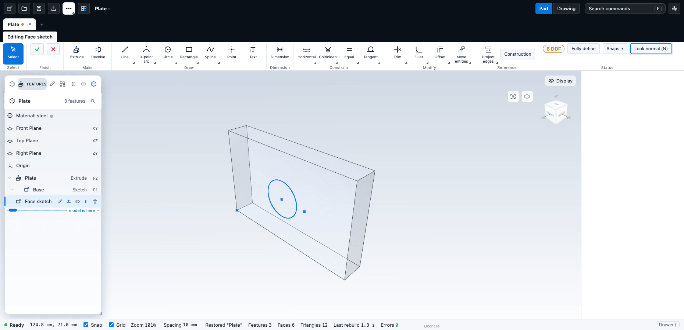

# Starting a sketch

A sketch is a flat drawing on a plane or on a face of the part. Extrudes, revolves, holes, sweeps and lofts all start from sketches. This chapter shows how to choose where a sketch goes, how to enter it, how to finish or abandon it, how to reopen it later and how to show or hide sketches.

## Choose a plane or a face

Every sketch sits on one of:

- **A reference plane.** A new part has three: **Front Plane** (the XY plane), **Top Plane** (XZ) and **Right Plane** (ZY). They are the first rows of the feature tree, below **Material**.
- **A plane feature** that you made yourself with **Plane** (Features tab, **Reference** group): an offset plane, an angled plane, a plane through three points and so on.
- **A flat face** of a body. Cylinders and spheres also work: CadKit makes a plane that touches the surface at the point you clicked and sketches on that. For any other curved face, make a plane first.

A body that was imported from STEP, SolidWorks or SketchUp is view-only. You cannot sketch on its faces, only on reference planes. See [Importing](../files/import.md).

## Enter a sketch

There are several ways in; all of them open the same sketch editor.

| From | How |
| --- | --- |
| A blank part | The **Start here** card offers **Sketch on Front Plane**, **Sketch on Top Plane** and **Sketch on Right Plane**. |
| The ribbon | On the **Home** tab, in the **Sketch** group, click the sketch button. It holds **Sketch on selected face or plane**, **Sketch on selected face**, and **New sketch: front plane**, **top plane** and **right plane**, and **New sketch from DXF**. The button shows the one you used last. |
| The keyboard | Select a plane (click its row in the tree) or a face, then press `S`. If nothing suitable is selected, CadKit says "Select a plane or a face first, then press S." |
| The viewport | Select a face and click the **Sketch on this face** chip that appears over the viewport. For a plane feature the chip says **Sketch on this plane**. |
| The right-click menu | With a face selected, choose **Sketch on selected face**. With nothing selected, the menu offers the three **New sketch** commands. |

When you start a sketch from a face, edges and faces you had selected are remembered. The **Project edges** tool can bring them into the sketch (see [Offsets and references](offset-reference.md)).

## What you see inside a sketch

- The ribbon changes to one tab named **Editing** followed by the sketch name (a new sketch is called **New sketch** while you edit it). Its groups are **Select**, **Finish**, **Make**, **Draw**, **Dimension**, **Constrain**, **Modify**, **Reference** and **Status**. The tools are described in [Sketch tools](tools.md) and [Constraints and dimensions](constraints.md).
- The **Line** tool is active, so you can start drawing at once.
- The body is drawn faded, to a quarter of its opacity, so you can see the sketch in front of it.
- Mouse buttons change: the left button draws and picks, the right button orbits, the middle button pans, and the wheel zooms towards the pointer. See [Moving around the model](../getting-started/navigation.md).
- The status bar shows the pointer position on the sketch plane, the active snap, the **Snap** and **Grid** switches, the zoom and the grid **Spacing**.
- If the view is angled to the sketch, a **Look normal (N)** button is highlighted. Click it, or press `N`, to turn the view square to the plane. Turn on **Auto look normal for new sketches** in the settings to do this automatically, and turn off **Keep the view when entering a sketch** if you want the view to square up whenever a sketch opens.
- If **Sketches** had been hidden in the Display menu, they are shown again so that you can see what you draw.

If the ribbon is off, the sketch controls sit in a small bar at the top of the viewport instead. If you use the **Tool palette in sketches** setting, the tools are also on a palette at the right edge.

## Finish or cancel

| To do this | Do this |
| --- | --- |
| Keep the sketch | Click the check mark in the **Finish** group (**Confirm sketch**), or press `Enter` when no tool is in the middle of a shape. |
| Keep the sketch and extrude it | Click **Extrude** in the **Make** group. The sketch is finished and the **Extrude** editor opens on it. |
| Keep the sketch and revolve it | Click **Revolve** in the **Make** group. The sketch needs a construction line for the axis; if it has none, CadKit says "Draw a construction line for the axis." Draw one with the **Centreline** tool. |
| Throw away this session of editing | Click the cross in the **Finish** group (**Cancel sketch**). |

`Esc` steps out in stages. While a tool is in the middle of a shape, `Esc` abandons that shape. With a tool chosen but idle, `Esc` returns to the **Select** tool. With nothing chosen and nothing selected, `Esc` cancels the whole sketch, discarding what you did since you entered it. If that is not what you want, use `Ctrl+Z` to undo steps inside the sketch instead.

Undo inside a sketch (`Ctrl+Z`) steps back through the sketch's own edits.

Switching to another document tab while a sketch is open finishes the sketch and keeps it.

## Reopen and reuse a sketch

- **Edit it again.** Double-click the sketch's row in the feature tree. A sketch that a feature uses is tucked under that feature; the features that depend on it rebuild when you finish.
- **Use it again.** **Extrude** and the other sketch-based commands use the sketch selected in the tree, or else the last sketch that no feature uses yet. If every sketch is already used, CadKit says so: select a sketch in the tree to use it again, or draw a new one (`S`).
- **Rename it.** Select the row and press `F2`.
- **Delete it.** Select the row and press `Delete`. If a feature uses it, CadKit refuses and names the features that depend on it.

## Show and hide sketches

- The **Show** section of the **Display** menu has a **Sketches** switch for all sketches, and **Curves**, **Planes**, **Axes**, **Relations** and **Overall size** switches for other helpers. Turning **Sketches** off does not delete anything.
- To hide one sketch, click the eye on its row in the tree. This hides it in the view only; it is not saved. `Alt+H` or **Show all** brings everything back.
- Select a sketch and press `H` to hide it.
- Finishing a sketch while **Sketches** is off turns the switch back on, with a notice, so a sketch you just made cannot vanish.
- Inside a sketch, the **Display** menu also has a **Sketch** section: **Dimensions**, **Relation glyphs**, **Reference dimensions**, **Colour by definition** and **Constraints panel**. These change only what is drawn.

## Check

After you finish a sketch, the feature tree shows it. If you then extrude and nothing appears, the sketch probably has no closed outline. See [When a sketch will not solve](troubleshooting.md).

## Next

- [Sketch tools](tools.md)
- [Constraints and dimensions](constraints.md)
- [Offsets and references](offset-reference.md)
- [Extrude, revolve, sweep and loft](../modelling/solids.md)
