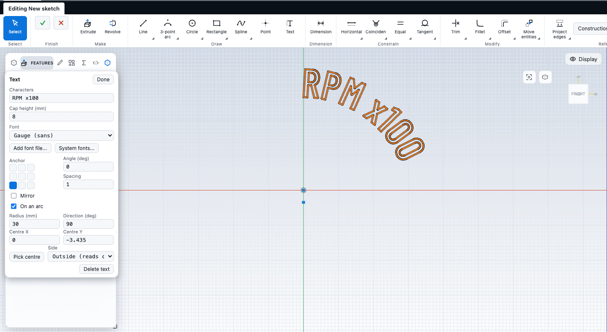

# Text

Lettering on a part, such as dial numerals, captions, nameplates and part numbers, is a text item in a sketch. This chapter covers placing and editing text, choosing a font and adding your own, laying text along a circle, and turning it into an engraving or a raised emboss. It also says plainly what CadKit cannot do with text yet: wrap it onto a curved face.

## How text works

The kernel turns the letters of a font into closed outlines. Because they are closed loops like any other sketch profile, everything that works on a sketch works on text: **Extruded cut** engraves it and **Extrude** embosses it.

## Place and edit text

1. Open a sketch on a plane or a face. See [Starting a sketch](start.md).
2. Choose **Text** in the **Draw** group, or press `Q`.
3. Click where the text should go. A text item holding the word `TEXT` is placed at once, and its panel opens. The lettering is drawn in the sketch colour and follows every change.
4. Edit it in the panel:

| Field | Meaning |
| --- | --- |
| **Characters** | The string, one line, 1 to 500 characters. |
| **Cap height** | The height of a capital letter, in millimetres. |
| **Font** | The font. See below. |
| **Anchor** | A 3 by 3 grid: which point of the text sits on the point you clicked (**left**, **centre**, **right** across; **top**, **middle**, **baseline** down). |
| **Angle** | Rotation about the anchor, in degrees. |
| **Spacing** | The letter pitch as a factor; 1 is the font's own spacing. |
| **Mirror** | Flips the text, for the back of a clear part. |
| **On an arc** | Lays the letters along a circle. See below. |

5. Click **Done**, press `Enter` in the string field, or press `Esc` to leave the panel. To edit the text later, choose the **Select** tool and click the lettering.

**Delete text** removes the text and its anchor point.

The anchor is a normal sketch point. You can drag it, fix it, dimension it, or snap other geometry to it. The Copy, Move, Rotate and Scale tools and the patterns take text along; Rotate moves the anchor, so also set **Angle** if you want the letters to turn.

### Warnings and errors

The panel and the hint line say what is wrong, and what to change:

- **Under 0.8 mm cap height the strokes are too thin to engrave or print.**
- **Some characters are not in the font and were skipped.** Only Basic Latin and Latin-1 letters are covered by the built-in fonts, including the degree sign.
- **The text was cut to 500 characters.**
- **Neighbouring letters were moved apart so they do not touch**, and **Letters still overlap on this radius**: on an arc, use a larger radius or more spacing.
- **The text is empty**, **The cap height must be above 0** and similar, for a bad value.
- **Strokes of this font overlap inside letters; engraving or cutting may fail validation.** Try another font.

## Text on an arc

Tick **On an arc** to lay the letters along a circle, as on a dial or a badge.

| Field | Meaning |
| --- | --- |
| **Radius** | The radius of the baseline. |
| **Direction** | The angle, in degrees, of the middle of the text seen from the centre; 90 is the top. |
| **Centre X**, **Centre Y** | The centre of the circle. Or click **Pick centre**, then click a sketch point or any place. |
| **Side** | **Outside (reads clockwise)**: the tops of the letters point away from the centre. **Inside (reads counter-clockwise)**: the tops point towards it. |

## Fonts

The **Font** list has three groups.

| Group | What it holds |
| --- | --- |
| **Built in** | **Gauge (sans)**, a condensed sans-serif, and **Engrave (serif)**. They are always available and look the same everywhere. |
| **Library** | Ten open-licence fonts hosted with the app: Barlow, Barlow Condensed, Source Sans 3, Bebas Neue, Anton, PT Serif, Special Elite, IBM Plex Mono, Great Vibes and Satisfy. A library font is fetched when you pick it, so it needs a connection the first time. The browser then keeps it. |
| **This part** | Fonts you have added to this part. |

Below the list are two ways to add more:

- **Add font file...** loads a `.ttf`, `.otf` or `.ttc` file (the first face of a collection) from your disk.
- **System fonts...** lists the fonts installed on your computer, with a filter. This needs the browser's Local Font Access feature, which only Chrome and Edge have. In other browsers CadKit says so, and you should use **Add font file...** instead. The browser asks for your permission when you click the button, never before.

A font file you add is stored inside the part file, so the part opens anywhere. A font larger than 1.5 MB is stored as a subset that holds only the letters the part's text uses; the panel then says so. If you later type characters that were not in the subset, add the font file again. A library font is stored as a reference only, and fetched again when the part opens. If it cannot be fetched (you are offline), the part still opens; the lettering reports that the font is not loaded until you open the part online or pick the font again.

**Check the licence.** Fonts you add or take from the system are embedded in the part file. Make sure you may embed them. The panel reminds you.

Font notes the panel can show: kerning pairs and ligatures are ignored; a variable font gives only its default style; a collection gives its first face; a font whose licence flags forbid embedding or subsetting is reported. WOFF and WOFF2 files are not supported; use the TrueType or OpenType file. A font file can be at most 24 MB, and at most 64 fonts can be loaded at once.

## Engrave and emboss

Finish the sketch, then:

- **Engrave.** Use **Extruded cut** on the sketch, with the depth of the engraving. A depth of 0.1 to 0.5 mm is typical. The cut goes into the face the sketch lies on.
- **Emboss.** Use **Extrude** with the height of the raised letters. If you start the sketch on a plane a little above the face (an offset plane), the lettering becomes a body of its own, with its own name and colour in the **Bodies** tab.

The extrude and cut editor lists the lettering as one shape per text item, so one text in a sketch can be cut and another embossed.

**Keep lettering in a sketch of its own.** The outlines of text are not trimmed against, merged with or made into holes by the other curves of the sketch. One sketch can hold several texts, for example one per numeral on a dial.

## Text in scripts

A script can place text with `s.text(...)`, choosing the font, height, anchor and an arc. See [Scripting](../automation/scripting.md).

## Limits

- **Text is flat.** It lies on the plane of its sketch. CadKit cannot yet wrap lettering around a cylinder or a cone. A cut from a flat sketch removes material straight along the cut direction, so lettering cut into a curved face is not bent to follow it.
- Text is one line per item.
- Kerning and ligatures are ignored; letters are placed with their plain advance widths. Bold and italic are separate font files.
- Fonts whose strokes overlap inside a letter, and connected script faces, can fail validation when engraved.
- Very small text can fail to engrave cleanly. Keep the cap height at 0.8 mm or more.
- While a sketch is open, the lettering outlines come from the kernel. A finished sketch in the tree shows the cut or extruded result, not the lettering curves.

## Next

- [Sketch tools](tools.md)
- [Starting a sketch](start.md)
- [Extrude, revolve, sweep and loft](../modelling/solids.md)
- [Scripting](../automation/scripting.md)
