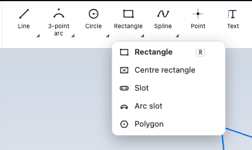

# Sketch tools

This chapter describes every tool in the sketch editor: how to draw lines, arcs, circles, rectangles, polygons, ellipses, slots, splines and points; how to trim, extend, fillet, chamfer, mirror, offset, pattern, move, copy, rotate and scale; how to project edges of the part into the sketch; and how to mark geometry as construction. Dimensions and constraints are in [Constraints and dimensions](constraints.md).

## Choosing a tool

All tools are on the **Editing** tab of the ribbon while a sketch is open, in the groups **Draw**, **Dimension**, **Constrain**, **Modify** and **Reference**. They are also in command search while you sketch.

- Several tools share one button. The button shows the tool you used last. A small arrow, a long press or a right click opens the family with names and keys.
- Some tools have a single key. Press it while the pointer is over the viewport.
- **Select** (in the **Select** group) returns to selecting and dragging. `Esc` also goes there when no shape is in progress.
- A tool stays active after it finishes a shape, so you can draw the next one. Click **Select** or press `Esc` when you are done.

| Key | Tool or command | Key | Tool or command |
| --- | --- | --- | --- |
| `L` | **Line** | `D` | **Dimension** |
| `R` | **Rectangle** | `H` | **Horizontal** |
| `C` | **Circle** | `V` | **Vertical** |
| `A` | **3-point arc** | `T` | **Trim** |
| `Q` | **Text** | `E` | **Extend** |
| `O` | **Offset** | `X` | **Construction** |
| `P` | **Project edges** | `N` | **Look normal** |

## Typing values while you draw

Most tools show small fields beside the pointer while you draw, labelled with short names such as `len`, `ang`, `w`, `h`, `rad`, `dia`. Each tool's fields are listed in its entry below, in the order `Tab` visits them: Line `len`, `ang`; Rectangle and Centre rectangle `w`, `h`; Rounded rectangle `w`, `h`, `corner`; Circle `rad`, `dia` (either one ends the circle); Ellipse `major`, `ang`, then `minor`; Slot `len`, `ang`, then `w`. Type digits (or `.` or `-`) and the first field takes them; letters are not typed into fields, and with no field on screen `D` switches to the Dimension tool. Press `Tab` to lock the value as a driving dimension and move to the next field, or `Enter` to lock it. A value you type but do not lock only previews. `Esc` clears typed values first, then the shape. A field also accepts an expression or a variable name, such as `=width/2`.

The setting **Values beside the pointer** chooses whether the fields show dimensions only (the default), dimensions and positions, or nothing. See [Units and settings](../getting-started/settings.md).

In a field that holds a plain number, **ArrowUp** and **ArrowDown** change it by 1 (**Shift** by 10, **Alt** by 0.1) and the preview follows. A formula or a variable name in the field is left alone.

## Snaps and inferred constraints

As you move the pointer, CivilKit CAD snaps to existing points and curves and shows a marker and a name: **endpoint**, **centre**, **origin**, **midpoint**, **quadrant**, **intersection**, **perpendicular**, **tangent**, **on curve**, **aligned** and **grid**. The same markers appear for model geometry: **model endpoint**, **model midpoint**, **model centre**, **model quadrant**, **model crossing**, **mid-extent**, **body centre** and **mid of extrusion**.

- Hold `Alt` while you click to turn snapping off for that click.
- With **Infer constraints while drawing** on (the default), the tools add horizontal, vertical, coincident and tangent constraints as you draw. Hold `Shift` at a click to turn that off for the click. A snap to a guide places only the point, unless **Add constraints from snaps** and **Auto-constrain from guides** are on.
- Hold `Shift` while you click a model snap to attach the point to the model: a fixed reference point is added there and your point is made coincident with it.
- The **Snaps** menu in the **Status** group switches each snap kind on or off.

## Draw

| Tool | How to use it |
| --- | --- |
| **Line** (`L`) | Click to start, click for each next end. The chain continues from the last end. Click the first point again to close the outline. Horizontal and vertical are inferred within 2 degrees. Type `len` and `ang` for an exact segment. Press `M` or `A` to continue with a tangent arc, and `L` or `M` to return to lines; with **Line to tangent arc** set to **Rest the pointer on the end** (the default), resting the pointer on the end of the chain switches too. |
| **Centreline** | Two clicks make a construction line. It is never extruded. Use it as the axis of a revolve. |
| **3-point arc** (`A`) | Click the start, then a point the arc passes through, then the end. Collinear points are refused. |
| **Centre arc** | Click the centre, the start (this sets the radius), then the end. The shorter way round is drawn unless the pointer goes past half a turn. |
| **Tangent arc** | Click the free end of a line or arc, then click where the arc should end. It is made tangent to that curve. |
| **Circle** (`C`) | Click the centre, then click for the radius. Type `rad` or `dia` to set it exactly. |
| **Ellipse** | Click the centre, click the end of the major axis, then click (or type) the minor radius. |
| **Rectangle** (`R`) | Click one corner, then the opposite corner. Type `w` and `h`. The four sides are kept horizontal and vertical. |
| **Rounded rectangle** | Click a corner, then the opposite one, like Rectangle. The four corners are rounded; the field `corner` is the radius (it stays for the next one, and is held to just under half the shorter side unless you type it). A typed radius becomes a driving dimension on each corner arc. |
| **Centre rectangle** | Click the centre, then a corner. The rectangle is symmetric about the centre. |
| **Slot** | Click the first centre, the second centre, then set the width with the pointer or by typing. The result is two lines and two arcs. |
| **Arc slot** | A curved slot, in the Slot button's flyout. Click the arc centre, click the start point (it sets the radius and the start angle; `len` and `ang` fields), click the end of the arc (the `sweep` field; the arc follows the pointer round, either way), then set the width with the pointer or by typing (`w`). The result is two concentric arcs joined by two half-round ends, all kept tangent. A typed radius and width are held as dimensions. To change the slot later, click one of its arcs in the sketch: the fields **rad** (radius of the centre arc), **ang** (start angle), **sweep** and **w** (width) appear, and typing a value and pressing Enter reshapes the whole slot, keeping it tangent. |
| **Polygon** | Click the centre, then a second point: its distance is the radius and its direction the rotation. The default is 6 sides. Press `+` to add a side. The fields, in order, are `radius` (or `apothem`), `ang` and `sides`: type digits for the first and press `Tab` to lock it and move on, and so reach `sides`. Press `M` to switch between a polygon whose corners touch the circle (**radius**) and one whose sides touch it (**apothem**). The sides are kept equal. |
| **Add spline point** | Click a spline where it should get one more point. The new point lies on the curve between its two neighbours, and you can drag it to bend that part. The spline is fitted through all its points again, so it can shift slightly. |
| **Spline** | A smooth curve through the points you click. Press `Enter` or click the last point again to finish. Click the first point to close the curve. `Esc` cancels. |
| **Control-point spline** | A curve shaped by control points; it passes through the first and last only. Same keys as the spline. The degree is 3; it cannot be changed in the interface. |
| **Bridge curve** | Click a free end of one curve, then a free end of another. A smooth spline joins them. Press `1` for tangent continuity (the default) or `2` for curvature continuity. |
| **Equation curve** | Click where the curve starts, then type formulas `x(t)` and `y(t)` in its panel. See [Equation curves](equation-curves.md). |
| **Point** | Each click adds a point. Points mark where **Hole** will drill. |
| **Text** (`Q`) | Click where the text goes. See [Text](text.md). |

## Select and edit by hand

With the **Select** tool:

- Click a line, arc, circle or point to select it. `Shift`-click or `Ctrl`-click adds to the selection.
- Drag on empty space to draw a box. Drag **right** for a **window** box that picks what is fully inside; drag **left** for a **crossing** box that picks what the box touches.
- `Ctrl+A` selects everything; `Delete` or `Backspace` removes the selection; `Esc` clears it.
- Drag a point to move it. If the sketch is fully defined, CivilKit CAD says so and does not move it: remove a constraint first. If the move would break a constraint, it says "This move conflicts with the constraints".
- With one item selected, type a digit to start editing its size.

## Modify

| Tool | How to use it |
| --- | --- |
| **Trim** (`T`) | Click a part of a line, arc or circle. It is removed back to the nearest crossings with other curves. A part with no crossings is deleted. A circle needs two crossings. Hover shows what will go. Splines and ellipses are not trimmed. |
| **Extend** (`E`) | Click a line or arc near the end you want to lengthen. It runs on to the first curve it meets. A circle cannot be extended. |
| **Fillet** | Click two lines that meet at a corner (or click the corner), then type or accept a radius to replace the corner with a tangent arc. A radius you type before picking is applied as soon as you pick the corner and is kept as a dimension. |
| **Chamfer** | The same picks as the fillet. The distance is the length cut from the corner along both lines. |
| **Offset** (`O`) | Click a line, arc, circle or spline. For lines and arcs, the whole connected chain is selected. Press `Enter`, then move the pointer to the side you want. The pointer's distance is the offset distance, or type digits for the single field, `dist`, and press `Enter` to lock it. `F` flips the side. Click to place. See [Offsets and references](offset-reference.md). |
| **Mirror** | Click the entities to mirror (click again to unselect), press `Enter`, then click the mirror line. The source geometry stays. |
| **Linear pattern** | Select entities, press `Enter`. A panel opens with the same groups as the Linear pattern feature: see [Patterns](#patterns) below. |
| **Circular pattern** | Select entities, press `Enter`, click the centre. A panel opens with the count and the angle: see [Patterns](#patterns) below. |
| **Move**, **Copy**, **Rotate**, **Scale** | Select entities first (or click them in the tool), press `Enter`, click a base point (the centre for **Rotate**), then move the pointer and click, or type the values. The fields, in order, are `dx`, `dy` and `copies` for Copy; `dx` and `dy` for Move; `ang` and `copies` for Rotate; `factor` and `copies` for Scale. Type digits for the first field and press `Tab` to lock it and move on. Copy, Rotate and Scale take a number of copies (at most 99); with 0 copies, Rotate and Scale change the selected geometry in place. |

### Patterns

The **Linear pattern** makes a grid of copies, in columns and rows. Pick the shapes (click them, or select them first), press `Enter`, and the pattern panel opens, with a live preview of every copy on the canvas.

- **Direction 1 (columns)**: `Count` (the number of instances, the first one included), `Angle` (typed, or press `Pick a line` and click a line of the sketch to take its direction; horizontal until you set it), and the distance. `Spacing` is the distance between neighbours; switch to `Total length` to give the distance from the first copy to the last (the spacing follows the count).
- **Direction 2 (rows)**: the same group. Its count starts at 1, which means no rows; raise it to make rows. Its angle starts at 90 degrees to direction 1. Spacing and total length work as above.
- `Enter` or **OK** makes the pattern. `Esc` first clears what you typed, then goes back a step; **Cancel** leaves the tool.

The shortcut still works: before you move onto the panel, the pointer sets direction 1 (where it sits is where the second copy goes) and a click on the canvas makes the pattern. Digits typed go into the fields next to the pointer: `count`, `space` and `ang` of direction 1.

The result is real geometry with these constraints:

- Each step along direction 1 is a driving dimension (a horizontal and vertical distance from the previous copy; a horizontal or vertical constraint instead when one of them is 0).
- With rows, direction 2 adds ONE dimension, the step from the first copy to the first copy of row 2. Every other copy in the rows repeats that step again from the copy below it, as a dashed construction line kept parallel and equal to the first step. Editing a spacing dimension (double-click it) moves every copy that depends on it; no other dimension is added.
- A count cannot be changed afterwards: delete the copies and make the pattern again. The pattern is also not linked to the shape you started from.
- At most 99 in one direction and 200 copies in all. The two directions must not be parallel.

The **Circular pattern** panel has the `Count` (the first one included), the angle and an `Angle type`: `Step angle` (the angle between neighbours, negative for clockwise) or `Total angle` (the turn from the first copy to the last; 360 spreads the copies right round). The step angle is a driving dimension between construction lines from the centre.

### What the edit tools do to constraints

- **Trim** and **Extend** bind the new end to the curve it stops at. A length dimension or equal constraint on a trimmed line is dropped, because its length changed. Horizontal, vertical, parallel and perpendicular constraints stay.
- **Fillet** and **Chamfer** replace the corner point; a dimension or coincident constraint on that point goes with it. The fillet arc is tangent to both lines.
- **Offset** keeps the copy parametric: each copied line gets a parallel constraint and a distance dimension; each copied arc or circle shares the centre of its source and keeps a radius difference.
- **Mirror** ties each copied point to its source with a symmetric constraint, and the radius of a copied circle to the source radius.
- **Patterns** write the spacings or the step angle as visible dimensions. The copies follow those, not later changes to the shape of the source.
- **Move**, **Rotate** and **Scale** re-measure dimensions that mention what changed. A fixed point cannot be moved. Relations to geometry that did not move are kept, so the solver can pull the shape back; if it refuses, press `Ctrl+Z`.

## Reference

| Tool | How to use it |
| --- | --- |
| **Project edges** (`P`) | Hover an edge of the part to preview its projection onto the sketch plane and click to project it. Press `Enter` to project the edges and faces you selected before opening the sketch. The result is fixed reference geometry, drawn dashed, that is not extruded. |
| **Construction** (`X`) | Click a line, arc, circle, ellipse or spline to switch it between normal and construction. `Shift`-click switches the whole connected chain. |

The **Construction** button in the **Reference** group is a mode: while it is on, new geometry is drawn as construction (dashed, not extruded). With geometry selected, **Make construction** switches the selection between normal and construction. Points cannot be construction.

**Project edges** is a snapshot. If the part changes later, the projected geometry does not follow it. Edges that are square-on to the plane project to nothing and are skipped, and a tilted circle becomes a spline.

## Importing a drawing

**Import DXF into sketch** (available in command search while a sketch is open) adds the lines, arcs, circles, polylines and splines of an ASCII DXF file to the current sketch. **New sketch from DXF** makes a new sketch from a file. Binary DXF is not supported. **Import SVG into sketch** and **New sketch from SVG** do the same for an SVG drawing: paths (curves become splines, circular arcs stay arcs), rectangles, circles, ellipses, lines and polygons, with the file's size in millimetres, centimetres or inches. See [Importing](../files/import.md).

## Next

- [Constraints and dimensions](constraints.md)
- [Offsets and references](offset-reference.md)
- [Text](text.md)
- [When a sketch will not solve](troubleshooting.md)
